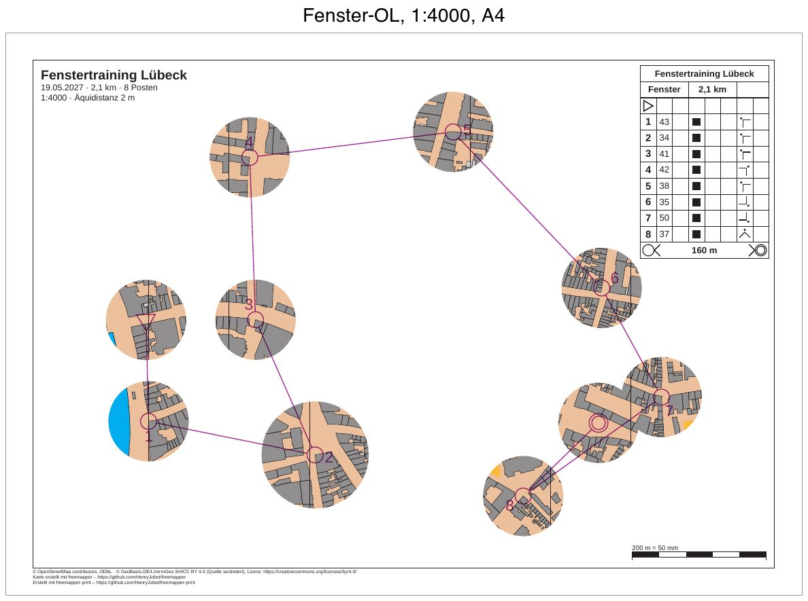
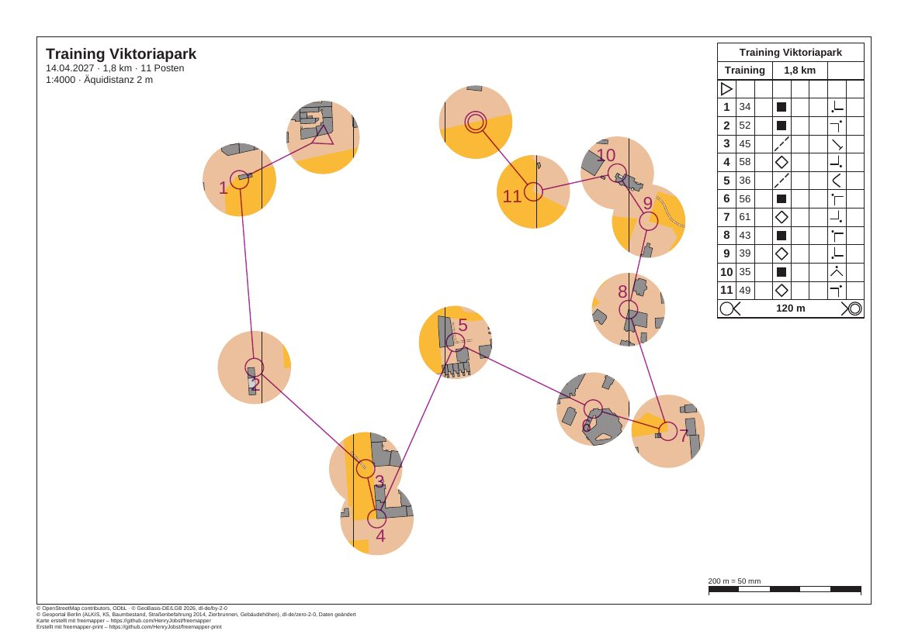
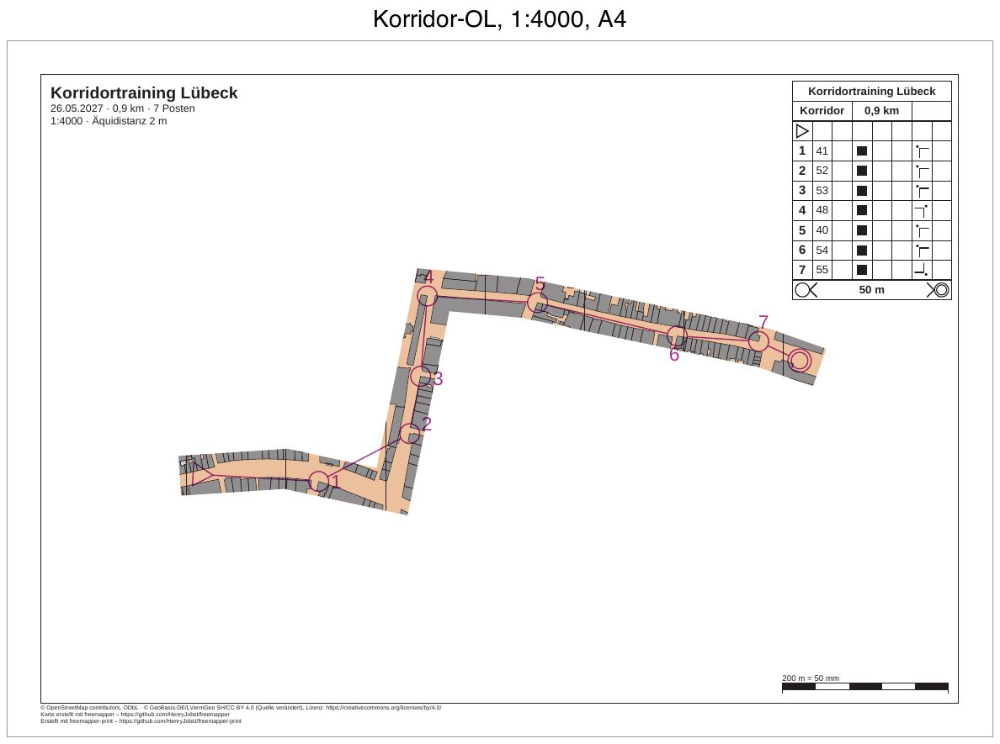
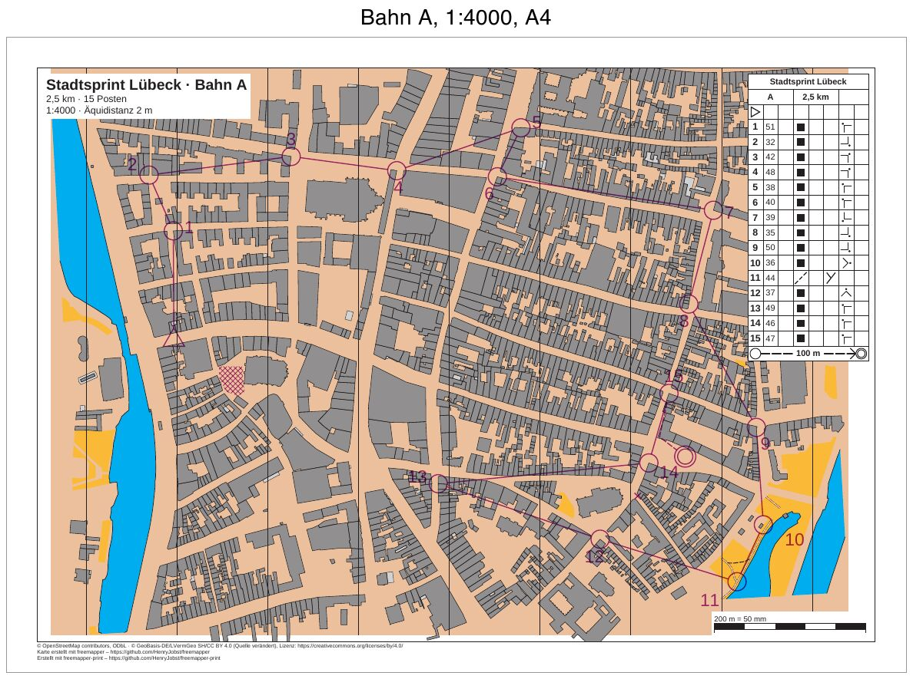
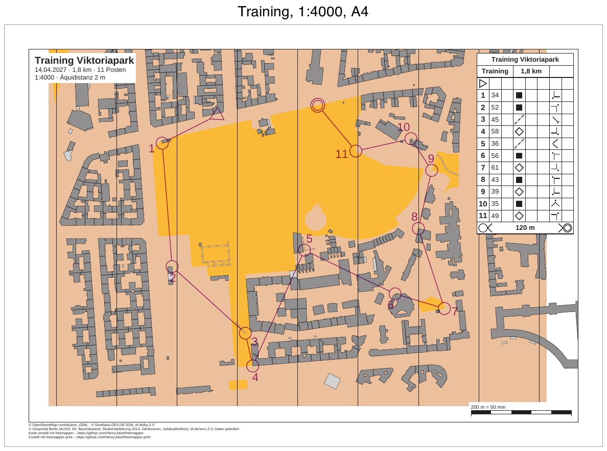
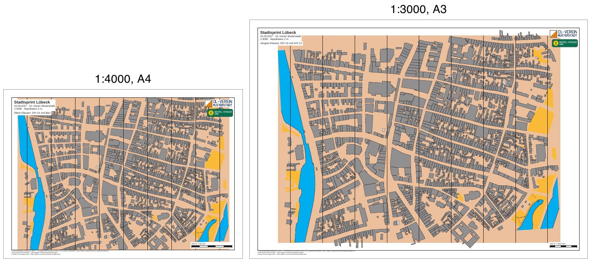
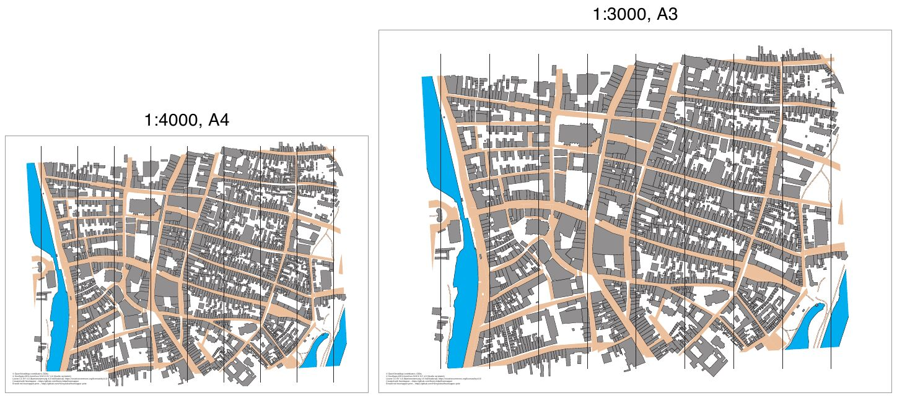

# freemapper-print

[Deutsche Version](README.md) · [User manual](docs/manual/en.md) · [Glossary](docs/glossary.md) · [Changes](CHANGELOG.en.md)

<!-- claude-cost:start -->
[](docs/ai-cost/history.csv)
<!-- claude-cost:end -->
[What the number means](docs/ai-cost/README.md#english)

freemapper-print turns a finished orienteering map and the courses from a course-setting program into
ready-to-print sheets, one sheet per course. It is the counterpart to
[freemapper](https://github.com/HenryJobst/freemapper): freemapper produces the starter map, the mapper draws in
OpenOrienteering Mapper (OOM), and freemapper-print puts the finished map on paper.

What it does already:

- print a finished OOM map (`.omap`) at the exact scale as a vector PDF, on A4, A3 or a page size of your choice, also at a different scale
  with the symbol sizes the standard prescribes (for example 1:3000 for the youngest classes with symbols at
  133 %);
- one project file per event with any number of layouts: created with `init`, checked with `check`, written as
  PDFs with `export`;
- on every sheet a passe-partout, a frame line and a footer with source notes and credit; as elements you place
  yourself, a title block and texts with placeholders, club and sponsor logos (PNG, JPEG, SVG) and a scale check
  bar to measure against;
- always print the map's north lines, and add them when the map has none;
- print the base area of freemapper's sprint maps, always and without a switch (best printed in colour);
- link courses from Purple Pen (`.ppen`) and from any program that writes IOF XML 3.0 (Condes, OCAD course
  setting) in the project file, and read them again on every run;
- one sheet per course, with the course overprint in purple, split into lower and upper purple, and the control
  description from Purple Pen files (IOF XML has no descriptions);
- control numbers where the course file puts them, or placed by the program so that they leave legs, circles and
  the map's point and line symbols free; `check` suggests a better place, `numbers accept` writes it into the
  project;
- `init --courses` creates a project from a course file; `export` writes one PDF per course, with `--course`
  only chosen courses, with `--single-file` one PDF with all courses;
- the course symbols at the size the standard sets for the print scale, such as control circles of 7.5 mm on a
  forest map at 1:10000;
- check that the course fits the map: the program reads Purple Pen with the y axis up and detects it in IOF XML,
  checks the map scale, compares the controls with latitude and longitude, and stops on a doubtful fit;
- masks for window and corridor orienteering: a mask hides the map on a course's sheet except for windows or a
  corridor. Course overprint, control description, title and footer stay everywhere, including the legs between
  windows;
- `masks window` puts round windows around a course's controls, with a radius in millimetres on paper and, if
  wanted, its own radius per control; `masks corridor` turns a line you give into a corridor of adjustable width.
  There is no automatic corridor, because no rule set says where it runs;
- masks can also be written by hand into the project file; the program prints Purple Pen's white-out as a mask
  of the courses it applies to;
- `check` warns about controls, mandatory legs, out-of-bounds areas and other course overprint that lie under a
  mask;
- an MCP server (`freemapper-print mcp`) with eleven tools, through which an AI agent such as Claude Code reads
  and checks a project, enters masks, number positions, layouts and sheet elements, and writes the PDFs;
- messages and help in German and English; a full disk leaves no half-written PDF, and the program never writes
  through a link at the target.

Planned:

- an editor in the browser (M6);
- OCAD maps, later.

The program needs no OCAD and runs on macOS, Linux and Windows.

## Part of the freemapper suite

freemapper-print is one of several programs around the same maps. The code that they share lives in
[freemapper-core](https://github.com/HenryJobst/freemapper-core), a library of small Rust crates that each program
takes in a fixed version instead of copying it. freemapper-print uses `freemapper-text` (program texts),
`freemapper-rules` (rule profiles), `freemapper-fs` (safe file writing), `freemapper-omap` (map model and reader)
and `freemapper-course` (courses, course files and where control numbers go) from it. The renderer (`freemapper-render`) lives
there too since core v0.9.0, and the page builder since v0.13.0. The rules for how much symbols grow at another
print scale stay in freemapper-print.

## Examples

Finished examples are in [`examples/`](examples/README.en.md). Click a picture to open the example with its PDFs.

<a href="examples/luebeck-training-window/README.en.md"></a>

**Window orienteering** ([`luebeck-training-window`](examples/luebeck-training-window/README.en.md)): a training
course with eight controls in Lübeck's old town, on A4 at 1:4000. The map shows only in windows of 15 mm radius
around start, controls and finish, one of them larger. `masks window` writes the mask.

<a href="examples/mcp-session/README.en.md"></a>

**With an AI agent** ([`mcp-session`](examples/mcp-session/README.en.md)): a recorded session over the MCP server.
An agent turns the Viktoriapark training into window orienteering with 12 mm windows, checks the sheet and writes
the PDF, in five calls.

<a href="examples/luebeck-training-corridor/README.en.md"></a>

**Corridor orienteering** ([`luebeck-training-corridor`](examples/luebeck-training-corridor/README.en.md)): a
short course with seven controls in a corridor 12 mm wide along three streets of the old town. The line was chosen
by hand, and `masks corridor` turns it into the mask.

<a href="examples/luebeck-competition-courses/README.en.md"></a>

**A competition with three courses**
([`luebeck-competition-courses`](examples/luebeck-competition-courses/README.en.md)): the Lübeck sprint with
courses A and B on A4 at 1:4000 and course C on A3 at 1:3000, from a Purple Pen file, with control descriptions, an
out-of-bounds area, a forbidden crossing, a marked route to the finish and one number moved with
`numbers accept`. The same courses from IOF XML are in the subfolder `iof/`, without descriptions.

<a href="examples/berlin-viktoriapark-training/README.en.md"></a>

**A club training in Berlin** ([`berlin-viktoriapark-training`](examples/berlin-viktoriapark-training/README.en.md)):
one course of 1.8 km on freemapper's Viktoriapark map, from a Purple Pen file, on A4 at 1:4000.

<a href="examples/luebeck-competition-layouts/README.en.md"></a>

**One competition, two layouts**
([`luebeck-competition-layouts`](examples/luebeck-competition-layouts/README.en.md)): a city sprint with an A4
sheet at 1:4000 for the older classes and an A3 sheet at 1:3000 for the youngest, both with title block, club
and sponsor logo, scale check bar and footer. Built with `init`, `check` and `export` alone.

<a href="examples/luebeck-scales/README.en.md"></a>

**Lübeck at two scales** ([`luebeck-scales`](examples/luebeck-scales/README.en.md)): the same sprint map at 1:4000
on A4 and at 1:3000 on A3, printed with `render`. At 1:3000 every symbol grows to 133 % as ISSprOM requires.

## Status

The current version is [v0.6.1](https://github.com/HenryJobst/freemapper-print/releases/tag/v0.6.1) of
11 November 2026 (see the [changes](CHANGELOG.en.md)). It prints a finished OOM map at the exact scale
(`freemapper-print render`) and turns a project file into finished sheets with layouts, title block, logos and
scale check bar (`init`, `check`, `export`). Courses, the course overprint, control descriptions and control
numbers (M3) are part of it. Milestone M4, masks for window and corridor orienteering, is part of it.
Milestone M5, the MCP server for AI agents, is part of this version.
The first version targets club training in towns and parks: sprint maps on A4, printed at home or in a
copy shop. More in the [design](docs/superpowers/specs/2026-11-08-freemapper-print-design.md), the
[glossary](docs/glossary.md) and the [architecture decisions](docs/adr/README.md).

## Installation

freemapper-print is a single program without an installer:

1. Download the archive for your system from the
   [release page](https://github.com/HenryJobst/freemapper-print/releases/latest):
   - Windows: `freemapper-print-…-windows-x86_64.zip`
   - macOS with Apple chip (M1 and newer): `freemapper-print-…-macos-arm64.tar.gz`
   - macOS with Intel processor: `freemapper-print-…-macos-x86_64.tar.gz`
   - Linux: `freemapper-print-…-linux-x86_64.tar.gz` (ARM computers: `linux-arm64`)
2. Unpack the archive. The folder contains `freemapper-print` or `freemapper-print.exe`.
3. On the first start the system warns because the program is not signed. On Windows choose "More info", then
   "Run anyway". On macOS click "Open Anyway" in "System Settings › Privacy & Security", or run
   `xattr -d com.apple.quarantine freemapper-print` in Terminal in the unpacked folder. On Linux, run
   `chmod +x freemapper-print` if needed.
4. Check in a terminal in the unpacked folder: `./freemapper-print --version` (Windows:
   `.\freemapper-print.exe --version`).

An AI agent that can run commands (Claude Code, Codex) can also do the download, the check and the registration for you: tell it "Read AGENTS.md from github.com/HenryJobst/freemapper-print and set up freemapper-print." Besides the program, the archive holds the READMEs, the licence, the manual and `AGENTS.md`.

## Building from source (for developers)

```sh
git clone https://github.com/HenryJobst/freemapper-print
cd freemapper-print
cargo build --release
```

`rust-toolchain.toml` fixes the Rust version; `rustup` installs it on the first build. Before each commit,
[lefthook](https://github.com/evilmartians/lefthook) checks formatting and clippy (`lefthook install`).

freemapper-print depends on [freemapper-core](https://github.com/HenryJobst/freemapper-core) in a fixed version (a
git tag). For a normal build that is all there is to it, Cargo fetches the crates itself. If you work on
freemapper-core at the same time, check it out next to freemapper-print (`../freemapper-core`) and add the local
folder to `Cargo.toml` for now:

```toml
[patch."https://github.com/HenryJobst/freemapper-core"]
freemapper-text = { path = "../freemapper-core/crates/freemapper-text" }
freemapper-rules = { path = "../freemapper-core/crates/freemapper-rules" }
freemapper-fs = { path = "../freemapper-core/crates/freemapper-fs" }
```

This entry is for development only. `main` never carries a `[patch]`. The freemapper-core README has the details.

## Usage

### An event

```sh
freemapper-print init citysprint --map luebeck.omap --title "Stadtsprint Lübeck"
freemapper-print check citysprint
freemapper-print export citysprint
```

`init` creates the project file `freemapper-print.toml` in the folder `citysprint`: one layout at the map's
scale on A4 or A3, a title block, a scale check bar and a proposed contour interval for you to check against the
map. In the file you add more layouts, logos and texts. `check` draws every layout without writing anything and
lists the notes: map too large for the map frame, passe-partout too narrow for the footer, logo unreadable, and so
on. `export` writes one PDF per layout into the folder `out` next to the project file, named after the layout id.
The [manual](docs/manual/en.md#5-setting-up-an-event) describes the project file key by key.

### Courses

```sh
freemapper-print init citysprint --map luebeck.omap --title "Stadtsprint Lübeck" --courses courses.ppen
freemapper-print check citysprint
freemapper-print numbers accept citysprint --course A --control 49 --sheet
freemapper-print export citysprint
```

`--courses` takes a `.ppen` file or IOF XML 3.0 (`.xml`). `init` reads it and fits it to the map first, so a
file that does not belong to the map stops `init` before it writes anything. It then creates the layouts, an
assignment for every course and, for a `.ppen`, a control description box. The project file stores the path to
the course file, and every `check` and `export` reads it again, so a change in Purple Pen needs no new `init`.

`check` goes through every course and lists the notes: the course does not fit the map, a control lies outside the
frame, a sheet element covers a control, a control number lies on a leg or a map symbol, and so on. For a number in
conflict the note proposes a place. `numbers accept` takes that proposal for one course (`--sheet`) or for every
course on its layout (`--layout-wide`) and appends it to the project file as a `[[numbers]]` table, with
everything before it left unchanged. `--direction` and `--gap` set your own place.

`export` writes one PDF per course into the folder `out`, named after the course. `--course <NAME>` (repeatable)
exports only those courses, `--single-file` writes all courses into one PDF with a page per course, and `--layout`
exports a layout without courses. The [manual](docs/manual/en.md#8-courses) goes through the project file keys, the
fit errors and the notes.

### Window and corridor orienteering

```sh
freemapper-print masks window stadtsprint --course A --radius 15 --assign
freemapper-print masks corridor stadtsprint --points "-92,2.3;-60,4.4;-28,-2.5;-15.5,58.5" --width 12 --assign --course B
freemapper-print check stadtsprint
```

`masks window` puts a round window around each control of course A, the start and the finish included, and
`--assign` prints the course with it. The radius counts in millimetres on paper; `--controls` picks controls, and
`--radius-for 35=20` gives one control a larger window. `masks corridor` lays a corridor 12 mm wide along the
points, in map mm with the y axis up, as OOM's status bar shows them. Both append a `[[masks]]` table to the
project file; everything before it stays unchanged. `check` then reports controls and overprint under the mask.
The [manual](docs/manual/en.md#11-masks-for-window-and-corridor-orienteering) describes masks, their limits and
Purple Pen's white-out.

### The map alone

```sh
freemapper-print render luebeck.omap --out luebeck-3000-a3.pdf --paper a3 --scale 3000
```

This writes the sprint map as a PDF on an A3 page at 1:3000, without title or scale check bar. The main options:

- `--paper a4|a3` picks the paper (default A4), `--orientation auto|portrait|landscape` the orientation. With
  `auto` the program takes the orientation that cuts off less of the map.
- `--scale <number>` sets the print scale, for example 4000 for 1:4000. Without it the scale of the map applies.
  At a larger scale the symbols grow as the standard sets: a sprint map at 1:3000 to 133 %, a forest map at
  1:10000 to 150 %. A scale smaller than the standard's base (sprint 1:5000) keeps the symbols at their
  standard size, and the program warns that the print is for training only.
- `--kind sprint|schoolyard|forest` sets the map kind if the program can tell it neither from `freemapper.toml`
  nor from the map file.
- `--show-sheet-objects` also prints freemapper's information block: title, scale, scale bar and credits.
  North lines belong to the map and are always in the PDF.
- `--lang de|en` picks the language of the messages; without it `FREEMAPPER_LANG` and the system's
  language settings decide.

If the map does not fit on the page, the program writes the PDF anyway and says how many millimetres are
missing. It also lists objects it did not draw, or drew in simplified form.

The base area of a freemapper sprint map (map part `base`) belongs to the map and is always in the PDF. It does
not count for the overflow, because it reaches beyond the map. Print such maps in colour; in greyscale its light
brown is hard to tell from paper.

Print the PDF at actual size (100 %) and switch "fit to page" off. Otherwise the scale is wrong. The manual
explains printing in the chapter
[Printing](docs/manual/en.md#9-printing-at-the-right-scale-at-home-and-in-a-copy-shop).

## With an AI agent

`freemapper-print mcp` starts an MCP server on standard input and output. Through it an AI agent such as Claude
Code runs the same steps as the command line: `project_info`, `check_project` and `list_courses` read,
`init_project`, `masks_window`, `masks_corridor`, `numbers_accept`, `set_layout`, `set_element` and `assign_mask`
write into the project file, and `export_project` writes the PDFs. For Claude Code a file `.mcp.json` in the
folder you start Claude Code in is enough:

```json
{
  "mcpServers": {
    "freemapper-print": {
      "command": "/home/user/bin/freemapper-print",
      "args": ["--lang", "en", "mcp"]
    }
  }
}
```

`command` is the absolute path of the unpacked program. The calls take absolute paths only, too, because the
server does not know the agent's working folder. The tools that write do not get in each other's way, and the
comments in the project file stay, apart from a few cases the manual lists. The agent can cancel a long export; it stops after the sheet in hand. The
[manual](docs/manual/en.md#3-with-an-ai-agent) describes every tool, and the example
[`mcp-session`](examples/mcp-session/README.en.md) shows a real session: window orienteering from the
Viktoriapark training, checked and written as a PDF.

For AI agents there is an [AGENTS.md](AGENTS.md), which also ships in every release archive: it tells an agent how to install the program from the release archives and how to use it through MCP or the command line.

## Licence and credit

freemapper-print is licensed [GPL-3.0-or-later](LICENSE), like freemapper. It takes over code from freemapper
and may take over code from OOM (ADR 0002).

The program embeds the Arimo font (Arial-compatible, SIL Open Font License 1.1). Its licence is in the release
archives as `FONT-LICENSE.txt`.
