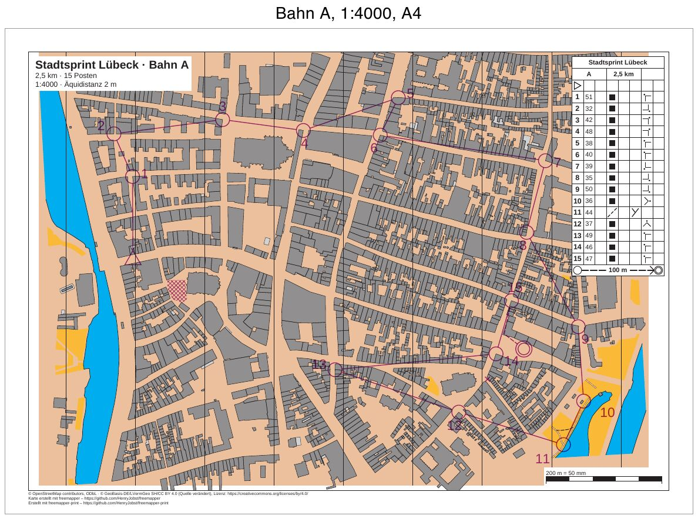
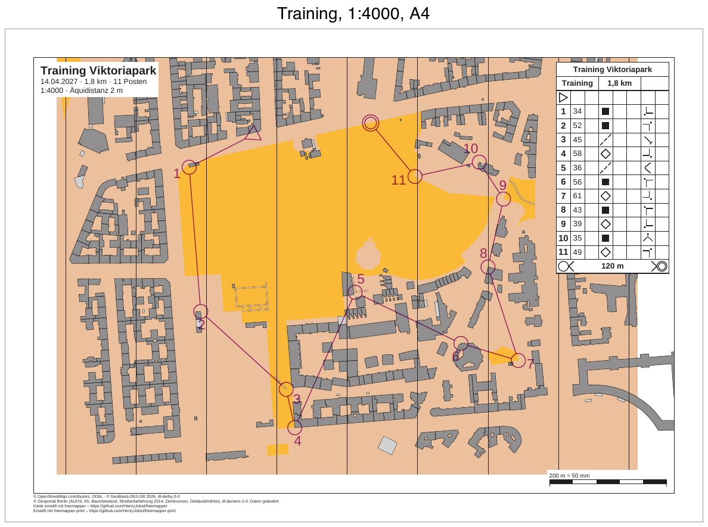
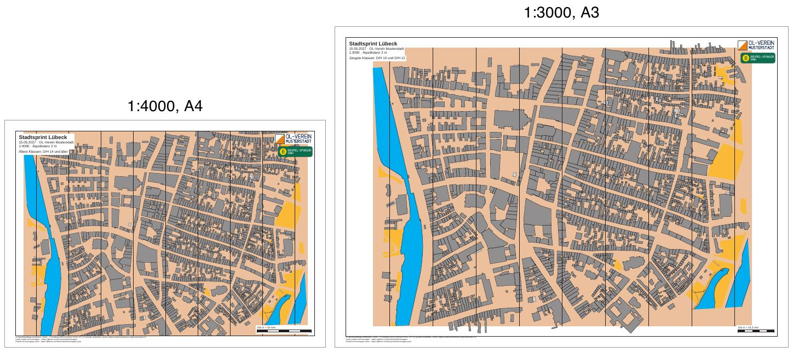
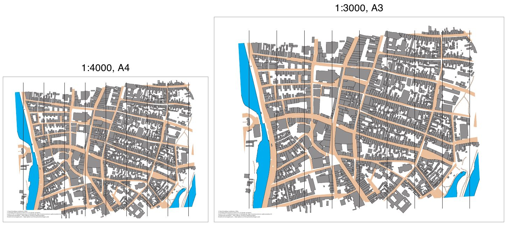

# freemapper-print

[English version](README.en.md) · [Handbuch](docs/manual/de.md) · [Glossar](docs/glossary.md) · [Änderungen](CHANGELOG.md)

<!-- claude-cost:start -->
[](docs/ai-cost/history.csv)
<!-- claude-cost:end -->
[Was die Zahl bedeutet](docs/ai-cost/README.md)

freemapper-print macht aus einer fertigen OL-Karte und den Bahnen aus einem Bahnlegungsprogramm die
druckfertigen Kartenblätter, ein Blatt je Bahn. Es ist das Gegenstück zu
[freemapper](https://github.com/HenryJobst/freemapper): freemapper liefert den Ausgangsstand der Karte,
gezeichnet wird in OpenOrienteering Mapper (OOM), und freemapper-print bringt die fertige Karte aufs Papier.

Das kann es schon:

- eine fertige Karte aus OOM (`.omap`) im exakten Druckmaßstab als Vektor-PDF ausgeben, auf A4 oder A3;
- in einem anderen Maßstab drucken, mit den Symbolgrößen, die die Norm vorschreibt (zum Beispiel 1:3000 für die
  jüngsten Klassen mit Symbolen auf 133 %);
- die Nordlinien der Karte immer mitdrucken.

Neu in 0.2.0:

- eine Projektdatei je Veranstaltung mit beliebig vielen Layouts, angelegt mit `init`, geprüft mit `check`, als
  PDFs geschrieben mit `export`;
- auf jedem Blatt Passepartout, Rahmenlinie und eine Fußzeile mit Quellenangaben und Namensnennung; als
  Elemente, die man selbst platziert, Titelblock und Texte mit Platzhaltern, Vereins- und Sponsorenlogos (PNG,
  JPEG, SVG) und eine Kontrollstrecke zum Nachmessen;
- Nordlinien ergänzt das Programm, wenn die Karte keine hat;
- auch `render` druckt die Quellenangaben aus den Kartennotizen und die Namensnennung;
- Meldungen und Hilfe auf Deutsch und Englisch;
- ein volles Laufwerk hinterlässt kein halbes PDF.

Neu in 0.3.0 (Meilenstein M3):

- Bahnen aus Purple Pen (`.ppen`) und aus jedem Programm, das IOF-XML 3.0 schreibt (Condes, OCAD-Bahnlegung, der
  eigene Export von Purple Pen), in der Projektdatei verknüpft und bei jedem Lauf neu gelesen;
- ein Blatt je Bahn, mit dem Bahnaufdruck in Violett, aufgeteilt in unteres und oberes Violett, und der
  Postenbeschreibung aus Purple-Pen-Dateien (IOF-XML kennt keine Beschreibungen);
- Postennummern dort, wo die Bahndatei sie hinsetzt, oder vom Programm so platziert, dass sie Strecken, Kreise und
  die Punkt- und Liniensymbole der Karte frei lassen; `check` schlägt einen besseren Platz vor, `numbers accept`
  schreibt ihn ins Projekt;
- `init --courses` legt ein Projekt aus einer Bahndatei an;
- `export` schreibt ein PDF je Bahn, mit `--course` nur gewählte Bahnen, mit `--single-file` ein PDF mit allen
  Bahnen;
- die Bahnsymbole in der Größe, die die Norm für den Druckmaßstab vorgibt, etwa Postenkreise von 7,5 mm auf einer
  Waldkarte in 1:10000;
- die Bahn muss zur Karte passen: Das Programm liest Purple Pen mit der y-Achse nach oben und erkennt sie bei
  IOF-XML, prüft den Kartenmaßstab, vergleicht die Posten mit Breite und Länge und hält bei einer zweifelhaften
  Einpassung an.

Geplant ist:

- Abdeckungen für Fenster- und Korridor-OL in Varianten, die man einzelnen Bahnen zuordnet; das White-out aus
  Purple Pen wird schon gelesen, aber noch nicht gedruckt (M4);
- Bedienung über einen KI-Assistenten (MCP, M5) und einen Editor im Browser (M6);
- später OCAD-Karten.

Das Programm braucht kein OCAD und läuft auf macOS, Linux und Windows.

## Teil der freemapper-Suite

freemapper-print ist eines von mehreren Programmen rund um dieselben Karten. Den Code, den sie gemeinsam brauchen,
soll [freemapper-core](https://github.com/HenryJobst/freemapper-core) enthalten, eine Bibliothek aus kleinen
Rust-Crates, die jedes Programm in einer festen Version einbindet, statt den Code zu kopieren. freemapper-print
zieht seinen Kartenleser, den Renderer und den Bahncode nach M3 dorthin um. Heute nutzt es noch eigene Kopien.

## Beispiele

Fertige Beispiele liegen in [`examples/`](examples/README.md). Ein Klick auf ein Bild öffnet das Beispiel mit
den PDFs.

<a href="examples/luebeck-competition-courses/README.md"></a>

**Ein Wettkampf mit drei Bahnen** ([`luebeck-competition-courses`](examples/luebeck-competition-courses/README.md)):
der Lübecker Sprint mit den Bahnen A und B auf A4 in 1:4000 und der Bahn C auf A3 in 1:3000, aus einer
Purple-Pen-Datei, mit Postenbeschreibung, Sperrgebiet, verbotener Querung, Pflichtstrecke zum Ziel und einer mit
`numbers accept` versetzten Nummer. Dieselben Bahnen aus IOF-XML liegen im Unterordner `iof/`, ohne Beschreibung.

<a href="examples/berlin-viktoriapark-training/README.md"></a>

**Ein Vereinstraining in Berlin** ([`berlin-viktoriapark-training`](examples/berlin-viktoriapark-training/README.md)):
eine Bahn von 1,7 km auf der Viktoriapark-Karte von freemapper, aus einer Purple-Pen-Datei, auf A4 in 1:4000.

<a href="examples/luebeck-competition-layouts/README.md"></a>

**Ein Wettkampf, zwei Layouts** ([`luebeck-competition-layouts`](examples/luebeck-competition-layouts/README.md)):
ein Stadtsprint mit einem A4-Blatt in 1:4000 für die älteren Klassen und einem A3-Blatt in 1:3000 für die
jüngsten, beide mit Titelblock, Vereins- und Sponsorenlogo, Kontrollstrecke und Fußzeile. Gebaut nur mit
`init`, `check` und `export`.

<a href="examples/luebeck-scales/README.md"></a>

**Lübeck in zwei Maßstäben** ([`luebeck-scales`](examples/luebeck-scales/README.md)): dieselbe Sprintkarte in
1:4000 auf A4 und in 1:3000 auf A3, gedruckt mit `render`. Bei 1:3000 wachsen alle Symbole nach ISSprOM auf
133 %. Der nächste Meilenstein bringt Fenster- und Korridor-OL (M4).

## Status

Aktuelle Version ist [v0.3.0](https://github.com/HenryJobst/freemapper-print/releases/tag/v0.3.0) vom
9. November 2026 (was sich geändert hat, steht in den [Änderungen](CHANGELOG.md)). Sie druckt eine fertige
OOM-Karte maßstabsgetreu (`freemapper-print render`) und macht aus einer Projektdatei fertige Blätter mit
Layouts, Titelblock, Logos und Kontrollstrecke (`init`, `check`, `export`). Bahnen, Bahnaufdruck, Postenbeschreibung und
Postennummern (M3) gehören dazu. Abdeckungen für Fenster- und Korridor-OL
(M4) folgen. Die erste Version richtet sich an Vereinstrainings in Stadt und
Park: Sprintkarten auf A4, gedruckt am eigenen Drucker oder im Copyshop. Mehr steht im
[Design](docs/superpowers/specs/2026-11-08-freemapper-print-design.md), im [Glossar](docs/glossary.md) und in den
[Architekturentscheidungen](docs/adr/README.md).

## Installation

freemapper-print ist ein einzelnes Programm ohne Installer:

1. Auf der [Release-Seite](https://github.com/HenryJobst/freemapper-print/releases/latest) das Archiv für das
   eigene System herunterladen:
   - Windows: `freemapper-print-…-windows-x86_64.zip`
   - macOS mit Apple-Chip (M1 und neuer): `freemapper-print-…-macos-arm64.tar.gz`
   - macOS mit Intel-Prozessor: `freemapper-print-…-macos-x86_64.tar.gz`
   - Linux: `freemapper-print-…-linux-x86_64.tar.gz` (ARM-Rechner: `linux-arm64`)
2. Das Archiv entpacken. Der Ordner enthält `freemapper-print` bzw. `freemapper-print.exe`.
3. Beim ersten Start warnt das System, weil das Programm nicht signiert ist. Unter Windows „Weitere
   Informationen“ und dann „Trotzdem ausführen“ wählen. Unter macOS in „Systemeinstellungen › Datenschutz &
   Sicherheit“ auf „Trotzdem öffnen“ klicken, oder im Terminal im entpackten Ordner
   `xattr -d com.apple.quarantine freemapper-print` ausführen. Unter Linux reicht notfalls
   `chmod +x freemapper-print`.
4. Im Terminal im entpackten Ordner prüfen: `./freemapper-print --version` (Windows:
   `.\freemapper-print.exe --version`).

## Selbst bauen (für Entwickler)

```sh
git clone https://github.com/HenryJobst/freemapper-print
cd freemapper-print
cargo build --release
```

`rust-toolchain.toml` legt die Rust-Version fest; `rustup` installiert sie beim ersten Bauen. Vor jedem Commit
prüft [lefthook](https://github.com/evilmartians/lefthook) Formatierung und clippy (`lefthook install`).

freemapper-print hängt noch nicht von [freemapper-core](https://github.com/HenryJobst/freemapper-core) ab. Sobald es
das tut, legen Sie freemapper-core neben freemapper-print ab und binden es während der Entwicklung über einen
lokalen `[patch]` ein. Die Einzelheiten stehen in der README von freemapper-core.

## Benutzung

### Eine Veranstaltung

```sh
freemapper-print init stadtsprint --map luebeck.omap --title "Stadtsprint Lübeck"
freemapper-print check stadtsprint
freemapper-print export stadtsprint
```

`init` legt im Ordner `stadtsprint` die Projektdatei `freemapper-print.toml` an: ein Layout im Maßstab der
Karte auf A4 oder A3, einen Titelblock, eine Kontrollstrecke und einen Vorschlag für die Äquidistanz, den Sie an
der Karte prüfen. In der Datei ergänzen Sie weitere Layouts, Logos und Texte. `check` zeichnet jedes Layout,
ohne etwas zu schreiben, und listet die Hinweise: Karte zu groß für den Kartenausschnitt, Passepartout zu
schmal für die Fußzeile, Logo nicht lesbar und so weiter. `export` schreibt je Layout ein PDF in den Ordner
`out` neben der Projektdatei, benannt nach der Layout-ID. Das [Handbuch](docs/manual/de.md#5-eine-veranstaltung-anlegen)
beschreibt die Projektdatei Schlüssel für Schlüssel.

### Bahnen

```sh
freemapper-print init stadtsprint --map luebeck.omap --title "Stadtsprint Lübeck" --courses courses.ppen
freemapper-print check stadtsprint
freemapper-print numbers accept stadtsprint --course A --control 49 --sheet
freemapper-print export stadtsprint
```

`--courses` nimmt eine `.ppen`-Datei oder IOF-XML 3.0 (`.xml`). `init` liest sie zuerst und passt sie an die Karte
an, eine Datei, die nicht zur Karte gehört, stoppt `init` also vor dem Schreiben. Danach legt es die Layouts an,
eine Zuordnung für jede Bahn und, bei einer `.ppen`, einen Kasten für die Postenbeschreibung. Die Projektdatei
speichert den Pfad zur Bahndatei, und jedes `check` und `export` liest sie neu: Eine Änderung in Purple Pen
braucht kein neues `init`.

`check` geht jede Bahn durch und listet die Hinweise: Die Bahn passt nicht zur Karte, ein Posten liegt außerhalb
des Ausschnitts, ein Blattelement deckt einen Posten ab, eine Postennummer liegt auf einer Strecke oder einem
Kartensymbol und so weiter. Bei einer Nummer im Konflikt schlägt der Hinweis einen Platz vor. `numbers accept`
übernimmt den Vorschlag für eine Bahn (`--sheet`) oder für alle Bahnen auf ihrem Layout (`--layout-wide`) und hängt
ihn als Tabelle `[[numbers]]` an die Projektdatei an; alles davor bleibt unverändert. Mit `--direction` und `--gap`
setzen Sie einen eigenen Platz.

`export` schreibt je Bahn ein PDF in den Ordner `out`, benannt nach der Bahn. `--course <NAME>` (wiederholbar)
exportiert nur diese Bahnen, `--single-file` schreibt alle Bahnen in ein PDF mit einer Seite je Bahn, und
`--layout` exportiert ein Layout ohne Bahnen. Das [Handbuch](docs/manual/de.md#8-bahnen) geht die Schlüssel der
Projektdatei, die Einpassungsfehler und die Hinweise durch.

### Nur die Karte

```sh
freemapper-print render luebeck.omap --out luebeck-3000-a3.pdf --paper a3 --scale 3000
```

Das schreibt die Sprintkarte als PDF auf eine A3-Seite im Maßstab 1:3000, ohne Titel und Kontrollstrecke. Die
wichtigsten Optionen:

- `--paper a4|a3` wählt das Papier (Standard A4), `--orientation auto|portrait|landscape` die Ausrichtung. Bei
  `auto` nimmt das Programm die Ausrichtung, die weniger von der Karte abschneidet.
- `--scale <Zahl>` setzt den Druckmaßstab, zum Beispiel 4000 für 1:4000. Ohne die Option gilt der Maßstab der
  Karte. Bei einem größeren Maßstab wachsen die Symbole so, wie es die Norm vorschreibt: eine Sprintkarte in
  1:3000 auf 133 %, eine Waldkarte in 1:10000 auf 150 %. Einen kleineren Maßstab als den der Norm (Sprint
  1:5000) druckt das Programm mit Symbolen in Normgröße und warnt, dass der Druck nur fürs Training taugt.
- `--kind sprint|schoolyard|forest` gibt die Kartenart vor, falls das Programm sie weder aus `freemapper.toml`
  noch aus der Kartendatei erkennt.
- `--show-sheet-objects` druckt auch den Informationsblock von freemapper: Titel, Maßstab, Maßstabsleiste und
  Namensnennung. Die Nordlinien gehören zur Karte und stehen immer im PDF.
- `--lang de|en` wählt die Sprache der Meldungen; ohne die Option entscheiden `FREEMAPPER_LANG` und
  die Spracheinstellung des Systems.

Passt die Karte nicht auf die Seite, schreibt das Programm das PDF trotzdem und meldet, wie viele Millimeter
fehlen. Es nennt auch Objekte, die es nicht oder nur vereinfacht gezeichnet hat.

Drucken Sie das PDF in Originalgröße (100 %, „Tatsächliche Größe“) und schalten Sie „An Seite anpassen“
aus. Sonst stimmt der Maßstab nicht. Das Handbuch erklärt das Drucken im Kapitel
[Drucken](docs/manual/de.md#9-drucken-maßstabsgetreu-am-eigenen-drucker-und-im-copyshop).

## Mit einem KI-Agenten

Ein MCP-Server, über den ein KI-Agent die Karten drucken kann, kommt in einem späteren Meilenstein. Bis dahin
läuft alles über die Kommandozeile.

## Lizenz und Namensnennung

freemapper-print steht unter der [GPL-3.0-or-later](LICENSE), wie freemapper. Es übernimmt Code aus freemapper
und darf Code aus OOM übernehmen (ADR 0002).

Das Programm bettet die Schrift Arimo ein (Arial-kompatibel, SIL Open Font License 1.1). Ihre Lizenz liegt in
den Release-Archiven als `FONT-LICENSE.txt`.
