# Handbuch zu freemapper-print

[English](en.md) · [README](../../README.md)

Dieses Handbuch wächst mit dem Programm. Geschrieben sind die Kapitel 2, 3 und 5 bis 12. Am Ende soll es
Schritt für Schritt von der fertigen OOM-Karte und der Purple-Pen-Datei zu den gedruckten Kartenblättern führen,
auch ohne Erfahrung mit der Kommandozeile.

Kapitel:

1. Was freemapper-print macht
2. [Installation](#2-installation)
3. [Mit einem KI-Agenten](#3-mit-einem-ki-agenten)
4. Ohne Agenten: Editor und Kommandozeile
5. [Eine Veranstaltung anlegen](#5-eine-veranstaltung-anlegen)
6. [Layouts: Blattformat, Maßstab, Kartenausschnitt](#6-layouts-blattformat-maßstab-kartenausschnitt)
7. [Titel, Logos und andere Blattelemente](#7-titel-logos-und-andere-blattelemente)
8. [Bahnen](#8-bahnen)
9. [Drucken: maßstabsgetreu am eigenen Drucker und im Copyshop](#9-drucken-maßstabsgetreu-am-eigenen-drucker-und-im-copyshop)
10. [Meldungen und was zu tun ist](#10-meldungen-und-was-zu-tun-ist)
11. [Abdeckungen für Fenster- und Korridor-OL](#11-abdeckungen-für-fenster--und-korridor-ol)
12. [Der Editor im Browser](#12-der-editor-im-browser)

Das Programm spricht Deutsch oder Englisch. Es nimmt die Sprache aus `--lang de` oder `--lang en`, sonst aus
den Umgebungsvariablen `FREEMAPPER_LANG`, `LC_ALL`, `LC_MESSAGES` und `LANG`. Die Meldungen in diesem Handbuch
sind die deutschen.

## 2. Installation

Laden Sie das Archiv für Ihr System von der [Release-Seite](https://github.com/HenryJobst/freemapper-print/releases/latest) herunter, entpacken Sie es und prüfen Sie das Programm mit `freemapper-print --version`. Die Schritte für jedes System, auch die Warnung vor einem nicht signierten Programm beim ersten Start, stehen im README im Abschnitt „Installation“. Ein KI-Agent kann sie für Sie übernehmen (Kapitel 3).

### Aktualisierungen

Ein Release-Build aktualisiert sich selbst. Ein Befehl installiert das neueste Release an Ort und Stelle:

```sh
freemapper-print update
```

Er sucht das neueste Release, sagt, was neu ist, und fragt „Jetzt installieren? [j/N]“. Bei „ja“ lädt er das Programm für Ihr System, prüft Signatur und Prüfsumme und ersetzt das laufende Programm am selben Pfad. Die Anmeldung des MCP-Servers bleibt also gültig. Nichts Unsigniertes oder Ungeprüftes wird installiert. Stimmt die Signatur nicht, endet der Befehl mit einem Fehler und ändert nichts.

| Schalter | Wirkung |
|---|---|
| `--check` | Prüft nur. Exit-Code 10, wenn es eine neuere Version gibt, 0, wenn diese aktuell ist. |
| `--yes` | Installiert ohne Rückfrage. Nötig, wenn die Eingabe kein Terminal ist, etwa in einem Skript. |
| `--version <X.Y.Z>` | Installiert diese Version statt der neuesten, auch eine ältere. |
| `--rollback` | Kehrt zur Version zurück, die die letzte Aktualisierung ersetzt hat. |
| `--mode notify\|install\|off` | Legt fest, was die tägliche Prüfung tut, wenn sie eine neuere Version findet (Standard: `notify`). |

Ein Release, das vor dem Update erschien, kann sich nicht selbst aktualisieren; das erste mit Update installieren Sie einmal von Hand. Verlangt das neueste Release eine neuere Version der Aktualisierungsfunktion, als Ihre hat, sagt `update` das und nennt die Version, die Sie von Hand installieren.

#### Die tägliche Prüfung

Nach `init`, `check`, `export` und `render` sowie beim Start von `mcp` und `edit` fragt das Programm einmal nach einem neueren Release, höchstens einmal in 24 Stunden. Die Prüfung läuft neben dem Befehl und bekommt 3 Sekunden. Ein langsames oder nicht erreichbares GitHub ändert weder die Ausgabe noch den Exit-Code Ihres Befehls; der Versuch gilt als gescheitert, der nächste kommt einen Tag später. `numbers`, `masks` und `update` prüfen nicht. Ist die Umgebungsvariable `CI` gesetzt, tut die Prüfung nichts.

Was sie meldet, hängt vom Modus ab:

- `notify` (Standard): eine Zeile auf der Standardfehlerausgabe, „freemapper-print 1.2.3 ist verfügbar (Sie haben 1.2.2). Aktualisieren mit: freemapper-print update“. `edit` gibt sie einmal beim Start aus, und der MCP-Server gibt sie mit seinem ersten Ergebnis an den Agenten weiter (Kapitel 3).
- `install`: installiert die neuere Version nach einem Befehl, der mit Exit-Code 0 endete. Ein `check`, der Hinweise findet, endet mit Exit-Code 1 und installiert deshalb nichts. `mcp` und `edit` installieren nie. Die neue Version gilt ab dem nächsten Start.
- `off`: keine Prüfung und keine Anfrage.

`freemapper-print update --mode off` schreibt die Einstellung, und `FREEMAPPER_PRINT_UPDATE=off` (oder `notify`, `install`) überschreibt sie, solange die Variable gesetzt ist.

#### Was gesendet wird

Die Prüfung fragt das Aktualisierungsmanifest `freemapper-print-update.json` und seine Signatur `freemapper-print-update.json.minisig` bei den GitHub-Releases ab, und `update` lädt zusätzlich das Programm selbst. Die Anfragen tragen den festen User-Agent `freemapper-print/<Version> (+https://github.com/HenryJobst/freemapper-print)`: Programm, Version und Repository. Sie enthalten keine Daten über Sie oder Ihr Projekt, und das Programm hat keine Telemetrie. Außer für die Prüfung und `update` stellt das Programm keine Netzwerkanfragen.

#### Ordner

| Was | Wo | Überschreiben |
|---|---|---|
| Die Einstellung `[update] mode` | `settings.toml` in `freemapper-print` im Konfigurationsordner des Systems | `FREEMAPPER_PRINT_CONFIG_DIR` nennt den Ordner, der `settings.toml` enthält |
| Zeit und Ergebnis der letzten Prüfung | `update-check.json` in `freemapper-print` im Zwischenspeicher des Systems | `FREEMAPPER_PRINT_CACHE_DIR` nennt den Ordner |

Löschen Sie `update-check.json`, prüft der nächste Befehl wieder.

#### Zurückkehren und der Ordner des Programms

Eine Aktualisierung hebt die ersetzte Version neben dem Programm als `freemapper-print.previous` auf (Windows: `freemapper-print.previous.exe`). `freemapper-print update --rollback` tauscht beide zurück und nennt, wo die verlassene Version liegt. Eine weitere Aktualisierung ersetzt die Datei.

Das Programm verlangt keine Administratorrechte. Ist sein Ordner nicht beschreibbar, etwa `/usr/local/bin` oder `C:\Program Files`, nennt `update` den Ordner, ändert nichts und endet mit Exit-Code 1. Entpacken Sie das neue Release dann von Hand dorthin, oder legen Sie das Programm in einen Ordner, den Sie beschreiben dürfen.

#### Selbst gebaute Programme

Ein aus dem Quellcode gebautes Programm und ein Release, das ohne den Signierschlüssel gebaut wurde, können sich nicht selbst aktualisieren. `update` sagt das, nennt die [Release-Seite](https://github.com/HenryJobst/freemapper-print/releases/latest) und den Weg für einen Klon (`git pull`, dann `cargo build --release --locked`) und endet mit Exit-Code 0. Die tägliche Prüfung bleibt in so einem Build still. `--mode` funktioniert trotzdem, denn es schreibt nur die Einstellung.

## 3. Mit einem KI-Agenten

freemapper-print bringt einen MCP-Server mit. Ein KI-Agent wie Claude Code kann darüber ein Projekt lesen und
prüfen, Abdeckungen, Postennummern, Layouts und Blattelemente in die Projektdatei schreiben und die PDFs
erzeugen. Sie sagen dem Agenten in eigenen Worten, was Sie brauchen, etwa „Mach aus dem Training einen
Fenster-OL mit 12-mm-Fenstern“, und er ruft die passenden Werkzeuge auf. Der Server ruft selbst kein Sprachmodell
auf. Er tut dasselbe wie die Befehle der Kommandozeile und liefert dieselben Meldungen.

### Einrichten

`freemapper-print mcp` startet den Server. Er liest Anfragen von der Standardeingabe und antwortet auf der
Standardausgabe, bis der Agent die Verbindung schließt. Von Hand starten Sie ihn nicht, das übernimmt das
Programm des Agenten. Für Claude Code legen Sie eine Datei `.mcp.json` in den Ordner, in dem Sie Claude Code
starten, zum Beispiel den Ordner mit Ihren Veranstaltungen:

```json
{
  "mcpServers": {
    "freemapper-print": {
      "command": "/home/user/bin/freemapper-print",
      "args": ["--lang", "de", "mcp"]
    }
  }
}
```

Bei `command` steht der absolute Pfad zum Programm, dort, wohin Sie es entpackt haben (README, Abschnitt „Installation“). Unter Windows
lautet er etwa `C:\\Users\\name\\freemapper-print\\freemapper-print.exe`, mit doppelten Backslashes, weil die
Datei JSON ist. `--lang de` wählt deutsche Meldungen; ohne die Option gilt die Sprache des Systems wie bei der
Kommandozeile. Nach dem nächsten Start von Claude Code zeigt `/mcp` den Server mit seinen dreizehn Werkzeugen.

### Einrichten lassen

Ein Agent, der Befehle ausführen kann, etwa Claude Code oder Codex, übernimmt auch das Herunterladen, das Prüfen,
das Entpacken und die Anmeldung des Servers. Er richtet sich nach der Datei [AGENTS.md](../../AGENTS.md), die im
Archiv neben dem Programm liegt. Sie sagen ihm zum Beispiel: „Lies AGENTS.md von
github.com/HenryJobst/freemapper-print und richte freemapper-print ein.“ Unter macOS hebt er dabei die
Sperre für nicht signierte Programme auf und sagt Ihnen das. Je nach Einstellung fragt er vor jedem Befehl nach.
Claude Desktop führt keine Befehle aus; dort melden Sie den Server selbst an, wie oben beschrieben.

### Die Werkzeuge

Jedes Werkzeug nimmt dazu `lang` (`"de"` oder `"en"`), um für diesen einen Aufruf eine andere Sprache zu wählen.
`project` ist der Projektordner oder die Datei `freemapper-print.toml` darin.

| Werkzeug | Entspricht | Pflichtangaben | Weitere Angaben | Ergebnis |
|---|---|---|---|---|
| `project_info` | | `project` | | Titel, Kartenart und -maßstab, Karte und Bahndatei, Layouts mit ihren Elementen, Bahnen mit Layout und Abdeckungen, die Abdeckungen und die Zuordnungen |
| `check_project` | `check` | `project` | | die Hinweise jedes Blatts mit `kind`, `severity` (`info`, `warning`, `error`), `course` und `message`; `needs_attention` ist wahr, wenn `check` mit Exit-Code 1 enden würde |
| `list_courses` | | `project` | | die Bahnen der Bahndatei mit Postenzahl, Layout und Abdeckungen |
| `init_project` | `init` | `folder`, `map` | `title`, `kind`, `courses` | die geschriebenen Layouts, woher die Kartenart stammt, und die Meldungen von `init` |
| `masks_window` | `masks window` | `project`, `course` | `controls`, `radius`, `radius_for`, `gap`, `no_start`, `no_finish`, `id`, `assign` | die ID der Abdeckung, die Fenster und die Meldungen |
| `masks_corridor` | `masks corridor` | `project`, `points` | `width`, `id`, `assign`, `course` | die ID der Abdeckung und die Meldungen |
| `numbers_accept` | `numbers accept` | `project`, `course`, `control`, `scope` (`sheet` oder `layout_wide`) | `direction` und `gap`, nur zusammen | die eingetragene Korrektur und die Meldung |
| `set_layout` | | `project`, `id` | `paper`, `page_mm`, `orientation`, `print_scale`, `centre_map_mm`, `margin_mm`, `border_mm`, `crop`, `north_lines`, `hide_parts`, `hide_shared` | das Layout, wie es jetzt in der Datei steht, und `change` |
| `set_element` | | `project`, `id`, `kind`, `anchor` | `layout`, `lines`, `size_pt`, `box_white`, `file`, `width_mm`, `cell_mm` | das Element und `change` |
| `assign_mask` | | `project`, `course` | `mask`, `layout` | die Zuordnung und `change` |
| `export_project` | `export` | `project`, `out_dir` | `courses`, `layouts`, `single_file` | die geschriebenen PDFs mit Größe, die Hinweise der Blätter und die Erinnerung, in Originalgröße zu drucken |
| `check_update` | `update --check` | | | ob es eine neuere Version gibt, mit den Versionsnummern und den Versionshinweisen |
| `install_update` | `update --yes` | | `confirm` | Installiert nur mit `confirm` auf `true`; ohne gibt das Werkzeug einen Fehler zurück. Installiert das neueste Release und sagt, dass der laufende Server die alte Version behält, bis er neu gestartet wird |

Die Eingaben heißen wie die Optionen der Befehle (Kapitel 5, 8 und 11) und die Schlüssel der Projektdatei
(Kapitel 6 und 7), nur mit Unterstrich: `radius_for` statt `--radius-for`, `points` als Text `"x,y;x,y"` wie bei
`--points`. `change` sagt, ob das Werkzeug etwas hinzugefügt (`added`), geändert (`changed`) oder nichts zu tun
hatte (`unchanged`).

`set_layout` ändert nur die Schlüssel, die der Aufruf nennt; die übrigen behalten ihren Wert, ein neues Layout
bekommt für sie die Vorgaben. `null` bei `print_scale` druckt wieder im Kartenmaßstab, bei `centre_map_mm`
zentriert es den Ausschnitt wieder. Die Elemente eines Layouts ändert nur `set_element`. Es ersetzt das Element
mit derselben ID ganz; ohne `layout` gilt es für alle Layouts (`[[shared]]`). Ein Logo nennt `file` mit
absolutem Pfad, die Projektdatei speichert ihn relativ zu sich. `assign_mask` setzt die Abdeckung einer Bahn,
auch wenn sie schon eine hat; ohne `mask` druckt die Bahn ohne Abdeckung. `masks_window` und `masks_corridor`
mit `assign` ersetzen dagegen keine Abdeckung.

`check_update` und `install_update` brauchen kein `project`. `check_update` sagt, ob es eine neuere Version gibt. `install_update` installiert sie nur mit `confirm` auf `true`; ohne liefert es „Es wurde nichts installiert. Fragen Sie zuerst die Person und rufen Sie install_update erst nach ihrer Zustimmung mit confirm: true auf.“ Das erste Ergebnis einer Server-Sitzung trägt einen Hinweis, wenn es eine neuere Version gibt. Der Agent gibt ihn weiter und fragt Sie, bevor er installiert. Ein Server läuft nach einer Installation mit der alten Version weiter, bis der Assistent ihn neu startet.

Die Ergebnisse sind JSON. Die Werkzeuge, die schreiben, geben in `messages` dieselben Sätze zurück, die der
Befehl in der Kommandozeile ausgibt. Wo der Befehl eine Option nennt, nennt der Server das Werkzeug und die
Eingabe: „Mit check_project sehen Sie das Ergebnis“ statt „Mit check sehen Sie das Ergebnis“.

### Regeln

- Alle Pfade sind absolut. Der Server kennt den Arbeitsordner des Agenten nicht, deshalb lehnt er einen
  relativen Pfad mit einer Meldung ab, die genau das sagt. `~` zählt als relativ.
- Geht etwas schief, kommt die Meldung zurück, die auch die Kommandozeile ausgeben würde, und die Projektdatei
  bleibt, wie sie war. Die Werkzeuge, die Layouts, Elemente und Zuordnungen ändern, prüfen die geänderte Datei,
  bevor sie sie schreiben. Scheitert ein Export an einem Blatt, bleiben die PDFs davor stehen, und die Meldung
  nennt sie.
- Eine Eingabe, die das Werkzeug nicht kennt, ist ein Fehler, der sie nennt. Ein Tippfehler wie `print_scal`
  geht so nicht als Aufruf durch, der nichts geändert hat.
- Schreiben geht der Reihe nach. Alle Werkzeuge, die schreiben, und `export_project` warten aufeinander, auch
  wenn der Agent mehrere zugleich aufruft. So sieht jeder Aufruf, was der vorige geschrieben hat. `project_info`,
  `check_project` und `list_courses` warten nicht.
- Kommentare in der Projektdatei bleiben stehen, mit drei Ausnahmen. Ändert sich der Wert eines Schlüssels,
  bekommt er eine neue Zeile. Ein Kommentar am Ende dieser Zeile geht dabei verloren, ebenso einer in einem
  Wert über mehrere Zeilen, etwa zwischen den Einträgen von `lines = [ … ]`. Eine Untertabelle wie
  `[layouts.map_frame]` oder `[layouts.elements.anchor]` wird zu einer Zeile in der kurzen Form
  `map_frame = { … }`. Die Kommentarzeilen über und in ihr wandern über diese Zeile, Kommentare am Ende ihrer
  Zeilen gehen verloren. Fällt der Schlüssel dagegen weg, gehen seine Kommentare mit. Eine neue Zeile verliert
  außerdem die Einrückung der alten.
- Ist die Projektdatei ein Link, ändert der Server sie nicht und sagt das. Die Kommandozeile ersetzt den Link in
  diesem Fall durch eine Datei, was ein Agent nicht bemerken würde. Ein Projektordner, der ein Link ist, ist
  dagegen kein Problem.
- `export_project` schreibt in `out_dir`, einen Ordner, den es schon gibt. Ein PDF gleichen Namens dort ersetzt
  es. `layouts` geht nicht zusammen mit `courses` oder `single_file`.
- Die Ergebnisse bleiben auch bei großen Bahndateien klein. `export_project` nennt höchstens 200 Dateien,
  `check_project` 200 Blätter, `project_info` 200 Bahnen, Abdeckungen und Zuordnungen, `list_courses` 200
  Bahnen und `init_project` 200 Bahnnamen über alle Layouts. `check_project` und `export_project` geben
  höchstens 200 Hinweise zurück. `more_files`, `more_sheets`, `more_courses`, `more_masks`,
  `more_assignments` und `more` zählen den Rest. `needs_attention` gilt für alle Blätter, auch die
  weggelassenen, und `more_sheets_needing_attention` zählt die weggelassenen Blätter, die einen Blick brauchen.
- Abbrechen lässt sich nur `export_project`. Bricht der Agent den Aufruf ab, endet der Export nach dem Blatt, an
  dem er gerade zeichnet. Die PDFs davor bleiben ganz, eine halbe Datei bleibt nicht zurück. Mit `single_file`
  entsteht dann gar kein PDF. Schließt der Agent die Verbindung, zeichnet der Server noch bis zu fünf Sekunden
  weiter und endet dann ebenso. Die anderen Werkzeuge laufen bis zum Ende. Das dauert bei `check_project` mit
  einer sehr großen Bahndatei (1000 Bahnen mit je 200 Posten) knapp zwei Minuten. Ein Werkzeug, das schreibt
  und abgebrochen wird, während es auf einen anderen Schreibvorgang wartet, ändert nichts. Das Schließen der
  Verbindung zählt als Abbruch: Ein Schreibaufruf, den der Agent kurz davor schickt, kann ausbleiben. Nach so
  einer Sitzung zeigt `project_info`, was in der Datei steht.
- Die Standardausgabe gehört dem Protokoll. Fehler des Servers selbst stehen auf der Standardfehlerausgabe.

Was kein Werkzeug ändert, etwa `[event]`, `[print]` oder eine vorhandene Korrektur unter `[[numbers]]`, ändert
der Agent mit seinen eigenen Mitteln in der Datei, oder Sie tun es selbst. `check_project` zeigt danach, ob die
Datei noch stimmt.

### Ein Beispiel

Das Beispiel [examples/mcp-session](../../examples/mcp-session/README.md) zeichnet eine echte Sitzung auf. Die
Bitte an den Agenten lautet sinngemäß: „Mach aus dem Training im Viktoriapark einen Fenster-OL mit Fenstern von
12 mm und leg das PDF in den Ordner pdf.“

1. `project_info` zeigt eine Bahn „Training“ mit 11 Posten auf dem Layout `a4-4000`, noch ohne Abdeckung.
2. `check_project` meldet nur Hinweise zur Information, `needs_attention` ist falsch.
3. `masks_window` mit `course` „Training“, `radius` 12 und `assign` schreibt die Abdeckung `window-Training` mit
   13 Fenstern um Start, Posten und Ziel und gibt sie der Bahn.
4. `check_project` meldet wieder nur Hinweise zur Information: Kein Posten liegt unter der Abdeckung.
5. `export_project` schreibt `Training.pdf` (170 397 Byte) und erinnert daran, in Originalgröße zu drucken.

Die Sitzung entstand, bevor die Fenster einen Abstand hielten (ADR 0063). Heute schreibt `masks_window`
dieselben 13 Fenster, sechs davon aber kleiner, etwa um die Posten 45 und 58 mit je 6,88 mm Radius.
## 5. Eine Veranstaltung anlegen

Zu jeder Veranstaltung gehört ein Ordner mit einer Projektdatei, `freemapper-print.toml`. Darin stehen die
Veranstaltung, die Karte, die Layouts und die Blattelemente. Ohne Bahndatei druckt das Programm die Karte mit
Titel, Logos und Kontrollstrecke. Mit einer Bahndatei druckt es ein Blatt je Bahn, mit Bahnaufdruck (Kapitel 8).

Der Ablauf hat drei Befehle:

1. `init` legt die Projektdatei an.
2. Sie bearbeiten die Datei mit einem Texteditor und rufen `check` auf, bis die Blätter so aussehen, wie sie
   sollen.
3. `export` schreibt je Layout ein PDF, bei einem Projekt mit Bahndatei je Bahn eines.

Das Beispiel [examples/luebeck-competition-layouts](../../examples/luebeck-competition-layouts/README.md) zeigt
den ganzen Weg mit allen Befehlen und Ausgaben.

### Die Projektdatei anlegen: `init`

```sh
freemapper-print init stadtsprint --map karten/luebeck.omap --title "Stadtsprint Lübeck"
```

Das legt den Ordner `stadtsprint` an, falls es ihn noch nicht gibt, und darin `freemapper-print.toml`. Eine
vorhandene Projektdatei überschreibt `init` nicht. Den Pfad zur Karte speichert die Datei relativ zu sich
selbst. Sie können den Ordner also verschieben, solange die Karte mitwandert.

Die neue Datei enthält:

- den Titel aus `--title`, ohne die Option den Dateinamen der Karte;
- die Kartenart. Sie kommt aus `--kind`, sonst aus der `freemapper.toml` neben der Karte, sonst aus dem
  Symbolsatz und dem Maßstab der Karte, und `init` sagt, woher. Findet das Programm keine, bricht es ab und
  fragt nach `--kind sprint`, `--kind schoolyard` oder `--kind forest`;
- einen Vorschlag für die Äquidistanz: 2 m für Sprintkarten, 5 m für Waldkarten, keinen für Schulhofkarten.
  Ein Kommentar in der Datei markiert den Wert. Sehen Sie auf der Karte nach, welche Äquidistanz sie hat, und
  korrigieren Sie ihn;
- einen Titelblock mit `{event}` und `1:{print_scale} · {contour_interval}` oben links im Kartenausschnitt
  und eine Kontrollstrecke unten rechts;
- ein Layout im Maßstab der Karte. `init` probiert A4 mit 8 mm Passepartout, dann A4 mit breiterem
  Passepartout (in Schritten von 2 mm bis 24 mm), dann A3 und nimmt das erste Blatt, auf dem `check` nichts zu
  melden hat. Für die Lübecker Sprintkarte ist das A3 mit 14 mm. Passt keines, bleibt die Datei bei A4 mit
  8 mm; `init` beginnt seine Meldung dann mit „Warnung:“ und zeigt, was `check` melden wird.

Die Blattsprache, also die Sprache von Datum, Dezimalzeichen und Namensnennung auf dem Blatt, setzt `init` auf
die Programmsprache. Sie steht in `event.lang`.

### Die Projektdatei

Die Datei ist [TOML](https://toml.io/de/). Jede Zeile hat die Form `schlüssel = wert`, Abschnitte stehen in
eckigen Klammern. Ein Schlüssel, den das Programm nicht kennt, ist ein Fehler mit Datei, Zeile und Spalte, damit
ein Tippfehler nicht still übergangen wird. Ein Wert außerhalb seines Bereichs ist ein Fehler mit Zeile und
Spalte des Werts. Pfade gelten relativ zur Projektdatei.

```toml
format = 1

[event]
title = "Stadtsprint Lübeck"
date = 2027-05-15                  # optional, für {date}
organiser = "OL-Verein Musterstadt" # optional, für {organiser}
lang = "de"                        # Blattsprache: de oder en, Standard de

[sources]
map = "luebeck.omap"

[map]
kind = "sprint"                    # sprint, schoolyard oder forest
contour_interval_m = 2.0           # Äquidistanz in Metern, für {contour_interval}

[print]
copyright = """
© OpenStreetMap contributors, ODbL
© GeoBasis-DE/LVermGeo SH/CC BY 4.0 (Quelle verändert)
"""                                # optional, ersetzt die Quellen aus der Karte

[[shared]]                         # gemeinsame Blattelemente, Kapitel 7
id = "title"
kind = "title_block"
lines = ["{event}", "1:{print_scale} · Äquidistanz {contour_interval}"]
anchor = { to = "map_frame", corner = "top_left", offset_mm = [2.0, 2.0] }

[[layouts]]                        # ein oder mehrere Layouts, Kapitel 6
id = "a4-4000"
paper = "A4"
print_scale = 4000
```

| Abschnitt | Schlüssel | Bedeutung |
|---|---|---|
| oben | `format` | immer `1`. Eine andere Zahl lehnt das Programm ab und nennt die Version, die es kennt. |
| `[event]` | `title` | Name der Veranstaltung, für `{event}` |
| | `date` | Datum als `JJJJ-MM-TT` ohne Anführungszeichen, für `{date}` |
| | `organiser` | Ausrichter, für `{organiser}` |
| | `lang` | Blattsprache `de` oder `en`: „15.05.2027“ oder „15 May 2027“, „2,5 m“ oder „2.5 m“, „Erstellt mit“ oder „Created with“ |
| `[sources]` | `map` | Pfad zur OOM-Karte (`.omap`) |
| `[map]` | `kind` | Kartenart: `sprint`, `schoolyard` oder `forest`. Sie bestimmt, wie die Symbole bei einem anderen Druckmaßstab wachsen (Kapitel 9) und wie weit Nordlinien auseinanderliegen. |
| | `contour_interval_m` | Äquidistanz in Metern, größer als 0 und höchstens 100 |
| `[print]` | `copyright` | Quellenangaben, eine je Zeile. Ohne den Schlüssel nimmt das Programm die Kartennotizen. |
| | `rule_profile` | Regelprofil mit den Druckregeln, Vorgabe `iof-print`, zurzeit das einzige. Die Profile beschreibt `crates/freemapper-printrules/rules/README.md` in [freemapper-core](https://github.com/HenryJobst/freemapper-core). |
| | `rule_overlays` | Aufsätze auf das Regelprofil, als Liste in der Reihenfolge, in der sie gelten. Vorgabe: keine. |
| `[[shared]]` | | ein gemeinsames Blattelement; der Abschnitt darf mehrfach vorkommen |
| `[[layouts]]` | | ein Layout; mindestens eines, beliebig viele |

### Prüfen: `check`

```sh
freemapper-print check stadtsprint
```

`check` nimmt die Projektdatei oder ihren Ordner. Es zeichnet jedes Layout im Speicher, schreibt aber keine
Datei, und gibt je Layout eine Zeile mit Papier, Ausrichtung, Maßstab und Faktoren aus, danach die Hinweise.
Zum Schluss steht „1 Layout geprüft, keine Hinweise.“ oder „Layouts mit Hinweisen: 1 von 2.“

Der Exit-Code ist 0, wenn kein Layout etwas zu melden hat, und 1, wenn eines einen Hinweis hat oder sich nicht
zeichnen lässt. Zeilen, die mit „Zur Information:“ beginnen, für ergänzte Nordlinien und einen gewollten
Beschnitt (`map_frame.crop`), zählen nicht. So kann ein Skript `check` vor `export` setzen. Ein Hinweis hält den
Export nicht auf. Manche Hinweise sind gewollt, etwa der Überstand einer Karte, die größer
ist als das Blatt. Kapitel 10 erklärt jeden Hinweis.

### Die PDFs schreiben: `export`

```sh
freemapper-print export stadtsprint
freemapper-print export stadtsprint --layout a4-4000
freemapper-print export stadtsprint --out-dir ~/Desktop/druck
```

`export` schreibt je Layout ein PDF und benennt es nach der Layout-ID, etwa `a4-4000.pdf`. Ohne `--out-dir`
landen die PDFs im Ordner `out` neben der Projektdatei, den das Programm bei Bedarf anlegt. Ein Ordner hinter
`--out-dir` muss schon existieren. `--layout` exportiert nur dieses Layout und lässt sich wiederholen. Ein PDF
gleichen Namens wird überschrieben.

Für jedes Layout gibt `export` dieselben Zeilen aus wie `check`, mit dem Pfad des PDFs in der ersten. Die
Layouts entstehen nacheinander, es liegt immer nur ein Blatt im Speicher. Der Exit-Code ist 0, sobald alle
PDFs geschrieben sind, auch wenn es Hinweise gab.

Vor dem Schreiben prüft das Programm den freien Platz: Es braucht die Größe des PDFs und 50 MB Reserve. Das PDF
entsteht zuerst als Teildatei (`<Name>.pdf.….part`) und bekommt erst seinen Namen, wenn es vollständig auf dem
Datenträger steht. Ist der Datenträger voll, bleibt ein älteres PDF gleichen Namens unverändert, und es bleibt kein halbes
PDF zurück; ebenso bei jedem anderen Fehler. Die Meldung nennt, wie viel Platz nötig und wie viel frei ist, oder
dass der Datenträger das nicht meldet. Die Teildatei heißt `<Name>.pdf.<Prozess-ID>.<Zähler>.part`, zwei Exporte
im selben Ordner teilen sie sich also nicht. `export` löscht Teildateien im Ordner `out` des Projekts, die älter
als eine Stunde sind.

Ist `out` oder ein Ordner im Projekt, den Sie mit `--out-dir` angeben, ein Link aus dem Projektordner
hinaus, schreibt das Programm nichts dorthin und meldet „Ein Link führt aus dem Projektordner hinaus“.
Ersetzen Sie den Link durch einen echten Ordner. Ein `--out-dir` außerhalb des Projekts, auch auf einem
anderen Laufwerk, funktioniert.

## 6. Layouts: Blattformat, Maßstab, Kartenausschnitt

Ein Layout ist eine Vorlage für ein Kartenblatt. Meist hat eine Veranstaltung ein bis fünf: zum Beispiel A4 in
1:4000 für die älteren Klassen und A3 in 1:3000 für die jüngsten. Jedes Layout wird zu einem PDF.

```toml
[[layouts]]
id = "a3-3000"
paper = "A3"
orientation = "landscape"
print_scale = 3000
north_lines = "auto"
hide_parts = []
hide_shared = []
map_frame = { margin_mm = 10.0, border_mm = 0.25 }
```

| Schlüssel | Standard | Bedeutung |
|---|---|---|
| `id` | | Name des Layouts und des PDFs (`a3-3000.pdf`), Pflicht |
| `paper` | `"A4"` | `"A4"` oder `"A3"` |
| `page_mm` | Papier | stattdessen eine Seite beliebiger Größe, `[Breite, Höhe]` im Hochformat, jede Seite 10 bis 5080 mm: `page_mm = [500.0, 700.0]`. Für eine Karte, die im Kartenmaßstab größer als A3 ist. Die Ausrichtung gilt auch dafür. Über A3 sagt `check` das, weil ein Bürodrucker so ein Blatt nicht annimmt |
| `orientation` | `"auto"` | `"portrait"` (hoch), `"landscape"` (quer) oder `"auto"`: die Ausrichtung, in der weniger von der Karte fehlt |
| `print_scale` | Maßstab der Karte | Nenner des Druckmaßstabs, `3000` für 1:3000 |
| `north_lines` | `"auto"` | `"auto"` ergänzt Nordlinien, wenn die Karte keine hat; `"never"` nie |
| `hide_parts` | leer | Kartenteile, die das Blatt nicht zeigt, mit ihrem genauen Namen aus OOM |
| `hide_shared` | leer | IDs gemeinsamer Elemente, die dieses Layout nicht zeigt |
| `elements` | leer | eigene Blattelemente dieses Layouts, Kapitel 7 |
| `map_frame.margin_mm` | 8 | Breite des Passepartouts in mm, auf allen Seiten gleich; kleiner als die halbe kürzere Papierseite |
| `map_frame.border_mm` | 0,25 | Breite der Rahmenlinie in mm, höchstens 20; 0 zeichnet keine |
| `map_frame.centre_map_mm` | Mitte der Karte | Kartenpunkt `[x, y]` in der Mitte des Kartenausschnitts, so wie OOM ihn anzeigt |
| `map_frame.crop` | `false` | `true`: Der Kartenausschnitt beschneidet die Karte mit Absicht; der Überstand ist nur ein Hinweis |

Die Layout-ID wird zum Dateinamen. Sie darf deshalb keines der Zeichen `/ \ : * ? " < > |` enthalten, nicht
mit einem Punkt beginnen oder enden und kein Gerätename von Windows sein (`con`, `nul`, `com1` …). Zwei IDs, die
sich nur in Groß- und Kleinschreibung unterscheiden, lehnt das Programm ab, weil ihre PDFs unter macOS und
Windows dieselbe Datei wären.

### Kartenausschnitt und Passepartout

Der Kartenausschnitt ist das Blatt ohne das Passepartout. Die Karte wird auf ihn beschnitten und nie verkleinert,
denn das würde den Maßstab verfälschen. Ragt sie hinaus, meldet `check`, um wie viele Millimeter (Kapitel 9).
Die Rahmenlinie liegt mittig auf der Kante des Kartenausschnitts: Die eine Hälfte deckt die Schnittkante der
Karte, die andere liegt auf dem Passepartout.

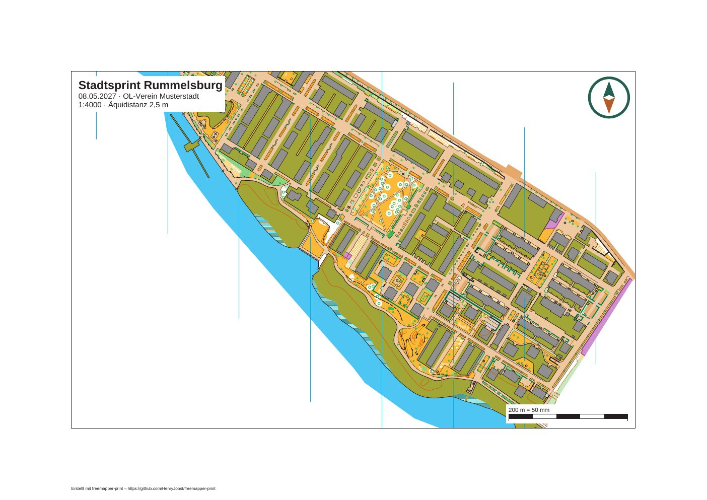

*Ein A4-Blatt mit 30 mm Passepartout und `crop = true`: Die Karte endet an der Rahmenlinie, die Namensnennung steht darunter im Passepartout. Karte: Remo Madella, MOO Challenge Berlin 2025.*

Ohne `centre_map_mm` liegt die Mitte dessen, was gedruckt wird, in der Mitte des Ausschnitts. Mit
`centre_map_mm = [x, y]` liegt dort dieser Punkt der Karte. Die Zahlen sind Millimeter auf der Karte im
Kartenmaßstab, genau so, wie OOM sie in der Statusleiste anzeigt, wenn die Koordinatenanzeige auf
Kartenkoordinaten steht: Zeigen Sie in OOM auf die Stelle und übernehmen Sie beide Zahlen. OOM zeigt y nach oben
(sein Quelltext gibt in `MapWidget::updateCursorposLabel` `x` und `-y` aus); das Programm rechnet das in die
Koordinaten der `.omap` mit y nach unten um. Jede Zahl darf höchstens 2 000 000 mm vom Ursprung der Karte
entfernt sein. Bei einer Karte, die größer ist als das Blatt, legen Sie so den Ausschnitt auf das
Wettkampfgebiet.

Soll das Blatt nur einen Teil der Karte zeigen, setzen Sie dazu `crop = true`
(`map_frame = { centre_map_mm = [120.0, -80.0], crop = true }`). Der Überstand ist dann ein Hinweis zur
Information, und `check` endet trotzdem mit 0.

Wie breit das Passepartout sein muss, hängt vor allem von der Fußzeile ab (Kapitel 7): Sie steht nur dann unter
dem Kartenausschnitt, wenn sie dort ganz Platz hat. Für zwei Zeilen reichen 8 mm, für fünf braucht es etwa
14 mm.

### Druckmaßstab

Ohne `print_scale` druckt das Layout im Maßstab der Karte. Ein anderer Maßstab ändert die Symbolgrößen so, wie
die Norm es vorsieht (Kapitel 9). Eine Sprintkarte lässt sich in 1:3000, 1:4000 und 1:5000 drucken, eine
Waldkarte in 1:5000 bis 1:20000. Blattelemente behalten ihre Größe in Millimetern: Ein Titel in 14 pt ist auf
dem A3-Blatt in 1:3000 genauso groß wie auf dem A4-Blatt in 1:4000.

### Nordlinien

Nordlinien (Symbol 601) gehören zur Karte. Hat die Karte welche, druckt das Programm sie so, wie sie gezeichnet
sind, mit ihren Lücken an kleinen Objekten. Hat sie keine und steht `north_lines` auf `"auto"`, ergänzt das
Programm senkrechte Linien über den ganzen Kartenausschnitt, im Bodenabstand der Kartenart: 120 m bei
Sprintkarten (30 mm in 1:4000, 40 mm in 1:3000), 300 m bei Waldkarten, 37,5 m bei Schulhofkarten. Sie nehmen
das Symbol 601 der Karte und liegen deshalb wie gezeichnete unter Mauern und Zäunen. Ohne Lücken laufen sie
trotzdem durch; die setzt der Kartograf in OOM. Verbirgt ein Layout mit `hide_parts` den Kartenteil, in dem die
Nordlinien der Karte liegen, ergänzt das Programm keine.

Auf einem Blatt mit Abdeckung (Kapitel 11) verschwinden die Nordlinien der Karte, gezeichnete wie mit dem Symbol
601 ergänzte, mit dem Rest der Karte. Hat der Symbolsatz kein Symbol 601, zeichnet das Programm stattdessen
einfache schwarze Linien auf der Blattebene, und die bleiben auch über dem abgedeckten weißen Papier sichtbar.

### Kartenteile ausblenden

`hide_parts = ["peripheral information"]` blendet den Kartenteil dieses Namens aus. Groß- und Kleinschreibung
zählt. Ein Name, den die Karte nicht hat, gibt einen Hinweis. Den Informationsblock von freemapper (Titel,
Maßstab, Maßstabsleiste) druckt ein Layout ohnehin nie, die Blattelemente treten an seine Stelle.

### Die Grundfläche von Sprintkarten

Neuere Sprintkarten von freemapper liegen auf einer Grundfläche: einer Fläche in der Farbe „belaufbare Fläche“,
einem hellen Braun wie bei befestigten Flächen, im Kartenteil `base`. Sie gehört zur Karte und wird immer
gedruckt, beschnitten am Kartenausschnitt. Abschalten lässt sie sich nicht, `hide_parts = ["base"]` lehnt das
Programm mit einer Fehlermeldung ab. Weil sie etwas über die Karte hinausreicht, zählt sie nicht für die Mitte des
Kartenausschnitts, den Überstand, die ergänzten Nordlinien und die Lage der Postennummern. Drucken Sie solche
Karten farbig: In Graustufen ist das helle Braun kaum von Papierweiß und von befestigten Flächen zu
unterscheiden. Schulhofkarten haben keine Grundfläche.

## 7. Titel, Logos und andere Blattelemente

Blattelemente stehen auf dem Blatt, gehören aber nicht zur Karte. Gemeinsame Elemente stehen unter
`[[shared]]` und erscheinen auf jedem Blatt. Ein Layout blendet einzelne mit `hide_shared` aus und hat unter
`[[layouts.elements]]` eigene. Die IDs der gemeinsamen Elemente und der Elemente eines Layouts müssen
zusammen eindeutig sein. `footer` ist vergeben.

Jedes Element hat:

| Schlüssel | Bedeutung |
|---|---|
| `id` | Name, mit dem Hinweise das Element nennen |
| `kind` | `title_block`, `text`, `logo`, `scale_check_bar`, `copyright_line`, `credit_line` oder `control_descriptions` (Kapitel 8) |
| `anchor.to` | `"page"` (das Blatt) oder `"map_frame"` (der Kartenausschnitt) |
| `anchor.corner` | eine von neun Stellen: `top_left`, `top`, `top_right`, `left`, `centre`, `right`, `bottom_left`, `bottom`, `bottom_right` |
| `anchor.offset_mm` | `[x, y]`, Abstand in mm von dieser Stelle nach innen |

Jeder Abstand liegt zwischen -2000 und 2000 mm. Er zählt von einer linken oder oberen Kante nach rechts oder unten,
von einer rechten oder unteren nach links oder oben, von einer Mitte nach rechts oder unten. Das Element liegt
innen an seiner Stelle: `top_right` mit `[2, 2]` setzt seine rechte obere Ecke 2 mm links und 2 mm unter die rechte
obere Ecke.

Ein Element am Kartenausschnitt liegt auf der Karte und deckt sie ab, das ist gewollt. Ein Element am Blatt,
das in den Kartenausschnitt ragt, bekommt einen Hinweis. Ebenso ein Element, das über den Blattrand ragt.

Andere Schlüssel gelten nur für bestimmte Arten. Steht einer bei der falschen Art, ist das ein Fehler.

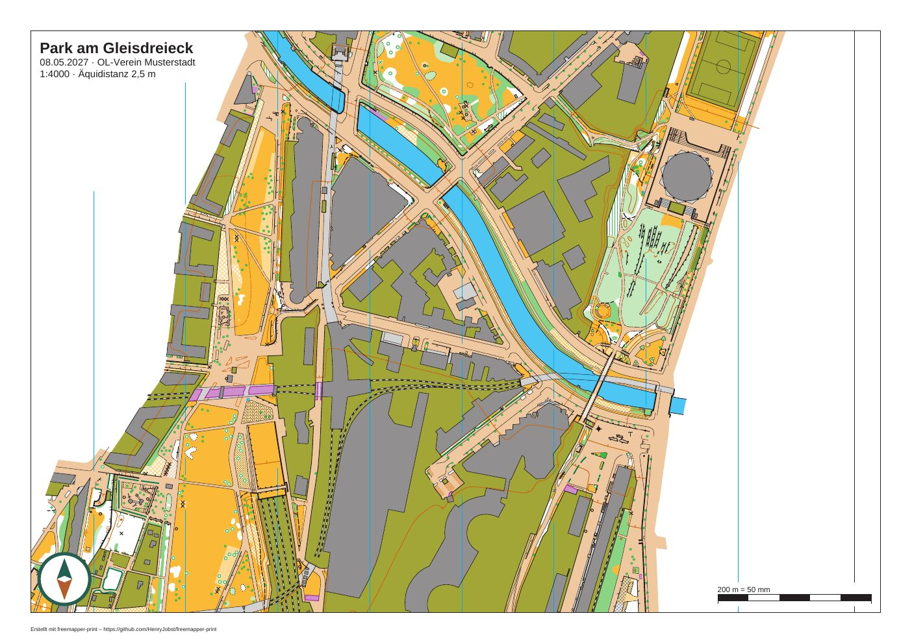

*Ein Layoutblatt mit Titelblock, Logo, Maßstabsleiste und Namensnennung (das Logo ist für dieses Beispiel gezeichnet). Karte: Remo Madella, MOO Challenge Berlin 2025.*

### Titelblock und Text

```toml
[[shared]]
id = "title"
kind = "title_block"
lines = ["{event}", "{date} · {organiser}", "1:{print_scale} · Äquidistanz {contour_interval}"]
anchor = { to = "map_frame", corner = "top_left", offset_mm = [2.0, 2.0] }
```

Ein Titelblock setzt die erste Zeile fett in 14 pt (`size_pt` ändert das, bis 200) und die übrigen in 9 pt. Ein
`text` setzt alle Zeilen in 9 pt oder in `size_pt`. Beide stehen auf einem weißen Kasten mit 1 mm Rand; `box_white
= false` lässt ihn weg. Die Schrift ist Arimo, dieselbe wie für Kartentexte.

In den Zeilen setzt das Programm diese Platzhalter ein:

| Platzhalter | wird zu |
|---|---|
| `{event}` | `event.title` |
| `{date}` | `event.date`, auf Deutsch „15.05.2027“, auf Englisch „15 May 2027“ |
| `{organiser}` | `event.organiser` |
| `{print_scale}` | Druckmaßstab des Layouts, ab fünf Stellen mit schmalem Leerzeichen: „4000“, „10 000“ |
| `{map_scale}` | Maßstab der Karte |
| `{contour_interval}` | `map.contour_interval_m` mit Einheit: „2 m“, „2,5 m“ |
| `{layout}` | die Layout-ID |
| `{course}` | auf einem Bahnblatt der Name der Bahn |
| `{length_km}` | auf einem Bahnblatt die Länge der Bahn in Kilometern, ohne Einheit |
| `{climb_m}` | auf einem Bahnblatt der Anstieg in Metern, ohne Einheit |
| `{controls}` | auf einem Bahnblatt die Zahl der Posten |

Ein unbekannter Platzhalter, etwa ein Tippfehler wie `{evnet}`, bleibt so stehen und gibt einen Hinweis. Die vier Bahn-Platzhalter kennt das
Programm überall, gefüllt werden sie aber nur auf Bahnblättern (Kapitel 8). Auf einem Layoutblatt bleiben sie leer,
und `check` sagt das als Information.

Die IOF verlangt Maßstab und Äquidistanz auf jedem Blatt. Fehlt in allen Texten eines Layouts
`{print_scale}` oder `{contour_interval}`, oder fehlt `map.contour_interval_m`, meldet `check` das.

### Logo

```toml
[[shared]]
id = "club_logo"
kind = "logo"
file = "logos/verein.svg"
width_mm = 35.0
anchor = { to = "map_frame", corner = "top_right", offset_mm = [2.0, 2.0] }
```

`width_mm` ist die Breite auf dem Papier, höchstens 2000; die Höhe folgt aus dem Seitenverhältnis. Das Programm
nimmt PNG, JPEG und SVG:

- **PNG und JPEG** bleiben Pixelbilder, ein PNG behält seine Transparenz. Für den Druck sollte das Bild etwa
  300 Pixel je Zoll haben, für 35 mm Breite also rund 400 Pixel.
- **SVG** wird zu Flächen und Linien in CMYK und bleibt in jeder Größe scharf. Das ist die beste Wahl, wenn
  das Logo nur aus Flächen, Linien und Verläufen besteht.

Nicht jedes SVG lässt sich drucken. Ein SVG kann viel mehr als Formen: Masken, Filter, Muster, eingebettete
Bilder, Schrift, Stilvorlagen. Manche Dateien nutzen das, um mit wenigen Kilobyte Minuten an Rechenzeit oder
Gigabyte an Speicher zu verlangen. Deshalb nimmt das Programm nur eine feste Liste einfacher Elemente an: `svg`,
`g`, `path`, `rect`, `circle`, `ellipse`, `line`, `polyline`, `polygon`, `defs`, `linearGradient`,
`radialGradient`, `stop`, `use`, `title`, `desc`, `metadata` und `clipPath` (nur in Nutzerkoordinaten). Enthält
ein Logo etwas anderes, lässt das Programm es weg und meldet das. Typische Gründe:

- Text als `<text>`: Wandeln Sie die Schrift in Pfade um (Inkscape: „Pfad › Objekt in Pfad umwandeln“,
  Illustrator: „Schrift › In Pfade umwandeln“).
- Masken, Filter, Schatten, Muster, eingebettete Pixelbilder, Stilvorlagen in `<style>`: Speichern Sie das
  Logo ohne diese Effekte.
- Eine Dokumenttypdeklaration (DTD), die mehr enthält als Kommentare und kurze Text-Entitäten, wie Illustrator
  sie schreibt.
- Zu groß oder zu tief verschachtelt: über 10 MB, über 20 000 Pfadsegmente, über 256 Ebenen.

Die Meldung rät dann, das Logo als einfaches SVG zu exportieren, in Inkscape etwa mit „Speichern unter ›
Normales SVG“. Den Rest des Blatts druckt das Programm trotzdem.

Was das Blatt nicht genau so zeichnen kann, wie das SVG es beschreibt, zeichnet es vereinfacht und meldet es:
ein Verlauf erscheint in seiner ersten Farbe, Transparenz wird deckend, Strichelung wird durchgezogen, und
Beschneidungspfade wirken nicht. Ein PNG oder JPEG über 25 Megapixel oder über 65 535 Pixel Kantenlänge, eine
Datei über 10 MB und eine fehlende oder kaputte Datei werden ausgelassen und gemeldet. Die genauen Grenzen
stehen im [Glossar](../glossary.md) unter „Logo“ und in ADR 0026.

Das Programm liest und dekodiert jede Logodatei einmal je `check` oder `export`, egal wie viele Elemente und
Layouts sie nutzen, und das PDF enthält sie einmal. Ein Blatt trägt höchstens 50 Megapixel an PNG- und
JPEG-Logos und 1 000 000 Einheiten SVG-Arbeit, jedes Logo so oft gezählt, wie es platziert ist. Ein Logo
darüber hinaus fehlt mit einem Hinweis. Zwei Logos der größten erlaubten Größe passen; ein Vereinslogo von
einigen hundert Pixeln braucht fast nichts davon.

### Kontrollstrecke

```toml
[[shared]]
id = "scale_check_bar"
kind = "scale_check_bar"
anchor = { to = "map_frame", corner = "bottom_right", offset_mm = [2.0, 2.0] }
```

Ein schwarz-weißer Balken auf weißem Kasten, beschriftet etwa „200 m = 50 mm“. Seine Länge ist die größte
runde Strecke (5, 10, 20, 50, 100, 200, 250, 500 oder 1000 m), die im Druckmaßstab höchstens 50 mm lang ist:
200 m bei 1:4000, 100 m (33,3 mm) bei 1:3000. Mit einem Lineal am Ausdruck sehen Sie, ob der Drucker skaliert
hat (Kapitel 9).

### Fußzeile: Quellenangaben und Namensnennung

Jedes Blatt hat unten links eine Fußzeile in 5 pt, auf einem weißen Kasten, damit nichts darunter sie verdeckt;
unter dem Kartenausschnitt ist der Kasten weiß auf weißem Papier. Oben stehen die Quellenangaben, eine je Zeile,
aus `print.copyright` oder aus den Kartennotizen. Darunter steht die Namensnennung „Erstellt mit freemapper-print –
https://github.com/HenryJobst/freemapper-print“ (auf englischen Blättern „Created with …“). Die Namensnennung lässt
sich nicht abschalten.

Die Fußzeile steht unter dem Kartenausschnitt, wenn sie dort ganz Platz hat. Sonst steht sie links unten im
Kartenausschnitt, und `check` meldet, dass sie einen Teil der Karte abdeckt. An beiden Stellen nennt `check`
jedes Element, das die Fußzeile abdeckt. Abhilfe: ein breiteres Passepartout (`margin_mm`) oder weniger Zeilen in
`print.copyright`. Mehr als sechs Zeilen Quellenangaben zeigt das Programm nicht: fünf und eine sechste, die den
Rest zählt. Eine Zeile, die breiter ist als der Kartenausschnitt, kürzt es mit „…“, und `check` nennt sie.

Ein Element `copyright_line` oder `credit_line` holt diesen Teil aus der Fußzeile und setzt ihn an seinen eigenen
Anker, in 5 pt oder `size_pt`. Es verschiebt die Zeilen nur; die Namensnennung bleibt auf dem Blatt, auf einem
eigenen weißen Kasten. Ein
`credit_line` braucht mindestens 5 pt. Läge es nicht ganz auf dem Blatt, bleibt die Namensnennung in der
Fußzeile, und `check` meldet das. Die Namensnennung wird nach allem anderen auf dem Blatt gezeichnet, kein
Element kann sie verdecken.

## 8. Bahnen

Ein Bahnblatt ist ein Layout, auf dem die Bahn in Violett über der Karte liegt. Die Projektdatei verweist auf die
Datei Ihres Bahnlegungsprogramms, den Rest erledigen `check` und `export`: ein Blatt je Bahn, mit Postennummern
und, bei Purple-Pen-Dateien, der Postenbeschreibung. Das Beispiel
[examples/luebeck-competition-courses](../../examples/luebeck-competition-courses/README.md) geht alles mit jedem
Befehl und seiner Ausgabe durch. [examples/berlin-viktoriapark-training](../../examples/berlin-viktoriapark-training/README.md)
ist ein kleineres, ein Vereinstraining mit einer einzigen Bahn.

### Woher die Bahnen kommen

Das Programm liest zwei Arten von Dateien:

- Ein Purple-Pen-Projekt, `.ppen`. Es enthält die Posten, die Bahnen, Knickpunkte und Lücken der Strecken,
  Kreislücken je Maßstab, die Postenbeschreibungen, Sonderobjekte wie Sperrgebiete, verbotene Strecken und
  Pflichtstrecken, die Lage jeder Postennummer und den Druckmaßstab jeder Bahn.
- IOF-XML 3.0 mit `CourseData`, aus Purple Pen, Condes, der OCAD-Bahnlegung oder jedem anderen Programm, das es
  schreibt. Es enthält Posten, Bahnen, die Positionen der Posten und, wenn das schreibende Programm sie setzt, die
  Lage jeder Nummer, die Länge der Bahn und den Anstieg.

IOF-XML kennt keine Postenbeschreibungen, Sonderobjekte, Knickpunkte oder Druckmaßstäbe. Ein Blatt aus einer
IOF-XML-Datei zeigt die Posten, die Strecken und die Nummern, sonst nichts. Wollen Sie die Postenbeschreibung oder
ein Sperrgebiet auf dem Blatt, nehmen Sie die `.ppen` aus Purple Pen. Das Programm wählt den Leser nach der
Dateiendung, `.ppen` oder `.xml`; jede andere Endung ist ein Fehler. Bietet Ihr Programm beides an, gibt die
`.ppen` das vollständigere Blatt.

Noch nicht alles in einer Datei wird gedruckt:

- Eine Bahn mit Varianten (Gabelungen und Schleifen in Purple Pen) fehlt, ebenso eine Bahn mit alternativen
  Posten an einer Stelle. `check` sagt, welche. Der IOF-XML-Export von Purple Pen schreibt jede Variante als eigene
  Bahn, und die wird ein eigenes Blatt.
- Ein Element, das das Programm nicht kennt, wird übersprungen, mit einem Hinweis.

Abdeckflächen (White-out) druckt das Programm als Abdeckungen der Bahnen, für die sie gelten, jede für sich, auch
wenn sie sich überlappen (ADR 0045). Dort fehlt die Karte; Bahnaufdruck, Beschreibungskasten und Fußzeile bleiben.
Nennt die Zuordnung einer Bahn eine eigene Abdeckung, gilt nur diese. `check` nennt die Abdeckflächen zur
Information. Abdeckungen für Fenster- und Korridor-OL beschreibt Kapitel 11.

### Die Datei verknüpfen: die lebende Verbindung

In der Projektdatei bekommt `[sources]` den Schlüssel `courses`:

```toml
[sources]
map = "luebeck.omap"
courses = "courses.ppen"
```

Der Pfad gilt relativ zur Projektdatei. Das Programm liest die Bahndatei bei jedem `check` und jedem `export`
neu. Verschieben Sie in Purple Pen einen Posten, legen eine Bahn an oder ändern eine Beschreibung, speichern Sie
die Datei und rufen `export` auf. Im Projekt muss nichts aufgefrischt werden.

Die Projektdatei hält nur, was die Bahndatei nicht weiß. Zwei Arten von Einträgen beziehen sich auf sie:

- `[[assignments]]` sagt, auf welchem Layout eine Bahn gedruckt wird. Es nennt die Bahn so, wie die Bahndatei sie
  nennt:

  ```toml
  [[assignments]]
  course = "A"
  layout = "a4-4000"
  ```

  Eine Bahn ohne Zuordnung nimmt das erste Layout, und `check` sagt das als Information.
- `[[numbers]]` korrigiert die Lage einer Postennummer, entweder für ein Layout oder für eine Bahn (siehe
  „Lage der Nummern“ unten). Es nennt den Posten mit seinem Code.

Ändert sich die Bahndatei, kann ein solcher Eintrag etwas nennen, das es nicht mehr gibt, etwa eine umbenannte
Bahn oder einen gelöschten Posten. Das Programm wirft ihn nicht weg. Es meldet jeden mit einem Hinweis und lässt
ihn in der Projektdatei stehen, damit eine umbenannte Bahn nicht ihre Einstellungen kostet. Die übrigen Bahnen
laden wie gewohnt. Korrigieren Sie den Namen in der Projektdatei oder löschen Sie den Eintrag. Ist eine Lage in der
Bahndatei weitergewandert, seit Sie eine Korrektur gemacht haben, meldet `check` auch das. Die Korrektur gilt
weiter, und Sie entscheiden, ob sie noch passt.

### Koordinaten und Einpassung

Bevor es druckt, passt das Programm die Bahn an die Karte an und bricht ab, wenn die Einpassung falsch aussieht.
Eine Bahn auf der falschen Karte oder auf dem Kopf schickte Läufer an die falsche Stelle. Diese Prüfungen laufen:

- Die y-Achse. Purple Pen, Condes und OCAD schreiben die y-Achse nach oben, OOM zählt nach unten. Purple Pen
  schreibt sie immer nach oben, also liest das Programm eine `.ppen` so. Passt die Bahn damit nicht auf die Karte,
  bricht die Einpassung ab; gespiegelt druckt es eine Purple-Pen-Bahn nie. Eine IOF-XML-Datei sagt nicht, welche
  Achse sie nutzt. Das Programm probiert beide Lesarten und nimmt die, bei der jeder Posten auf der Karte liegt.
  Gibt es in der Datei Breite und Länge und ist die Karte georeferenziert, entscheiden die Koordinaten. Passen
  beide Lesarten und entscheidet nichts, nimmt das Programm „oben“ und warnt, denn eine Bahn nahe der Kartenmitte
  passt in beide Richtungen. Sehen Sie sich ein Blatt an und bestätigen Sie dann die Achse in der Projektdatei:

  ```toml
  [sources]
  course_y_axis = "up"      # oder "down"
  ```

  Eine IOF-XML-Datei, die nach unten geschrieben wurde und in beide Richtungen passt, druckt auf dem Kopf, bis
  Sie die Achse setzen. Das ist der eine Fall, in dem das Programm Sie bittet hinzusehen. Ein Purple-Pen-Projekt
  braucht kein `course_y_axis`. Setzen Sie bei einer `.ppen` trotzdem `"down"`, folgt das Programm dem und warnt,
  denn die Bahn steht dann gespiegelt auf dem Blatt.
- Der Kartenmaßstab. Nennt die Bahndatei einen Kartenmaßstab, muss er dem der Karte entsprechen. Weicht er ab,
  bricht die Einpassung ab. Die Meldung ist noch englisch: „the course file is drawn for 1:…, the map is 1:…“.
  Exportieren Sie die Bahnen im Bahnlegungsprogramm für den Maßstab der
  Karte. Das Programm skaliert Positionen nie um. Eine Datei ohne Kartenmaßstab bekommt eine Zeile „Zur
  Information“. Nennt die Karte selbst keinen Maßstab, bricht die Einpassung mit „the course file is drawn for
  1:…, and the map states no scale“ ab; tragen Sie den Maßstab in OOM ein.
- Die Georeferenzierung. Ist die Karte in UTM georeferenziert und hat ein Posten sowohl eine Kartenposition als auch
  Breite und Länge, vergleicht das Programm beide. Liegt ein Posten mehr als 20 m von dem Ort entfernt, den seine
  Breite und Länge angeben, bricht die Einpassung ab mit „control … lies … m from where its lat/lng put it“.
  Breite und Länge aus einer GNSS-Messung im Gelände stimmen auf 5 bis 10 m. Eine falsche Karte, Zone oder ein
  falsches Datum verschiebt jeden Posten um Hunderte Meter. Was zu tun ist, hängt von der Ursache ab:
  - Die Georeferenzierung der Karte ist falsch oder gehört zu einer anderen Karte. Korrigieren Sie sie in OOM.
  - Die Bahndatei gehört zu einer anderen Karte. Nehmen Sie die richtige Datei.
  - Nur Breite und Länge sind falsch oder unerwünscht. Setzen Sie `course_georef_check = false` unter `[sources]`.
    Die Kartenpositionen platzieren die Bahn dann allein, und `check` sagt in einer Zeile „Zur Information“,
    dass es die Koordinaten nicht beachtet hat.

  Andere Koordinatensysteme als UTM werden noch nicht geprüft; `check` sagt das als Information.
- Außerhalb der Karte. Bringt keine Lesart der y-Achse alle Posten auf die Karte, bricht die Einpassung ab mit
  „only … of … controls lie on the map; the course file belongs to another map, uses another origin or another y
  axis“. Prüfen Sie, ob Sie die richtige Bahndatei und die richtige Karte verknüpft haben, und, falls Sie
  `course_y_axis` gesetzt haben, ob der Wert stimmt. Posten bis 10 mm außerhalb der gezeichneten Karte zählen
  noch, ein Start oder Ziel am Rand eines Ausschnitts geht also.
- Nur Breite und Länge. Ein Posten mit Breite und Länge, aber ohne Kartenposition wird über die Georeferenzierung der
  Karte platziert. Kann die Karte das nicht, oder haben Sie die Prüfung abgeschaltet, bricht die Einpassung ab mit
  „controls … have only lat/lng and cannot be placed“ und dem Grund.

Schlägt eine Prüfung fehl, geben `check` und `export` den Fehler aus und halten für die ganze Bahndatei an, damit
eine schlechte Datei nie ein Blatt erzeugt. Der Exit-Code ist 1.

### Bahnblätter und Bahnaufdruck

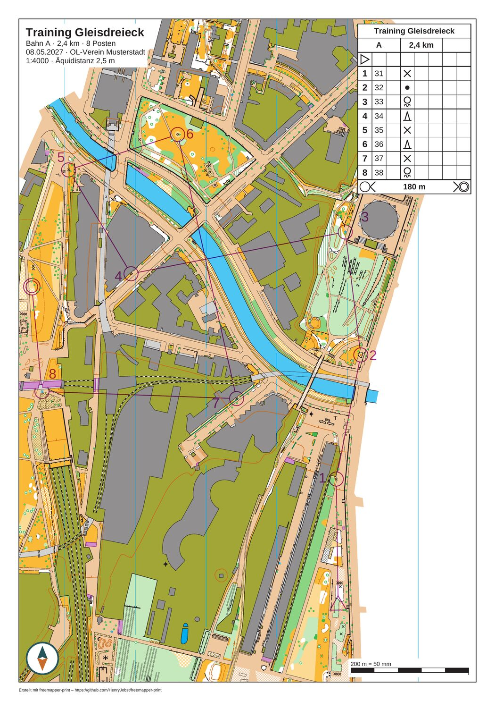

*Das Blatt der Bahn „A“ in 1:4000 mit Bahnaufdruck, Nummern, Titelblock und Beschreibungskasten (die Bahn ist für dieses Handbuch erfunden). Karte: Remo Madella, MOO Challenge Berlin 2025.*

Mit einer Bahndatei schreibt `export` ein PDF je Bahn statt je Layout (siehe „Export“ unten). Ein Bahnblatt ist
das Layout, dem die Bahn zugeordnet ist, mit diesen Änderungen:

- Der Kartenausschnitt zentriert sich auf die Bahn, sofern das Layout kein `map_frame.centre_map_mm` setzt. Das
  Programm zentriert auf Posten und Knickpunkte und weitet den Ausschnitt für ein Sonderobjekt nur, wenn das
  Objekt noch hineinpasst. Bahnblätter schneiden meist einen Teil aus einer größeren Karte, setzen Sie also
  `map_frame.crop = true`, wie es `init --courses` tut. Eine Karte, die größer ist als der Ausschnitt, ist auf
  einem Bahnblatt zu erwarten und nur eine Zeile „Zur Information“. Ein Posten, der außerhalb des Ausschnitts oder
  auf seinem Rand liegt, ist ein Hinweis.
- Das Programm zeichnet die Bahn in Violett (35/85/0/0 CMYK im Regelprofil) über die Karte, mit den
  Symbolgrößen, die das Regelprofil für die Kartenart vorgibt, aus ISSprOM 2019-2 und ISOM 2017-2. Das sind die
  Größen im Basismaßstab (Sprint 1:4000, Wald 1:15000). Auf dem Blatt bekommen sie die Größe, die die Norm für den
  Druckmaßstab vorgibt, den Bahnfaktor: 133 % bei 1:3000 auf einer Sprintkarte, 150 % bei 1:10000 auf einer
  Waldkarte. Das hängt nicht vom Maßstab ab, in dem die Kartendatei gezeichnet ist. Eine Waldkarte, gezeichnet in
  1:10000, bekommt in 1:10000 Kreise von 7,5 mm und in 1:15000 Kreise von 5,0 mm. Die Kopfzeile nennt den
  Symbolfaktor; er gilt für die Symbole der Karte selbst.
- Das Violett hat zwei Schichten, wie es die „Printing and Colour Definitions“ der IOF (Rev. 4) verlangen. Das
  untere Violett enthält Start, Posten, Strecken, Ziel, verbotene Linien und Querungsstellen. Es liegt unter
  Schwarz, Braun und Blau 100 %, damit schwarze Kartendetails über dem Kreis lesbar bleiben. Das obere Violett
  enthält die Postennummern, Kartenwechsel, Sperrgebiete, verbotene Strecken, Pflichtstrecken und Texte. Es liegt
  über der ganzen Karte.
- Beide Schichten werden im Mischmodus `Multiply` gemalt. Die Karte scheint überall durch das Violett, und Schwarz
  unter dem Violett bleibt schwarz. Ein Bürodrucker hat weder Sonderfarbe noch Überdruckattribut, deshalb muss das
  PDF das Ergebnis selbst zeigen.
- Die Textelemente kennen vier weitere Platzhalter: `{course}` (der Bahnname), `{length_km}` (die Länge in
  Kilometern, ohne Einheit), `{climb_m}` (der Anstieg in Metern, ohne Einheit) und `{controls}` (die Zahl der
  Posten). Ein Platzhalter bleibt leer, mit einer Zeile „Zur Information“, wenn die Datei für die Bahn keinen Wert
  hat oder das Blatt keine Bahn hat. Zum Beispiel nennt `"{event} · Bahn {course}"` die Bahn im Titelblock.
  `init --courses` schreibt `{event} · {course}`.
- Nennt die Zuordnung der Bahn eine Abdeckung, oder hat die Bahn Abdeckflächen aus Purple Pen, fehlt die Karte in
  der abgedeckten Fläche. Der Bahnaufdruck und die Blattelemente bleiben (Kapitel 11).

Das Programm prüft auch, dass kein Blattelement einen Teil der Bahn verdeckt. Deckt ein Titelblock, Logo, Text,
eine Kontrollstrecke, Fußzeile oder die Postenbeschreibung einen Posten, den Start oder das Ziel ab, warnt
`check` und nennt das Element und die Posten. Versetzen Sie das Element mit seinem Anker.

### Die Postenbeschreibung

Ein Layoutelement der Art `control_descriptions` zeigt die Postenbeschreibung der Bahn so, wie die IOF sie
festlegt:

```toml
[[layouts.elements]]
id = "descriptions"
kind = "control_descriptions"
cell_mm = 6.0                        # optional, 4 bis 10, sonst aus dem Regelprofil
anchor = { to = "map_frame", corner = "top_right", offset_mm = [2.0, 2.0] }
```

Der Kasten ist so aufgebaut, wie Purple Pen ihn aufbaut. Er zeigt den Titel der Veranstaltung, die Bahn mit Länge
und Anstieg, den Start, je Posten eine Zeile mit Nummer, Code und den Symbolen der Spalten C bis H, Zeilen für
Pflichtstrecken und Kartenwechsel mit ihrer Länge und das Ziel. Der zweite Titel einer Bahn aus Purple Pen
bekommt eine eigene Zeile, ein Kartenwechsel („map flip“) die Zeile 15.6. Eine Bahn mit Wertung (Score-Lauf) führt ihre Posten
nach Code auf, wie Purple Pen es tut.

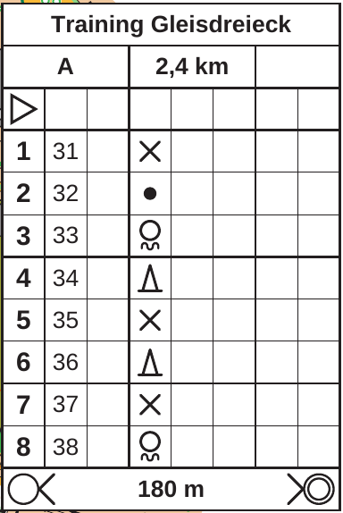

*Der Beschreibungskasten der Bahn „A“ mit Titel, Länge, Start, acht Posten und Ziel. Karte: Remo Madella, MOO Challenge Berlin 2025.*

Der Kasten hat weißen Hintergrund und ist in Arimo gesetzt. Ein Kästchen ist standardmäßig 6 mm groß, `cell_mm`
setzt 4 bis 10 mm. Der Kasten behält seine Größe bei jedem Druckmaßstab, wie es ein Element auf dem Papier tun
soll. Braucht ein Blatt in 1:3000 mehr Platz für die Karte, nehmen Sie kleinere Kästchen.

Der Kasten entfällt, wenn er über den Blattrand ragen würde, denn eine abgeschnittene Beschreibung könnte einen
Posten verbergen. Davor warnt `check`, ebenso vor einer Bahn, bei der kein Posten eine Beschreibung hat. Ein
Layout ohne das Element hat schlicht keinen Kasten, und `check` sagt das als Information. Dasselbe gilt für
IOF-XML. Ein Symbol, das der Beschreibungsstandard der Bahndatei nicht kennt, lässt sein Kästchen leer, und
`check` nennt es. Die Beschreibungsstandards 2004, 2018 und 2024 werden gelesen.

Noch nicht gemacht:

- Eine Kartenausgabe („map issue“) wird als Start gelesen. Ihre eigene Zeile mit der Länge der Pflichtstrecke zum
  Start fehlt.
- Eine Strecke, die nur teilweise abgeflaggt ist, wird als nicht abgeflaggt gezeichnet und beschrieben.
- Eine lange Bahn wird nicht auf mehrere Spalten verteilt.
- Der Kasten hat keine Textspalte neben den Symbolen und keine Legende für eigene Symbole.

### Lage der Nummern

Wo eine Postennummer steht, zählt auf einer vollen Sprintkarte, und mehrere Beteiligte wollen mitreden. Das
Programm kennt vier Ebenen, die genauere gewinnt:

1. Die automatische Platzierung. Sie gilt nur für einen nummerierten Posten, für den die Bahndatei keine Lage
   angibt.
2. Die Bahndatei. Purple Pen speichert die Lage je Bahn, relativ zum Posten. Bei einer `.ppen` rechnet das
   Programm den Versatz im Druckmaßstab der Bahn um, mit der Einstellung von Purple Pen, ob Bahnobjekte mit dem
   Maßstab wachsen („Scale sizes of items“). Bei IOF-XML nimmt es `MapTextPosition`.
3. Eine Korrektur für das Layout: eine Tabelle `[[numbers]]` mit `layout`.
4. Eine Korrektur für das Blatt einer Bahn: eine Tabelle `[[numbers]]` mit `course`.

Eine Korrektur nennt den Posten, eine Richtung in Grad (0 ist Osten, gegen den Uhrzeigersinn) und, wenn nötig, einen
Abstand:

```toml
[[numbers]]
control = "49"
course = "A"
direction = 161.0
gap_mm = 0.5
```

Der Abstand ist die kürzeste Entfernung in mm im Basismaßstab zwischen dem äußeren Rand der Kreislinie und dem
Kasten der Nummer. Er wächst mit dem Bahnfaktor wie der Kreis, die Nummer behält also bei jedem Druckmaßstab ihr
Aussehen.
`gap_mm` liegt über 0 und bei höchstens 10 mm. Ohne ihn behält die Korrektur den Abstand der Ebene darunter.
`numbers accept` schreibt außerdem eine Tabelle `[numbers.base_seen]` mit der Lage, die die Datei hatte, als Sie die
Korrektur machten.

Das Regelprofil legt fest, in welcher Spanne ein Abstand liegen soll. In `iof-print` sind es 0,5 bis 5 mm. Eine
Nummer außerhalb der Spanne wird dort gedruckt, wo sie steht, und `check` warnt. Hat eine Regel im Profil nur
ein Minimum, hält die automatische Platzierung genau diesen Abstand ein, wie freemapper-courseplan; `check` lässt
dann jeden größeren Abstand bis 10 mm gelten.

Platziert das Programm eine Nummer selbst, folgt es vier Regeln, die aus den Regeln der Bahnleger stammen:

1. Die Nummer verdeckt kein Punkt- und kein Liniensymbol der Karte. Diese Regel ist hart.
2. Die Nummer steht hinter dem Posten, in Linie mit der hereinführenden Strecke. Beim ersten Posten kommt diese
   Strecke vom Start.
3. Käme der Kasten hinter dem Posten näher als eine halbe Linienbreite an die hinausführende Strecke, steht die
   Nummer auf der äußeren Winkelhalbierenden, zwischen den beiden Strecken auf ihrer Außenseite.
4. Ist der bevorzugte Platz belegt, gewinnt der freie Platz, der am wenigsten davon abweicht.

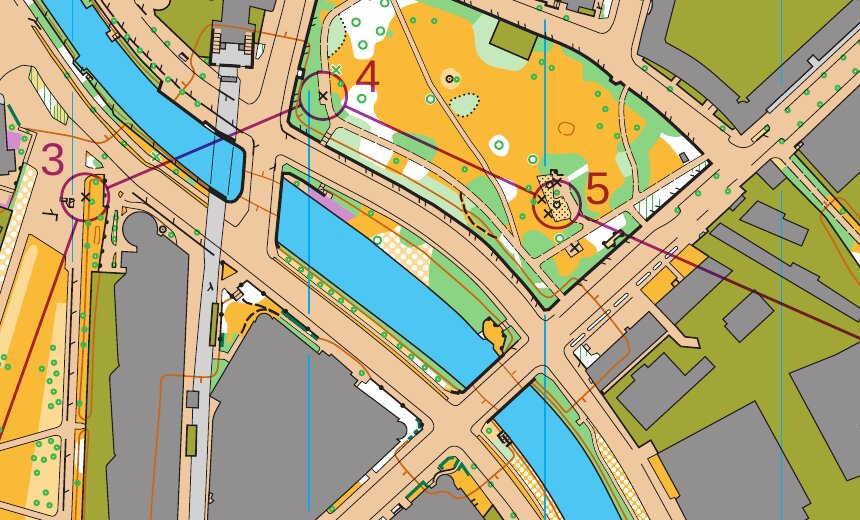

*Die Posten 3 bis 5 der Bahn „A“ mit Kreis, Strecke und Nummer. Karte: Remo Madella, MOO Challenge Berlin 2025.*

Das Programm verschiebt eine Nummer nie von selbst. Es druckt sie dort, wo ihre Ebene sie hinsetzt, und `check`
bewertet jede Nummer gegen den Bahnaufdruck, die Blattelemente, den Rand des Kartenausschnitts und die Symbole der
Karte. Liegt eine Nummer auf einem davon, nennt der Hinweis, was sie überdeckt (Kartensymbole mit ihrem Code), und
schlägt eine Richtung und einen Abstand vor. Gibt es keinen freien Platz, ist der Vorschlag der am wenigsten
verdeckte.

Die Suche hat eine Grenze je Blatt: 2 Millionen Lagen, die sie prüft, und 200 Millionen für alle Blätter einer
Bahndatei, zu gleichen Teilen. Echte Bahnen bleiben weit darunter. Ein Blatt, das sie erreicht, sagt es in einem
Hinweis; die Nummern, zu denen die Suche nicht mehr kam, bleiben, wo ihre Ebene sie hinsetzt, und ihre Konflikte
kommen ohne Vorschlag.

So übernehmen Sie einen Vorschlag:

```sh
freemapper-print numbers accept stadtsprint --course A --control 49 --sheet
```

`--sheet` macht die Korrektur für das Blatt dieser Bahn (Ebene 4). `--layout-wide` macht sie für jede Bahn, die auf
dem Layout der Bahn gedruckt wird (Ebene 3). Eines von beiden ist nötig. Ohne `--direction` und `--gap` nimmt der
Befehl den Vorschlag von `check`. Mit beiden schreibt er Ihre Werte. Hat `check` keinen Vorschlag, weil die Nummer
keinen Konflikt hat, hält der Befehl an und verlangt die beiden Werte.

Der Vorschlag stammt vom Blatt der Bahn, die Sie nennen. Mit `--layout-wide` und ohne eigene Werte zeichnet der
Befehl jede andere Bahn dieses Layouts, die die Nummer druckt, mit der neuen Korrektur, und schreibt nur, wenn
keine davon dort einen Konflikt bekommt. Sonst nennt er diese Bahnen und hält mit Exit-Code 2 an. Nehmen Sie dann
`--sheet` für die eine Bahn, oder geben Sie `--direction` und `--gap` für alle an.

`numbers accept` hängt eine Tabelle `[[numbers]]` als Text ans Ende der Projektdatei. Alles davor bleibt, wie es
ist, auch die Kommentare. Die neuen Zeilen enden wie die der Datei (CRLF oder LF), eine Projektdatei, die ein Link ist,
wird durch eine normale Datei ersetzt (das Ziel des Links behält seinen Inhalt), und die Datei behält ihre Rechte. Danach lädt es die Datei neu und stellt den alten Inhalt
wieder her, wenn das scheitert.
Eine zweite Korrektur für denselben Posten und Geltungsbereich lehnt es ab. Zum Ändern bearbeiten Sie die Datei.
Danach rufen Sie `check` auf, um das Ergebnis zu sehen.

### Export

```sh
freemapper-print export stadtsprint
freemapper-print export stadtsprint --course A --course B
freemapper-print export stadtsprint --single-file
freemapper-print export stadtsprint --layout a4-4000
```

Mit einer Bahndatei schreibt `export` ein PDF je Bahn in den Ordner `out`, benannt nach der Bahn: `A.pdf`.
Zeichen, die ein Dateiname nicht enthalten kann, werden zu `-`. Namen, die sich nur in der Groß- und Kleinschreibung
unterscheiden, bekommen „ (2)“.

- `--course <NAME>` exportiert nur die genannte Bahn. Die Option lässt sich wiederholen. Ein Name, den die Datei
  nicht hat, ist ein Fehler, der die vorhandenen Bahnen nennt, mit Exit-Code 2.
- `--single-file` schreibt alle Bahnen in ein PDF, eine Seite je Bahn, jede auf dem Papier ihres Layouts. Die Datei
  heißt nach dem Titel der Veranstaltung mit „ - alle Bahnen“ („ - all courses“ auf englischen Blättern). Mit
  `--layout` lässt sie sich nicht verbinden.
- `--layout <ID>` exportiert ein Layout wie bisher ohne Bahn, die Karte allein mit Titel und Kontrollstrecke. Mit
  einer Bahndatei lässt sich die Option nicht mit `--course` oder `--single-file` verbinden.
- `--out-dir` wirkt wie bisher.

Ein Projekt ohne Bahndatei exportiert genau wie in Kapitel 5.

### Mit einer Bahndatei beginnen: `init --courses`

```sh
freemapper-print init stadtsprint --map luebeck.omap --title "Stadtsprint Lübeck" --courses courses.ppen
```

`init` liest die Bahndatei zuerst und passt sie an die Karte an. Eine Datei, die nicht zur Karte passt, stoppt
`init` vor dem Schreiben. Aus einer `.ppen` entstehen dann ein Layout je Druckmaßstab der Datei, eine Zuordnung für
jede Bahn, ein Beschreibungskasten in der oberen rechten Ecke des Kartenausschnitts und `map_frame.crop = true`.
Eine Bahn ohne Druckmaßstab bekommt den Kartenmaßstab. Aus IOF-XML entsteht ein Layout im Kartenmaßstab, ohne
Beschreibungskasten, denn das Format hat keine. Jede Layout-ID nennt ihren Druckmaßstab, etwa `a4-4000`. In beiden
Fällen beginnt der Titelblock mit `{event} · {course}`, damit jedes Blatt seine Bahn nennt. `init` sagt, woher jeder
Wert stammt, und nennt die Bahndatei wie die Projektdatei, relativ zum Projektordner.

Nehmen Sie die Datei als Anfang. `init` wählt Papier und Passepartout für das Layout als Blatt für sich; ob jede
Bahn in den Ausschnitt passt, zeigt `check`. Ändern Sie Papier und Passepartout nach Wunsch und rufen Sie dann
`check` auf. Bei einer IOF-XML-Datei meldet das erste `check` vielleicht die angenommene y-Achse; bestätigen Sie
sie wie oben beschrieben.

### Bahnen prüfen

`check` geht jede Bahn durch. Je Bahn gibt es eine Zeile mit Layout, Papier, Druckmaßstab, Kartenmaßstab und
Faktoren, danach die Hinweise. Danach prüft es jedes Layout als Blatt ohne Bahn, so wie `export --layout` es
schreibt. Hinweise zur Bahndatei selbst, vom Lesen und Einpassen, stehen einmal vor der ersten Bahn. Die letzte
Zeile lautet „3 Bahnen und 2 Layoutblätter geprüft, keine Hinweise.“ oder „Mit Hinweisen: 1 von 3 Bahnen, 0 von 2
Layoutblättern.“ Der Exit-Code ist 0, wenn nichts Ihre Aufmerksamkeit braucht („Zur Information“ zählt nicht), sonst 1.
Ein Skript kann `check` vor `export` aufrufen.

Die Hinweise und was zu tun ist, stehen in Kapitel 10.

## 9. Drucken: maßstabsgetreu am eigenen Drucker und im Copyshop

Eine Orientierungslaufkarte muss den Maßstab haben, der darauf steht. Das PDF von freemapper-print hat ihn
genau: 1 mm auf dem Papier sind die Strecke im Gelände, die der Druckmaßstab vorgibt. Ob der Ausdruck ihn
behält, entscheidet der Druckdialog.

### Das PDF erzeugen

Für eine Veranstaltung schreibt `export` die PDFs (Kapitel 5). Für einen schnellen Druck der nackten Karte
ohne Projektdatei gibt es `render`:

```sh
freemapper-print render luebeck.omap --out luebeck-4000-a4.pdf --paper a4
```

Ohne `--scale` druckt das Programm im Maßstab der Karte. `--scale 3000` druckt in 1:3000. Zum Drucken wählen Sie A4
oder A3 (`--paper`) und, wenn nötig, die Ausrichtung (`--orientation`). Bei `auto` nimmt das Programm die
Ausrichtung, die weniger von der Karte abschneidet. `render` lässt rundum 5 mm frei und druckt weder Titel noch
Kontrollstrecke. Die Fußzeile druckt es aber: die Quellenangaben aus den Kartennotizen und die Namensnennung in der
Programmsprache, auf einem weißen Kasten unten links im Druckbereich. Unter der Karte ist dafür bei 5 mm Rand kein
Platz. Deckt der Kasten einen Teil der Karte ab, meldet `render` das; ein Projekt mit breiterem Passepartout setzt
die Fußzeile unter die Karte. Zuerst schreibt das Programm eine Zeile mit Papier, Druckmaßstab und Faktoren, danach
folgen Hinweise und eine Erinnerung ans Drucken in Originalgröße.

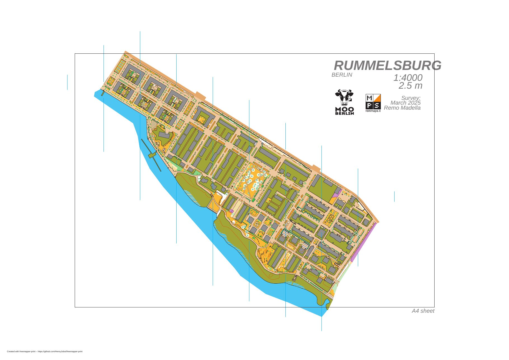

*Ausgabe von `render` für die Karte Rummelsburg: A3 quer in 1:4000, die ganze Karte auf einer Seite. Karte: Remo Madella, MOO Challenge Berlin 2025.*

Auch ein Bahnblatt kommt aus `export` (Kapitel 8). Für den Maßstab gelten dieselben Regeln wie bei einem
Layoutblatt. Ein Bahnblatt zeigt die Karte im Kartenausschnitt, darüber den Bahnaufdruck in Violett, den
Beschreibungskasten und die Blattelemente. Hat die Bahn eine Abdeckung für Fenster- oder Korridor-OL (Kapitel 11),
bleibt das Papier in der abgedeckten Fläche weiß; Bahnaufdruck, Beschreibungskasten, Titel, Kontrollstrecke und
Fußzeile druckt das Programm trotzdem vollständig. Für den Druck ändert das nichts. In einem PDF aus `--single-file` hat jede Seite das Papier ihres Layouts, und der Druckdialog muss
jede Seite in Originalgröße drucken.

### In Originalgröße drucken

Öffnen Sie das PDF und wählen Sie im Druckdialog 100 % oder „Tatsächliche Größe“. Schalten Sie „An Seite
anpassen“ und „Verkleinern auf Druckbereich“ aus. Jede andere Einstellung ändert den Maßstab, und die Karte
stimmt nicht mehr. Im Copyshop sagen Sie dasselbe: ohne Skalierung, 100 %, Papier wie im PDF.

### A4 oder A3

Ist die Karte größer als der Kartenausschnitt (bei `render` die Seite ohne 5 mm Rand), schneidet das Programm
sie ab und meldet es, zum Beispiel:

```
Warnung: Die Karte passt nicht auf die Seite. Sie ist 4,0 mm zu hoch für den bedruckbaren Bereich. Versuchen Sie ...
```

Die Zahl sagt, um wie viele Millimeter die Karte hinausragt, oben und unten zusammen. Gemessen wird an dem, was
tatsächlich gedruckt würde, also mit Linienbreiten, Punktsymbolen und Texten. Die Karte wird nicht verkleinert,
denn das würde den Maßstab verfälschen. Sie können ein größeres Papier nehmen (A3), einen Druckmaßstab mit größerer
Zahl oder in einem Layout mit `centre_map_mm` den Ausschnitt wählen und den Schnitt mit `map_frame.crop = true` als
gewollt kennzeichnen (Kapitel 6). Haben Sie die Ausrichtung selbst gewählt, nennt die Meldung auch die andere. Das
PDF entsteht auch bei einem Überstand, damit Sie nachsehen können, was fehlt.

### Wie groß die Symbole sind

Die Vorschrift der Kartenart legt die Symbolgrößen für einen Basismaßstab fest: 1:4000 für Sprintkarten
(ISSprOM), 1:15000 für Waldkarten (ISOM). Druckt man größer, wächst alles im selben Verhältnis, das Gelände
und jedes Symbol. Eine Sprintkarte in 1:3000, wie sie die Norm für die jüngsten Altersklassen empfiehlt, hat
Symbole in 133 %: Ein schmaler Fußweg ist dann 0,36 mm statt 0,27 mm breit. Eine Waldkarte wächst in 1:10000
auf 150 %, in 1:7500 auf 200 % und in 1:5000 auf 300 %. Die Karte braucht dabei entsprechend mehr Papier.

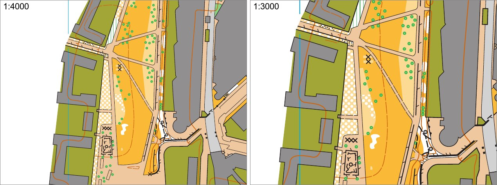

*Dieselbe Stelle der Karte in 1:4000 (links) und 1:3000 (rechts), je 80 mm × 60 mm aus einem A4-Blatt in Originalgröße. Karte: Remo Madella, MOO Challenge Berlin 2025.*

Kleiner als im Basismaßstab sieht die Norm keinen Druck vor. Das Programm druckt ihn trotzdem, etwa eine
Sprintkarte in 1:5000. Die Symbole behalten dann ihre Größe aus 1:4000, nur das Gelände schrumpft. Das Programm
warnt dabei:

```
Warnung: 1:5000 ist kein normgerechter Maßstab für Sprintkarten. Die Karte wird verkleinert, die Symbole
behalten ihre Größe im Maßstab 1:4000. Dieser Druck taugt nur fürs Training.
```

Das Programm kennt dafür die Kartenart (Sprintkarte, Schulhofkarte, Waldkarte). Bei `render` erkennt es sie aus
`freemapper.toml` oder aus der Kartendatei, sonst geben Sie sie mit `--kind` an. Im Projekt steht sie in
`map.kind`.

### Den Maßstab mit dem Lineal prüfen

Ein Layout zeigt eine Kontrollstrecke, wenn es ein Element `scale_check_bar` hat (Kapitel 7). `init` legt eines
an, und `check` meldet ein Layout ohne. Legen Sie das Lineal an den Balken: Bei
„200 m = 50 mm“ muss er genau 50 mm lang sein. Bei `render` fehlt die Kontrollstrecke. Messen Sie dann zwischen
zwei Punkten, deren Abstand Sie kennen, etwa zwei Gebäudeecken oder den Enden eines geraden Straßenstücks. Für
100 m muss das Lineal diese Werte zeigen:

| Druckmaßstab | 100 m auf der Karte |
|---|---|
| 1:4000 | 25 mm |
| 1:3000 | 33,3 mm |

Weicht das Maß ab, hat der Drucker skaliert. Prüfen Sie dann den Druckdialog. Die Beispiele
[examples/luebeck-scales](../../examples/luebeck-scales/README.md) und
[examples/luebeck-competition-layouts](../../examples/luebeck-competition-layouts/README.md) enthalten dieselbe
Karte in 1:4000 auf A4 und 1:3000 auf A3.

### Hinweise zum Druck der Karte

Diese Hinweise kommen von `render`, `check` und `export`:

- „… nicht gezeichnet, weil das Symbol unbekannt oder ausgeblendet ist“: Objekte, deren Symbol die Kartendatei
  ausblendet oder nicht kennt. Sie fehlen im PDF.
- „… vereinfacht oder gekürzt“: Ein Objekt braucht mehr Zeichenarbeit, als das Programm je Objekt zulässt. Es
  erscheint vereinfacht oder abgeschnitten.
- „… nicht gezeichnet, weil die Seite ihre Zeichengrenze erreicht hat“: Die ganze Seite braucht mehr
  Zeichenarbeit, als das Programm je Seite zulässt. Das passiert nur bei kaputten oder absichtlich überladenen
  Dateien.
- „… nicht gezeichnet, weil das Programm ihren Objekttyp nicht kennt“: Die Datei enthält Objekte einer Art,
  die OOM nicht schreibt. Sie fehlen im PDF.
- „… ohne Flächenmuster gezeichnet, dessen Abstand unter 0,05 mm liegt oder keine Zahl ist“: Die Kartendatei
  verlangt ein Flächenmuster, das dichter als 0,05 mm ist oder ungültige Zahlen hat. Das Programm lässt das
  Muster weg und druckt den Rest der Fläche.
- „Hinweis: … Die Kartenart kommt stattdessen aus der Kartendatei.“: Die Datei `freemapper.toml` neben der
  Karte ist kaputt. Das Programm bestimmt die Kartenart dann aus der Kartendatei. Eine Kartenart, die das
  Programm nicht kennt, ist kein Fehler: Auch dann entscheidet die Kartendatei, ohne Hinweis.
- „Die Schrift Arimo ersetzt …“: Das PDF enthält nur die Schrift Arimo. Andere Schriften der Karte ersetzt das
  Programm durch sie.
- „Die eingebettete Schrift kann diese Zeichen nicht darstellen …“: Ein Zeichen der Karte fehlt in Arimo und
  wird nicht gedruckt.
- „Die Fußzeile mit Quellenangaben und Namensnennung steht auf einem weißen Kasten … und deckt einen Teil der
  Karte ab“ (nur `render`): Die Fußzeile liegt unten links auf der Karte. Ein Projekt setzt sie unter die Karte.
- Den Informationsblock von freemapper (Titel, Maßstab, Maßstabsleiste, Namensnennung) druckt `render` nur mit
  `--show-sheet-objects`. Bei einem anderen Druckmaßstab skaliert er mit der Karte, ein darin gedruckter
  Maßstab kann also falsch sein. Die Nordlinien gehören zur Karte und stehen immer im PDF.

## 10. Meldungen und was zu tun ist

Dieses Kapitel erklärt die Hinweise zu den Blättern eines Layouts und einer Bahn. Die Hinweise zum Druck der Karte
selbst stehen in Kapitel 9. Keiner hält den Export auf. Jede Zeile, die mit „Hinweis:“ beginnt, lässt `check` mit
Exit-Code 1 enden; eine Zeile, die mit „Zur Information:“ beginnt, nicht.

| Hinweis (gekürzt) | Bedeutung und Abhilfe |
|---|---|
| „Die Karte passt nicht auf die Seite. Sie ist … zu hoch/zu breit …“ | Die Karte ist größer als der Kartenausschnitt und wird abgeschnitten. A3, ein anderer Maßstab, ein schmaleres Passepartout oder `centre_map_mm` für den gewünschten Ausschnitt. Ist der Schnitt gewollt, `map_frame.crop = true` setzen. |
| „Zur Information: Die Karte ist … für den Kartenausschnitt und wird dort mit Absicht beschnitten“ | Nur zur Information: Das Layout hat `map_frame.crop = true`. |
| „Das Passepartout ist zu schmal für die Fußzeile …“ | Die Fußzeile steht auf weißem Kasten in der Karte. `margin_mm` erhöhen, `print.copyright` kürzen oder die Zeilen mit `copyright_line`/`credit_line` woanders hinsetzen. |
| „Die Fußzeile … unten links deckt einen Teil des Elements … ab“ | Die Fußzeile mit ihrem weißen Kasten überdeckt ein Element unten links, unter oder im Kartenausschnitt. Das Element versetzen oder die Zeilen der Fußzeile mit einem Element `copyright_line` oder `credit_line` verschieben. Der Hinweis nennt, was die Fußzeile enthält: Quellenangaben, Namensnennung oder beides. |
| „Das Element … läge mit der Namensnennung nicht ganz auf dem Blatt“ | Das Element `credit_line` würde über den Blattrand ragen, deshalb bleibt die Namensnennung in der Fußzeile. Anker, Abstand und `size_pt` prüfen. |
| „Die Fußzeile … ragt über den Blattrand“ | Die Fußzeile reicht über das Blatt hinaus. Passepartout und Quellenangaben prüfen. |
| „Das Element … ragt über den Blattrand“ | Anker oder Abstand des Elements prüfen; ein Logo eventuell schmaler machen. |
| „Das Element … hängt am Blatt und deckt einen Teil des Kartenausschnitts ab“ | Ein Element am Blatt (`to = "page"`) liegt über der Karte. Ans Passepartout rücken oder an den Kartenausschnitt hängen, wenn es auf der Karte stehen soll. |
| „Das Papier ist größer als A3“ | Nur bei einer `page_mm` über A3. Eine Druckerei nimmt sie an, ein Bürodrucker nicht. |
| „Im Layout … fehlt ein Text mit {print_scale} …“ | Maßstab oder Äquidistanz stehen auf keinem Blattelement, oder `map.contour_interval_m` fehlt. Einen Titelblock oder Text mit dem Platzhalter ergänzen, den Wert eintragen. |
| „Layout … hat keine Kontrollstrecke“ | Das Layout zeigt kein Element `scale_check_bar`. Eines ergänzen (gemeinsam oder im Layout), damit ein Lineal am Ausdruck zeigt, ob der Drucker skaliert hat. |
| „Zur Information: Die Karte hat keine Nordlinien, deshalb wurden … Linien ergänzt“ | Nur zur Information, siehe Kapitel 6. `north_lines = "never"` schaltet das ab. |
| „… weder Nordlinien noch ein brauchbares Liniensymbol 601 …“ | Die Karte hat kein Symbol für Nordlinien. Das Programm zieht schwarze Linien von 0,14 mm über die Karte; sie liegen über allem. Besser: Nordlinien in OOM zeichnen. |
| „Layout … zeigt … von … Quellenangaben“ | Mehr als sechs Quellenzeilen. In `print.copyright` zusammenfassen. |
| „Die Quellenangabe ‚…‘ ist breiter als der Kartenausschnitt und wird mit ‚…‘ gekürzt“ | Die Zeile in den Kartennotizen oder in `print.copyright` kürzen oder auf zwei Zeilen verteilen. |
| „Das Logo … fehlt auf dem Blatt: …“ | Datei fehlt, ist kaputt, zu groß oder ein SVG mit nicht erlaubten Teilen, oder das Blatt trägt schon 50 Megapixel an Logos oder hat sein SVG-Budget aufgebraucht; der Grund steht dahinter. Siehe „Logo“ in Kapitel 7. |
| „Das Logo … wird vereinfacht gezeichnet: …“ | Verlauf, Transparenz, Strichelung oder Beschneidung im SVG. Das Logo erscheint, aber nicht ganz wie im Grafikprogramm. |
| „Der Text … enthält {…}. Das ist kein Platzhalter …“ | Tippfehler im Platzhalter. Die Liste steht in Kapitel 7. |
| „Layout … blendet den Kartenteil … aus, die Karte hat aber keinen Teil dieses Namens“ | Namen in `hide_parts` genau so schreiben wie in OOM, mit Groß- und Kleinschreibung. |

Fehler in der Projektdatei halten `check` und `export` an. Die Meldung nennt Datei, Zeile, Spalte und den
Schlüssel, etwa ``freemapper-print.toml:24:1: field `layouts[1].elements[0].width_mm`: a logo needs a `width_mm`
``. Fehlt der Schlüssel, nennt sie die Zeile der Tabelle, in die er gehört. Diese Texte kommen aus der Bibliothek
und sind vorerst Englisch. Nur die Meldung zu `hide_parts = ["base"]` (siehe „Die Grundfläche von Sprintkarten“ in
Kapitel 6) kommt schon auf Deutsch. Die Regeln für Abdeckungen und ihre Meldungen stehen in Kapitel 11.

### Hinweise zu den Bahnen

Diese Hinweise erscheinen, wenn das Projekt eine Bahndatei hat. Hinweise zur Bahndatei selbst stehen einmal vor
der ersten Bahn. Die Schlusszeile „Die Bahndatei selbst hat Hinweise. Sie stehen vor der ersten Bahn.“ sagt Ihnen,
dass einige Hinweise weiter oben zur Datei gehören und nicht zu einer Bahn. Eine Zeile mit „Zur Information:“ zählt
nicht für den Exit-Code.

| Hinweis (gekürzt) | Bedeutung und Abhilfe |
|---|---|
| „Zur Information: Die y-Achse der Bahndatei zeigt nach oben; das Programm hat sie zur Karte passend gedreht.“ | Nur zur Information. Die meisten Bahnlegungsprogramme schreiben sie so. |
| „Die Projektdatei setzt unter [sources] course_y_axis = "down", aber Purple Pen schreibt die y-Achse immer nach oben …“ | Die Bahn steht gespiegelt auf dem Blatt. Stammt die Datei aus Purple Pen, löschen Sie die Zeile. |
| „Die Bahn passt mit der y-Achse nach oben und nach unten auf die Karte, und nichts in der Datei entscheidet …“ | Nur bei IOF-XML. Die Bahn liegt dort, wo beide Lesarten passen, das Programm hat „oben“ angenommen. Sehen Sie sich ein Blatt an. Stimmt die Bahn, bestätigen Sie mit `course_y_axis = "up"` unter `[sources]`, steht sie auf dem Kopf, setzen Sie `"down"`. |
| „Zur Information: Die Bahndatei nennt keinen Kartenmaßstab, deshalb wurde er nicht mit dem der Karte verglichen.“ | Die Datei hat keinen Maßstab zum Vergleichen. Nichts zu tun, prüfen Sie aber, ob Sie die richtige Karte verknüpft haben. |
| „Zur Information: … eine Kartenposition und geografische Koordinaten. Beide weichen höchstens … m voneinander ab.“ | Die Prüfung mit den geografischen Koordinaten ist bestanden. |
| „Zur Information: Die geografischen Koordinaten wurden nicht geprüft, denn …“ | Es folgt der Grund: Die Karte ist nicht georeferenziert, ihr Koordinatensystem ist nicht UTM, kein Posten hat sowohl eine Kartenposition als auch geografische Koordinaten, oder die Projektdatei hat die Prüfung abgeschaltet. |
| „Zur Information: Die Projektdatei schaltet die Prüfung mit geografischen Koordinaten ab …“ | `course_georef_check = false` ist gesetzt. |
| „Zur Information: … nur geografische Koordinaten. Die Georeferenzierung der Karte hat sie platziert.“ | Für diese Posten hat die Bahndatei keine Kartenposition. Prüfen Sie einen davon auf dem Blatt. |
| „Zur Information: Die Bahndatei hat keine Postenbeschreibungen.“ | Die Datei ist IOF-XML oder eine `.ppen` ohne Beschreibungen. |
| „Die Bahndatei enthält das Element …, das diese Version nicht liest. Es fehlt auf den Blättern.“ | Das Element fehlt auf den Blättern. Sehen Sie in Ihrem Bahnlegungsprogramm nach, was es ist. |
| „Zur Information: Die Bahndatei hat Abdeckflächen (White-out). Jede deckt die Karte auf den Bahnen ab, für die sie gilt, außer wenn die Zuordnung einer Bahn eine eigene Abdeckung nennt.“ | Nur zur Information. Das White-out aus Purple Pen deckt die Karte auf den Bahnen ab, für die es in Purple Pen gilt. Prüfen Sie auf den Blättern, ob das so gewollt ist; eine eigene Abdeckung in der Zuordnung ersetzt es für diese Bahn. |
| „Die Bahn … hat Gabelungen oder Schleifen (Varianten in Purple Pen) … die Bahn fehlt deshalb.“ | Die Bahn fehlt mit Absicht. Exportieren Sie die Bahnen aus Purple Pen als IOF-XML, das jede Variante als eigene Bahn schreibt. |
| „Die Bahn … bietet an einer Stelle alternative Posten an … die Bahn fehlt deshalb.“ | Diese Version kann das nicht drucken. Teilen Sie die Bahn im Bahnlegungsprogramm auf. |
| „Zur Information: Die Bahnen … sind die Varianten der Gabelung …. Jede wird als eigenes Blatt gedruckt.“ | Nur zur Information. |
| „Zur Information: Die Kartenausgabe … dient als Start.“ | Eine Kartenausgabe wird als Start gelesen, ihre Zeile in der Postenbeschreibung fehlt deshalb. |
| „Zur Information: Die Bahndatei hat mehr Hinweise ergeben, als hier stehen.“ | Die Datei ist ungewöhnlich oder beschädigt. Die gezeigten Hinweise sind die ersten. |
| „Zur Information: Die Bahn … hat keine Zuordnung und wird auf dem ersten Layout gedruckt, …“ | Legen Sie einen Eintrag `[[assignments]]` an, wenn ein anderes Layout gemeint ist. |
| „Die Projektdatei ordnet die Bahn … einem Layout zu, die Bahndatei hat aber keine solche Bahn. Die Zuordnung bleibt …“ | Die Bahn wurde in der Bahndatei umbenannt oder gelöscht. Korrigieren Sie den Namen in der Projektdatei oder löschen Sie den Eintrag. |
| „Die Projektdatei korrigiert die Nummer von Posten … für …, die Bahndatei hat dort aber keinen solchen Posten. Die Korrektur bleibt …“ | Der Posten wurde umnummeriert oder entfernt, oder er gehört nicht zu dieser Bahn. Korrigieren Sie den Code oder löschen Sie den Eintrag. |
| „Die Bahndatei hat die Nummer von Posten … verschoben, seit die Projektdatei sie korrigiert. Prüfen Sie, ob die Korrektur noch passt.“ | Jemand hat die Nummer im Bahnlegungsprogramm verschoben, nachdem Sie die Korrektur gemacht haben. Sehen Sie sich das Blatt an. Passt die Korrektur noch, bleibt der Hinweis, bis Sie den Eintrag löschen und mit `numbers accept --direction … --gap …` neu schreiben. Passt sie nicht, löschen Sie den Eintrag. |
| „Zur Information: Keine Bahn nutzt die Abdeckung … Nennen Sie sie in einer Zuordnung …“ | Ein Eintrag `[[masks]]` gilt für keine Bahn. Keine Zuordnung nennt ihn mit `mask`, und keine Abdeckfläche der Bahndatei hat seine ID. Tragen Sie `mask = "…"` in die Zuordnung der Bahn ein, oder löschen Sie den Eintrag. Der Hinweis kommt einmal je Lauf. |
| „Die Projektdatei gibt der Bahn … die Abdeckung …, aber die Bahndatei hat keine solche Abdeckfläche (White-out). …“ | Die Zuordnung nennt eine Abdeckfläche aus Purple Pen, die es in der Bahndatei nicht mehr gibt. Die Bahn wird ohne Abdeckung gedruckt. Korrigieren Sie die Nummer, nennen Sie eine eigene Abdeckung, oder löschen Sie die Zeile `mask`. |
| „Zur Information: Die Bahn … wird mit der Abdeckfläche whiteout-… aus der Bahndatei gedruckt, die um … liegt …“ und „Zur Information: Auf dem Blatt der Bahn … tritt die Tabelle [[masks]] mit der ID whiteout-… an die Stelle der Abdeckfläche …“ | Die Projektdatei nennt eine Abdeckfläche mit ihrer Nummer, und die Nummer ist Purple Pens eigene Nummer der Fläche. Sehen Sie in OOM nach, ob die Fläche um diesen Punkt die gemeinte ist. |
| „Die Bahndatei hat keine Bahn zum Exportieren, deshalb wurde kein PDF geschrieben.“ | Die Datei hat keine Bahn, oder jede Bahn fehlt. Siehe die Hinweise davor. |

Hinweise zum Blatt einer Bahn:

| Hinweis (gekürzt) | Bedeutung und Abhilfe |
|---|---|
| „Auf dem Blatt der Bahn … liegt Posten … außerhalb des Kartenausschnitts oder auf seinem Rand.“ | Der Ausschnitt zeigt nicht die ganze Bahn. Nehmen Sie größeres Papier oder einen Druckmaßstab mit größerer Zahl, oder verschieben Sie den Ausschnitt mit `map_frame.centre_map_mm`. |
| „Zur Information: Die Karte ist … für den Kartenausschnitt. Ein Bahnblatt zeigt den Teil um die Bahn …“ | Nur zur Information. Ein Bahnblatt schneidet die Karte mit Absicht. |
| „Zur Information: Die Bahn … kommt aus IOF-XML. Das Format kennt keine Postenbeschreibungen, das Blatt hat deshalb keine.“ | Nur zur Information. Für Beschreibungen nehmen Sie die `.ppen`. |
| „Zur Information: Das Layout der Bahn … hat kein Element control_descriptions …“ | Nur zur Information. Fügen Sie dem Layout das Element hinzu, wenn Sie den Kasten wollen. |
| „Die Postenbeschreibung der Bahn … würde über den Blattrand reichen und fehlt deshalb …“ | Versetzen Sie sie über ihren Anker oder verkleinern Sie sie mit `cell_mm`. |
| „Kein Posten der Bahn … hat in der Bahndatei eine Beschreibung … Tragen Sie die Beschreibungen in Purple Pen ein.“ | Tragen Sie die Beschreibungen in Purple Pen ein. |
| „Das Element … deckt den Posten … der Bahn ab. Versetzen Sie das Element über seinen Anker …“ | Ein Titelblock, Logo, Text, eine Fußzeile oder der Kasten liegt auf einem Posten, dem Start oder dem Ziel. Versetzen Sie das Element. |
| „Die Postenbeschreibung der Bahn … nutzt das Symbol …, das der Beschreibungsstandard der Bahndatei nicht kennt. Sein Kästchen bleibt leer.“ | Die Symbol-ID gibt es im Standard der Datei (2004, 2018 oder 2024) nicht. Wählen Sie in Purple Pen ein anderes Symbol. |
| „Der Bahnaufdruck der Bahn … verlangt mehr Schraffurlinien, Striche oder Kreuze, als ein Blatt zeichnet, deshalb fehlen einige.“ | Ein Sonderobjekt ist sehr groß, oder die Datei ist beschädigt. Verkleinern oder teilen Sie die Fläche. |
| „Die Bahn … hat … Abdeckungen, ein Blatt wendet höchstens 1000 an. Die übrigen fehlen …“ | Meist hat die Bahndatei sehr viele Abdeckflächen (White-out). Fassen Sie sie in Purple Pen zu wenigen größeren zusammen, oder geben Sie der Bahn in der Zuordnung eine eigene Abdeckung. |
| „Auf dem Blatt der Bahn … liegen die Posten … dort, wo die Abdeckung die Karte verbirgt …“ | Der Mittelpunkt dieser Posten (auch Start, Ziel oder Kartenwechsel) liegt im Kartenausschnitt in einer abgedeckten Fläche. Die Läufer sähen um den Kreis keine Karte. Beim Fenster-OL fehlt meist ein Fenster; ergänzen Sie es in der Abdeckung. Prüfen Sie auch, ob die Zuordnung die richtige Abdeckung nennt. |
| „Auf dem Blatt der Bahn … liegt eine Pflichtstrecke ganz oder teilweise dort, wo die Abdeckung die Karte verbirgt …“ | Der Hinweis zählt je Art, was vom Bahnaufdruck in einer abgedeckten Fläche liegt: Pflichtstrecken (auch abgeflaggte Strecken zwischen Posten), Querungsstellen, verbotene Strecken, Sperrgebietsgrenzen, Sperrgebiete, Gefahrengebiete und Texte aus der Bahndatei. Gedruckt wird alles, aber ohne Karte darunter. Vergrößern Sie das Fenster oder legen Sie eines an. Ist es gewollt, etwa ein Sperrgebiet am Rand, können Sie den Hinweis stehen lassen. Gewöhnliche Strecken und Postennummern zählen nicht, denn beim Fenster-OL laufen sie ohnehin über abgedeckte Flächen. |
| „Die Abdeckung … verbirgt den ganzen Kartenausschnitt der Bahn …, das Blatt zeigt also gar keine Karte.“ | Kein Fenster der Abdeckung liegt im Kartenausschnitt. Meist sind die Punkte in der falschen y-Richtung geschrieben: Abdeckungen nehmen Karten-mm mit der y-Achse nach oben, wie die Statusleiste von OOM sie zeigt, nicht wie die `.omap`-Datei sie speichert. |
| „Auf dem Blatt der Bahn … deckt das Element … einen Teil der Fenster der Abdeckung … ab.“ | Ein Blattelement, meist der Beschreibungskasten, oder die Fußzeile liegt im Kartenausschnitt über einem Fenster. Beim Fenster-OL sind die Fenster die einzige Karte, die der Läufer hat, und das Element nimmt ihm einen Teil davon. Versetzen Sie das Element über seinen Anker, oder legen Sie das Fenster anders, mit einem anderen Radius oder um einen anderen Posten. |
| „Zur Information: Die Abdeckung … verbirgt im Kartenausschnitt der Bahn … nichts.“ | Nur zur Information. Die Abdeckung liegt ganz neben dem Ausschnitt, oder der Ausschnitt liegt ganz in einem Fenster. Ist das nicht gewollt, prüfen Sie die Punkte wie im Hinweis davor. |
| „Zur Information: Im Kartenausschnitt der Bahn … verbergen die … Abdeckflächen … aus der Bahndatei nichts.“ | Dasselbe für Abdeckflächen aus Purple Pen, in einer Zeile je Bahn mit ihrer Zahl und ihren IDs (die ersten zehn, der Rest gezählt). Eine Abdeckfläche für alle Bahnen liegt oft neben dem Ausschnitt der meisten. |
| „Auf dem Blatt der Bahn … hat die Prüfung gegen die Abdeckung ihre Grenze erreicht …“ | `check` prüft je Blatt höchstens 200 000 Punkte und 50 Millionen Rechenschritte. Eine Bahn mit sehr langen Pflichtstrecken oder Tausenden Abdeckflächen kommt darüber; was danach kommt, bleibt ungeprüft. Sehen Sie sich das Blatt an. |
| „Zur Information: Der Text … nutzt …, die Bahndatei hat für die Bahn … aber keinen Wert. Der Platzhalter bleibt leer.“ | Die Datei hat für die Bahn keine Länge oder keinen Anstieg. Tragen Sie sie im Bahnlegungsprogramm ein oder lassen Sie den Platzhalter aus dem Text weg. |
| „Zur Information: Der Text … nutzt …, der nur auf Bahnblättern gefüllt wird. Auf diesem Blatt bleibt er leer.“ | Ein gemeinsamer Text mit `{course}` oder ähnlichem steht auf einem Blatt ohne Bahn. Blenden Sie den Text auf diesem Layout mit `hide_shared` aus. |
| „Auf dem Blatt der Bahn … überdeckt die Nummer von Posten … Sie wird trotzdem dort gedruckt. …“ | Die Nummer liegt auf dem Bahnaufdruck, einem Blattelement, dem Rand des Kartenausschnitts oder einem Punkt- oder Liniensymbol der Karte. Der Hinweis schlägt eine freie Richtung und einen Abstand vor. Übernehmen Sie sie mit `numbers accept` (siehe Kapitel 8). |
| „… Das Blatt hat seine Suchgrenze erreicht, deshalb gibt es keinen Vorschlag. …“ | Die Nummer hat einen Konflikt, aber die Suche nach Plätzen war schon beendet. Setzen Sie eine Lage mit `numbers accept --direction … --gap …`. |
| „Auf dem Blatt der Bahn … hat die Suche nach Plätzen für die Postennummern ihre Grenze erreicht. …“ | Die Bahn hat Hunderte Posten dicht beieinander. Die Nummern, zu denen die Suche nicht mehr kam, bleiben, wo ihre Ebene sie hinsetzt. Sehen Sie sich das Blatt an und korrigieren Sie Nummern von Hand. |
| „… steht die Nummer von Posten … mm vom Kreis entfernt. Das Regelprofil erlaubt … bis … mm.“ | Der Abstand aus der Datei oder einer Korrektur liegt außerhalb der Spanne des Regelprofils. Die Nummer wird so gedruckt. Ändern Sie ihn unter `[[numbers]]`. |

### Fehler mit der Bahndatei

Ein Fehler hält `check` und `export` an. Die Zeile beginnt mit „Die Bahndatei lässt sich nicht verwenden“ oder „die
Bahndatei … ließ sich nicht lesen“, danach folgt der Grund. Die Gründe beim Lesen der Datei sind englisch:

- „invalid course file: …“: Das XML ist beschädigt oder es fehlt etwas, das das Format verlangt, etwa die ID eines
  Postens. Öffnen Sie die Datei im Bahnlegungsprogramm und speichern Sie sie neu.
- „course file too large or too complex: …“: Die Datei überschreitet eine der Grenzen, die das Programm vor
  feindlichen Dateien schützen. Teilen Sie die Veranstaltung auf mehrere Dateien auf.
- „… uses unit …; only mm is supported“: Das IOF-XML gibt Positionen in einer anderen Einheit an. Exportieren Sie es
  mit Millimetern.
- „unknown file type; use `.ppen` (Purple Pen) or `.xml` (IOF XML 3.0)“: Die Endung von `[sources] courses` ist
  keine von beiden.

Die Gründe der Einpassung sind die Fehler aus dem Abschnitt über Koordinaten in Kapitel 8, ebenfalls englisch:

- „the course file is drawn for 1:…, the map is 1:…; export the courses for the map's scale“
- „the course file is drawn for 1:…, and the map states no scale; set the map's scale in the map file“
- „only … of … controls lie on the map; the course file belongs to another map, uses another origin or another y axis“
- „control … lies … m from where its lat/lng put it (20 m allowed); the course file does not match the map's georeferencing“
- „controls … have only lat/lng and cannot be placed: …“

Fehler von `export` und `numbers accept` zu Namen:

- „Die Bahndatei hat keine Bahn …; vorhanden sind …“: Der Name hinter `--course` steht nicht in der Datei.
- „--course und --single-file brauchen eine Bahndatei, das Projekt nennt aber keine unter [sources] courses“:
  Ergänzen Sie den Schlüssel `courses`.
- „die Bahn … hat keinen Posten …; ihre Posten sind …“: Der Code für `numbers accept` gehört nicht zur Bahn.
- „für Posten … auf dem Blatt der Bahn … gibt es keinen Vorschlag, denn seine Nummer hat keinen Konflikt. Mit
  --direction und --gap setzen Sie eine Lage selbst.“: Es gibt nichts zu korrigieren. Geben Sie beide Werte an, wenn
  Sie die Nummer trotzdem versetzen wollen.
- „die Projektdatei hat für Posten … schon eine Korrektur für …. Ändern Sie sie in der Datei …“: Bearbeiten Sie den
  Eintrag.
- „der Vorschlag für Posten … stammt vom Blatt der Bahn … und ist auf dem Layout … nicht für jede Bahn frei …“:
  `--layout-wide` würde einen Konflikt auf die genannten Bahnen bringen. Nehmen Sie `--sheet`, oder geben Sie
  `--direction` und `--gap` an.
- „--direction braucht eine endliche Zahl, und --gap muss größer als 0 und höchstens … mm sein“.
- „das Projekt … lässt sich mit der neuen Korrektur nicht laden, deshalb blieb es unverändert“: Das Programm hat die
  Datei wiederhergestellt. Melden Sie das, denn es sollte nicht vorkommen.

## 11. Abdeckungen für Fenster- und Korridor-OL

Beim Fenster-OL zeigt das Blatt die Karte nur in kleinen Fenstern um die Posten, dazwischen ist das Papier weiß.
Die Läufer überbrücken die Lücken mit Kompass und Entfernungsgefühl und lesen erst im nächsten Fenster wieder
Karte.

Beim Korridor-OL zeigt das Blatt die Karte nur in einem schmalen Streifen, und alle Posten liegen darin. Wer den
Korridor verlässt, hat keine Karte mehr, also muss man die Richtung genau halten.

Für beides gibt es in der Projektdatei Abdeckungen (`[[masks]]`). Eine Abdeckung verbirgt die Karte in einer
Fläche. Sie gehört zur Zuordnung einer Bahn und gilt nur auf deren Blatt. Nie abgedeckt werden der Bahnaufdruck
(Start, Posten, Strecken, Nummern, Ziel und die Sonderobjekte), der Beschreibungskasten, der Titelblock, die
Kontrollstrecke, andere Blattelemente, die Rahmenlinie und die Fußzeile. Auch die Strecken zwischen den Fenstern
druckt das Programm immer, denn die Läufer brauchen die Richtung, und ohne die Linie gewinnt das Training nichts.

Zwei Beispiele gehen alles mit jedem Befehl durch:
[examples/luebeck-training-window](../../examples/luebeck-training-window/README.md) für Fenster-OL und
[examples/luebeck-training-corridor](../../examples/luebeck-training-corridor/README.md) für Korridor-OL.

### Die Abdeckung in der Projektdatei

```toml
[[assignments]]
course = "Fenster"
layout = "a4-4000"
mask = "halbe-karte"

[[masks]]
id = "halbe-karte"
polygons = [
    [
        [[0.0, -110.0], [150.0, -110.0], [150.0, 110.0], [0.0, 110.0]],
        [[40.0, -75.0], [60.0, -75.0], [60.0, -55.0], [40.0, -55.0]],
        [[70.0, 0.0], [90.0, 0.0], [90.0, 25.0], [70.0, 25.0]],
    ],
]
```

Diese Abdeckung verbirgt auf dem Blatt der Bahn „Fenster“ aus luebeck-training-window die östliche Hälfte der
Karte und lässt darin zwei eckige Fenster offen.

- `id` ist der Name der Abdeckung: 1 bis 64 Zeichen, keine Steuerzeichen, in der Datei nur einmal.
- `polygons` ist eine Liste von Polygonen. Jedes Polygon ist eine Liste von Ringen, jeder Ring eine Liste von
  Punkten `[x, y]`. Der erste Ring ist der Umriss, jeder weitere ein Loch, also ein Fenster. Den ersten Punkt am
  Ende zu wiederholen ist nicht nötig. Ob ein Ring im oder gegen den Uhrzeigersinn läuft, ist gleich.
- Abgedeckt ist, was im Umriss liegt und in keinem seiner Löcher. Außerhalb jedes Umrisses und in jedem Loch zeigt
  das Blatt die Karte. Löcher dürfen sich überlappen, sie verschmelzen dann zu einem Fenster. Das gilt für
  Abdeckungen, die Sie selbst schreiben; `masks window` hält seine Fenster auseinander, siehe unten.
- Die Punkte sind Millimeter auf der Karte im Kartenmaßstab mit der y-Achse nach oben, genau so, wie OOM sie in
  der Statusleiste anzeigt, wenn die Koordinatenanzeige auf Kartenkoordinaten steht. Das ist dieselbe Regel wie
  bei `centre_map_mm` (Kapitel 6). Die `.omap`-Datei speichert y nach unten. Wer Punkte von dort kopiert, bekommt
  eine gespiegelte Abdeckung, und `check` meldet dann meist, dass die Abdeckung den ganzen Kartenausschnitt
  verbirgt oder nichts.
- In `[[assignments]]` nennt `mask` die Abdeckung, mit der die Bahn gedruckt wird. Eine Bahn hat höchstens eine
  Abdeckung, mehrere Bahnen dürfen dieselbe nutzen. Eine Bahn ohne `mask` bekommt die Abdeckflächen (White-out)
  ihrer Bahndatei, siehe unten.

Eine Abdeckung, die keine Bahn nutzt, meldet `check` einmal als Information.

### Fenster um die Posten: `masks window`

Den Normalfall des Fenster-OL schreibt das Programm selbst: ein rundes Fenster um jeden Posten einer Bahn.

```sh
freemapper-print masks window stadtsprint --course A --radius 15 --assign
```

| Option | Bedeutung |
|---|---|
| `--course <NAME>` | die Bahn, wie in der Bahndatei. Ihre Posten bekommen die Fenster, ihr Layout gibt den Druckmaßstab. Pflicht. |
| `--controls <LISTE\|BEREICH>` | welche Posten ein Fenster bekommen: Codes mit Kommas dazwischen (`31,32,35`) oder die Postennummern auf dem Blatt als Bereich (`3-6`). Im Bereich zählen Start und Ziel nicht mit. Ohne Angabe jeder Posten. Start und Ziel bekommen ihr Fenster in jedem Fall. |
| `--radius <MM>` | Radius jedes Fensters, 1 bis 100 mm. Ohne Angabe 15. |
| `--radius-for <CODE=MM>` | eigener Radius für einen Posten, etwa `35=20`. Der Start hat meist den Code `STA1`, das Ziel `FIN1`. Darf mehrmals stehen, nur für Posten, die ein Fenster bekommen. |
| `--gap <MM>` | kleinster Abstand zwischen den Rändern zweier Fenster, 1 bis 100 mm. Ohne Angabe 3. |
| `--no-start` | der Start bekommt kein Fenster |
| `--no-finish` | das Ziel bekommt kein Fenster |
| `--id <ID>` | ID der neuen Abdeckung. Ohne Angabe `window-<Bahn>`, mit angehängter Nummer (`-2`, `-3` …), wenn es die schon gibt. |
| `--assign` | die Bahn wird mit der neuen Abdeckung gedruckt: Ihre Zuordnung bekommt `mask`, oder eine neue Zuordnung kommt hinzu. |

Der Radius gilt in Millimetern auf dem Papier, im Druckmaßstab des Layouts, auf dem die Bahn gedruckt wird. Ein
Fenster sieht deshalb in jedem Maßstab gleich groß aus und zeigt bei größerem Maßstab weniger Gelände: 15 mm sind
bei 1:4000 60 m, bei 1:3000 45 m. Das Programm rechnet den Radius selbst in Karten-mm um, und die Abdeckung
behält die Karten-mm. Ändern Sie später den Druckmaßstab des Layouts oder geben Sie die Abdeckung einer Bahn auf
einem Layout mit anderem Maßstab, haben die Fenster nicht mehr den gewünschten Radius. Löschen Sie dann die
Abdeckung und rufen Sie den Befehl noch einmal auf. Der Kommentar über der Tabelle nennt den Maßstab, für den sie
entstand.

Auch Start und Ziel bekommen ein Fenster, damit sich die Läufer am Start orientieren können. `--no-start` und
`--no-finish` lassen sie weg; dann sagt der Befehl das, und `check` meldet sie unter der Abdeckung. Ein Fenster ist
ein Vieleck mit mindestens 48 Ecken, das höchstens 0,05 mm vom Kreis abweicht. Der Umriss ist ein Rechteck 100 mm
außerhalb der Karte, sodass kein Teil der Karte daran vorbeischaut.

Die Fenster überlappen nicht. Zwischen den Rändern zweier Fenster bleibt mindestens der Abstand von `--gap` frei,
in Millimetern auf dem Papier wie der Radius. Ohne Angabe sind es 3 mm, bei 1:4000 also 12 m im Gelände. Liegen zwei
Posten dafür zu nah, werden beide Fenster kleiner, bis genau dieser Abstand bleibt. Jedes gibt im Verhältnis seines
gewünschten Radius nach, auch ein Fenster mit eigenem Radius aus `--radius-for`, und Start und Ziel zählen wie jedes
andere Fenster. Hat ein Fenster mehrere Nachbarn, die zu nah liegen, kommt das engste Paar zuerst dran; die anderen
teilen sich den Platz, der dann bleibt. Für jedes verkleinerte Fenster schreibt der Befehl eine Zeile, und der
Kommentar über der Tabelle wiederholt sie.

Kleiner als 5 mm Radius wird kein Fenster, sonst passt der Postenkreis nicht mehr hinein. Bräuchte der Abstand das,
schreibt der Befehl nichts, nennt die beiden Posten und ihren Abstand auf dem Papier und endet mit Exit-Code 2.
Lassen Sie dann einen der beiden weg, mit `--controls`, `--no-start` oder `--no-finish`, oder geben Sie einen
kleineren `--gap` an; die Meldung nennt den größten, der noch passt. Eine Abdeckung, die Sie von Hand schreiben,
prüft das Programm nicht auf den Abstand. Dort dürfen Fenster überlappen.

Die Ausgabe aus luebeck-training-window:

```
Abdeckung „window-Fenster“ in ./freemapper-print.toml eingetragen: 10 Fenster mit 15 mm Radius auf dem Papier bei 1:4000 um den Start, die Posten 43, 34, 41, 42, 38, 35, 50 und 37 und das Ziel der Bahn „Fenster“, mindestens 3 mm auseinander.
Posten 34 hat ein Fenster mit 20 mm Radius.
Posten 50 hat ein Fenster mit 11,21 mm Radius statt 15 mm, damit der Abstand bleibt.
Das Ziel hat ein Fenster mit 11,21 mm Radius statt 15 mm, damit der Abstand bleibt.
Die Bahn „Fenster“ wird jetzt damit gedruckt, auf Layout a4-4000.
Mit check sehen Sie das Ergebnis.
```

Posten 50 und das Ziel liegen 25,4 mm auseinander. Die Abdeckung im Beispielprojekt entstand, bevor die Fenster
einen Abstand hielten, und dort überlappen die beiden Fenster noch.

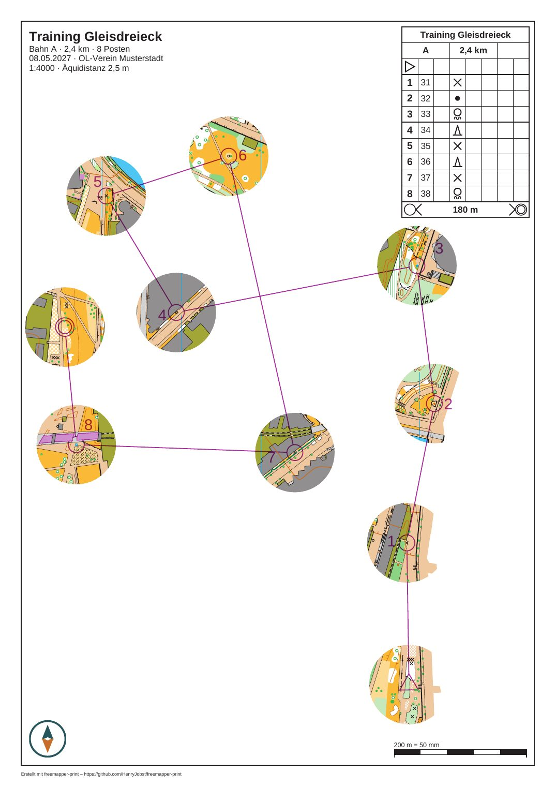

*Die Bahn „A“ mit Abdeckung für Fenster-OL (`masks window --radius 14 --assign`): Die Karte ist nur in den Fenstern um Start, Posten und Ziel zu sehen. Karte: Remo Madella, MOO Challenge Berlin 2025.*

### Ein Korridor entlang einer Linie: `masks corridor`

Einen automatischen Korridor gibt es nicht. Kein Regelwerk legt fest, wo ein Korridor verläuft; das entscheidet
der Bahnleger. Sie geben die Linie vor, das Programm macht daraus den Streifen.

```sh
freemapper-print masks corridor stadtsprint --points "-92,2.3;-60,4.4;-28,-2.5;-15.5,58.5" --width 12 --assign --course A
```

| Option | Bedeutung |
|---|---|
| `--points <X,Y;X,Y;…>` | die Linie als Punkte in Karten-mm mit der y-Achse nach oben, wie OOMs Statusleiste sie zeigt, Dezimalstellen mit Punkt. Mindestens 2 verschiedene Punkte, höchstens 1000. Pflicht. |
| `--width <MM>` | Breite des Korridors, 1 bis 100 mm. Ohne Angabe 10. |
| `--course <NAME>` | die Bahn, deren Layout den Druckmaßstab für die Breite gibt |
| `--assign` | die Bahn aus `--course` wird mit dem Korridor gedruckt. Braucht `--course`. |
| `--id <ID>` | ID der neuen Abdeckung. Ohne Angabe `corridor-<n>` mit der ersten freien Nummer. |

Die Punkte suchen Sie in OOM: Zeigen Sie auf eine Stelle der Straße und lesen Sie die beiden Zahlen in der
Statusleiste ab, genau wie für `centre_map_mm`. Setzen Sie einen Punkt an jede Kreuzung und an jeden Knick und
achten Sie darauf, dass jeder Posten der Bahn im Korridor liegt.

Auch die Breite gilt in Millimetern auf dem Papier: mit `--course` im Druckmaßstab des Layouts dieser Bahn, sonst
im Druckmaßstab, den alle Layouts gemeinsam haben. Drucken die Layouts in verschiedenen Maßstäben, verlangt der
Befehl `--course`. Wie beim Radius behält die Abdeckung die Breite in Karten-mm. Nach einem neuen Druckmaßstab
löschen Sie die Abdeckung und rufen den Befehl noch einmal auf. Der Korridor reicht die halbe Breite zu jeder Seite der Linie und ist an seinen Enden gerade
abgeschnitten. Ein Knick bis 120° behält außen eine spitze Ecke, ein schärferer wird abgeschrägt. Das Programm
lehnt einen Korridor ab, der auf sich selbst zurückläuft, ein Stück hat, das für den Knick an seinem Ende zu kurz
ist, oder sich selbst kreuzt. Vereinfachen Sie dann die Linie an der genannten Stelle oder nehmen Sie eine
kleinere Breite. Das Programm repariert die Linie nicht selbst.

Der Kommentar über der neuen Tabelle wiederholt die Punkte als `--points "…"`, damit Sie den Befehl später wieder
aufrufen können. Eine Abzweigung oder einen zweiten Korridor für dieselbe Bahn schreibt der Befehl nicht. Rufen Sie
ihn dafür ohne `--assign` mit `--id` für jedes Stück auf und kopieren Sie danach den zweiten Ring (das Loch) des
einen Stücks in das Polygon des anderen. Löcher dürfen sich überlappen. Die Tabelle, die Sie dann nicht mehr
brauchen, löschen Sie.

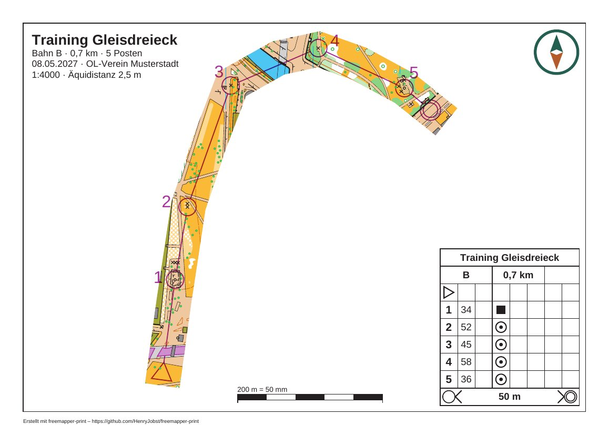

*Die Bahn „B“ mit Korridor-Abdeckung (`masks corridor --width 12`) auf einem Blatt von 210 mm × 150 mm (`page_mm`). Karte: Remo Madella, MOO Challenge Berlin 2025.*

### Was beide Befehle in die Datei schreiben

Beide hängen die neue Tabelle `[[masks]]` als Text ans Ende der Projektdatei, mit einem Kommentar, wie sie
entstand. Mit `--assign` bekommt die Zuordnung der Bahn eine Zeile `mask = "…"` direkt unter ihrer Kopfzeile
`[[assignments]]`, oder eine neue Zuordnung folgt nach der Tabelle. Alles andere bleibt, wie es ist, auch die
Kommentare und die Zeilenenden. Danach lädt das Programm die Datei neu und stellt den alten Inhalt wieder her, wenn
das scheitert.

Eine vorhandene Abdeckung ändern die Befehle nie. Eine ID, die es schon gibt, und eine Bahn, die schon mit einer
anderen Abdeckung gedruckt wird, lehnen sie mit Exit-Code 2 ab. Für einen neuen Radius oder eine neue Linie löschen
Sie die Tabelle und die Zeile `mask = "…"` und rufen den Befehl noch einmal auf. Danach zeigt `check` das Ergebnis.

### Abdeckflächen aus Purple Pen

Purple Pen kennt Abdeckflächen (White-out). Das Programm druckt sie als Abdeckungen mit den IDs `whiteout-<n>`, wobei n die Nummer
ist, die Purple Pen der Fläche gegeben hat (nicht immer 1, 2 …), auf den Bahnen, für die sie in Purple Pen gelten. Eine Bahn ohne
`mask` in ihrer Zuordnung bekommt jede ihrer Abdeckflächen, jede für sich, auch wenn sie sich überlappen.
`check` nennt die Abdeckflächen einmal zur Information.

- Nennt die Zuordnung einer Bahn eine eigene Abdeckung, gilt nur diese, und die Abdeckflächen fallen für diese
  Bahn weg.
- `mask = "whiteout-101"` druckt die Bahn nur mit der Abdeckfläche mit der Nummer 101.
- Eine Tabelle `[[masks]]` mit der ID `whiteout-101` tritt an die Stelle der Abdeckfläche mit der Nummer 101.
- Hat die Bahndatei die genannte Abdeckfläche nicht mehr, meldet `check` das, und die Bahn wird ohne Abdeckung
  gedruckt. Die Zuordnung bleibt in der Projektdatei.

Die Nummer in `whiteout-<n>` ist Purple Pens eigene Nummer der Fläche. Sie bleibt, wenn Sie eine andere
Abdeckfläche löschen oder die Reihenfolge ändern. Nur eine Bahndatei ohne solche Nummern (nicht aus Purple Pen 4)
fällt auf die Stelle in der Datei zurück; dann kann `whiteout-2` nach einem Löschen eine andere Fläche meinen. Prüfen Sie nach einer solchen Änderung die Zuordnungen und die Tabellen `[[masks]]`. Dabei hilft `check` mit
einer Zeile zur Information für jede Bahn, deren Zuordnung eine Abdeckfläche mit ihrer Nummer nennt oder auf deren
Blatt eine Tabelle `[[masks]]` an die Stelle einer Abdeckfläche tritt. Die Zeile nennt die Mitte der Fläche in
Karten-mm mit der y-Achse nach oben, so finden Sie sie in OOM.

Ein Blatt wendet höchstens 1000 Abdeckungen an. Hat eine Bahn mehr Abdeckflächen, fehlen die übrigen, und `check`
warnt.

### Was `check` zu Abdeckungen meldet

`check` prüft jedes Blatt gegen die Abdeckungen, die es anwendet. Die Meldungen stehen mit ihrer Abhilfe in
Kapitel 10; hier, wann sie kommen:

- Ein Posten, der Start, das Ziel oder ein Kartenwechsel liegt mit seinem Mittelpunkt in einer abgedeckten Fläche
  (Hinweis). Beim Fenster-OL fehlt meist ein Fenster, beim Korridor-OL liegt der Posten neben dem Korridor. Ergänzen
  Sie das Fenster, verlegen Sie die Linie, oder prüfen Sie, ob die Zuordnung die richtige Abdeckung nennt.
- Pflichtstrecken, Querungsstellen, verbotene Strecken, Sperrgebiete und ihre Grenzen, Gefahrengebiete oder Texte
  der Bahndatei liegen ganz oder teilweise unter der Abdeckung (Hinweis, je Art mit ihrer Zahl). Der Läufer sähe
  sie ohne Karte darunter. Vergrößern Sie ein Fenster oder legen Sie eins an; ist es gewollt, lassen Sie den
  Hinweis stehen. Gewöhnliche Strecken und Postennummern zählen nicht.
- Die Abdeckung verbirgt den ganzen Kartenausschnitt (Hinweis). Meist ist y falsch herum geschrieben.
- Ein Blattelement oder die Fußzeile deckt im Kartenausschnitt einen Teil eines Fensters ab (Hinweis).
- Die Abdeckung verbirgt im Kartenausschnitt nichts (Information). Abdeckflächen aus Purple Pen, die nichts
  verbergen, stehen in einer Zeile je Bahn.
- Die Prüfung hat ihre Grenze erreicht, höchstens 200 000 Punkte und 50 Millionen Rechenschritte je Blatt
  (Hinweis). Sehen Sie sich das Blatt an.
- Keine Bahn nutzt eine Abdeckung (Information, einmal je Lauf).

### Grenzen

Was das Programm noch nicht kann:

- Es legt keinen Korridor von selbst und keine Fenster um Strecken. Andere Formen als Kreise und Korridore
  schreiben Sie von Hand.
- Die Befehle ändern und ersetzen keine Abdeckung. Der Editor (Kapitel 12) zeichnet Abdeckungen, ersetzt aber auch keine;
  zum Ändern bearbeiten Sie die Datei oder nehmen eine neue Kennung.
- Ein Layoutblatt ohne Bahn (`export --layout`) hat keine Abdeckung.
- Nordlinien, die das Programm ohne Symbol 601 im Symbolsatz ergänzt, liegen auf der Blattebene und bleiben über
  dem abgedeckten Papier sichtbar (Kapitel 6, „Nordlinien“). Die Nordlinien der Karte verschwinden mit der Karte.
- Eine Abdeckfläche aus Purple Pen, deren Ring sich selbst kreuzt, prüft das Programm nicht. Eine Schleife, die
  gegen den Rest läuft, zeigt dort die Karte, wo Purple Pen sie abdeckt.

Für Abdeckungen, die Sie von Hand schreiben, prüft das Programm beim Laden:

| Regel | Grund |
|---|---|
| Ein Ring hat mindestens 3 verschiedene Punkte, die nicht auf einer Linie liegen. | Sonst umschließt er keine Fläche. |
| Ein Ring kreuzt und berührt sich nicht selbst. | Bei einem Ring, der sich kreuzt, ist nicht klar, was innen liegt. |
| Ein Loch liegt ganz im Umriss seines Polygons und berührt ihn nicht. | Ein Loch außerhalb des Umrisses deckt nichts auf; was gemeint war, bleibt offen. |
| Die Umrisse einer Abdeckung überlappen sich nicht, berühren sich nicht und liegen nicht ineinander. | In einer Überlappung würde die Karte wieder sichtbar. Für zwei Flächen, die sich berühren, zeichnen Sie einen Umriss um beide. |
| Jede Zahl ist endlich und liegt zwischen −2 000 000 und 2 000 000 mm. | Das ist die Reichweite einer OOM-Karte. |
| Höchstens 64 Abdeckungen je Datei, 256 Polygone je Abdeckung, 4096 Punkte je Ring, 100 000 Punkte in der ganzen Datei, 100 Millionen Rechenschritte für alle Prüfungen zusammen. | Die Grenzen schützen vor kaputten oder feindlichen Dateien. Ein Fenster aus `masks window` hat etwa 50 Punkte, die zehn Fenster aus luebeck-training-window zusammen etwa 500. |
| Die Projektdatei ist höchstens 16 MB groß. | Die Abdeckungen einer Datei innerhalb der übrigen Grenzen brauchen höchstens etwa 4 MB. Eine größere Datei würde beim Lesen Gigabytes an Speicher belegen, bevor diese Grenzen sie ablehnen könnten. |

Eine verletzte Regel hält `check` und `export` an. Die Meldung ist vorerst englisch und nennt Datei, Zeile, Spalte
und das Feld, zum Beispiel:

```
./freemapper-print.toml:74:9: field `masks[0].polygons[0][2]`: the hole must lie wholly inside the outline of its polygon (the first ring) and not touch it
```

`polygons[0][2]` ist der dritte Ring des ersten Polygons, also das zweite Loch.

### Fehler der Befehle

Diese Meldungen beenden `masks window` und `masks corridor` mit Exit-Code 2, die Projektdatei bleibt unverändert:

- „die Projektdatei hat schon eine Abdeckung …“: Wählen Sie mit `--id` eine andere ID.
- „die Bahn … wird schon mit der Abdeckung … gedruckt“: Ändern Sie die Zuordnung von Hand; das Programm ersetzt
  keine Abdeckung.
- „die Zuordnung der Bahn … steht nicht als eigene Tabelle [[assignments]] in der Datei …“: Tragen Sie
  `mask = "…"` von Hand ein. „die Zuordnungen stehen nicht als Tabellen [[assignments]] in der Datei …“ kommt für
  eine Bahn ohne Zuordnung, wenn die Datei ihre Zuordnungen als `assignments = [...]` schreibt: Tragen Sie die
  Zuordnung mit `mask = "…"` von Hand ein.
- „… mm liegt außerhalb von 1 bis 100 mm …“: Radius, Breite und Abstand sind Druck-mm.
- „… liegen auf dem Papier nur … mm auseinander, zu nah für zwei Fenster …“: Lassen Sie einen der beiden Posten weg,
  oder geben Sie einen kleineren `--gap` an, höchstens den Wert, den die Meldung nennt.
- „--controls nimmt Postencodes mit Kommas dazwischen …“ und „die Bahn … hat die Postennummern 1 bis …“: Prüfen Sie
  die Auswahl.
- „Posten … bekommt kein Fenster, deshalb kann --radius-for seinen Radius nicht setzen“: Nehmen Sie den Posten in
  `--controls` auf oder lassen Sie `--radius-for` für ihn weg.
- „--points nimmt Punkte als x,y;x,y;… in Karten-mm …“: Trennen Sie die Punkte mit Semikolon, x und y mit Komma,
  Dezimalstellen mit Punkt.
- „der Korridor knickt bei … für seine Breite zu scharf ab …“ und „der Korridor kreuzt sich selbst bei …“:
  Vereinfachen Sie die Linie dort oder verringern Sie die Breite.
- „die Layouts drucken in verschiedenen Maßstäben …“: Geben Sie `--course` an.

Mit Exit-Code 1 endet ein Befehl, wenn sich Projekt, Karte oder Bahndatei nicht laden oder die Datei nicht
schreiben lässt, oder wenn die geänderte Datei nicht lädt. Im letzten Fall stellt das Programm den alten Inhalt
wieder her.

## 12. Der Editor im Browser

`freemapper-print edit` öffnet ein Projekt in einer Seite Ihres Browsers. Sie sehen das Blatt so, wie es gedruckt
wird, klicken ein Element an und verschieben es, ändern ein Layout in einem Formular, zeichnen eine Fenster- oder
Korridormaske und rücken eine Postennummer zurecht. Der Editor ist für Menschen. Er schreibt dieselbe Projektdatei
wie die Befehle und der MCP-Server und ruft dieselben Funktionen auf; was der Editor anlegt, ist also dasselbe wie
das Ergebnis von `masks window` oder `set_layout`. Ein KI-Agent bleibt bei Kommandozeile oder MCP (Kapitel 3 und
5). Die Seite sagt „Maske“, wo dieses Handbuch „Abdeckung“ sagt (Kapitel 11); gemeint ist dasselbe.

### Starten

```sh
freemapper-print edit <Projekt> [--port N] [--no-browser]
```

`<Projekt>` ist `freemapper-print.toml` oder der Ordner, in dem sie liegt. Das Programm gibt eine Zeile aus, „Der
Editor läuft unter …“, mit einer Adresse, die mit `http://127.0.0.1:` und einer Portnummer beginnt und mit einem
langen Zufallsteil weitergeht. Diese Adresse öffnet es in Ihrem Standardbrowser. Öffnet sich kein Browser oder
möchten Sie einen anderen, starten Sie mit `--no-browser` und kopieren die Adresse aus dem Terminal in den
Browser. Der Zufallsteil ist bei jedem Start neu; eine Adresse von früher gilt nicht mehr. `--port` legt den Port
fest, sonst wählt das System einen freien.

Für Bahnblätter braucht das Projekt eine Bahndatei; der Editor zeigt, was `check` und `export` zeichnen würden.
Ohne Bahndatei zeigt er die Layouts, die Bahnauswahl ist ausgeblendet und ein Hinweis erklärt, warum.

Die Seite spricht die Sprache aus `--lang` oder `FREEMAPPER_LANG`. Ist keine von beiden gesetzt, folgt sie der
Sprache des Browsers und nimmt Englisch, wenn der weder Deutsch noch Englisch spricht. `LANG` und `LC_*` zählen
hier nicht.

Beenden Sie den Editor mit „Fertig“ im Menü „Datei“ oder mit Strg+C im Terminal. Das Programm schreibt dann „Der
Editor ist beendet. Die Projektdatei ist …“. Nach „Fertig“ meldet auch die Seite, dass Sie das Fenster schließen
können. Nach Strg+C kann man ihr das nicht sagen; sie meldet nach wenigen Sekunden, solange der Tab sichtbar ist, „Die Verbindung zum Editor ist
abgebrochen.“ und bietet „Neu laden“ an.

### Die Seite

- **Projekt** (Baum, links): Quellen (Karte und Bahndatei), Layouts, Masken, Gemeinsame Elemente, Zuordnungen und
  „Elemente des Layouts X“ für das Layout auf dem Bildschirm. Ein Klick wählt den Eintrag aus.
- **Blattvorschau** (Mitte): das Blatt, genau so gezeichnet, wie `export` es zeichnet, mit Bahnaufdruck, Masken und
  Postennummern. Darüber wählen Sie Bahn und Layout. Eine Bahn erscheint auf dem Layout, das ihr zugeordnet ist.
- **Eigenschaften** (rechts): das Formular zum Gewählten und die Antwort auf einen Klick ins Blatt: „Element …“,
  „Nummer von Posten …“, „Kartenobjekt Nr. … im Blatt“ oder „Maske …“. Unter dem Blatt stehen die Hinweise zum
  Blatt, jeweils mit der Schwere als Wort (Info, Warnung, Fehler), darunter bei Bedarf die Liste „Postennummern im
  Konflikt“.
- **Menü** (oben): Datei (Alle Blätter prüfen, Fertig), Bearbeiten (Rückgängig, Wiederholen), Masken
  (Fenstermaske, Korridormaske), Ansicht (Vergrößern, Verkleinern, Ganze Seite), Export (Dieses Blatt als PDF, Alle
  Blätter als PDFs, Alle Bahnen als ein PDF).
- **Statuszeile** (unten): die letzte Meldung, das Projekt, der Druckmaßstab und die Seitengröße.

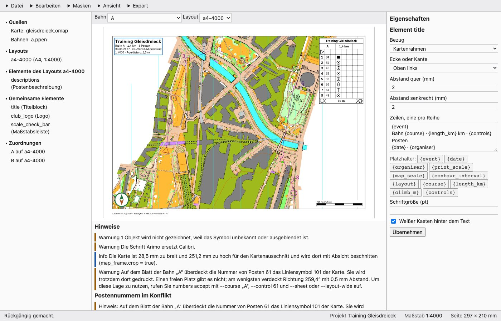

*Der Editor mit gewähltem Titelblock: Projektbaum links, Blattvorschau in der Mitte, Formular rechts, Hinweise unter der Vorschau. Karte: Remo Madella, MOO Challenge Berlin 2025.*

### Jede Änderung steht sofort in der Datei

Es gibt keinen Speichern-Knopf. Jede Änderung, ob Verschieben, Formular mit „Anwenden“, Maske oder Nummer, wird in
dem Moment in die Projektdatei geschrieben, in dem Sie sie machen, mit denselben Kommentaren wie bei den
Befehlen. Die Datei ist immer der aktuelle Stand. Das Blatt wird nach jeder Änderung aus der Datei neu gezeichnet.

Rückgängig und Wiederholen (Menü „Bearbeiten“, Strg+Z, Strg+Umschalt+Z oder Strg+Y; am Mac Cmd statt Strg) stellen
die ganze Datei so her, wie sie vor der Änderung war. Der Editor merkt sich die letzten 100 Schritte. Eine neue
Änderung nach einem Rückgängig verwirft die Schritte, die Sie hätten wiederholen können. In einem Textfeld gehört
Strg+Z dem Feld, nicht dem Editor.

Ändert ein anderes Programm die Projektdatei, während der Editor offen ist (Sie bearbeiten sie in einem Texteditor
oder ein Agent schreibt eine Maske), merkt die Seite das innerhalb von zwei Sekunden und zeigt einen Balken: „Die
Projektdatei wurde außerhalb des Editors geändert.“ mit dem Knopf „Neu laden“. „Neu laden“ liest die Datei erneut
und zeichnet das Blatt neu. Bis dahin lehnt der Editor Änderungen von der Seite ab: „Die Projektdatei hat sich
geändert, seit diese Seite sie zuletzt gelesen hat. Laden Sie sie neu, bevor Sie etwas ändern.“ Auch Rückgängig
und Wiederholen hören dann auf („Die Projektdatei wurde außerhalb des Editors geändert, darum ist hier mit
Rückgängig und Wiederholen Schluss. Laden Sie sie neu.“); der Editor schreibt nie einen alten Stand über Ihre
Änderung von außen.

### Was Sie tun können

**Elemente wählen und verschieben.** Klicken Sie ein Element im Blatt oder einen Eintrag im Baum an. Ziehen Sie
ein Element mit der Maus; es rastet auf 0,5 mm ein. Oder nehmen Sie die Pfeiltasten: 0,5 mm pro Druck, mit der
Umschalttaste 1 mm. Der Editor ändert den `offset_mm` des Ankers (Kapitel 7), ein Ziehen bleibt also eine kleine
Änderung in der Datei. Ein gemeinsames Element gehört zu jedem Layout. Verschieben Sie eines, fragt die Seite
einmal je Element und Sitzung „Gemeinsames Element verschieben?“; „Verschieben“ verschiebt es in allen Layouts,
denn dort ist es gespeichert.

**Layout oder Element ändern.** Wählen Sie ein Layout im Baum, erscheint das Formular mit Papier oder freier
Seitengröße, Ausrichtung, Druckmaßstab, Passepartoutbreite, Rahmenlinienbreite und Nordlinien. Ein Element hat
sein eigenes Formular: Bezug (Seite oder Kartenrahmen), Ecke oder Rand, die beiden Abstände und die Felder seiner
Art (Zeilen und Schriftgröße, Bilddatei und gedruckte Breite, Zellengröße, weißer Kasten). Die Platzhalter-Knöpfe
setzen die Platzhalter aus Kapitel 7 ein. „Anwenden“ schreibt die Änderung. Eine Logodatei ist ein Pfad relativ zur
Projektdatei und muss im Projektordner liegen.

**Fenstermaske.** Menü „Masken“, „Fenstermaske“. Klicken Sie im Blatt die Nummer eines Postens an, um ihn
aufzunehmen oder zu entfernen, oder tippen Sie Codes (`31,32`) oder Plätze (`2-5`) ins Feld. Leer heißt alle
Posten. Dazu kommen Radius, eigene Radien (`35=20`), der Abstand zwischen den Fenstern, „Kein Fenster am Start“,
„Kein Fenster am Ziel“, eine Kennung und „Bahn mit dieser Maske drucken“. „Fenstermaske anlegen“ schreibt sie, wie
`masks window`. Radien und Abstand sind in Millimetern auf dem Papier. Eine Fenstermaske braucht eine Bahndatei.

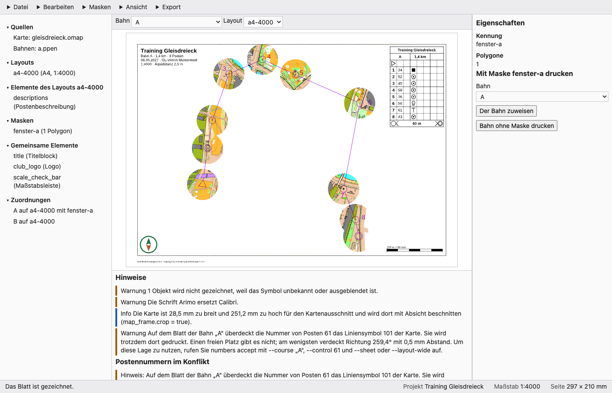

*Der Editor nach „Fenstermaske anlegen“: Die Vorschau zeigt die Fenster, die Abdeckung „fenster-a“ steht im Baum. Karte: Remo Madella, MOO Challenge Berlin 2025.*

**Korridormaske.** Menü „Masken“, „Korridormaske“. Klicken Sie die Punkte der Linie im Blatt an und den letzten
doppelt; das Formular nennt die Zahl der gezeichneten Punkte. Statt zu zeichnen, tippen Sie die Strecke ins Feld
„Punkte als x,y;x,y in Karten-mm, y nach oben“, in derselben Form wie bei `masks corridor --points`; getippte Punkte
gelten dann statt der gezeichneten. Stellen Sie die Breite in Millimetern auf dem Papier ein, wählen Sie die Bahn und
ob die Maske zugewiesen wird, dann „Korridormaske anlegen“. Escape wirft die bisher gezeichnete Linie weg, ein
zweites Escape beendet den Modus. Das Zeichnen der Linie ist Mausarbeit, aber jede Maske lässt sich allein mit den
Feldern anlegen.

**Eine Maske zuweisen.** Wählen Sie eine Maske im Baum. „Der Bahn zuweisen“ gibt sie einer Bahn, „Bahn ohne Maske
drucken“ nimmt sie weg.

**Postennummern.** Meldungen zu einer Nummer, die schlecht liegt, stehen unter dem Blatt in „Postennummern im
Konflikt“. „Vorschlag annehmen“ schreibt den Vorschlag von `check`. „Lage eingeben“ öffnet ein Formular mit der
Richtung (Grad, 0 ist Osten, gegen den Uhrzeigersinn) und dem Abstand zum Kreis in Millimetern auf dem Papier;
„Lage setzen“ schreibt sie. Eine Nummer lässt sich auch auf dem Bahnblatt ziehen. In beiden Fällen fragt die Seite
„Wofür gilt die Lage?“: „Für das Layout“ oder „Nur dieses Blatt“, wie `--layout-wide` und `--sheet`. Mit M lässt
sich jede Postennummer wählen, nicht nur die im Konflikt.

**Prüfen.** Menü „Datei“, „Alle Blätter prüfen“. Der Editor zeichnet jedes Blatt und listet die Hinweise von
`check`, dazu „Alle Blätter sind in Ordnung.“ oder „Einige Blätter brauchen einen Blick.“.

**Exportieren.** Menü „Export“: „Dieses Blatt als PDF“, „Alle Blätter als PDFs“ oder „Alle Bahnen als ein PDF“. Ein
Fenster fragt nach dem Ordner. Der Browser kann keinen Ordner auswählen, darum tippen Sie den vollen Pfad ein, zum
Beispiel `/Users/anna/pdfs` oder `C:\Users\Anna\pdfs`. Den Ordner muss es geben. Die Seite merkt sich den zuletzt
getippten in diesem Browser. „Exportieren“ startet; die Statuszeile zählt die fertigen Blätter. „Anhalten“ beendet
den Export nach dem Blatt, das gerade entsteht; die davor geschriebenen PDFs bleiben ganz, eine halbe Datei bleibt
nicht übrig. Das Ergebnis listet die Dateien mit Größe, die Hinweise und die Erinnerung, in Originalgröße zu
drucken (Kapitel 9). Es läuft immer nur ein Export.

### Tastatur und Maus

| Tasten | Wirkung |
|---|---|
| Strg+Z (Cmd+Z), Strg+Umschalt+Z, Strg+Y | Rückgängig, Wiederholen. |
| Tab, Umschalt+Tab | Durch Baum, Bahn- und Layoutwahl, Blatt, Hinweise, Eigenschaften und Menü gehen, in dieser Reihenfolge. Menüs öffnen mit der Eingabetaste. |
| N, Umschalt+N | Das nächste, vorige Element des Blatts wählen. |
| M, Umschalt+M | Die nächste, vorige Postennummer des Blatts wählen und ihr Formular öffnen. |
| Pfeiltasten | Bei gewähltem Element: 0,5 mm verschieben (Umschalt: 1 mm). Sonst: das Blatt verschieben. |
| + (auch =), - | Vergrößern, verkleinern. |
| 0 | Ganze Seite. |
| Escape | Beendet das Zeichnen: erst die Linie, dann den Modus. Ohne offenen Modus hebt es die Auswahl auf, sodass die Pfeiltasten wieder verschieben. |

N, M, die Pfeiltasten, + - und 0 wirken, solange das Blatt den Fokus hat; mit Tab kommen Sie hin. Nur das Zeichnen
auf der Karte geht allein mit der Maus: die Punkte eines Korridors und die Nummern für eine Fenstermaske anklicken.
Die Felder führen zum selben Ergebnis durch Tippen.

### Beenden

„Fertig“ und das Schließen des Fensters fragen nur nach, solange ein Zeichenmodus ungesendete Arbeit hält: eine unfertige
Korridorlinie oder Posten, die Sie für eine Fenstermaske gewählt und nicht angewendet haben. Die Frage lautet „Arbeit
verwerfen?“ mit „Verwerfen“ und „Weiterarbeiten“. Sonst geht nichts verloren, denn alles steht
schon in der Datei. Strg+C im Terminal beendet den Editor jederzeit; ein laufender Export hält nach dem Blatt an,
das gerade entsteht.

### Sicherheit

Der Editor hört nur auf 127.0.0.1, erreichbar sind also nur Programme auf Ihrem Rechner. Die Adresse enthält ein
zufälliges Kennzeichen, das bei jedem Start neu ist, und die Seite nimmt nur Änderungen an, die es tragen und von
ihrer eigenen Adresse kommen. Der Editor selbst sendet nichts. Das Programm wendet sich nur für die Update-Prüfung und für `update` selbst an GitHub (Kapitel 2), die Prüfung höchstens einmal am Tag.

### Probleme

| Was Sie sehen | Was zu tun ist |
|---|---|
| Es öffnet sich kein Browser. | Kopieren Sie die ausgegebene Adresse in einen Browser oder starten Sie mit `--no-browser` und tun das jedes Mal. |
| Die Adresse von gestern zeigt einen Fehler. | Das Kennzeichen ist bei jedem Start neu. Nehmen Sie die Adresse der laufenden Sitzung. |
| „Die Verbindung zum Editor ist abgebrochen.“ / „Der Editor ist beendet. Das Fenster kann geschlossen werden.“ | Der Editor läuft nicht mehr. Starten Sie `edit` neu. |
| „Die Projektdatei wurde außerhalb des Editors geändert.“ | Klicken Sie „Neu laden“. Ihre eigenen Änderungen stehen schon in der Datei. |
| „Es gibt nichts zum Rückgängigmachen.“ | Es ist kein Schritt mehr übrig, etwa gleich nach dem Öffnen des Projekts. |
| „Die Änderung wurde nicht vorgenommen.“ | Die Änderung wurde abgelehnt; die Meldung nennt den Grund, etwa eine Kennung, die es schon gibt. Ändern Sie die Eingabe und versuchen Sie es noch einmal. |
| „Das Blatt konnte nicht gezeichnet werden.“ | Karte oder Bahndatei lassen sich nicht lesen oder passen nicht. `check` auf der Kommandozeile nennt die Ursache. |
| „Eine Fenstermaske braucht eine Bahndatei.“ | Das Projekt hat keine Bahndatei; nehmen Sie einen Korridor oder legen Sie eine mit `init --courses` an. |
| „Der Ordner … für die PDFs existiert nicht; zuerst anlegen“ | Legen Sie den Ordner an und exportieren Sie noch einmal. |
| „Eine Logodatei muss im Projektordner liegen.“ | Legen Sie das Bild neben die Projektdatei oder in einen Unterordner und geben Sie einen relativen Pfad an. |
