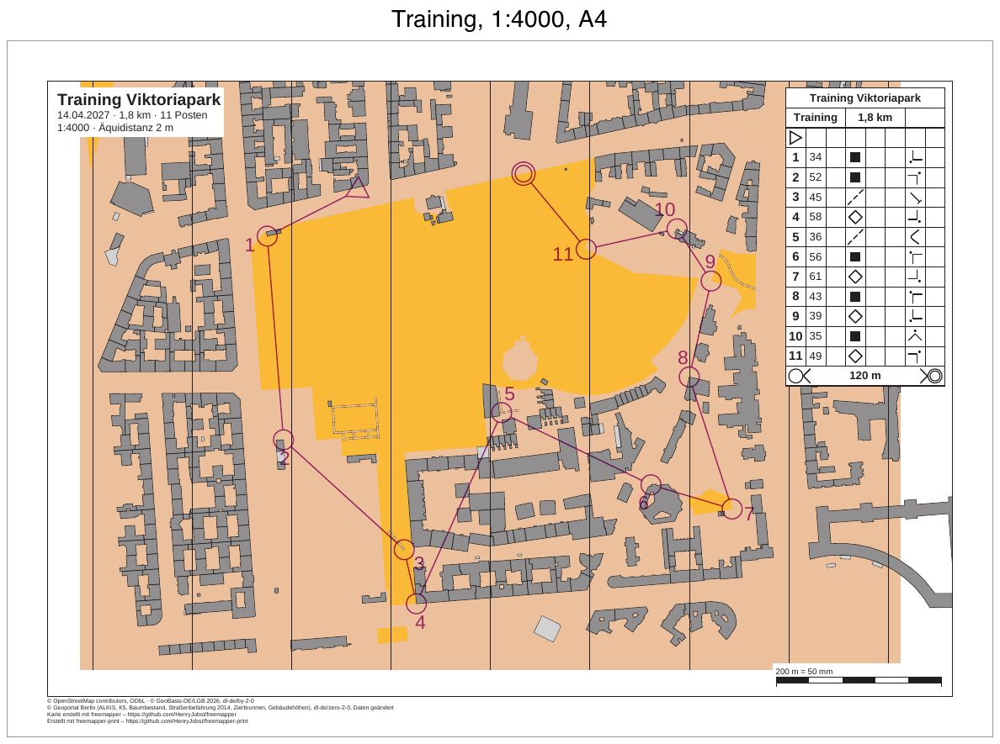

# berlin-viktoriapark-training

[Deutsch](README.md)

A club training in the Viktoriapark in Berlin-Kreuzberg: one course of 1.7 km with 10 controls, from a Purple
Pen file, printed on A4 at 1:4000 with control descriptions.



| File | Content |
|---|---|
| `freemapper-print.toml` | the project file |
| `training.ppen` | the course as a Purple Pen file, written by hand for this example |
| `berlin-viktoriapark.omap` | the map (OOM, ISSprOM 2019, 1:4000) |
| `freemapper.toml` | freemapper's sidecar file; `init` reads only the map kind from it |
| `ATTRIBUTION.txt` | the map's sources, from freemapper |
| `out/Training.pdf` | the course sheet, A4 landscape, 1:4000 |
| `preview.jpg` | the same sheet as an image |

The sheet is in German (`event.lang = "de"`), as for a German club.

## The course

The start is on the street along the north edge of the park, and the finish is on the same street, 200 m
further east. In between the course runs anticlockwise through the park and around it: five controls at path
junctions in the park, five at building corners. The finish row of the descriptions has symbol 14.3: from the
last control, runners navigate to the finish without tapes.

Every control except start and finish sits on a feature of the map, a corner of a building (symbol 521) or a node
where two paths meet (505.1). A small script read these points from `berlin-viktoriapark.omap`, converted them to
millimetres and wrote them with y pointing up, as Purple Pen writes it (ADR 0032). The descriptions follow the IOF
2018 standard: column D "building" or "path", column G the outside corner with its compass direction, column F
"junction". The file gives no number positions, so the program places every number itself.

## What `check` reports

The sheet is fine, and `check` ends with exit code 0. The "Zur Information" (Info) lines do not count. After the
course, `check` checks the layout as a sheet without a course, as `export --layout` writes it.

```
Zur Information: Die geografischen Koordinaten wurden nicht geprüft, denn kein Posten hat sowohl eine Kartenposition als auch geografische Koordinaten.
Bahn „Training“ auf Layout a4-4000: A4 Querformat, Druckmaßstab 1:4000, Kartenmaßstab 1:4000, Geometriefaktor 1,000, Symbolfaktor 1,000.
Zur Information: Die Karte ist 37,4 mm zu breit und 18,3 mm zu hoch für den Kartenausschnitt und wird dort mit Absicht beschnitten (map_frame.crop = true).
Layout a4-4000: A4 Querformat, Druckmaßstab 1:4000, Kartenmaßstab 1:4000, Geometriefaktor 1,000, Symbolfaktor 1,000.
Zur Information: Die Karte ist 18,1 mm zu breit und 18,1 mm zu hoch für den Kartenausschnitt und wird dort mit Absicht beschnitten (map_frame.crop = true).
Zur Information: Der Text title nutzt {length_km}, der nur auf Bahnblättern gefüllt wird. Auf diesem Blatt bleibt er leer.
Zur Information: Der Text title nutzt {controls}, der nur auf Bahnblättern gefüllt wird. Auf diesem Blatt bleibt er leer.
1 Bahn und 1 Layoutblatt geprüft, keine Hinweise.
```

## How it was made

With freemapper-print alone, in the folder of this example:

```sh
freemapper-print --lang de init . --map berlin-viktoriapark.omap --title "Training Viktoriapark" --courses training.ppen
```

```
Kartenart: Sprintkarten, wie in der freemapper.toml neben der Karte angegeben.
Bahndatei training.ppen gelesen: 1 Bahn, an die Karte angepasst.
Suche ein A4- oder A3-Blatt, das die Karte in 1:4000 zeigt …
./freemapper-print.toml geschrieben mit einem Layout und einer Bahnzuordnung, für Sprintkarten.
Layout a4-4000 bei 1:4000: A4, Passepartout 8 mm, für „Training“.
Warnung: Kein A4- oder A3-Blatt zeigt die Karte bei 1:4000 ohne Hinweise oder Fehler, deshalb bleibt Layout a4-4000 bei A4. check meldet das.
Die Druckmaßstäbe stammen aus der Bahndatei, ein Layout je Maßstab. Eine Bahn ohne Druckmaßstab bekommt den Kartenmaßstab 1:4000.
Jedes Layout hat einen Beschreibungskasten in der oberen rechten Ecke des Kartenausschnitts, mit der Zellengröße des Regelprofils.
Ein Bahnblatt schneidet die Karte mit Absicht auf die Bahn zu, deshalb haben die Layouts map_frame.crop = true.
Das Projekt schlägt eine Äquidistanz von 2 m vor, üblich für Sprintkarten. Sehen Sie auf der Karte nach und bestätigen Sie den Wert oder ändern Sie map.contour_interval_m.
Als Nächstes freemapper-print check ./freemapper-print.toml aufrufen. Es meldet die Hinweise oben, bis das Layout geändert ist.
```

The first `check` has two notes, on the course sheet and once more on the layout sheet:

```
Hinweis: Layout a4-4000 zeigt 5 von 9 Quellenangaben. Eine weitere Zeile zählt die übrigen.
Hinweis: Das Passepartout ist zu schmal für die Fußzeile mit Quellenangaben und Namensnennung. Sie steht deshalb auf einem weißen Kasten im Kartenausschnitt und deckt einen Teil der Karte ab. Ein breiteres margin_mm oder ein Element copyright_line oder credit_line verschiebt sie.
```

The map notes have nine lines, too many for the footer. Then the project file was edited by hand:

- `[event]`: date and organiser added.
- `[print]`: the sources in three lines. The six datasets of the Geoportal Berlin share one line, since they
  all have the same licence, dl-de/zero-2-0.
- In the title block, a line `{date} · {length_km} km · {controls} Posten` added and "Äquidistanz" written
  before `{contour_interval}`.
- The layout `a4-4000` is A4 landscape instead of `auto`, with a 12 mm passe-partout instead of 8 mm,
  so that the four footer lines fit below the map frame.

Then check and write the PDF:

```sh
freemapper-print --lang de check .
freemapper-print --lang de export .
```

`export` writes `out/Training.pdf` and exits with code 0.

## Open

- Open `training.ppen` once in Purple Pen (macOS beta) and check it. Does Purple Pen load the map
  `berlin-viktoriapark.omap`? Do the controls sit at their building corners and path junctions, and are the
  descriptions right? The value `Spr2019` for the map standard has not been checked against Purple Pen.

## Checked

- `check` and `export` as above, with the messages above.
- Exported twice: the PDF is identical byte for byte.
- The page viewed at 110 dpi: every control sits at its building corner or path junction, the description box
  covers no control, and the footer sits below the map frame.

## Regenerate

The PDF comes from `export` as above, the preview as for
[luebeck-competition-courses](../luebeck-competition-courses/README.en.md#regenerate), with `out/Training.pdf`
as input and the label "Training, 1:4000, A4".

## Printing

Print at 100 % ("Actual size") and switch "Fit to page" off. Measure the scale check bar on the printout to see
whether the printer scaled the page.

## Credits and licence

Map, `freemapper.toml` and `ATTRIBUTION.txt` from the example `berlin-viktoriapark` of
[freemapper](https://github.com/HenryJobst/freemapper), version 0.6.0 (commit `a2f8b80`), unchanged. The map's
templates (orthophoto, K5 and others under `templates/`) were not copied; freemapper-print does not print
templates. The map is under the terms `ATTRIBUTION.txt` names: © OpenStreetMap contributors (ODbL),
© GeoBasis-DE/LGB 2026 (dl-de/by-2-0) and data of the Geoportal Berlin (dl-de/zero-2-0, partly modified). The
course in `training.ppen` was written for this example and is released under CC0. The PDF was made with
[freemapper-print](https://github.com/HenryJobst/freemapper-print).
