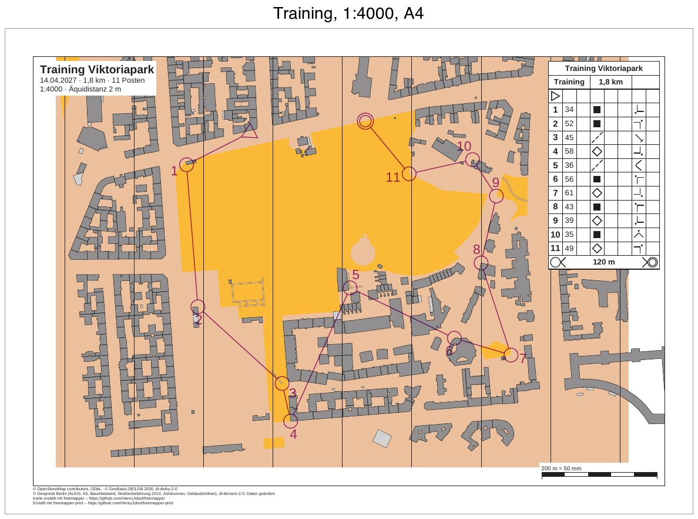

# berlin-viktoriapark-training

[English](README.en.md)

Ein Vereinstraining im Viktoriapark in Berlin-Kreuzberg: eine Bahn von 1,8 km mit 11 Posten, aus einer
Purple-Pen-Datei, gedruckt auf A4 in 1:4000 mit Postenbeschreibung.



| Datei | Inhalt |
|---|---|
| `freemapper-print.toml` | die Projektdatei |
| `training.ppen` | die Bahn als Purple-Pen-Datei, für dieses Beispiel von Hand geschrieben |
| `berlin-viktoriapark.omap` | die Karte (OOM, ISSprOM 2019, 1:4000) |
| `freemapper.toml` | Begleitdatei von freemapper; `init` liest daraus nur die Kartenart |
| `ATTRIBUTION.txt` | die Quellen der Karte, von freemapper |
| `out/Training.pdf` | das Blatt der Bahn, A4 quer, 1:4000 |
| `preview.jpg` | dasselbe Blatt als Bild |

## Die Bahn

Start auf der Straße am Nordrand des Parks, Ziel ebenfalls dort, 200 m weiter östlich. Dazwischen führt die Bahn
gegen den Uhrzeigersinn um den Park herum. Die Posten liegen auf drei Arten von Objekten: fünf an Gebäudeecken
(Codes 34, 52, 56, 43 und 35), vier an Ecken offener Flächen (58, 61, 39 und 49), zwei an Wegen (45 am Ende eines
Pfads, 36 an der Biegung eines Pfads). So wechselt die Beschreibung zwischen „Gebäude“, „offenes Gebiet“ und
„Pfad“ und zwischen Ecke, Ende und Biegung. Die Zielzeile der Beschreibung hat das Symbol 14.3: Vom letzten Posten
orientiert man sich ohne Markierung ins Ziel.

Jeder Posten außer Start und Ziel liegt auf einem Punkt eines Objekts der Karte: einem Eckpunkt eines Gebäudes
(Symbol 521) oder einer offenen Fläche (401) oder einem Punkt eines Pfads (505.1). Ein kleines Skript hat diese Punkte aus `berlin-viktoriapark.omap` gelesen, in Millimeter
umgerechnet und mit der y-Achse nach oben geschrieben, wie Purple Pen es tut (ADR 0032). Die Beschreibungen folgen
der IOF-Norm von 2018: Spalte D „Gebäude“, „offenes Gebiet“ oder „Pfad“, Spalte G die Außenecke, das Ende oder die
Biegung, mit Himmelsrichtung, wo es eine gibt. Die
Datei gibt keine Lage für Postennummern an, alle Nummern setzt das Programm selbst.

Die Karte aus freemapper 0.8.0 hat im Park nur die gelbe offene Fläche, wenige Pfade und viele Gebäude ringsum, keine
Bäume und keine Wege aus Kies. Eine frühere Fassung dieser Bahn stand mit neun von zehn Posten an Gebäudeecken. Die
jetzige Bahn nutzt, was die Karte hergibt: die Ecken der kleinen gelben Flächen am Rand, die Pfadenden und
-biegungen.

## Was `check` meldet

Das Blatt ist in Ordnung, `check` endet mit Exit-Code 0. Die Zeilen „Zur Information“ zählen nicht. Nach der
Bahn prüft `check` das Layout als Blatt ohne Bahn, so wie `export --layout` es schreibt.

```
Zur Information: Die geografischen Koordinaten wurden nicht geprüft, denn kein Posten hat sowohl eine Kartenposition als auch geografische Koordinaten.
Bahn „Training“ auf Layout a4-4000: A4 Querformat, Druckmaßstab 1:4000, Kartenmaßstab 1:4000, Geometriefaktor 1,000, Symbolfaktor 1,000.
Zur Information: Die Karte ist 31,8 mm zu breit und 26,0 mm zu hoch für den Kartenausschnitt und wird dort mit Absicht beschnitten (map_frame.crop = true).
Layout a4-4000: A4 Querformat, Druckmaßstab 1:4000, Kartenmaßstab 1:4000, Geometriefaktor 1,000, Symbolfaktor 1,000.
Zur Information: Die Karte ist 21,8 mm zu breit und 18,1 mm zu hoch für den Kartenausschnitt und wird dort mit Absicht beschnitten (map_frame.crop = true).
Zur Information: Der Text title nutzt {length_km}, der nur auf Bahnblättern gefüllt wird. Auf diesem Blatt bleibt er leer.
Zur Information: Der Text title nutzt {controls}, der nur auf Bahnblättern gefüllt wird. Auf diesem Blatt bleibt er leer.
1 Bahn und 1 Layoutblatt geprüft, keine Hinweise.
```

## So ist es entstanden

Nur mit freemapper-print selbst, im Ordner dieses Beispiels:

```sh
freemapper-print --lang de init . --map berlin-viktoriapark.omap --title "Training Viktoriapark" --courses training.ppen
```

```
Kartenart: Sprintkarten, wie in der freemapper.toml neben der Karte angegeben.
Bahndatei training.ppen gelesen: 1 Bahn, an die Karte angepasst.
Suche ein A4- oder A3-Blatt, das die Karte in 1:4000 zeigt …
./freemapper-print.toml geschrieben mit einem Layout und einer Bahnzuordnung, für Sprintkarten.
Layout a4-4000 bei 1:4000: A4, Passepartout 8 mm, für „Training“.
Warnung: Kein A4- oder A3-Blatt zeigt die Karte bei 1:4000 ohne Hinweise oder Fehler, deshalb bleibt Layout a4-4000 bei A4. check meldet das.
Die Druckmaßstäbe stammen aus der Bahndatei, ein Layout je Maßstab. Eine Bahn ohne Druckmaßstab bekommt den Kartenmaßstab 1:4000.
Jedes Layout hat einen Beschreibungskasten in der oberen rechten Ecke des Kartenausschnitts, mit der Zellengröße des Regelprofils.
Ein Bahnblatt schneidet die Karte mit Absicht auf die Bahn zu, deshalb haben die Layouts map_frame.crop = true.
Das Projekt schlägt eine Äquidistanz von 2 m vor, üblich für Sprintkarten. Sehen Sie auf der Karte nach und bestätigen Sie den Wert oder ändern Sie map.contour_interval_m.
Als Nächstes freemapper-print check ./freemapper-print.toml aufrufen. Es meldet die Hinweise oben, bis das Layout geändert ist.
```

Der erste `check` hat zwei Hinweise, auf dem Bahnblatt und noch einmal auf dem Layoutblatt:

```
Hinweis: Layout a4-4000 zeigt 5 von 9 Quellenangaben. Eine weitere Zeile zählt die übrigen.
Hinweis: Das Passepartout ist zu schmal für die Fußzeile mit Quellenangaben und Namensnennung. Sie steht deshalb auf einem weißen Kasten im Kartenausschnitt und deckt einen Teil der Karte ab. Ein breiteres margin_mm oder ein Element copyright_line oder credit_line verschiebt sie.
```

Die Kartennotizen haben neun Zeilen, zu viele für die Fußzeile. Danach ist die Projektdatei
von Hand bearbeitet:

- `[event]`: Datum und Ausrichter ergänzt.
- `[print]`: die Quellen in drei Zeilen. Die sechs Datensätze des Geoportals Berlin stehen in einer Zeile,
  weil alle unter derselben Lizenz dl-de/zero-2-0 stehen.
- Im Titelblock eine Zeile mit `{date} · {length_km} km · {controls} Posten` ergänzt und „Äquidistanz“ vor
  `{contour_interval}` geschrieben.
- Das Layout `a4-4000` ist A4 quer statt `auto`, 12 mm Passepartout statt 8 mm. So passen die
  vier Zeilen der Fußzeile unter den Kartenausschnitt.

Dann prüfen und das PDF schreiben:

```sh
freemapper-print --lang de check .
freemapper-print --lang de export .
```

`export` schreibt `out/Training.pdf` und endet mit Exit-Code 0.

## Geprüft

- Die Posten liegen in Purple Pen an den richtigen Objekten (Rückmeldung des Nutzers, 2026-11-10).
- `training.ppen` lässt sich in Purple Pen ohne Fehler öffnen; die Bahn ist da, die Postenbeschreibung mit ihren
  Symbolen auch (Rückmeldung des Nutzers, 2026-11-10).
- `check` und `export` wie oben, mit den Meldungen von oben.
- Zweimal exportiert: Das PDF ist Byte für Byte gleich.
- Die Seite bei 100 dpi und die Posten bei 300 dpi angesehen: Jeder Posten steht an seiner Gebäudeecke, an der
  Ecke seiner offenen Fläche oder am Pfad (Ende oder Biegung), der Beschreibungskasten deckt keinen Posten ab, die Fußzeile steht unter dem
  Kartenausschnitt. Die hellbraune Grundfläche reicht bis an den Rand der Karte; westlich und östlich davon
  bleibt das Papier weiß.

## Neu erzeugen

Das PDF mit `export` wie oben, die Vorschau wie bei
[luebeck-competition-courses](../luebeck-competition-courses/README.md#neu-erzeugen), mit `out/Training.pdf` als
Eingabe und der Beschriftung „Training, 1:4000, A4“.

## Drucken

Drucken Sie mit 100 % („Tatsächliche Größe“), und schalten Sie „An Seite anpassen“ aus. Mit der
Kontrollstrecke messen Sie am Ausdruck nach, ob der Drucker skaliert hat.

## Herkunft und Lizenz

Karte, `freemapper.toml` und `ATTRIBUTION.txt` aus dem Beispiel `berlin-viktoriapark` von
[freemapper](https://github.com/HenryJobst/freemapper), Version 0.8.0 (Commit `a2b41b4`), unverändert. Die
Vorlagen der Karte (Orthofoto, Schummerung, die Kandidaten und andere unter `templates/`) sind nicht kopiert;
freemapper-print druckt keine Vorlagen. Für die Karte gilt, was `ATTRIBUTION.txt` nennt: © OpenStreetMap-Mitwirkende (ODbL),
© GeoBasis-DE/LGB 2026 (dl-de/by-2-0) und Daten des Geoportals Berlin (dl-de/zero-2-0, zum Teil geändert). Die
Bahn in `training.ppen` ist für dieses Beispiel geschrieben und steht unter CC0. Das PDF ist mit
[freemapper-print](https://github.com/HenryJobst/freemapper-print) erzeugt.
