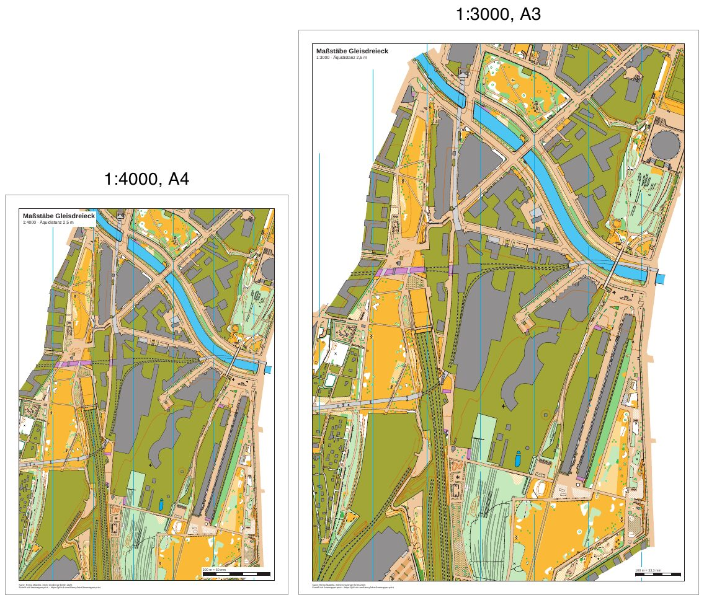

# gleisdreieck-scales

[Deutsch](README.md)

The same section of one sprint map printed twice: at 1:4000 on A4 and at 1:3000 on A3. The map is "Gleisdreieck" by
Remo Madella, made for the MOO Challenge Berlin 2025. There are no courses. The event data is made up for the
example.



| File | Content |
|---|---|
| `freemapper-print.toml` | the project file with the two layouts `a4-4000` and `a3-3000` |
| `gleisdreieck.omap` | the map (OOM, 1:4000), unchanged |
| `ATTRIBUTION.txt` | author, event and the terms of use, German and English |
| `out/a4-4000.pdf` | print at 1:4000 on A4 portrait (2.9 MB) |
| `out/a3-3000.pdf` | print at 1:3000 on A3 portrait (3.2 MB) |
| `preview.jpg` | both pages side by side, with a grey page frame |

## What the example shows

The pages are exactly A4 and A3, and the map on them has exactly the scale named in the file. A distance of 100 m
measures 25 mm in the PDF at 1:4000 and 33.3 mm at 1:3000. The scale check bar at the bottom right says so: "200 m
= 50 mm" on the A4 sheet, "100 m = 33,3 mm" on the A3 sheet.

The sprint standard (ISSprOM 2019-2, section 3.1) draws at 1:4000 and recommends 1:3000 for the youngest age
groups. Terrain and symbols grow by the same ratio, to 133 % (ADR 0018). The summary line of `check` says so:
geometry factor 1.333, symbol factor 1.333. A small footpath (symbol 506) is 0.27 mm wide at 1:4000 and 0.36 mm at
1:3000. Compare the narrow paths in the park in the top right of both sheets.

Both sheets have the same centre (`map_frame.centre_map_mm = [10.0, 120.0]`), so the A3 sheet shows the A4 section
and a bit more around it: 760 m × 1108 m of ground on A4 at 1:4000 and 831 m × 1200 m on A3 at 1:3000. The paper
grows by a factor of 1.41, the map by 1.33, so the larger scale costs almost no ground.

The map is larger than both frames (about 300 mm × 440 mm at map scale). `crop = true` marks the cut as
intended, so the "map larger than the sheet" kind is only an Info line.

## What `check` reports

`check` ends with exit code 1. Both notes come from the map and appear on every sheet of every Gleisdreieck
example. The Info line about the cut does not count.

```
Layout a4-4000: A4 portrait, print scale 1:4000, map scale 1:4000, geometry factor 1.000, symbol factor 1.000.
Note: 1 object is not drawn because the symbol is unknown or hidden.
Note: the font Arimo replaces Calibri.
Info: the map is 115.5 mm too wide and 164.2 mm too tall for the map frame and is cut there on purpose (map_frame.crop = true).
Layout a3-3000: A3 portrait, print scale 1:3000, map scale 1:4000, geometry factor 1.333, symbol factor 1.333.
Note: 1 object is not drawn because the symbol is unknown or hidden.
Note: the font Arimo replaces Calibri.
Info: the map is 130.3 mm too wide and 188.3 mm too tall for the map frame and is cut there on purpose (map_frame.crop = true).
Layouts with notes: 2 of 2.
```

- The undrawn object has the symbol 714.1 "map area". The map file marks that symbol as hidden, and the program
  follows it.
- The map names the font Calibri in four symbols for control numbers (803.7 and 803.10). The program has no
  Calibri and takes Arimo. The control numbers on the sheets come from the program, not from these symbols.

## How it was made

First the project from the map. The map has no `freemapper.toml`, so `init` needs `--kind`:

```sh
freemapper-print --lang en init . --map gleisdreieck.omap --kind sprint --title "Scales Gleisdreieck"
```

`init` writes one layout at 1:4000 and warns that no A4 or A3 sheet shows the whole map at that scale. That is
true, and the example handles it with a section instead of a larger sheet. Then the project file was edited by
hand:

- The contour interval changed from the suggested 2 m to 2.5 m, which the map's information block names.
- `[print]` added with the map credit. The map has no notes, so there is nothing else for the footer to show.
- The title block reads `{event}` and `1:{print_scale} · Äquidistanz {contour_interval}`.
- Two layouts with the same `centre_map_mm`, 10 mm passe-partout and `crop = true`: `a4-4000` and `a3-3000`.
  The centre was chosen so that neither frame reaches the map's information block at the top and bottom.

```sh
freemapper-print --lang en check .
freemapper-print --lang en export .
```

`export` writes `out/a4-4000.pdf` and `out/a3-3000.pdf` and ends with exit code 0.

## Checked

- Line widths read from the PDF content: symbol 506 is 0.765 pt (0.27 mm) in `a4-4000.pdf` and 1.020 pt
  (0.36 mm) in `a3-3000.pdf`.
- Page sizes from `pdfinfo`: A4 and A3, both portrait.
- Both PDFs rendered with `pdftoppm` and looked at: the section is the same, nothing of the map's information block
  shows, the scale check bar and the footer sit where `check` puts them.

## Regenerate

The preview comes from `pdftoppm` and ImageMagick. On macOS `FONT` is the path to a font file; on Linux and
Windows it is a font name from `magick -list font`, such as `DejaVu-Sans`.

```sh
FONT=/System/Library/Fonts/Helvetica.ttc
tmp=$(mktemp -d)
pdftoppm -r 55 -png -singlefile out/a4-4000.pdf "$tmp/p4"
pdftoppm -r 55 -png -singlefile out/a3-3000.pdf "$tmp/p3"
magick "$tmp/p4.png" -bordercolor gray60 -border 1 -background white -gravity north -splice 0x40 \
  -font "$FONT" -pointsize 28 -annotate +0+4 "1:4000, A4" -bordercolor white -border 8 "$tmp/l4.png"
magick "$tmp/p3.png" -bordercolor gray60 -border 1 -background white -gravity north -splice 0x40 \
  -font "$FONT" -pointsize 28 -annotate +0+4 "1:3000, A3" -bordercolor white -border 8 "$tmp/l3.png"
magick "$tmp/l4.png" "$tmp/l3.png" -background white -gravity south +append -strip -quality 82 preview.jpg
rm -r "$tmp"
```

More on layouts, frames and scales: [manual, chapter 6](../../docs/manual/en.md#6-layouts-paper-size-scale-map-frame)
and [chapter 9](../../docs/manual/en.md#9-printing-at-the-right-scale-at-home-and-in-a-copy-shop). A club training
with courses on the same map: [gleisdreieck-training](../gleisdreieck-training/README.en.md).

## Printing

Print at 100 % ("actual size") with "fit to page" switched off. Any other size breaks the scale. Measure the scale
check bar on the printout.

## Credits

Map: "Gleisdreieck" by Remo Madella, MOO Challenge Berlin 2025, unchanged. Remo Madella agreed on 2026-11-12 that
the freemapper suite may use it as an example map. That is a permission for the suite, not an open licence;
`ATTRIBUTION.txt` has the details. The PDFs were made with
[freemapper-print](https://github.com/HenryJobst/freemapper-print).
