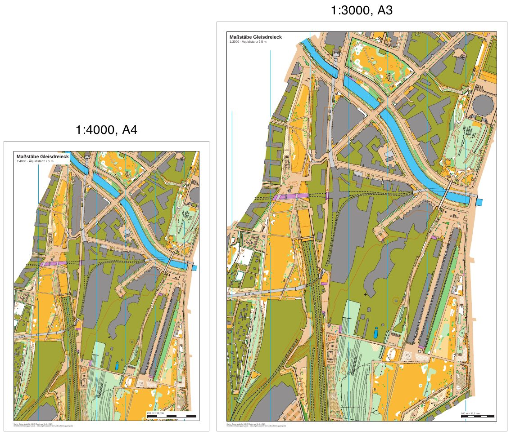

# gleisdreieck-scales

[English](README.en.md)

Derselbe Ausschnitt einer Sprintkarte, zweimal gedruckt: in 1:4000 auf A4 und in 1:3000 auf A3. Die Karte ist
„Gleisdreieck“ von Remo Madella, entstanden für die MOO Challenge Berlin 2025. Es gibt keine Bahnen. Die
Veranstaltungsdaten sind für das Beispiel erfunden.



| Datei | Inhalt |
|---|---|
| `freemapper-print.toml` | die Projektdatei mit den beiden Layouts `a4-4000` und `a3-3000` |
| `gleisdreieck.omap` | die Karte (OOM, 1:4000), unverändert |
| `ATTRIBUTION.txt` | Autor, Veranstaltung und Nutzungsbedingungen, deutsch und englisch |
| `out/a4-4000.pdf` | Druck in 1:4000 auf A4 hoch (2,9 MB) |
| `out/a3-3000.pdf` | Druck in 1:3000 auf A3 hoch (3,2 MB) |
| `preview.jpg` | beide Seiten nebeneinander, mit grauem Seitenrahmen |

## Was das Beispiel zeigt

Die Seiten sind genau A4 und A3, und die Karte darauf hat genau den Maßstab aus der Datei. 100 m messen im PDF bei
1:4000 genau 25 mm und bei 1:3000 genau 33,3 mm. Der Maßstabsbalken unten rechts sagt es: „200 m = 50 mm“ auf dem
A4-Blatt, „100 m = 33,3 mm“ auf dem A3-Blatt.

Die Sprintnorm (ISSprOM 2019-2, Abschnitt 3.1) zeichnet in 1:4000 und empfiehlt 1:3000 für die jüngsten
Altersklassen. Gelände und Symbole wachsen im gleichen Verhältnis auf 133 % (ADR 0018). Die Zeile von `check` zeigt
es: Geometriefaktor 1,333, Symbolfaktor 1,333. Ein kleiner Fußweg (Symbol 506) ist in 1:4000 0,27 mm breit und in
1:3000 0,36 mm. Vergleichen Sie die schmalen Wege im Park rechts oben auf beiden Blättern.

Beide Blätter haben denselben Mittelpunkt (`map_frame.centre_map_mm = [10.0, 120.0]`). Das A3-Blatt zeigt deshalb
den A4-Ausschnitt und etwas mehr drumherum: 760 m × 1108 m Gelände auf A4 in 1:4000 und 831 m × 1200 m auf A3 in
1:3000. Das Papier wächst um den Faktor 1,41, die Karte um 1,33, der größere Maßstab kostet also fast kein Gelände.

Die Karte ist größer als beide Kartenausschnitte (etwa 300 mm × 440 mm im Kartenmaßstab). `crop = true` kennzeichnet
den Schnitt als gewollt, der Hinweis „Karte größer als das Blatt“ ist deshalb nur eine Info-Zeile.

## Was `check` meldet

`check` endet mit Exitcode 1. Beide Hinweise stammen aus der Karte und stehen auf jedem Blatt jedes
Gleisdreieck-Beispiels. Die Info-Zeile zum Schnitt zählt nicht mit.

```
Layout a4-4000: A4 Hochformat, Druckmaßstab 1:4000, Kartenmaßstab 1:4000, Geometriefaktor 1,000, Symbolfaktor 1,000.
Hinweis: 1 Objekt wird nicht gezeichnet, weil das Symbol unbekannt oder ausgeblendet ist.
Hinweis: Die Schrift Arimo ersetzt Calibri.
Zur Information: Die Karte ist 115,5 mm zu breit und 164,2 mm zu hoch für den Kartenausschnitt und wird dort mit Absicht beschnitten (map_frame.crop = true).
Layout a3-3000: A3 Hochformat, Druckmaßstab 1:3000, Kartenmaßstab 1:4000, Geometriefaktor 1,333, Symbolfaktor 1,333.
Hinweis: 1 Objekt wird nicht gezeichnet, weil das Symbol unbekannt oder ausgeblendet ist.
Hinweis: Die Schrift Arimo ersetzt Calibri.
Zur Information: Die Karte ist 130,3 mm zu breit und 188,3 mm zu hoch für den Kartenausschnitt und wird dort mit Absicht beschnitten (map_frame.crop = true).
Layouts mit Hinweisen: 2 von 2.
```

- Das nicht gezeichnete Objekt hat das Symbol 714.1 „map area“. Die Kartendatei markiert dieses Symbol als
  ausgeblendet, und das Programm folgt ihr.
- Die Karte nennt die Schrift Calibri in vier Symbolen für Postennummern (803.7 und 803.10). Das Programm hat kein
  Calibri und nimmt Arimo. Die Postennummern auf den Blättern setzt das Programm selbst, nicht diese Symbole.

## So ist es entstanden

Zuerst das Projekt aus der Karte. Die Karte hat keine `freemapper.toml`, deshalb braucht `init` die Angabe `--kind`:

```sh
freemapper-print --lang de init . --map gleisdreieck.omap --kind sprint --title "Maßstäbe Gleisdreieck"
```

`init` schreibt ein Layout in 1:4000 und warnt, dass kein A4- oder A3-Blatt die ganze Karte in diesem Maßstab zeigt.
Das stimmt, und das Beispiel löst es mit einem Ausschnitt statt mit einem größeren Blatt. Danach wurde die
Projektdatei von Hand bearbeitet:

- Die Äquidistanz von den vorgeschlagenen 2 m auf 2,5 m geändert, wie es der Informationsblock der Karte nennt.
- `[print]` mit dem Kartennachweis ergänzt. Die Karte hat keine Notizen, die Fußzeile hätte sonst nichts zu zeigen.
- Der Titelblock zeigt `{event}` und `1:{print_scale} · Äquidistanz {contour_interval}`.
- Zwei Layouts mit demselben `centre_map_mm`, 10 mm Passepartout und `crop = true`: `a4-4000` und `a3-3000`. Der
  Mittelpunkt ist so gewählt, dass keiner der Ausschnitte oben oder unten an den Informationsblock der Karte reicht.

```sh
freemapper-print --lang de check .
freemapper-print --lang de export .
```

`export` schreibt `out/a4-4000.pdf` und `out/a3-3000.pdf` und endet mit Exitcode 0.

## Geprüft

- Linienbreiten aus dem PDF-Inhalt gelesen: Symbol 506 ist in `a4-4000.pdf` 0,765 pt (0,27 mm) und in
  `a3-3000.pdf` 1,020 pt (0,36 mm) breit.
- Seitengrößen mit `pdfinfo`: A4 und A3, beide hoch.
- Beide PDFs mit `pdftoppm` gezeichnet und angesehen: gleicher Ausschnitt, nichts vom Informationsblock der Karte
  im Bild, Maßstabsbalken und Fußzeile dort, wo `check` sie hinsetzt.

## Neu erzeugen

Die Vorschau entsteht mit `pdftoppm` und ImageMagick. Auf macOS ist `FONT` der Pfad zu einer Schriftdatei, auf
Linux und Windows ein Schriftname aus `magick -list font`, etwa `DejaVu-Sans`.

```sh
FONT=/System/Library/Fonts/Helvetica.ttc
tmp=$(mktemp -d)
pdftoppm -r 55 -png -singlefile out/a4-4000.pdf "$tmp/p4"
pdftoppm -r 55 -png -singlefile out/a3-3000.pdf "$tmp/p3"
magick "$tmp/p4.png" -bordercolor gray60 -border 1 -background white -gravity north -splice 0x40 \
  -font "$FONT" -pointsize 28 -annotate +0+4 "1:4000, A4" -bordercolor white -border 8 "$tmp/l4.png"
magick "$tmp/p3.png" -bordercolor gray60 -border 1 -background white -gravity north -splice 0x40 \
  -font "$FONT" -pointsize 28 -annotate +0+4 "1:3000, A3" -bordercolor white -border 8 "$tmp/l3.png"
magick "$tmp/l4.png" "$tmp/l3.png" -background white -gravity south +append -strip -quality 82 preview.jpg
rm -r "$tmp"
```

Mehr zu Layouts, Kartenausschnitt und Maßstäben: [Handbuch, Kapitel 6](../../docs/manual/de.md#6-layouts-blattformat-maßstab-kartenausschnitt)
und [Kapitel 9](../../docs/manual/de.md#9-drucken-maßstabsgetreu-am-eigenen-drucker-und-im-copyshop). Ein
Vereinstraining mit Bahnen auf derselben Karte: [gleisdreieck-training](../gleisdreieck-training/README.md).

## Drucken

Drucken Sie mit 100 % („Tatsächliche Größe“) und schalten Sie „An Seite anpassen“ aus. Jede andere Größe zerstört
den Maßstab. Messen Sie den Maßstabsbalken auf dem Ausdruck nach.

## Nachweise

Karte: „Gleisdreieck“ von Remo Madella, MOO Challenge Berlin 2025, unverändert. Remo Madella hat am 12.11.2026
zugestimmt, dass die freemapper-Suite sie als Beispielkarte nutzt. Das ist eine Erlaubnis für die Suite, keine
offene Lizenz; `ATTRIBUTION.txt` hat die Einzelheiten. Die PDFs sind mit
[freemapper-print](https://github.com/HenryJobst/freemapper-print) erstellt.
