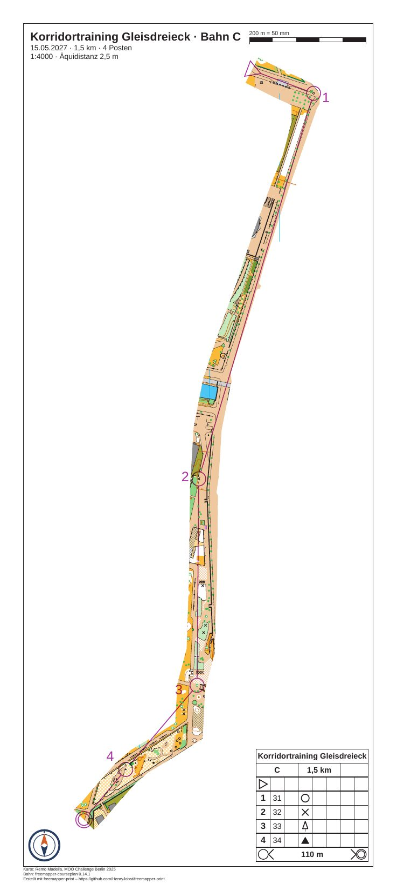

# gleisdreieck-training-corridor

[Deutsch](README.md)

Corridor orienteering on the map "Gleisdreieck" by Remo Madella (MOO Challenge Berlin 2025): course C with 4
controls on 1.45 km at 1:4000. The map shows only in a narrow band along the route, and every control lies in it.
Whoever leaves the band has no map left. The program prints legs, circles, numbers, control descriptions, title and
footer everywhere. The course is made up for the example, and so are the event and the club.



| File | Content |
|---|---|
| `freemapper-print.toml` | the project file, with the mask `corridor-1` |
| `gleisdreieck-corridor.ppen` | course C as a Purple Pen file, made with freemapper-courseplan 0.14.1 |
| `gleisdreieck.omap` | the map (OOM, 1:4000), unchanged |
| `logos/kompass.svg` | the club logo, a compass mark drawn for this example (CC0) |
| `ATTRIBUTION.txt` | author, event and the terms of use, German and English |
| `out/C.pdf` | the sheet of course C, 170 mm × 380 mm, 1:4000 (3.7 MB) |
| `preview.jpg` | the same sheet as an image |

The sheets are in German (`event.lang = "de"`).

## What to look at

- The corridor is 12 mm wide on paper, 48 m on the ground, and 320 mm long at map scale. It follows the paved strip
  along the east edge of the map and, in the south, cuts diagonally across open land to the finish. The four
  controls lie in it, and the legs of the course run inside the band.
- The page is a free size, 170 mm × 380 mm (`page_mm`), not A3. A3 would have left more than half the sheet white.
  It prints on A3 (297 mm × 420 mm) with a wide white edge. On A4 it does not fit.
- The elements stand where the corridor is not: the scale check bar at the top right, the description box at the
  bottom right, the club logo at the bottom left, the title block at the top left.
- The number of control 32 (number 2) stands to the left of its circle, a little below. In its first place it
  covered a line symbol of the map, and `numbers accept` moved it.

## The corridor line

No rule says where a corridor runs, so the program lays none on its own. The line was set by hand in map
millimetres, y up, as OOM's status bar shows them, and then checked. Drawn over an unmasked sheet, it follows the
paved strip at the east edge of the map, and the corridor of 12 mm is wide enough for the strip. In the south it
runs diagonally to the finish.

```
108,278;120,272;131,267;131,255;127,240;121,225;114,206;107,185;99,163;93,145;89,125;87.5,100;87,60;86,30;82,15;81,-4;70,-11;60,-17;54,-22;46,-31;40,-38;36,-42
```

The start is the first point, the finish the last.

## What `check` reports

`check` ends with exit code 1, because of the same two notes as in all Gleisdreieck examples. They come from the
map: the undrawn object has the hidden symbol 714.1 "map area", and the four Calibri entries belong to symbols for
control numbers (803.7 and 803.10), which the program sets in Arimo. The Info lines do not count.

```
Info: latitude and longitude were not checked, because no control has both a map position and latitude and longitude.
Course "C" on layout korridor-4000: A4 portrait, print scale 1:4000, map scale 1:4000, geometry factor 1.000, symbol factor 1.000.
Note: 1 object is not drawn because the symbol is unknown or hidden.
Note: the font Arimo replaces Calibri.
Info: the map is 155.5 mm too wide and 81.2 mm too tall for the map frame and is cut there on purpose (map_frame.crop = true).
Layout korridor-4000: ...
With notes: 1 of 1 course, 1 of 1 layout sheet.
```

The summary line says "A4 portrait" for the free page. The PDF itself is 170 mm × 380 mm, as `pdfinfo` shows. The mask
raises nothing: no control, start or finish lies outside the corridor, and no element covers it.

## How it was made

First the project from map and course file. The map has no `freemapper.toml`, so `init` needs `--kind`:

```sh
freemapper-print --lang en init . --map gleisdreieck.omap --kind sprint --title "Corridor Gleisdreieck" \
  --courses gleisdreieck-corridor.ppen
```

`init` writes a layout on A4 and warns that no A4 or A3 sheet shows the map without notes. Then the project file
was edited by hand (the file keeps German comments):

- `[event]`: date and organiser added. The contour interval changed from the suggested 2 m to the 2.5 m of the
  map's information block.
- `[print]` with the map credit and the course credit.
- The title block shows `{event} · Bahn {course}`, `{date} · {length_km} km · {controls} Posten` and
  `1:{print_scale} · Äquidistanz {contour_interval}`.
- The layout `a4-4000` of `init` replaced by `korridor-4000`: `page_mm = [170.0, 380.0]`, portrait, 10 mm
  passe-partout, `crop = true` and `centre_map_mm = [85.0, 118.0]`, the middle of the corridor.
- The shared scale check bar and logo hidden for this layout and placed again where the corridor is not.
- The description box at the bottom right.

The corridor comes from `masks corridor`:

```sh
freemapper-print --lang en masks corridor . --points "108,278;120,272;131,267;131,255;127,240;121,225;114,206;107,185;99,163;93,145;89,125;87.5,100;87,60;86,30;82,15;81,-4;70,-11;60,-17;54,-22;46,-31;40,-38;36,-42" \
  --width 12 --course C --assign
```

```
Added the mask "corridor-1" to ./freemapper-print.toml: a corridor 12 mm wide on paper at 1:4000 along 22 points.
Course "C" prints with it now, on layout korridor-4000.
Run check to see the result.
```

The command added a `[[masks]]` table with the id `corridor-1`, with the points in a comment so that it can run again,
and wrote `mask = "corridor-1"` into the assignment. The width counts in millimetres on paper at the print scale
of layout `korridor-4000`. Then `check`. It proposed a position for the number of control 32, which lay on a line
symbol of the map, and `numbers accept` took it:

```sh
freemapper-print --lang en check .
freemapper-print --lang en numbers accept . --course C --control 32 --sheet
freemapper-print --lang en export .
```

```
Added a correction for the number of control 32 for course "C" to ./freemapper-print.toml: direction 171.4° with a gap of 1 mm. Run check to see the result.
```

`export` writes `out/C.pdf` and ends with exit code 0. The gap of 1 mm lies in the range of 0.5 to 5 mm
that the rule profile sets.

## Checked

- `check` and `export` as above, with the messages above.
- The PDF rendered at 80 dpi and looked at: the band carries all four controls, the white paper has only the
  overprint, the description box, the title block, the logo and the scale check bar, and none of them touches the
  corridor.
- The line drawn over an unmasked sheet at 100 dpi in three sections: it follows the east edge of the map and the
  path over the meadow.
- Page size from `pdfinfo`: 481.89 × 1077.17 pt, that is 170 mm × 380 mm.

## Regenerate

The PDF comes from the commands above. The preview:

```sh
pdftoppm -r 110 -png -singlefile out/C.pdf preview
magick preview.png -strip -sampling-factor 4:2:0 -quality 82 preview.jpg
rm preview.png
```

More on corridors and their limits: [manual, chapter 11](../../docs/manual/en.md#11-masks-for-window-and-corridor-orienteering).
Window orienteering on the same map: [gleisdreieck-training-window](../gleisdreieck-training-window/README.en.md).

## Printing

Print at 100 % ("actual size") with "fit to page" switched off, on A3. Measure the scale check bar on the printout.

## Credits

Map: "Gleisdreieck" by Remo Madella, MOO Challenge Berlin 2025, unchanged. Remo Madella agreed on 2026-11-12 that
the freemapper suite may use it as an example map. That is a permission for the suite, not an open licence;
`ATTRIBUTION.txt` has the details. Course: made with freemapper-courseplan 0.14.1. The club logo is released under
CC0. The PDF was made with [freemapper-print](https://github.com/HenryJobst/freemapper-print).
