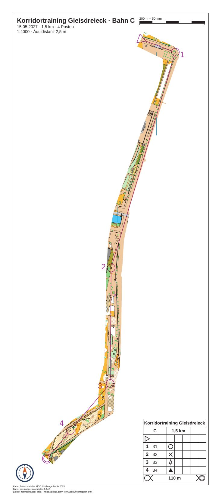

# gleisdreieck-training-corridor

[English](README.en.md)

Ein Korridor-OL auf der Karte „Gleisdreieck“ von Remo Madella (MOO Challenge Berlin 2025): Bahn C mit 4 Posten auf
1,45 km in 1:4000. Die Karte ist nur in einem schmalen Band entlang der Route zu sehen, und jeder Posten liegt darin.
Wer das Band verlässt, hat keine Karte mehr. Strecken, Kreise, Nummern, Postenbeschreibung, Titel und Fußzeile
druckt das Programm überall. Die Bahn ist für das Beispiel erfunden, ebenso die Veranstaltung und der Verein.



| Datei | Inhalt |
|---|---|
| `freemapper-print.toml` | die Projektdatei, mit der Abdeckung `corridor-1` |
| `gleisdreieck-corridor.ppen` | Bahn C als Purple-Pen-Datei, erstellt mit freemapper-courseplan 0.14.1 |
| `gleisdreieck.omap` | die Karte (OOM, 1:4000), unverändert |
| `logos/kompass.svg` | das Vereinszeichen, ein Kompasszeichen, für dieses Beispiel gezeichnet (CC0) |
| `ATTRIBUTION.txt` | Autor, Veranstaltung und Nutzungsbedingungen, deutsch und englisch |
| `out/C.pdf` | das Blatt der Bahn C, 170 mm × 380 mm, 1:4000 (0,4 MB) |
| `preview.jpg` | dasselbe Blatt als Bild |

Die Blätter sind deutsch (`event.lang = "de"`).

## Was Sie auf dem Blatt sehen

- Der Korridor ist auf dem Papier 12 mm breit, im Gelände 48 m, und im Kartenmaßstab 320 mm lang. Er folgt dem
  befestigten Streifen am Ostrand der Karte und schneidet im Süden diagonal über offenes Gelände zum Ziel. Die vier
  Posten liegen darin, und die Strecken der Bahn verlaufen innerhalb des Bandes.
- Die Seite hat eine freie Größe, 170 mm × 380 mm (`page_mm`), nicht A3. A3 hätte mehr als die Hälfte des Blattes
  weiß gelassen. Gedruckt wird sie auf A3 (297 mm × 420 mm) mit breitem weißem Rand. Auf A4 passt sie nicht.
- Die Elemente stehen dort, wo der Korridor nicht ist: der Maßstabsbalken rechts oben, der Beschreibungskasten
  rechts unten, das Vereinszeichen links unten, der Titelblock links oben.
- Die Nummer von Posten 32 (Nummer 2) steht links von ihrem Kreis, etwas darunter. Auf ihrem ersten Platz deckte
  sie ein Liniensymbol der Karte ab, und `numbers accept` hat sie verschoben.

## Die Korridorlinie

Keine Regel sagt, wo ein Korridor verläuft, deshalb legt das Programm keinen selbst. Die Linie wurde von Hand in
Kartenmillimetern gesetzt, y nach oben, wie sie OOMs Statusleiste zeigt, und danach geprüft. Über ein Blatt ohne
Abdeckung gezeichnet, folgt sie dem befestigten Streifen am Ostrand der Karte, und der Korridor mit 12 mm ist breit
genug für den Streifen. Im Süden läuft sie diagonal zum Ziel.

```
108,278;120,272;131,267;131,255;127,240;121,225;114,206;107,185;99,163;93,145;89,125;87.5,100;87,60;86,30;82,15;81,-4;70,-11;60,-17;54,-22;46,-31;40,-38;36,-42
```

Der Start ist der erste Punkt, das Ziel der letzte.

## Was `check` meldet

`check` endet mit Exitcode 1, wegen derselben zwei Hinweise wie in allen Gleisdreieck-Beispielen. Sie stammen aus
der Karte: Das nicht gezeichnete Objekt hat das ausgeblendete Symbol 714.1 „map area“, und die vier Calibri-Einträge
gehören zu Symbolen für Postennummern (803.7 und 803.10), die das Programm in Arimo setzt. Die Info-Zeilen zählen
nicht mit.

```
Zur Information: Die geografischen Koordinaten wurden nicht geprüft, denn kein Posten hat sowohl eine Kartenposition als auch geografische Koordinaten.
Bahn „C“ auf Layout korridor-4000: A4 Hochformat, Druckmaßstab 1:4000, Kartenmaßstab 1:4000, Geometriefaktor 1,000, Symbolfaktor 1,000.
Hinweis: 1 Objekt wird nicht gezeichnet, weil das Symbol unbekannt oder ausgeblendet ist.
Hinweis: Die Schrift Arimo ersetzt Calibri.
Zur Information: Die Karte ist 155,5 mm zu breit und 81,2 mm zu hoch für den Kartenausschnitt und wird dort mit Absicht beschnitten (map_frame.crop = true).
Layout korridor-4000: ...
Mit Hinweisen: 1 von 1 Bahn, 1 von 1 Layoutblatt.
```

Die Zeile nennt für die freie Seite „A4 Hochformat“. Das PDF selbst ist 170 mm × 380 mm groß, wie `pdfinfo` zeigt.
Die Abdeckung löst nichts aus: Kein Posten, Start oder Ziel liegt außerhalb des Korridors, und kein Element deckt
ihn ab.

## So ist es entstanden

Zuerst das Projekt aus Karte und Bahndatei. Die Karte hat keine `freemapper.toml`, deshalb braucht `init` die
Angabe `--kind`:

```sh
freemapper-print --lang de init . --map gleisdreieck.omap --kind sprint --title "Korridortraining Gleisdreieck" \
  --courses gleisdreieck-corridor.ppen
```

`init` schreibt ein Layout auf A4 und warnt, dass kein A4- oder A3-Blatt die Karte ohne Hinweise zeigt. Danach wurde
die Projektdatei von Hand bearbeitet:

- `[event]`: Datum und Veranstalter ergänzt. Die Äquidistanz von den vorgeschlagenen 2 m auf die 2,5 m aus dem
  Informationsblock der Karte geändert.
- `[print]` mit dem Kartennachweis und dem Bahnnachweis.
- Der Titelblock zeigt `{event} · Bahn {course}`, `{date} · {length_km} km · {controls} Posten` und
  `1:{print_scale} · Äquidistanz {contour_interval}`.
- Das Layout `a4-4000` von `init` durch `korridor-4000` ersetzt: `page_mm = [170.0, 380.0]`, hoch, 10 mm
  Passepartout, `crop = true` und `centre_map_mm = [85.0, 118.0]`, die Mitte des Korridors.
- Der gemeinsame Maßstabsbalken und das Logo für dieses Layout ausgeblendet und dort neu gesetzt, wo der Korridor
  nicht ist.
- Der Beschreibungskasten rechts unten.

Der Korridor kommt von `masks corridor`:

```sh
freemapper-print --lang de masks corridor . --points "108,278;120,272;131,267;131,255;127,240;121,225;114,206;107,185;99,163;93,145;89,125;87.5,100;87,60;86,30;82,15;81,-4;70,-11;60,-17;54,-22;46,-31;40,-38;36,-42" \
  --width 12 --course C --assign
```

```
Abdeckung „corridor-1“ in ./freemapper-print.toml eingetragen: ein Korridor 12 mm breit auf dem Papier bei 1:4000 entlang 22 Punkten.
Die Bahn „C“ wird jetzt damit gedruckt, auf Layout korridor-4000.
Mit check sehen Sie das Ergebnis.
```

Der Befehl hängt eine Tabelle `[[masks]]` mit der Id `corridor-1` an, mit den Punkten in einem Kommentar, damit er sich
wiederholen lässt, und schrieb `mask = "corridor-1"` in die Zuordnung. Die Breite zählt in Millimetern auf dem Papier
beim Druckmaßstab des Layouts `korridor-4000`. Dann `check`. Es schlug eine Lage für die Nummer von Posten 32 vor,
die auf einem Liniensymbol der Karte lag, und `numbers accept` übernahm sie:

```sh
freemapper-print --lang de check .
freemapper-print --lang de numbers accept . --course C --control 32 --sheet
freemapper-print --lang de export .
```

```
Korrektur für die Nummer von Posten 32 für Bahn „C“ in ./freemapper-print.toml eingetragen: Richtung 171,4° mit einem Abstand von 1 mm. Mit check sehen Sie das Ergebnis.
```

`export` schreibt `out/C.pdf` und endet mit Exitcode 0. Der Abstand von 1 mm liegt in dem Bereich von 0,5 bis 5 mm,
den das Regelprofil setzt.

## Geprüft

- `check` und `export` wie oben, mit den obigen Meldungen.
- Das PDF bei 80 dpi gezeichnet und angesehen: Das Band trägt alle vier Posten, auf dem weißen Papier stehen nur die
  Bahn, der Beschreibungskasten, der Titelblock, das Logo und der Maßstabsbalken, und keines davon berührt den
  Korridor.
- Die Linie bei 100 dpi in drei Abschnitten über ein Blatt ohne Abdeckung gelegt: Sie folgt dem Ostrand der Karte.
- Seitengröße mit `pdfinfo`: 481,89 × 1077,17 pt, das sind 170 mm × 380 mm.

## Neu erzeugen

Das PDF entsteht aus den Befehlen oben. Die Vorschau:

```sh
pdftoppm -r 110 -png -singlefile out/C.pdf preview
magick preview.png -strip -sampling-factor 4:2:0 -quality 82 preview.jpg
rm preview.png
```

Mehr zu Korridoren und ihren Grenzen: [Handbuch, Kapitel 11](../../docs/manual/de.md#11-abdeckungen-für-fenster--und-korridor-ol).
Fenster-OL auf derselben Karte: [gleisdreieck-training-window](../gleisdreieck-training-window/README.md).

## Drucken

Drucken Sie mit 100 % („Tatsächliche Größe“) und schalten Sie „An Seite anpassen“ aus, auf A3. Messen Sie den
Maßstabsbalken auf dem Ausdruck nach.

## Nachweise

Karte: „Gleisdreieck“ von Remo Madella, MOO Challenge Berlin 2025, unverändert. Remo Madella hat am 12.11.2026
zugestimmt, dass die freemapper-Suite sie als Beispielkarte nutzt. Das ist eine Erlaubnis für die Suite, keine
offene Lizenz; `ATTRIBUTION.txt` hat die Einzelheiten. Bahn: erstellt mit freemapper-courseplan 0.14.1. Das
Vereinszeichen ist unter CC0 freigegeben. Das PDF ist mit
[freemapper-print](https://github.com/HenryJobst/freemapper-print) erstellt.
