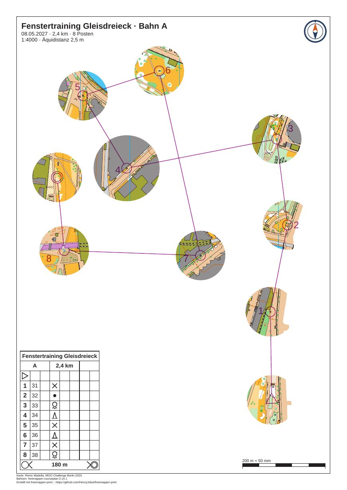

# gleisdreieck-training-window

[Deutsch](README.md)

Window orienteering on the map "Gleisdreieck" by Remo Madella (MOO Challenge Berlin 2025): course A of the club
training, 8 controls on 2.4 km, A4 at 1:4000. The map shows only in a circle around the start, each control and the
finish. Between them the paper stays white, and runners get from window to window by compass and leg. The program
prints legs, circles, numbers, control descriptions, title and footer everywhere. The course is made up for the
example, and so are the event and the club.



| File | Content |
|---|---|
| `freemapper-print.toml` | the project file, with the mask `window-A` |
| `gleisdreieck-training.ppen` | courses A and B as a Purple Pen file, made with freemapper-courseplan 0.14.1 |
| `gleisdreieck.omap` | the map (OOM, 1:4000), unchanged |
| `logos/kompass.svg` | the club logo, a compass mark drawn for this example (CC0) |
| `ATTRIBUTION.txt` | author, event and the terms of use, German and English |
| `out/A.pdf` | the sheet of course A, A4 portrait, 1:4000 (2.5 MB) |
| `preview.jpg` | the same sheet as an image |

The sheets are in German (`event.lang = "de"`). The project is a copy of
[gleisdreieck-training](../gleisdreieck-training/README.en.md) with a mask on course A. Course B stays in the
project without a mask and is not exported here; only `out/A.pdf` is part of the example.

## What to look at

- Ten round windows with a radius of 15 mm on paper, 60 m on the ground: around the start, the eight controls and
  the finish. The window around control 34 (number 4) has a radius of 20 mm, 80 m on the ground. It shows how one
  control gets more map.
- No window touches another. At least 3 mm of paper stay free between the edges, 12 m on the ground. That is the
  default of `masks window`, and the command did not have to make any window smaller: the controls are far enough
  apart.
- Outside the windows the paper is white. The north lines and the light brown base area of the map are missing
  there too, because they belong to the map.
- Legs, control circles, numbers, start and finish lie in purple over the white paper as well. The description box
  at the bottom left, the title block, the logo, the scale check bar and the footer are complete.
- Control 36 (number 6) is the one nearest the top edge. The frame sits 9 mm higher than in the training example,
  so its window stays clear of the title block.

## What `check` reports

`check` ends with exit code 1, because of the same two notes as in all Gleisdreieck examples. They come from the
map: the undrawn object has the hidden symbol 714.1 "map area", and the four Calibri entries belong to symbols for
control numbers (803.7 and 803.10), which the program sets in Arimo. The Info lines do not count.

```
Course "A" on layout a4-a: A4 portrait, print scale 1:4000, map scale 1:4000, geometry factor 1.000, symbol factor 1.000.
Note: 1 object is not drawn because the symbol is unknown or hidden.
Note: the font Arimo replaces Calibri.
Info: the map is 115.5 mm too wide and 164.2 mm too tall for the map frame and is cut there on purpose (map_frame.crop = true).
Course "B" on layout a4-b: ...
With notes: 2 of 2 courses, 2 of 2 layout sheets.
```

The mask itself raises nothing: no control or start lies under it, no element covers a window. If `--no-start` and
`--no-finish` had been used, `check` would name the start and the finish as lying where the mask hides the map.

## How it was made

The project starts as a copy of gleisdreieck-training: project file, map, course file and logo. Two things changed
in the project file. The title is now "Fenstertraining Gleisdreieck", and the frame of layout `a4-a` moved from
`centre_map_mm = [26.4, 135.0]` to `[26.4, 144.0]`. The mask comes from `masks window`, with no hand work:

```sh
freemapper-print --lang en masks window . --course A --radius-for 34=20 --assign
```

```
Added the mask "window-A" to ./freemapper-print.toml: 10 windows of 15 mm radius on paper at 1:4000 around the start, controls 31, 32, 33, 34, 35, 36, 37 and 38 and the finish of course "A", at least 3 mm apart.
Control 34 has a window of 20 mm radius.
Course "A" prints with it now, on layout a4-a.
Run check to see the result.
```

The command added a `[[masks]]` table with the id `window-A` and a comment on how it was made. It has one polygon: a
rectangle 100 mm outside the map as outline and ten circles as holes. `--assign` wrote `mask = "window-A"` into the
assignment of course A. The radius counts in millimetres on paper, at the print scale of layout `a4-a`; here that
equals map millimetres, because both are 1:4000. There is no line about a window made smaller, so the gap rule
changed nothing. With the frame of the training example, the title block covered the window of control 36, and
`check` said so. Moving the frame by 9 mm fixed it.

Then check and write the PDF of course A:

```sh
freemapper-print --lang en check .
freemapper-print --lang en export . --course A
```

`export` writes `out/A.pdf` and ends with exit code 0.

## Checked

- `check` and `export` as above, with the messages above.
- The PDF rendered at 100 dpi and looked at: map only in the windows, no window overlaps another, overprint and
  description box complete, title block and logo cover no window.
- Page size from `pdfinfo`: A4 portrait.

## Regenerate

The PDF comes from the commands above. The preview:

```sh
pdftoppm -r 105 -png -singlefile out/A.pdf preview
magick preview.png -strip -sampling-factor 4:2:0 -quality 80 preview.jpg
rm preview.png
```

More on windows and their options: [manual, chapter 11](../../docs/manual/en.md#11-masks-for-window-and-corridor-orienteering).
Corridor orienteering on the same map: [gleisdreieck-training-corridor](../gleisdreieck-training-corridor/README.en.md).

## Printing

Print at 100 % ("actual size") with "fit to page" switched off. Measure the scale check bar on the printout.

## Credits

Map: "Gleisdreieck" by Remo Madella, MOO Challenge Berlin 2025, unchanged. Remo Madella agreed on 2026-11-12 that
the freemapper suite may use it as an example map. That is a permission for the suite, not an open licence;
`ATTRIBUTION.txt` has the details. Courses: made with freemapper-courseplan 0.14.1. The club logo is released under
CC0. The PDF was made with [freemapper-print](https://github.com/HenryJobst/freemapper-print).
