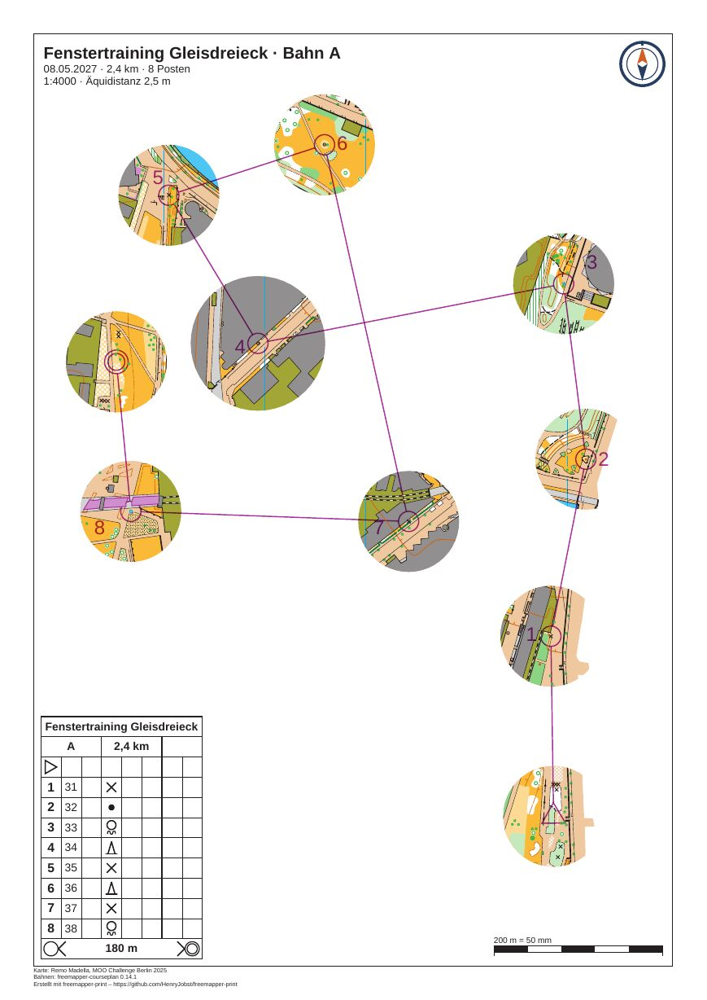

# gleisdreieck-training-window

[English](README.en.md)

Ein Fenster-OL auf der Karte „Gleisdreieck“ von Remo Madella (MOO Challenge Berlin 2025): Bahn A des
Vereinstrainings, 8 Posten auf 2,4 km, A4 in 1:4000. Die Karte ist nur in einem Kreis um den Start, jeden Posten
und das Ziel zu sehen. Dazwischen bleibt das Papier weiß, und die Läufer finden den Weg von Fenster zu Fenster mit
Kompass und Strecke. Strecken, Kreise, Nummern, Postenbeschreibung, Titel und Fußzeile druckt das Programm überall.
Die Bahn ist für das Beispiel erfunden, ebenso die Veranstaltung und der Verein.



| Datei | Inhalt |
|---|---|
| `freemapper-print.toml` | die Projektdatei, mit der Abdeckung `window-A` |
| `gleisdreieck-training.ppen` | die Bahnen A und B als Purple-Pen-Datei, erstellt mit freemapper-courseplan 0.14.1 |
| `gleisdreieck.omap` | die Karte (OOM, 1:4000), unverändert |
| `logos/kompass.svg` | das Vereinszeichen, ein Kompasszeichen, für dieses Beispiel gezeichnet (CC0) |
| `ATTRIBUTION.txt` | Autor, Veranstaltung und Nutzungsbedingungen, deutsch und englisch |
| `out/A.pdf` | das Blatt der Bahn A, A4 hoch, 1:4000 (0,5 MB) |
| `preview.jpg` | dasselbe Blatt als Bild |

Die Blätter sind deutsch (`event.lang = "de"`). Das Projekt ist eine Kopie von
[gleisdreieck-training](../gleisdreieck-training/README.md) mit einer Abdeckung auf Bahn A. Bahn B bleibt ohne
Abdeckung im Projekt und wird hier nicht exportiert; zum Beispiel gehört nur `out/A.pdf`.

## Was Sie auf dem Blatt sehen

- Zehn runde Fenster mit 15 mm Radius auf dem Papier, das sind 60 m im Gelände: um den Start, die acht Posten und
  das Ziel. Das Fenster um Posten 34 (Nummer 4) hat 20 mm Radius, im Gelände 80 m. Es zeigt, wie ein einzelner
  Posten mehr Karte bekommt.
- Kein Fenster berührt ein anderes. Zwischen den Rändern bleiben mindestens 3 mm Papier frei, im Gelände 12 m. Das
  ist der Standard von `masks window`, und der Befehl musste kein Fenster verkleinern: Die Posten liegen weit genug
  auseinander.
- Außerhalb der Fenster ist das Papier weiß. Auch die Nordlinien und die hellbraune Grundfläche der Karte fehlen
  dort, denn sie gehören zur Karte.
- Strecken, Postenkreise, Nummern, Start und Ziel liegen auch auf dem weißen Papier in Violett. Der
  Beschreibungskasten links unten, der Titelblock, das Logo, der Maßstabsbalken und die Fußzeile sind vollständig.
- Posten 36 (Nummer 6) liegt am nächsten am oberen Rand. Der Ausschnitt sitzt 9 mm höher als im
  Trainingsbeispiel, damit sein Fenster frei vom Titelblock bleibt.

## Was `check` meldet

`check` endet mit Exitcode 1, wegen derselben zwei Hinweise wie in allen Gleisdreieck-Beispielen. Sie stammen aus
der Karte: Das nicht gezeichnete Objekt hat das ausgeblendete Symbol 714.1 „map area“, und die vier Calibri-Einträge
gehören zu Symbolen für Postennummern (803.7 und 803.10), die das Programm in Arimo setzt. Die Info-Zeilen zählen
nicht mit.

```
Bahn „A“ auf Layout a4-a: A4 Hochformat, Druckmaßstab 1:4000, Kartenmaßstab 1:4000, Geometriefaktor 1,000, Symbolfaktor 1,000.
Hinweis: 1 Objekt wird nicht gezeichnet, weil das Symbol unbekannt oder ausgeblendet ist.
Hinweis: Die Schrift Arimo ersetzt Calibri.
Zur Information: Die Karte ist 115,5 mm zu breit und 164,2 mm zu hoch für den Kartenausschnitt und wird dort mit Absicht beschnitten (map_frame.crop = true).
Bahn „B“ auf Layout a4-b: ...
Mit Hinweisen: 2 von 2 Bahnen, 2 von 2 Layoutblättern.
```

Die Abdeckung selbst löst nichts aus: Kein Posten und kein Start liegt darunter, kein Element deckt ein Fenster ab.
Mit `--no-start` und `--no-finish` nennte `check` den Start und das Ziel als Stellen, an denen die Abdeckung die
Karte verbirgt.

## So ist es entstanden

Das Projekt beginnt als Kopie von gleisdreieck-training: Projektdatei, Karte, Bahndatei und Logo. In der
Projektdatei änderten sich zwei Dinge. Der Titel heißt jetzt „Fenstertraining Gleisdreieck“, und der Ausschnitt des
Layouts `a4-a` rückte von `centre_map_mm = [26.4, 135.0]` auf `[26.4, 144.0]`. Die Abdeckung kommt von
`masks window`, ohne Handarbeit:

```sh
freemapper-print --lang de masks window . --course A --radius-for 34=20 --assign
```

```
Abdeckung „window-A“ in ./freemapper-print.toml eingetragen: 10 Fenster mit 15 mm Radius auf dem Papier bei 1:4000 um den Start, die Posten 31, 32, 33, 34, 35, 36, 37 und 38 und das Ziel der Bahn „A“, mindestens 3 mm auseinander.
Posten 34 hat ein Fenster mit 20 mm Radius.
Die Bahn „A“ wird jetzt damit gedruckt, auf Layout a4-a.
Mit check sehen Sie das Ergebnis.
```

Der Befehl hängt eine Tabelle `[[masks]]` mit der Id `window-A` an, mit einem Kommentar, wie sie entstand. Sie hat ein
Polygon: als Umriss ein Rechteck 100 mm außerhalb der Karte und zehn Kreise als Löcher. `--assign` schrieb
`mask = "window-A"` in die Zuordnung von Bahn A. Der Radius zählt in Millimetern auf dem Papier, beim Druckmaßstab
des Layouts `a4-a`; das ist hier gleich den Kartenmillimetern, weil beides 1:4000 ist. Es gibt keine Zeile über ein
verkleinertes Fenster, die Abstandsregel hat also nichts geändert. Mit dem Ausschnitt des Trainingsbeispiels deckte
der Titelblock das Fenster von Posten 36 ab, und `check` sagte es. Der Ausschnitt 9 mm höher behob das.

Dann prüfen und das PDF der Bahn A schreiben:

```sh
freemapper-print --lang de check .
freemapper-print --lang de export . --course A
```

`export` schreibt `out/A.pdf` und endet mit Exitcode 0.

## Geprüft

- `check` und `export` wie oben, mit den obigen Meldungen.
- Das PDF bei 100 dpi gezeichnet und angesehen: Karte nur in den Fenstern, kein Fenster überlappt ein anderes,
  Bahn und Beschreibungskasten vollständig, Titelblock und Logo decken kein Fenster ab.
- Seitengröße mit `pdfinfo`: A4 hoch.

## Neu erzeugen

Das PDF entsteht aus den Befehlen oben. Die Vorschau:

```sh
pdftoppm -r 105 -png -singlefile out/A.pdf preview
magick preview.png -strip -sampling-factor 4:2:0 -quality 80 preview.jpg
rm preview.png
```

Mehr zu Fenstern und ihren Optionen: [Handbuch, Kapitel 11](../../docs/manual/de.md#11-abdeckungen-für-fenster--und-korridor-ol).
Korridor-OL auf derselben Karte: [gleisdreieck-training-corridor](../gleisdreieck-training-corridor/README.md).

## Drucken

Drucken Sie mit 100 % („Tatsächliche Größe“) und schalten Sie „An Seite anpassen“ aus. Messen Sie den
Maßstabsbalken auf dem Ausdruck nach.

## Nachweise

Karte: „Gleisdreieck“ von Remo Madella, MOO Challenge Berlin 2025, unverändert. Remo Madella hat am 12.11.2026
zugestimmt, dass die freemapper-Suite sie als Beispielkarte nutzt. Das ist eine Erlaubnis für die Suite, keine
offene Lizenz; `ATTRIBUTION.txt` hat die Einzelheiten. Bahnen: erstellt mit freemapper-courseplan 0.14.1. Das
Vereinszeichen ist unter CC0 freigegeben. Das PDF ist mit
[freemapper-print](https://github.com/HenryJobst/freemapper-print) erstellt.
