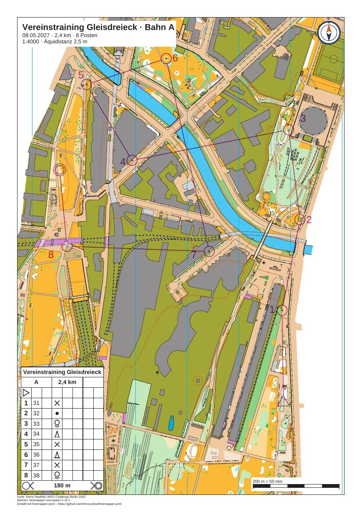

# gleisdreieck-training

[Deutsch](README.md)

A club training on the map "Gleisdreieck" by Remo Madella (MOO Challenge Berlin 2025): course A with 8 controls and
2.4 km, course B with 5 controls and 1.4 km, both at 1:4000 on A4. Each course gets a sheet with title block, club
logo, scale check bar and control descriptions. The courses are made up for the example, and so are the event, the
date and the club.



The preview shows sheet A. Sheet B is `out/B.pdf`.

| File | Content |
|---|---|
| `freemapper-print.toml` | the project file with two layouts, one per course, and one number correction |
| `gleisdreieck-training.ppen` | the courses A and B as a Purple Pen file, made with freemapper-courseplan 0.14.1 |
| `gleisdreieck.omap` | the map (OOM, 1:4000), unchanged |
| `logos/kompass.svg` | the club logo, a compass mark drawn for this example (CC0) |
| `ATTRIBUTION.txt` | author, event and the terms of use, German and English |
| `out/A.pdf` | sheet of course A, A4 portrait, 1:4000 (2.6 MB) |
| `out/B.pdf` | sheet of course B, A4 portrait, 1:4000 (3.0 MB) |
| `preview.jpg` | sheet A as an image |

The sheets are in German (`event.lang = "de"`).

## What to look at

- Course A has 8 controls on 2.4 km, with straight legs. The leg from control 7 to control 8 crosses the railway
  tracks.
- The description box sits at the bottom left, where no leg runs. At the top right, where `init` puts it, it
  covered the number of control 3.
- The title block names the course, length and number of controls: "Vereinstraining Gleisdreieck · Bahn A", "8 Posten".
  Course B reads "5 Posten".
- The club logo is at the top right. It is a small mark in blue and orange, drawn for this example and released
  under CC0.
- The scale check bar at the bottom right measures 200 m = 50 mm. The footer below the frame names the map author,
  the courses and freemapper-print.
- Course B lies at the southern edge of the map, where the map's own information block sits (logos, scale, title).
  The frame of sheet B ends just above it. A small scale check bar of its own, flush with the lower edge, covers
  the last millimetre of a logo that still reached in.

## The courses

The file comes from freemapper-courseplan 0.14.1. A starts in the south-east of the section and ends in the west.
B stays in the south-east. Control codes are 31 to 38 for A and 41 to 45 for B. A Purple Pen file holds the
positions, the position of each control number and the descriptions, so the program needs nothing else for the
sheets.

## What `check` reports

`check` ends with exit code 1. Two notes per sheet come from the map. The Info lines do not count.

```
Info: latitude and longitude were not checked, because no control has both a map position and latitude and longitude.
Course "A" on layout a4-a: A4 portrait, print scale 1:4000, map scale 1:4000, geometry factor 1.000, symbol factor 1.000.
Note: 1 object is not drawn because the symbol is unknown or hidden.
Note: the font Arimo replaces Calibri.
Info: the map is 115.5 mm too wide and 164.2 mm too tall for the map frame and is cut there on purpose (map_frame.crop = true).
Course "B" on layout a4-b: A4 portrait, print scale 1:4000, map scale 1:4000, geometry factor 1.000, symbol factor 1.000.
Note: 1 object is not drawn because the symbol is unknown or hidden.
Note: the font Arimo replaces Calibri.
Info: the map is 115.5 mm too wide and 164.2 mm too tall for the map frame and is cut there on purpose (map_frame.crop = true).
Layout a4-a: ...
Layout a4-b: ...
With notes: 2 of 2 courses, 2 of 2 layout sheets.
```

The lines for the two layout sheets without a course repeat the same notes. They add Info lines that the placeholders
`{course}`, `{length_km}` and `{controls}` stay empty there. `export` writes the courses only.

- The undrawn object has the symbol 714.1 "map area". The map file marks that symbol as hidden, and the program
  follows it.
- The map names the font Calibri in four symbols for control numbers (803.7 and 803.10). The program takes Arimo.
  The control numbers on the sheets come from the program, not from these symbols.

`check` has nothing else to say about the sheets.

## How it was made

With freemapper-print alone, in this example's folder. First the project from map and course file. The map has no
`freemapper.toml`, so `init` needs `--kind`:

```sh
freemapper-print --lang en init . --map gleisdreieck.omap --kind sprint --title "Club training Gleisdreieck" \
  --courses gleisdreieck-training.ppen
```

```
Map kind: sprint maps, as --kind says.
Read the course file gleisdreieck-training.ppen: 2 courses, fitted to the map.
Looking for an A4 or A3 sheet that shows the map at 1:4000 …
Wrote ./freemapper-print.toml with one layout and 2 course assignments, for sprint maps.
Layout a4-4000 at 1:4000: A4, passe-partout 8 mm, for "A", "B".
Warning: no A4 or A3 sheet shows the map at 1:4000 without notes or errors, so layout a4-4000 keeps A4. check reports this.
...
```

The warning is fair: the map is far larger than a sheet. A course sheet cuts the map to the course on purpose, so
the project file got `map_frame.crop = true`. Then it was edited by hand (the file keeps German comments):

- `[event]`: date and organiser added. The contour interval changed from the suggested 2 m to the 2.5 m of the
  map's information block.
- `[print]` with the map credit and the courses credit. The map has no notes of its own.
- The title block shows `{event} · Bahn {course}`, `{date} · {length_km} km · {controls} Posten` and
  `1:{print_scale} · Äquidistanz {contour_interval}`.
- The logo `logos/kompass.svg` at the top right, 14 mm wide.
- Two layouts instead of one, each with `centre_map_mm`, 10 mm passe-partout and `crop = true`: `a4-a` for course A
  and `a4-b` for course B. The centres come from the legs and from the information block of the map: sheet A ends
  below the title and logos at the top of the map, sheet B above the logos at the bottom.
- The description box at the bottom left of both frames.
- Layout `a4-b` hides the shared scale check bar and has its own, flush with the lower edge.

Then `check` and the one correction it proposed. On sheet B the number of control 43 (number 3) lay on a line
symbol of the map:

```sh
freemapper-print --lang en check .
freemapper-print --lang en numbers accept . --course B --control 43 --sheet
```

```
Added a correction for the number of control 43 for course "B" to ./freemapper-print.toml: direction 299.5° with a gap of 5 mm. Run check to see the result.
```

`numbers accept` appended a `[[numbers]]` table to the project file. The number now stands below and to the right of
its circle. Last the PDFs:

```sh
freemapper-print --lang en export .
```

`export` writes `out/A.pdf` and `out/B.pdf` and ends with exit code 0.

## Checked

- `check` and `export` as above, with the messages above.
- Both PDFs rendered with `pdftoppm` at 100 dpi and looked at: map, purple course and numbers, no number or
  element on a control, description box complete and at the bottom left, title block and logo free of the course.
- Sheet B at 250 dpi along the lower edge: no part of the map's logo shows beside the scale check bar.
- Page size from `pdfinfo`: A4 portrait.

## Regenerate

The PDFs come from the commands above. The preview comes from sheet A:

```sh
pdftoppm -r 105 -png -singlefile out/A.pdf preview
magick preview.png -strip -sampling-factor 4:2:0 -quality 80 preview.jpg
rm preview.png
```

More on courses: [manual, chapter 8](../../docs/manual/en.md#8-courses). The same project with a window mask:
[gleisdreieck-training-window](../gleisdreieck-training-window/README.en.md).

## Printing

Print at 100 % ("actual size") with "fit to page" switched off. Measure the scale check bar on the printout.

## Credits

Map: "Gleisdreieck" by Remo Madella, MOO Challenge Berlin 2025, unchanged. Remo Madella agreed on 2026-11-12 that
the freemapper suite may use it as an example map. That is a permission for the suite, not an open licence;
`ATTRIBUTION.txt` has the details. Courses: made with freemapper-courseplan 0.14.1. The club logo is released under
CC0. The PDFs were made with [freemapper-print](https://github.com/HenryJobst/freemapper-print).
