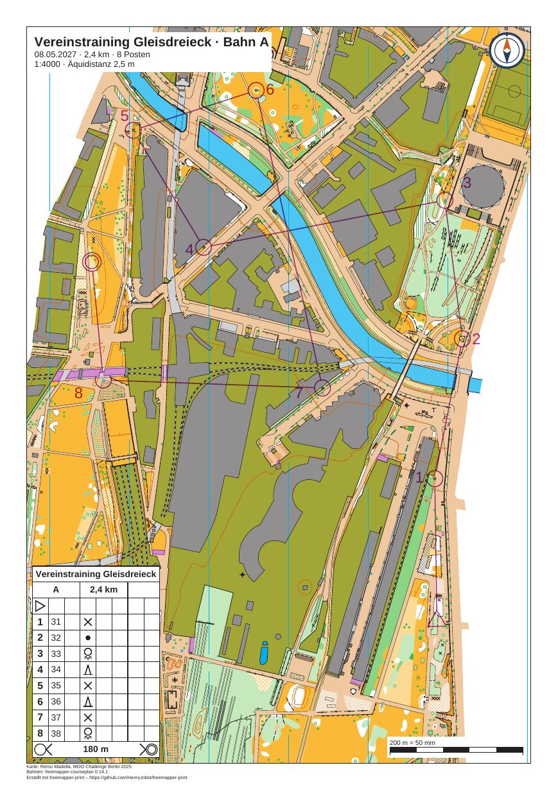

# gleisdreieck-training

[English](README.en.md)

Ein Vereinstraining auf der Karte „Gleisdreieck“ von Remo Madella (MOO Challenge Berlin 2025): Bahn A mit 8 Posten
und 2,4 km, Bahn B mit 5 Posten und 1,4 km, beide in 1:4000 auf A4. Jede Bahn bekommt ein Blatt mit Titelblock,
Vereinszeichen, Maßstabsbalken und Postenbeschreibung. Die Bahnen sind für das Beispiel erfunden, ebenso die
Veranstaltung, das Datum und der Verein.



Die Vorschau zeigt das Blatt A. Das Blatt B ist `out/B.pdf`.

| Datei | Inhalt |
|---|---|
| `freemapper-print.toml` | die Projektdatei mit zwei Layouts, eines je Bahn, und einer Nummernkorrektur |
| `gleisdreieck-training.ppen` | die Bahnen A und B als Purple-Pen-Datei, erstellt mit freemapper-courseplan 0.14.1 |
| `gleisdreieck.omap` | die Karte (OOM, 1:4000), unverändert |
| `logos/kompass.svg` | das Vereinszeichen, ein Kompasszeichen, für dieses Beispiel gezeichnet (CC0) |
| `ATTRIBUTION.txt` | Autor, Veranstaltung und Nutzungsbedingungen, deutsch und englisch |
| `out/A.pdf` | Blatt der Bahn A, A4 hoch, 1:4000 (0,5 MB) |
| `out/B.pdf` | Blatt der Bahn B, A4 hoch, 1:4000 (0,5 MB) |
| `preview.jpg` | das Blatt A als Bild |

Die Blätter sind deutsch (`event.lang = "de"`).

## Was Sie auf dem Blatt sehen

- Bahn A hat 8 Posten auf 2,4 km, mit geraden Strecken. Die Strecke von Posten 7 zu Posten 8 quert die
  Bahngleise.
- Der Beschreibungskasten steht links unten, wo keine Strecke läuft. Rechts oben, wo `init` ihn hinsetzt, deckte
  er die Nummer von Posten 3.
- Der Titelblock nennt Bahn, Länge und Postenzahl: „Vereinstraining Gleisdreieck · Bahn A“, „8 Posten“. Bei Bahn B
  steht dort „5 Posten“.
- Das Vereinszeichen sitzt rechts oben. Es ist ein kleines Zeichen in Blau und Orange, für dieses Beispiel
  gezeichnet und unter CC0 freigegeben.
- Der Maßstabsbalken rechts unten misst 200 m = 50 mm. Die Fußzeile unter dem Rahmen nennt den Kartenautor, die
  Bahnen und freemapper-print.
- Bahn B liegt am Südrand der Karte, wo der Informationsblock der Karte steht (Logos, Maßstab, Titel). Der
  Ausschnitt von Blatt B endet knapp darüber. Ein eigener, kleiner Maßstabsbalken bündig am unteren Rand deckt den
  letzten Millimeter eines Logos ab, der noch hineinreichte.

## Die Bahnen

Die Datei stammt aus freemapper-courseplan 0.14.1. A beginnt im Südosten des Ausschnitts und endet im Westen. B
bleibt im Südosten. Die Postencodes sind 31 bis 38 bei A und 41 bis 45 bei B. Eine Purple-Pen-Datei enthält die
Positionen, die Lage jeder Postennummer und die Beschreibungen, das Programm braucht für die Blätter nichts
weiter.

## Was `check` meldet

`check` endet mit Exitcode 1. Zwei Hinweise je Blatt stammen aus der Karte. Die Info-Zeilen zählen nicht mit.

```
Zur Information: Die geografischen Koordinaten wurden nicht geprüft, denn kein Posten hat sowohl eine Kartenposition als auch geografische Koordinaten.
Bahn „A“ auf Layout a4-a: A4 Hochformat, Druckmaßstab 1:4000, Kartenmaßstab 1:4000, Geometriefaktor 1,000, Symbolfaktor 1,000.
Hinweis: 1 Objekt wird nicht gezeichnet, weil das Symbol unbekannt oder ausgeblendet ist.
Hinweis: Die Schrift Arimo ersetzt Calibri.
Zur Information: Die Karte ist 115,5 mm zu breit und 164,2 mm zu hoch für den Kartenausschnitt und wird dort mit Absicht beschnitten (map_frame.crop = true).
Bahn „B“ auf Layout a4-b: A4 Hochformat, Druckmaßstab 1:4000, Kartenmaßstab 1:4000, Geometriefaktor 1,000, Symbolfaktor 1,000.
Hinweis: 1 Objekt wird nicht gezeichnet, weil das Symbol unbekannt oder ausgeblendet ist.
Hinweis: Die Schrift Arimo ersetzt Calibri.
Zur Information: Die Karte ist 115,5 mm zu breit und 164,2 mm zu hoch für den Kartenausschnitt und wird dort mit Absicht beschnitten (map_frame.crop = true).
Layout a4-a: ...
Layout a4-b: ...
Mit Hinweisen: 2 von 2 Bahnen, 2 von 2 Layoutblättern.
```

Die Zeilen der beiden Layoutblätter ohne Bahn wiederholen dieselben Hinweise. Dazu kommen Info-Zeilen, dass die
Platzhalter `{course}`, `{length_km}` und `{controls}` dort leer bleiben. `export` schreibt nur die Bahnen.

- Das nicht gezeichnete Objekt hat das Symbol 714.1 „map area“. Die Kartendatei markiert dieses Symbol als
  ausgeblendet, und das Programm folgt ihr.
- Die Karte nennt die Schrift Calibri in vier Symbolen für Postennummern (803.7 und 803.10). Das Programm nimmt
  Arimo. Die Postennummern auf den Blättern setzt das Programm selbst, nicht diese Symbole.

Zu den Blättern selbst hat `check` nichts weiter zu sagen.

## So ist es entstanden

Nur mit freemapper-print, im Ordner dieses Beispiels. Zuerst das Projekt aus Karte und Bahndatei. Die Karte hat
keine `freemapper.toml`, deshalb braucht `init` die Angabe `--kind`:

```sh
freemapper-print --lang de init . --map gleisdreieck.omap --kind sprint --title "Vereinstraining Gleisdreieck" \
  --courses gleisdreieck-training.ppen
```

```
Kartenart: Sprintkarten, wie mit --kind angegeben.
Bahndatei gleisdreieck-training.ppen gelesen: 2 Bahnen, an die Karte angepasst.
Suche ein A4- oder A3-Blatt, das die Karte in 1:4000 zeigt …
./freemapper-print.toml geschrieben mit einem Layout und 2 Bahnzuordnungen, für Sprintkarten.
Layout a4-4000 bei 1:4000: A4, Passepartout 8 mm, für „A“, „B“.
Warnung: Kein A4- oder A3-Blatt zeigt die Karte bei 1:4000 ohne Hinweise oder Fehler, deshalb bleibt Layout a4-4000 bei A4. check meldet das.
...
```

Die Warnung stimmt: Die Karte ist viel größer als ein Blatt. Ein Bahnblatt schneidet die Karte mit Absicht auf die
Bahn zu, deshalb hat die Projektdatei `map_frame.crop = true`. Danach wurde sie von Hand bearbeitet:

- `[event]`: Datum und Veranstalter ergänzt. Die Äquidistanz von den vorgeschlagenen 2 m auf die 2,5 m aus dem
  Informationsblock der Karte geändert.
- `[print]` mit dem Kartennachweis und dem Bahnnachweis. Die Karte hat keine eigenen Notizen.
- Der Titelblock zeigt `{event} · Bahn {course}`, `{date} · {length_km} km · {controls} Posten` und
  `1:{print_scale} · Äquidistanz {contour_interval}`.
- Das Logo `logos/kompass.svg` rechts oben, 14 mm breit.
- Zwei Layouts statt einem, jedes mit `centre_map_mm`, 10 mm Passepartout und `crop = true`: `a4-a` für Bahn A und
  `a4-b` für Bahn B. Die Mittelpunkte richten sich nach den Strecken und nach dem Informationsblock der Karte:
  Blatt A endet unter Titel und Logos am oberen Kartenrand, Blatt B über den Logos am unteren.
- Der Beschreibungskasten links unten in beiden Ausschnitten.
- Das Layout `a4-b` blendet den gemeinsamen Maßstabsbalken aus und hat einen eigenen, bündig am unteren Rand.

Dann `check` und die eine Korrektur, die es vorschlug. Auf Blatt B lag die Nummer von Posten 43 (Nummer 3) auf einem
Liniensymbol der Karte:

```sh
freemapper-print --lang de check .
freemapper-print --lang de numbers accept . --course B --control 43 --sheet
```

```
Korrektur für die Nummer von Posten 43 für Bahn „B“ in ./freemapper-print.toml eingetragen: Richtung 299,5° mit einem Abstand von 5 mm. Mit check sehen Sie das Ergebnis.
```

`numbers accept` hängt eine Tabelle `[[numbers]]` an die Projektdatei an. Die Nummer steht jetzt unten rechts von
ihrem Kreis. Zuletzt die PDFs:

```sh
freemapper-print --lang de export .
```

`export` schreibt `out/A.pdf` und `out/B.pdf` und endet mit Exitcode 0.

## Geprüft

- `check` und `export` wie oben, mit den obigen Meldungen.
- Beide PDFs mit `pdftoppm` bei 100 dpi gezeichnet und angesehen: Karte, violette Bahn und Nummern, keine Nummer
  und kein Element auf einem Posten, Beschreibungskasten vollständig und links unten, Titelblock und Logo frei von
  der Bahn.
- Blatt B bei 250 dpi am unteren Rand: Neben dem Maßstabsbalken ist nichts vom Logo der Karte zu sehen.
- Seitengröße mit `pdfinfo`: A4 hoch.

## Neu erzeugen

Die PDFs entstehen aus den Befehlen oben. Die Vorschau stammt vom Blatt A:

```sh
pdftoppm -r 105 -png -singlefile out/A.pdf preview
magick preview.png -strip -sampling-factor 4:2:0 -quality 80 preview.jpg
rm preview.png
```

Mehr zu Bahnen: [Handbuch, Kapitel 8](../../docs/manual/de.md#8-bahnen). Dasselbe Projekt mit Fensterabdeckung:
[gleisdreieck-training-window](../gleisdreieck-training-window/README.md).

## Drucken

Drucken Sie mit 100 % („Tatsächliche Größe“) und schalten Sie „An Seite anpassen“ aus. Messen Sie den
Maßstabsbalken auf dem Ausdruck nach.

## Nachweise

Karte: „Gleisdreieck“ von Remo Madella, MOO Challenge Berlin 2025, unverändert. Remo Madella hat am 12.11.2026
zugestimmt, dass die freemapper-Suite sie als Beispielkarte nutzt. Das ist eine Erlaubnis für die Suite, keine
offene Lizenz; `ATTRIBUTION.txt` hat die Einzelheiten. Bahnen: erstellt mit freemapper-courseplan 0.14.1. Das
Vereinszeichen ist unter CC0 freigegeben. Die PDFs sind mit
[freemapper-print](https://github.com/HenryJobst/freemapper-print) erstellt.
