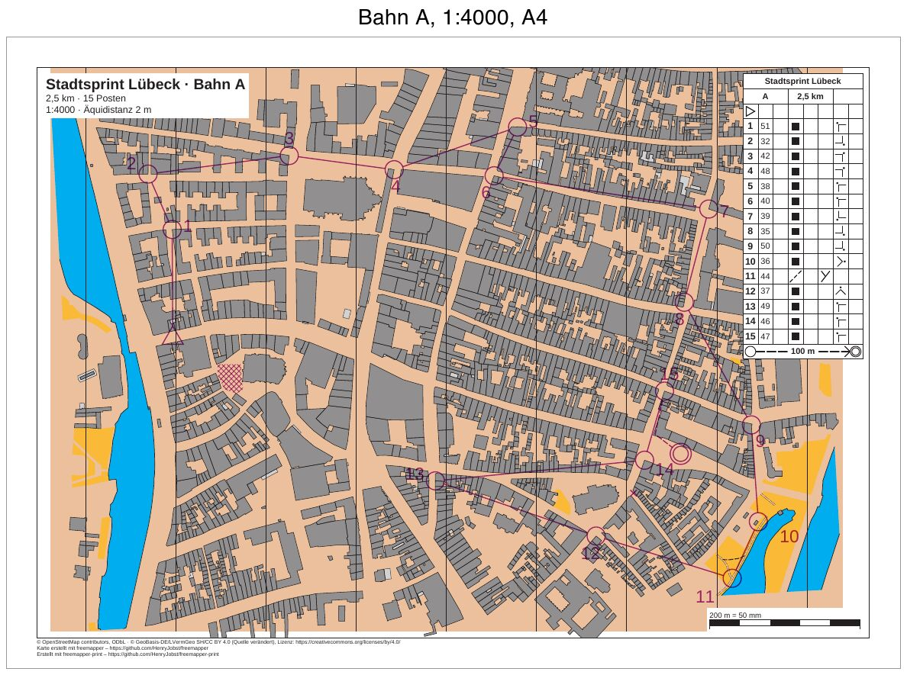

# luebeck-competition-courses

[Deutsch](README.md)

The sprint in the old town of Lübeck from
[luebeck-competition-layouts](../luebeck-competition-layouts/README.en.md), now with courses. Three courses come
from a Purple Pen file: A (long) and B (middle) on A4 at 1:4000, C for the youngest classes on A3 at 1:3000. Each
sheet shows the course with control numbers, the control descriptions, an out-of-bounds area, a forbidden
crossing and the marked route to the finish. The folder `iof/` holds the same courses as IOF XML 3.0. Those
sheets have no control descriptions, because the format has none.



| File | Content |
|---|---|
| `freemapper-print.toml` | the project file for `courses.ppen` |
| `courses.ppen` | the courses as a Purple Pen file, written by hand for this example |
| `courses.xml` | the same courses as IOF XML 3.0 `CourseData` |
| `luebeck.omap` | the map (OOM, ISSprOM 2019, 1:4000) |
| `freemapper.toml` | freemapper's sidecar file; `init` reads only the map kind from it |
| `ATTRIBUTION.txt` | the map's sources, from freemapper |
| `out/A.pdf`, `out/B.pdf`, `out/C.pdf` | the sheets of the three courses from `courses.ppen` |
| `iof/freemapper-print.toml` | the project file for `courses.xml` |
| `iof/out/A.pdf`, `iof/out/B.pdf`, `iof/out/C.pdf` | the same courses from `courses.xml` |
| `preview.jpg` | the sheet of course A |

The sheets are in German (`event.lang = "de"`), as for a German event.

## The courses

| Course | Length | Controls | Sheet |
|---|---|---|---|
| A | 2.5 km | 15 | A4 landscape, 1:4000 |
| B | 1.9 km | 10 | A4 landscape, 1:4000 |
| C | 1.2 km | 7 | A3 landscape, 1:3000, symbols at 133 % |

The program measures the lengths along the legs: straight from control to control, and the marked route to the
finish with its bend.

All three courses start at the same spot in the west of the old town and finish on the same square in the east.
The last control (code 47) is shared, and a marked route of 100 m leads from it to the finish. The descriptions
show it in the finish row with symbol 14.1.

Every control except start and finish sits on a feature of the map: the corner of a building (symbol 521) or the
junction of two paths (505.1) on the eastern edge of the old town. The start stands on the street in front of a
block of houses, the finish on a square. A small script read the building corners and path nodes from
`luebeck.omap`. Each control position is one of those points, converted to millimetres and written with y
pointing up, as Purple Pen writes it (ADR 0032). The descriptions follow the IOF 2018 standard: column D
"building" or "path", column G the outside corner with its compass direction, column F "junction".

Control 36 (number 10 of course A) stood on a path junction between the two water areas in the south-east up to
the map from freemapper 0.5.0. Since version 0.8.0 these gravel paths are candidates and no longer paths of the
map. The control now stands 53 m further west, at the east corner of a small building by the path along the
water. Course A is 49 m shorter for it, and the sheet now gives the same 2.5 km as the table.

Three special objects apply to all courses:

- an out-of-bounds area in a courtyard south-east of the start. The leg from 1 to 2 of course B crosses it, so
  runners have to go round.
- a forbidden crossing: a cross at the street mouth about 45 m south-west of control 46.
- the marked route from the last control to the finish.

## Control numbers

Four controls have a fixed number position in `courses.ppen` (`number-location`): 32 and 49 on course A, 38 on
course B, 45 on course C. The program places all other numbers itself, behind the circle in the running
direction and clear of legs and of the map's point and line symbols.

Number 13 of course A (code 49) sits east of its circle in the file, right between the leg coming from control 37
and the leg to control 46. `check` reports this and proposes a free position:

```
Hinweis: Auf dem Blatt der Bahn „A“ überdeckt die Nummer von Posten 49 die Strecke von 37 nach 49, die Strecke von 49 nach 46. Sie wird trotzdem dort gedruckt. Frei ist Richtung 161° mit 0,5 mm Abstand. Um diese Lage zu nutzen, rufen Sie numbers accept mit --course „A“, --control 49 und --sheet oder --layout-wide auf.
```

With `--lang en` the same note reads "Note: on the sheet of course "A" the number of control 49 covers the leg
from 37 to 49, the leg from 49 to 46. ...".
`numbers accept` takes the proposal for this one sheet:

```sh
freemapper-print --lang de numbers accept . --course A --control 49 --sheet
```

```
Korrektur für die Nummer von Posten 49 für Bahn „A“ in ./freemapper-print.toml eingetragen: Richtung 161° mit einem Abstand von 0,5 mm. Mit check sehen Sie das Ergebnis.
```

The project file then ends with a `[[numbers]]` table holding direction, gap and the position the correction
was made against (`base_seen`). If someone later moves the number in Purple Pen, `check` reports the correction
as stale.

## What `check` reports

After the correction everything is fine, and `check` ends with exit code 0. The "Zur Information" (Info) lines do
not count. A course sheet cuts the map to the course on purpose, and the file has no latitude and longitude for
the program to check. After the courses, `check` checks the two layouts as sheets without a course, as
`export --layout` writes them; there the course placeholders stay empty.

```
Zur Information: Die geografischen Koordinaten wurden nicht geprüft, denn kein Posten hat sowohl eine Kartenposition als auch geografische Koordinaten.
Bahn „A“ auf Layout a4-4000: A4 Querformat, Druckmaßstab 1:4000, Kartenmaßstab 1:4000, Geometriefaktor 1,000, Symbolfaktor 1,000.
Zur Information: Die Karte ist 14,0 mm zu hoch für den Kartenausschnitt und wird dort mit Absicht beschnitten (map_frame.crop = true).
Bahn „B“ auf Layout a4-4000: A4 Querformat, Druckmaßstab 1:4000, Kartenmaßstab 1:4000, Geometriefaktor 1,000, Symbolfaktor 1,000.
Zur Information: Die Karte ist 16,7 mm zu hoch für den Kartenausschnitt und wird dort mit Absicht beschnitten (map_frame.crop = true).
Bahn „C“ auf Layout a3-3000: A3 Querformat, Druckmaßstab 1:3000, Kartenmaßstab 1:4000, Geometriefaktor 1,333, Symbolfaktor 1,333.
Zur Information: Die Karte ist 3,0 mm zu hoch für den Kartenausschnitt und wird dort mit Absicht beschnitten (map_frame.crop = true).
Layout a4-4000: A4 Querformat, Druckmaßstab 1:4000, Kartenmaßstab 1:4000, Geometriefaktor 1,000, Symbolfaktor 1,000.
Zur Information: Die Karte ist 14,0 mm zu hoch für den Kartenausschnitt und wird dort mit Absicht beschnitten (map_frame.crop = true).
Zur Information: Der Text title nutzt {course}, der nur auf Bahnblättern gefüllt wird. Auf diesem Blatt bleibt er leer.
Zur Information: Der Text title nutzt {length_km}, der nur auf Bahnblättern gefüllt wird. Auf diesem Blatt bleibt er leer.
Zur Information: Der Text title nutzt {controls}, der nur auf Bahnblättern gefüllt wird. Auf diesem Blatt bleibt er leer.
Layout a3-3000: A3 Querformat, Druckmaßstab 1:3000, Kartenmaßstab 1:4000, Geometriefaktor 1,333, Symbolfaktor 1,333.
Zur Information: Der Text title nutzt {course}, der nur auf Bahnblättern gefüllt wird. Auf diesem Blatt bleibt er leer.
Zur Information: Der Text title nutzt {length_km}, der nur auf Bahnblättern gefüllt wird. Auf diesem Blatt bleibt er leer.
Zur Information: Der Text title nutzt {controls}, der nur auf Bahnblättern gefüllt wird. Auf diesem Blatt bleibt er leer.
3 Bahnen und 2 Layoutblätter geprüft, keine Hinweise.
```

## How it was made

With freemapper-print alone, in the folder of this example. First the project from map and course file:

```sh
freemapper-print --lang de init . --map luebeck.omap --title "Stadtsprint Lübeck" --courses courses.ppen
```

```
Kartenart: Sprintkarten, wie in der freemapper.toml neben der Karte angegeben.
Bahndatei courses.ppen gelesen: 3 Bahnen, an die Karte angepasst.
Suche ein A4- oder A3-Blatt, das die Karte in 1:4000 zeigt …
Suche ein A4- oder A3-Blatt, das die Karte in 1:3000 zeigt …
./freemapper-print.toml geschrieben mit 2 Layouts und 3 Bahnzuordnungen, für Sprintkarten.
Layout a3-4000 bei 1:4000: A3, Passepartout 14 mm, für „A“, „B“.
Layout a4-3000 bei 1:3000: A4, Passepartout 8 mm, für „C“.
Warnung: Kein A4- oder A3-Blatt zeigt die Karte bei 1:3000 ohne Hinweise oder Fehler, deshalb bleibt Layout a4-3000 bei A4. check meldet das.
Die Druckmaßstäbe stammen aus der Bahndatei, ein Layout je Maßstab. Eine Bahn ohne Druckmaßstab bekommt den Kartenmaßstab 1:4000.
Jedes Layout hat einen Beschreibungskasten in der oberen rechten Ecke des Kartenausschnitts, mit der Zellengröße des Regelprofils.
Ein Bahnblatt schneidet die Karte mit Absicht auf die Bahn zu, deshalb haben die Layouts map_frame.crop = true.
Das Projekt schlägt eine Äquidistanz von 2 m vor, üblich für Sprintkarten. Sehen Sie auf der Karte nach und bestätigen Sie den Wert oder ändern Sie map.contour_interval_m.
Als Nächstes freemapper-print check ./freemapper-print.toml aufrufen. Es meldet die Hinweise oben, bis das Layout geändert ist.
```

From the file's print scales (4000 for A and B, 3000 for C) `init` makes two layouts. For each it looks for the
paper the whole map fits on. A course sheet does not need that, so the layouts were changed by hand afterwards.
Nobody has to confirm the y axis: Purple Pen always writes it pointing up, and the program reads the file so.

Edited by hand:

- `[event]`: date and organiser added.
- The proposed contour interval of 2 m compared with the map's information block and confirmed.
- `[print]` added with the two copyright lines from luebeck-competition-layouts.
- The title block shows `{event} · Bahn {course}`, then `{length_km} km · {controls} Posten` and
  `1:{print_scale} · Äquidistanz {contour_interval}`.
- The layouts `a3-4000` and `a4-3000` replaced by `a4-4000` (A4 landscape, 10 mm passe-partout) and `a3-3000`
  (A3 landscape, 10 mm), both with `crop = true` and the description box at the top right. On A4 the box has
  5 mm cells instead of 6 mm. At 6 mm it reaches down to control 50 (number 9) of course A, and `check` reports
  that it covers it.
- The course assignments moved to the new layout ids.

Then check, take the correction for control 49 (see above), check again and write the PDFs:

```sh
freemapper-print --lang de check .
freemapper-print --lang de numbers accept . --course A --control 49 --sheet
freemapper-print --lang de check .
freemapper-print --lang de export .
```

`export` writes one PDF per course into the folder `out`, named after the course, and exits with code 0.

### The same courses as IOF XML

`courses.xml` holds the same controls at the same map positions (in millimetres, y up) and the same courses, plus
`Map/Scale` 4000 and each course's length. It has no latitude and longitude. IOF XML has no control
descriptions, special objects, bends or print scales, and this file gives no number positions either.

```sh
freemapper-print --lang de init iof --map luebeck.omap --title "Stadtsprint Lübeck" --courses courses.xml
freemapper-print --lang de check iof
freemapper-print --lang de export iof
```

`init` writes `iof/freemapper-print.toml` with one layout `a3-4000` for all three courses: A3 at 1:4000, without
a description box. The title block names the course, since otherwise its name appears nowhere on the sheet. The
first `check` reports the assumed y axis, because IOF XML does not say which one applies. With
`course_y_axis = "up"` in `[sources]`, `check` ends with exit code 0:

```
Zur Information: Die Bahndatei hat keine Postenbeschreibungen.
Zur Information: Die geografischen Koordinaten wurden nicht geprüft, denn kein Posten hat sowohl eine Kartenposition als auch geografische Koordinaten.
Bahn „A“ auf Layout a3-4000: A3 Hochformat, Druckmaßstab 1:4000, Kartenmaßstab 1:4000, Geometriefaktor 1,000, Symbolfaktor 1,000.
Zur Information: Die Bahn „A“ kommt aus IOF-XML. Das Format kennt keine Postenbeschreibungen, das Blatt hat deshalb keine.
Bahn „B“ auf Layout a3-4000: A3 Querformat, Druckmaßstab 1:4000, Kartenmaßstab 1:4000, Geometriefaktor 1,000, Symbolfaktor 1,000.
Zur Information: Die Bahn „B“ kommt aus IOF-XML. Das Format kennt keine Postenbeschreibungen, das Blatt hat deshalb keine.
Bahn „C“ auf Layout a3-4000: A3 Querformat, Druckmaßstab 1:4000, Kartenmaßstab 1:4000, Geometriefaktor 1,000, Symbolfaktor 1,000.
Zur Information: Die Bahn „C“ kommt aus IOF-XML. Das Format kennt keine Postenbeschreibungen, das Blatt hat deshalb keine.
Layout a3-4000: A3 Hochformat, Druckmaßstab 1:4000, Kartenmaßstab 1:4000, Geometriefaktor 1,000, Symbolfaktor 1,000.
Zur Information: Der Text title nutzt {course}, der nur auf Bahnblättern gefüllt wird. Auf diesem Blatt bleibt er leer.
3 Bahnen und 1 Layoutblatt geprüft, keine Hinweise.
```

Compared with `out/`, the sheets in `iof/out/` lack the description box, the out-of-bounds area, the forbidden
crossing and the marked route; the last leg is a plain line. Course C prints at 1:4000 instead of 1:3000, and
the program places every number itself.

## Open

- Open `courses.ppen` once in Purple Pen (macOS beta) and check it. Does Purple Pen load the map `luebeck.omap`?
  Do the controls sit at their building corners and path junctions? Are the descriptions, the special objects,
  the marked route and the four fixed numbers right? The file follows the layout of Purple Pen's sample files.
  The value `Spr2019` for the map standard (ISSprOM 2019) has not been checked against Purple Pen.

## Checked

- `check` and `export` as above, with the messages above, for both project files.
- Exported twice: the PDFs are identical byte for byte.
- The pages viewed at 200 dpi: every control sits at its building corner or path junction, number 13 of course A
  sits west of its circle after the correction, the out-of-bounds area, the cross and the marked route print in
  purple, and the description box covers no control.

## Regenerate

The PDFs come from `export` as above. The preview comes from `pdftoppm` and ImageMagick, working in a temporary
folder as for [luebeck-scales](../luebeck-scales/README.en.md#regenerate), here with one page at 100 dpi:

```sh
FONT=/System/Library/Fonts/Helvetica.ttc
tmp=$(mktemp -d)
pdftoppm -r 100 -png -singlefile out/A.pdf "$tmp/a"
magick "$tmp/a.png" -bordercolor gray60 -border 1 -background white -gravity north -splice 0x40 \
  -font "$FONT" -pointsize 28 -annotate +0+4 "Bahn A, 1:4000, A4" -bordercolor white -border 8 \
  -quality 80 preview.jpg
rm -r "$tmp"
```

## Printing

Print at 100 % ("Actual size") and switch "Fit to page" off. Measure the scale check bar on the printout to see
whether the printer scaled the page.

## Credits and licence

Map, `freemapper.toml` and `ATTRIBUTION.txt` from the example `schleswig-holstein-luebeck` of
[freemapper](https://github.com/HenryJobst/freemapper), version 0.8.0 (commit `a2b41b4`), unchanged. The map is
under the terms `ATTRIBUTION.txt` names: map data © OpenStreetMap contributors (ODbL) and © GeoBasis-DE/LVermGeo SH
(CC BY 4.0, source modified). The courses in `courses.ppen` and `courses.xml` were written for this example and are
released under CC0. The PDFs were made with [freemapper-print](https://github.com/HenryJobst/freemapper-print).
