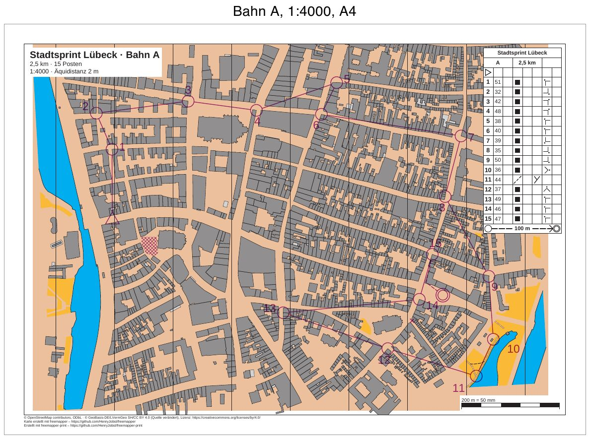

# luebeck-competition-courses

[English](README.en.md)

Der Stadtsprint in der Lübecker Altstadt aus [luebeck-competition-layouts](../luebeck-competition-layouts/README.md),
jetzt mit Bahnen. Drei Bahnen kommen aus einer Purple-Pen-Datei: A (lang) und B (mittel) auf A4 in 1:4000, C
für die jüngsten Klassen auf A3 in 1:3000. Jedes Blatt zeigt die Bahn mit Postennummern, die
Postenbeschreibung, ein Sperrgebiet, eine verbotene Querung und die markierte Strecke zum Ziel. Im Ordner `iof/`
stehen dieselben Bahnen als IOF-XML 3.0. Diese Blätter haben keine Postenbeschreibung, weil das Format keine kennt.



| Datei | Inhalt |
|---|---|
| `freemapper-print.toml` | die Projektdatei für `courses.ppen` |
| `courses.ppen` | die Bahnen als Purple-Pen-Datei, für dieses Beispiel von Hand geschrieben |
| `courses.xml` | dieselben Bahnen als IOF-XML 3.0 `CourseData` |
| `luebeck.omap` | die Karte (OOM, ISSprOM 2019, 1:4000) |
| `freemapper.toml` | Begleitdatei von freemapper; `init` liest daraus nur die Kartenart |
| `ATTRIBUTION.txt` | die Quellen der Karte, von freemapper |
| `out/A.pdf`, `out/B.pdf`, `out/C.pdf` | die Blätter der drei Bahnen aus `courses.ppen` |
| `iof/freemapper-print.toml` | die Projektdatei für `courses.xml` |
| `iof/out/A.pdf`, `iof/out/B.pdf`, `iof/out/C.pdf` | dieselben Bahnen aus `courses.xml` |
| `preview.jpg` | das Blatt der Bahn A |

Die Blätter sind deutsch (`event.lang = "de"`), wie für einen Wettkampf in Deutschland.

## Die Bahnen

| Bahn | Länge | Posten | Blatt |
|---|---|---|---|
| A | 2,5 km | 15 | A4 quer, 1:4000 |
| B | 1,9 km | 10 | A4 quer, 1:4000 |
| C | 1,2 km | 7 | A3 quer, 1:3000, Symbole auf 133 % |

Die Längen rechnet das Programm aus den Strecken: Luftlinie von Posten zu Posten, die markierte Strecke zum Ziel
mit ihrem Knick.

Alle drei Bahnen starten an derselben Stelle im Westen der Altstadt und enden auf demselben Platz im Osten. Der
letzte Posten (Code 47) ist für alle derselbe, von dort führt eine markierte Strecke von 100 m ins Ziel. Die
Beschreibung zeigt sie in der Zielzeile mit dem Symbol 14.1.

Jeder Posten außer Start und Ziel liegt auf einem Objekt der Karte: an der Ecke eines Gebäudes (Symbol 521) oder
an der Gabelung zweier Wege (505.1) am Ostrand der Altstadt. Der Start steht auf der Straße vor einem Häuserblock,
das Ziel auf einem Platz. Ein kleines Skript hat die Eckpunkte und Wegeknoten aus `luebeck.omap`
gelesen. Die Lage jedes Postens ist ein solcher Punkt, in Millimeter umgerechnet und mit der y-Achse nach oben
geschrieben, wie Purple Pen es tut (ADR 0032). Die Beschreibungen folgen der IOF-Norm von 2018: Spalte D
„Gebäude“ oder „Weg“, Spalte G die Außenecke mit ihrer Himmelsrichtung, Spalte F „Gabelung“.

Dazu kommen drei Sonderobjekte für alle Bahnen:

- ein Sperrgebiet in einem Hof südöstlich des Starts. Die Strecke von 1 nach 2 der Bahn B führt darüber
  hinweg, der Läufer muss außen herum.
- eine verbotene Querung: ein Kreuz an der Einmündung etwa 45 m südwestlich des Postens 46.
- die markierte Strecke vom letzten Posten ins Ziel.

## Postennummern

Vier Posten haben in `courses.ppen` eine feste Lage für ihre Nummer (`number-location`): 32 und 49 auf Bahn A,
38 auf Bahn B, 45 auf Bahn C. Alle anderen Nummern setzt das Programm selbst, hinter den Kreis in Laufrichtung
und frei von Strecken sowie Punkt- und Liniensymbolen der Karte.

Die Nummer 13 der Bahn A (Code 49) liegt in der Datei östlich des Kreises, genau zwischen der Strecke, die von
Posten 37 kommt, und der Strecke zu Posten 46. `check` meldet das und schlägt eine freie Lage vor:

```
Hinweis: Auf dem Blatt der Bahn „A“ überdeckt die Nummer von Posten 49 die Strecke von 37 nach 49, die Strecke von 49 nach 46. Sie wird trotzdem dort gedruckt. Frei ist Richtung 161° mit 0,5 mm Abstand. Um diese Lage zu nutzen, rufen Sie numbers accept mit --course „A“, --control 49 und --sheet oder --layout-wide auf.
```

`numbers accept` übernimmt den Vorschlag für dieses eine Blatt:

```sh
freemapper-print --lang de numbers accept . --course A --control 49 --sheet
```

```
Korrektur für die Nummer von Posten 49 für Bahn „A“ in ./freemapper-print.toml eingetragen: Richtung 161° mit einem Abstand von 0,5 mm. Mit check sehen Sie das Ergebnis.
```

Am Ende der Projektdatei steht danach eine Tabelle `[[numbers]]` mit Richtung, Abstand und der Lage, gegen die
die Korrektur gemacht ist (`base_seen`). Ändert jemand die Nummer später in Purple Pen, meldet `check` die
Korrektur als veraltet.

## Was `check` meldet

Nach der Korrektur ist alles in Ordnung, `check` endet mit Exit-Code 0. Die Zeilen „Zur Information“ zählen
nicht. Ein Bahnblatt schneidet die Karte mit Absicht auf die Bahn zu, und die Datei hat keine geografischen
Koordinaten, die das Programm prüfen könnte. Nach den Bahnen prüft `check` die beiden Layouts als Blätter ohne
Bahn, so wie `export --layout` sie schreibt; dort bleiben die Platzhalter der Bahn leer.

```
Zur Information: Die geografischen Koordinaten wurden nicht geprüft, denn kein Posten hat sowohl eine Kartenposition als auch geografische Koordinaten.
Bahn „A“ auf Layout a4-4000: A4 Querformat, Druckmaßstab 1:4000, Kartenmaßstab 1:4000, Geometriefaktor 1,000, Symbolfaktor 1,000.
Zur Information: Die Karte ist 2,2 mm zu breit und 14,0 mm zu hoch für den Kartenausschnitt und wird dort mit Absicht beschnitten (map_frame.crop = true).
Bahn „B“ auf Layout a4-4000: A4 Querformat, Druckmaßstab 1:4000, Kartenmaßstab 1:4000, Geometriefaktor 1,000, Symbolfaktor 1,000.
Zur Information: Die Karte ist 16,7 mm zu hoch für den Kartenausschnitt und wird dort mit Absicht beschnitten (map_frame.crop = true).
Bahn „C“ auf Layout a3-3000: A3 Querformat, Druckmaßstab 1:3000, Kartenmaßstab 1:4000, Geometriefaktor 1,333, Symbolfaktor 1,333.
Zur Information: Die Karte ist 3,0 mm zu hoch für den Kartenausschnitt und wird dort mit Absicht beschnitten (map_frame.crop = true).
Layout a4-4000: A4 Querformat, Druckmaßstab 1:4000, Kartenmaßstab 1:4000, Geometriefaktor 1,000, Symbolfaktor 1,000.
Zur Information: Die Karte ist 14,0 mm zu hoch für den Kartenausschnitt und wird dort mit Absicht beschnitten (map_frame.crop = true).
Zur Information: Der Text title nutzt {course}, der nur auf Bahnblättern gefüllt wird. Auf diesem Blatt bleibt er leer.
Zur Information: Der Text title nutzt {length_km}, der nur auf Bahnblättern gefüllt wird. Auf diesem Blatt bleibt er leer.
Zur Information: Der Text title nutzt {controls}, der nur auf Bahnblättern gefüllt wird. Auf diesem Blatt bleibt er leer.
Layout a3-3000: A3 Querformat, Druckmaßstab 1:3000, Kartenmaßstab 1:4000, Geometriefaktor 1,333, Symbolfaktor 1,333.
Zur Information: Der Text title nutzt {course}, der nur auf Bahnblättern gefüllt wird. Auf diesem Blatt bleibt er leer.
Zur Information: Der Text title nutzt {length_km}, der nur auf Bahnblättern gefüllt wird. Auf diesem Blatt bleibt er leer.
Zur Information: Der Text title nutzt {controls}, der nur auf Bahnblättern gefüllt wird. Auf diesem Blatt bleibt er leer.
3 Bahnen und 2 Layoutblätter geprüft, keine Hinweise.
```

## So ist es entstanden

Nur mit freemapper-print selbst, im Ordner dieses Beispiels. Zuerst das Projekt aus Karte und Bahndatei:

```sh
freemapper-print --lang de init . --map luebeck.omap --title "Stadtsprint Lübeck" --courses courses.ppen
```

```
Kartenart: Sprintkarten, wie in der freemapper.toml neben der Karte angegeben.
Bahndatei courses.ppen gelesen: 3 Bahnen, an die Karte angepasst.
Suche ein A4- oder A3-Blatt, das die Karte in 1:4000 zeigt …
Suche ein A4- oder A3-Blatt, das die Karte in 1:3000 zeigt …
./freemapper-print.toml geschrieben mit 2 Layouts und 3 Bahnzuordnungen, für Sprintkarten.
Layout a3-4000 bei 1:4000: A3, Passepartout 14 mm, für „A“, „B“.
Layout a4-3000 bei 1:3000: A4, Passepartout 8 mm, für „C“.
Warnung: Kein A4- oder A3-Blatt zeigt die Karte bei 1:3000 ohne Hinweise oder Fehler, deshalb bleibt Layout a4-3000 bei A4. check meldet das.
Die Druckmaßstäbe stammen aus der Bahndatei, ein Layout je Maßstab. Eine Bahn ohne Druckmaßstab bekommt den Kartenmaßstab 1:4000.
Jedes Layout hat einen Beschreibungskasten in der oberen rechten Ecke des Kartenausschnitts, mit der Zellengröße des Regelprofils.
Ein Bahnblatt schneidet die Karte mit Absicht auf die Bahn zu, deshalb haben die Layouts map_frame.crop = true.
Das Projekt schlägt eine Äquidistanz von 2 m vor, üblich für Sprintkarten. Sehen Sie auf der Karte nach und bestätigen Sie den Wert oder ändern Sie map.contour_interval_m.
Als Nächstes freemapper-print check ./freemapper-print.toml aufrufen. Es meldet die Hinweise oben, bis das Layout geändert ist.
```

Aus den Druckmaßstäben der Datei (4000 für A und B, 3000 für C) macht `init` zwei Layouts. Es sucht dafür das
Papier, auf das die ganze Karte passt. Ein Bahnblatt braucht das nicht, deshalb sind die Layouts danach von Hand
geändert. Die y-Achse muss niemand bestätigen: Purple Pen schreibt sie immer nach oben, und so liest das Programm
die Datei.

Von Hand bearbeitet:

- `[event]`: Datum und Ausrichter ergänzt.
- Die vorgeschlagene Äquidistanz von 2 m mit dem Informationsblock der Karte verglichen und bestätigt.
- `[print]` mit den zwei Quellenzeilen aus luebeck-competition-layouts ergänzt.
- Der Titelblock zeigt `{event} · Bahn {course}`, darunter `{length_km} km · {controls} Posten` und
  `1:{print_scale} · Äquidistanz {contour_interval}`.
- Die Layouts `a3-4000` und `a4-3000` durch `a4-4000` (A4 quer, 10 mm Passepartout) und `a3-3000` (A3 quer,
  10 mm) ersetzt, beide mit `crop = true` und dem Beschreibungskasten oben rechts. Auf A4 hat der Kasten Zellen
  von 5 mm statt 6 mm. Mit 6 mm reicht er bei Bahn A bis zum Posten 50 (Nummer 9) hinunter, und `check` meldet,
  dass er ihn abdeckt.
- Die Bahnzuordnungen auf die neuen Layout-IDs umgestellt.

Dann prüfen, die Korrektur für Posten 49 übernehmen (siehe oben), noch einmal prüfen und die PDFs schreiben:

```sh
freemapper-print --lang de check .
freemapper-print --lang de numbers accept . --course A --control 49 --sheet
freemapper-print --lang de check .
freemapper-print --lang de export .
```

`export` schreibt je Bahn ein PDF in den Ordner `out`, benannt nach der Bahn, und endet mit Exit-Code 0.

### Dieselben Bahnen als IOF-XML

`courses.xml` enthält dieselben Posten mit denselben Kartenpositionen (in Millimeter, y nach oben) und dieselben
Bahnen, dazu `Map/Scale` 4000 und je Bahn die Länge. Geografische Koordinaten fehlen. IOF-XML kennt keine
Postenbeschreibungen, keine Sonderobjekte, keine Knicke und keine Druckmaßstäbe. Die Datei gibt auch keine Lage
für Postennummern an.

```sh
freemapper-print --lang de init iof --map luebeck.omap --title "Stadtsprint Lübeck" --courses courses.xml
freemapper-print --lang de check iof
freemapper-print --lang de export iof
```

`init` legt `iof/freemapper-print.toml` an, mit einem Layout `a3-4000` für alle drei Bahnen: A3 in 1:4000, ohne
Beschreibungskasten. Der Titelblock nennt die Bahn, denn sonst steht ihr Name nirgends auf dem Blatt. Der erste
`check` meldet die angenommene y-Achse, denn IOF-XML sagt nicht, welche gilt. Nach `course_y_axis = "up"` in
`[sources]` endet `check` mit
Exit-Code 0:

```
Zur Information: Die Bahndatei hat keine Postenbeschreibungen.
Zur Information: Die geografischen Koordinaten wurden nicht geprüft, denn kein Posten hat sowohl eine Kartenposition als auch geografische Koordinaten.
Bahn „A“ auf Layout a3-4000: A3 Querformat, Druckmaßstab 1:4000, Kartenmaßstab 1:4000, Geometriefaktor 1,000, Symbolfaktor 1,000.
Zur Information: Die Bahn „A“ kommt aus IOF-XML. Das Format kennt keine Postenbeschreibungen, das Blatt hat deshalb keine.
Bahn „B“ auf Layout a3-4000: A3 Querformat, Druckmaßstab 1:4000, Kartenmaßstab 1:4000, Geometriefaktor 1,000, Symbolfaktor 1,000.
Zur Information: Die Bahn „B“ kommt aus IOF-XML. Das Format kennt keine Postenbeschreibungen, das Blatt hat deshalb keine.
Bahn „C“ auf Layout a3-4000: A3 Querformat, Druckmaßstab 1:4000, Kartenmaßstab 1:4000, Geometriefaktor 1,000, Symbolfaktor 1,000.
Zur Information: Die Bahn „C“ kommt aus IOF-XML. Das Format kennt keine Postenbeschreibungen, das Blatt hat deshalb keine.
Layout a3-4000: A3 Hochformat, Druckmaßstab 1:4000, Kartenmaßstab 1:4000, Geometriefaktor 1,000, Symbolfaktor 1,000.
Zur Information: Der Text title nutzt {course}, der nur auf Bahnblättern gefüllt wird. Auf diesem Blatt bleibt er leer.
3 Bahnen und 1 Layoutblatt geprüft, keine Hinweise.
```

Im Vergleich mit `out/` fehlen auf den Blättern in `iof/out/` der Beschreibungskasten, das Sperrgebiet, die
verbotene Querung und die markierte Strecke: Die letzte Strecke ist eine gewöhnliche Linie. Bahn C steht in
1:4000 statt 1:3000, und alle Nummern setzt das Programm selbst.

## Offen

- Öffnen Sie `courses.ppen` einmal in Purple Pen (Beta für macOS) und prüfen Sie die Datei: Lädt Purple Pen die
  Karte `luebeck.omap`? Stehen die Posten an ihren Gebäudeecken und Wegegabelungen? Stimmen Beschreibungen,
  Sonderobjekte, die markierte Strecke und die Lage der vier festen Nummern? Die Datei folgt dem Format der
  Beispieldateien von Purple Pen. Der Wert `Spr2019` für den Kartenstandard (ISSprOM 2019) ist dabei nicht
  gegen Purple Pen geprüft.

## Geprüft

- `check` und `export` wie oben, mit den Meldungen von oben, für beide Projektdateien.
- Zweimal exportiert: Die PDFs sind Byte für Byte gleich.
- Die Seiten bei 200 dpi angesehen: Jeder Posten steht an seiner Gebäudeecke oder Weggabelung, die Nummer 13
  der Bahn A steht nach der Korrektur westlich ihres Kreises, Sperrgebiet, Kreuz und markierte Strecke sind
  violett gedruckt, der Beschreibungskasten deckt keinen Posten ab.

## Neu erzeugen

Die PDFs mit `export` wie oben. Die Vorschau entsteht mit `pdftoppm` und ImageMagick in einem temporären Ordner,
wie bei [luebeck-scales](../luebeck-scales/README.md#neu-erzeugen), hier mit einer Seite in 100 dpi:

```sh
FONT=/System/Library/Fonts/Helvetica.ttc
tmp=$(mktemp -d)
pdftoppm -r 100 -png -singlefile out/A.pdf "$tmp/a"
magick "$tmp/a.png" -bordercolor gray60 -border 1 -background white -gravity north -splice 0x40 \
  -font "$FONT" -pointsize 28 -annotate +0+4 "Bahn A, 1:4000, A4" -bordercolor white -border 8 \
  -quality 80 preview.jpg
rm -r "$tmp"
```

## Drucken

Drucken Sie mit 100 % („Tatsächliche Größe“), und schalten Sie „An Seite anpassen“ aus. Mit der
Kontrollstrecke messen Sie am Ausdruck nach, ob der Drucker skaliert hat.

## Herkunft und Lizenz

Karte, `freemapper.toml` und `ATTRIBUTION.txt` aus dem Beispiel `schleswig-holstein-luebeck` von
[freemapper](https://github.com/HenryJobst/freemapper), Version 0.5.0 (Commit `e8b6db9`), unverändert; Version
0.6.0 (Commit `a2f8b80`) hat dieselben Dateien. Für die Karte gilt, was `ATTRIBUTION.txt` nennt: Kartendaten
© OpenStreetMap-Mitwirkende (ODbL) und © GeoBasis-DE/LVermGeo SH (CC BY 4.0, Quelle verändert). Die Bahnen in
`courses.ppen` und `courses.xml` sind für dieses Beispiel geschrieben und stehen unter CC0. Die PDFs sind mit
[freemapper-print](https://github.com/HenryJobst/freemapper-print) erzeugt.
