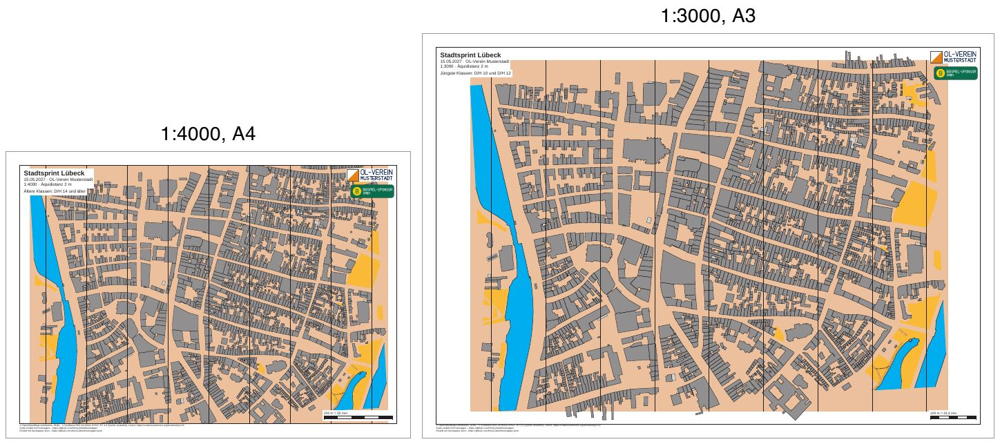

# luebeck-competition-layouts

[Deutsch](README.md)

A sprint in the old town of Lübeck with two layouts: A4 at 1:4000 for the older classes and A3 at 1:3000 for
the youngest. Both sheets have a passe-partout, a title block, a club logo and a sponsor logo, a scale check bar,
and the copyright and credit lines at the bottom left. Courses follow with M3.



| File | Content |
|---|---|
| `freemapper-print.toml` | the project file |
| `luebeck.omap` | the map (OOM, ISSprOM 2019, 1:4000) |
| `freemapper.toml` | freemapper's sidecar file; `init` reads only the map kind from it |
| `logos/` | two made-up logos, see [logos/README.en.md](logos/README.en.md) |
| `out/a4-4000.pdf` | sheet for the older classes, A4 landscape, 1:4000 |
| `out/a3-3000.pdf` | sheet for the youngest classes, A3 landscape, 1:3000 |
| `preview.jpg` | both sheets side by side |

The sheets are in German (`event.lang = "de"`), as for a German event.

## What the example shows

**Shared and layout elements.** The title block, the logos and the scale check bar are written once under
`[[shared]]` and appear on both sheets. Each layout adds its own text element `classes` with its classes. All
elements hang on a corner of the map frame and have the same size in millimetres on A4 and A3, whatever the
print scale of the map.

**Placeholders.** The title block writes `{event}`, `{date} · {organiser}` and
`1:{print_scale} · Äquidistanz {contour_interval}`. The A4 sheet shows "1:4000 · Äquidistanz 2 m", the A3 sheet
"1:3000 · Äquidistanz 2 m". The scale check bar reads "200 m = 50 mm" at 1:4000 and "100 m = 33,3 mm" at 1:3000.

**Symbols at 133 %.** The A3 layout prints at 1:3000, so terrain and symbols grow to 133 % as ISSprOM 2019-2
(section 3.1) says, as in the example [luebeck-scales](../luebeck-scales/README.en.md).

**North lines.** The map has its own north lines, so the program adds none.

**Base area.** The map lies on the light brown base area that freemapper puts under every sprint map. It prints
with the map, clipped to the map frame, and does not count for the overflow (ADR 0044).

**Footer.** The map notes name the sources in four lines. With the freemapper-print credit line that makes five
lines, and on the A3 sheet such a block fits only into a 14 mm margin. The map frame at 1:3000 needs almost the
whole page, though. `print.copyright` therefore puts the sources into two lines. Then a 10 mm passe-partout is
enough, and the footer sits below the map frame instead of on a white box inside the map.

## What `check` reports

Both sheets are fine, and `check` ends with exit code 0. On the A4 sheet the map at 1:4000 is 14.0 mm taller
than the map frame (210 mm of paper less twice the 10 mm passe-partout). The program cuts 7 mm at the top and
the bottom and does not shrink anything. That is intended here, so the layout sets `map_frame.crop = true`: the
overflow shows as an "Info" line and does not count for the exit code. Without `crop` it would be a warning, and
`check` would end with 1. For a real competition, `map_frame.centre_map_mm` moves the frame onto the competition
area.

```
Layout a4-4000: A4 Querformat, Druckmaßstab 1:4000, Kartenmaßstab 1:4000, Geometriefaktor 1,000, Symbolfaktor 1,000.
Zur Information: Die Karte ist 14,0 mm zu hoch für den Kartenausschnitt und wird dort mit Absicht beschnitten (map_frame.crop = true).
Layout a3-3000: A3 Querformat, Druckmaßstab 1:3000, Kartenmaßstab 1:4000, Geometriefaktor 1,333, Symbolfaktor 1,333.
2 Layouts geprüft, keine Hinweise.
```

With `--lang en` the same lines come in English ("Info: the map is 14.0 mm too tall for the map frame and is
cut there on purpose ...").

## How it was made

With freemapper-print alone, in the folder of this example:

```sh
freemapper-print --lang de init . --map luebeck.omap --title "Stadtsprint Lübeck"
```

```
Kartenart: Sprintkarten, wie in der freemapper.toml neben der Karte angegeben.
Suche ein A4- oder A3-Blatt, das die Karte in 1:4000 zeigt …
./freemapper-print.toml geschrieben, mit einem Layout a3: A3, Passepartout 14 mm, Druckmaßstab 1:4000, für Sprintkarten.
Das Projekt schlägt eine Äquidistanz von 2 m vor, üblich für Sprintkarten. Sehen Sie auf der Karte nach und bestätigen Sie den Wert oder ändern Sie map.contour_interval_m.
Als Nächstes freemapper-print check ./freemapper-print.toml aufrufen.
```

Then the project file was edited by hand:

- `[event]`: date and organiser added.
- The proposed contour interval of 2 m compared with the map's information block ("Maßstab 1:4000 ·
  Äquidistanz 2 m") and confirmed.
- `[print]` added with the two copyright lines.
- In the title block, the line with date and organiser added and "Äquidistanz" written before
  `{contour_interval}`.
- The two logos added as shared elements.
- The layout `a3` from `init` (1:4000, 14 mm) replaced by the layouts `a4-4000` and `a3-3000`, both landscape
  with a 10 mm passe-partout, each with its own text `classes`; the A4 layout with `crop = true`.

Then check and write the PDFs. `export` creates the folder `out` next to the project file.

```sh
freemapper-print --lang de check .
freemapper-print --lang de export .
```

`export` prints the same lines as `check`, names the path of the PDF in the first line of each layout and ends
with the reminder to print at actual size. It exits with code 0. `export` does that even when `check` reports
notes, since the PDFs are written all the same.

The preview is made as for [luebeck-scales](../luebeck-scales/README.en.md#regenerate), with `out/a4-4000.pdf`
and `out/a3-3000.pdf` as input.

## Checked

- `check` and `export` as above, with the messages above.
- Exported twice: the PDFs are identical byte for byte.
- The pages viewed at 200 dpi: title block and classes at the top left, the logos at the top right, the scale
  check bar at the bottom right, the three footer lines below the map frame, the map's north lines over the whole
  map, the light brown base area up to the map frame.

## Printing

Print at 100 % ("Actual size") and switch "Fit to page" off. Measure the scale check bar on the printout to see
whether the printer scaled the page.

## Credits

Map and `freemapper.toml` from the example `schleswig-holstein-luebeck` of
[freemapper](https://github.com/HenryJobst/freemapper), version 0.8.0 (commit `a2b41b4`), unchanged. Map data
© OpenStreetMap contributors (ODbL) and © GeoBasis-DE/LVermGeo SH (CC BY 4.0, source modified). The logos were
made for this example (CC0). The PDFs were made with
[freemapper-print](https://github.com/HenryJobst/freemapper-print).
