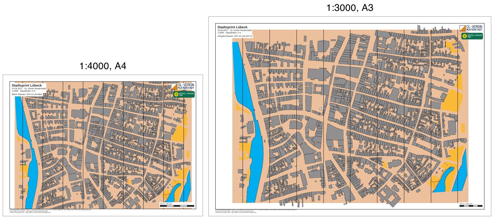

# luebeck-competition-layouts

[English](README.en.md)

Ein Stadtsprint in der Lübecker Altstadt mit zwei Layouts: A4 in 1:4000 für die älteren Klassen und A3 in
1:3000 für die jüngsten. Beide Blätter haben Passepartout, Titelblock, Vereins- und Sponsorenlogo, eine
Kontrollstrecke und unten links die Quellenangaben und die Namensnennung. Bahnen kommen erst mit M3 dazu.



| Datei | Inhalt |
|---|---|
| `freemapper-print.toml` | die Projektdatei |
| `luebeck.omap` | die Karte (OOM, ISSprOM 2019, 1:4000) |
| `freemapper.toml` | Begleitdatei von freemapper; `init` liest daraus nur die Kartenart |
| `logos/` | zwei erfundene Logos, siehe [logos/README.md](logos/README.md) |
| `out/a4-4000.pdf` | Blatt der älteren Klassen, A4 quer, 1:4000 |
| `out/a3-3000.pdf` | Blatt der jüngsten Klassen, A3 quer, 1:3000 |
| `preview.jpg` | beide Blätter nebeneinander |

## Was das Beispiel zeigt

**Gemeinsame Elemente und Layout-Elemente.** Titelblock, Logos und Kontrollstrecke stehen einmal unter
`[[shared]]` und erscheinen auf beiden Blättern. Jedes Layout hat dazu ein eigenes Textelement `classes` mit
seinen Klassen. Alle Elemente hängen an einer Ecke des Kartenausschnitts und haben auf A4 und A3 dieselbe Größe
in Millimetern, gleich in welchem Maßstab die Karte gedruckt wird.

**Platzhalter.** Der Titelblock schreibt `{event}`, `{date} · {organiser}` und
`1:{print_scale} · Äquidistanz {contour_interval}`. Auf dem A4-Blatt steht daraus „1:4000 · Äquidistanz 2 m“,
auf dem A3-Blatt „1:3000 · Äquidistanz 2 m“. Die Kontrollstrecke misst „200 m = 50 mm“ bei 1:4000 und
„100 m = 33,3 mm“ bei 1:3000.

**Symbole auf 133 %.** Das A3-Layout druckt in 1:3000, also wachsen Gelände und Symbole nach ISSprOM 2019-2
(Abschnitt 3.1) auf 133 %, wie im Beispiel [luebeck-scales](../luebeck-scales/README.md).

**Nordlinien.** Die Karte bringt ihre eigenen Nordlinien mit. Das Programm ergänzt deshalb keine.

**Grundfläche.** Die Karte liegt auf der hellbraunen Grundfläche, die freemapper unter jede Sprintkarte legt. Sie
wird mitgedruckt und am Kartenausschnitt beschnitten. Für den Überstand zählt sie nicht (ADR 0044).

**Fußzeile.** Die Karte nennt in ihren Notizen vier Zeilen Quellen. Mit der Namensnennung von freemapper-print
wären das fünf Zeilen, und auf dem A3-Blatt passt so ein Block nur in einen Rand von 14 mm. Der Kartenausschnitt
von 1:3000 braucht aber fast die ganze Seite. `print.copyright` fasst die Quellen deshalb in zwei Zeilen
zusammen, dann reicht ein Passepartout von 10 mm, und die Fußzeile steht unter dem Kartenausschnitt statt auf
einem weißen Kasten in der Karte.

## Was `check` meldet

Beide Blätter sind in Ordnung, `check` endet mit Exit-Code 0. Auf dem A4-Blatt ist die Karte in 1:4000 14,0 mm
höher als der Kartenausschnitt (210 mm Papier minus zweimal 10 mm Passepartout). Das Programm schneidet oben und
unten je 7 mm ab und verkleinert nichts. Das ist hier gewollt, deshalb steht im Layout `map_frame.crop = true`:
Der Überstand erscheint als Zeile „Zur Information“ und zählt nicht für den Exit-Code. Ohne `crop` wäre er eine
Warnung, und `check` endete mit 1. Für einen echten Wettkampf legt man mit `map_frame.centre_map_mm` den
Ausschnitt auf das Wettkampfgebiet.

```
Layout a4-4000: A4 Querformat, Druckmaßstab 1:4000, Kartenmaßstab 1:4000, Geometriefaktor 1,000, Symbolfaktor 1,000.
Zur Information: Die Karte ist 14,0 mm zu hoch für den Kartenausschnitt und wird dort mit Absicht beschnitten (map_frame.crop = true).
Layout a3-3000: A3 Querformat, Druckmaßstab 1:3000, Kartenmaßstab 1:4000, Geometriefaktor 1,333, Symbolfaktor 1,333.
2 Layouts geprüft, keine Hinweise.
```

## So ist es entstanden

Nur mit freemapper-print selbst, im Ordner dieses Beispiels:

```sh
freemapper-print --lang de init . --map luebeck.omap --title "Stadtsprint Lübeck"
```

```
Kartenart: Sprintkarten, wie in der freemapper.toml neben der Karte angegeben.
Suche ein A4- oder A3-Blatt, das die Karte in 1:4000 zeigt …
./freemapper-print.toml geschrieben, mit einem Layout a3: A3, Passepartout 14 mm, Druckmaßstab 1:4000, für Sprintkarten.
Das Projekt schlägt eine Äquidistanz von 2 m vor, üblich für Sprintkarten. Sehen Sie auf der Karte nach und bestätigen Sie den Wert oder ändern Sie map.contour_interval_m.
Als Nächstes freemapper-print check ./freemapper-print.toml aufrufen.
```

Danach ist die Projektdatei von Hand bearbeitet:

- `[event]`: Datum und Ausrichter ergänzt.
- Die vorgeschlagene Äquidistanz von 2 m mit dem Informationsblock der Karte verglichen („Maßstab 1:4000 ·
  Äquidistanz 2 m“) und bestätigt.
- `[print]` mit den zwei Quellenzeilen ergänzt.
- Im Titelblock die Zeile mit Datum und Ausrichter ergänzt und „Äquidistanz“ vor `{contour_interval}`
  geschrieben.
- Die beiden Logos als gemeinsame Elemente ergänzt.
- Das Layout `a3` von `init` (1:4000, 14 mm) durch die Layouts `a4-4000` und `a3-3000` ersetzt, beide quer und
  mit 10 mm Passepartout, jedes mit seinem Text `classes`; beim A4-Layout `crop = true`.

Dann prüfen und die PDFs schreiben. `export` legt den Ordner `out` neben der Projektdatei an.

```sh
freemapper-print --lang de check .
freemapper-print --lang de export .
```

`export` gibt dieselben Zeilen aus wie `check`, nennt in der ersten Zeile jedes Layouts den Pfad des PDFs und
erinnert zum Schluss ans Drucken in Originalgröße. Es endet mit Exit-Code 0. Das tut `export` auch dann, wenn
`check` Hinweise meldet, denn die PDFs sind trotzdem geschrieben.

Die Vorschau entsteht wie bei [luebeck-scales](../luebeck-scales/README.md#neu-erzeugen), nur mit
`out/a4-4000.pdf` und `out/a3-3000.pdf` als Eingabe.

## Geprüft

- `check` und `export` wie oben, mit den Meldungen von oben.
- Zweimal exportiert: Die PDFs sind Byte für Byte gleich.
- Die Seiten bei 200 dpi angesehen: Titelblock und Klassen oben links, die Logos oben rechts, die
  Kontrollstrecke unten rechts, die drei Zeilen der Fußzeile unter dem Kartenausschnitt, die Nordlinien der Karte
  über die ganze Karte, die Grundfläche hellbraun bis an den Kartenausschnitt.

## Drucken

Drucken Sie mit 100 % („Tatsächliche Größe“), und schalten Sie „An Seite anpassen“ aus. Mit der
Kontrollstrecke messen Sie am Ausdruck nach, ob der Drucker skaliert hat.

## Herkunft

Karte und `freemapper.toml` aus dem Beispiel `schleswig-holstein-luebeck` von
[freemapper](https://github.com/HenryJobst/freemapper), Version 0.8.0 (Commit `a2b41b4`), unverändert.
Kartendaten © OpenStreetMap-Mitwirkende (ODbL) und © GeoBasis-DE/LVermGeo SH (CC BY 4.0, Quelle verändert). Die
Logos sind für dieses Beispiel gemacht (CC0). Die PDFs sind mit
[freemapper-print](https://github.com/HenryJobst/freemapper-print) erzeugt.
