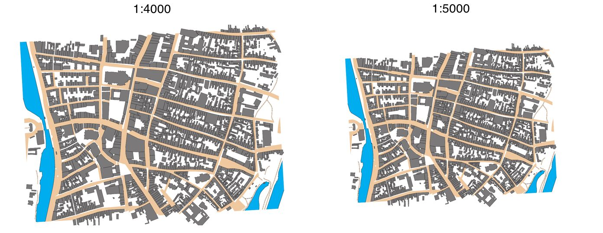

# luebeck-scales

[Deutsch](README.md)

The same sprint map printed twice, at 1:4000 and at 1:5000, both on A4 landscape.



| File | Content |
|---|---|
| `luebeck.omap` | the map (OOM, ISSprOM 2019, 1:4000) |
| `luebeck-4000-a4.pdf` | print at 1:4000 |
| `luebeck-5000-a4.pdf` | print at 1:5000 |
| `preview.jpg` | both pages side by side |

## What the example shows

The pages are exactly A4, and the map on them has exactly the scale named in the file. A distance of 100 m
measures 25 mm in the PDF at 1:4000 and 20 mm at 1:5000.

Going to 1:5000 shrinks the geometry to 80 %. The symbols do not shrink with it (ADR 0012). A footpath
(symbol 506) is 0.27 mm wide in both PDFs. Buildings stay equally dark and
paths equally readable, and more terrain fits on the page.

At 1:4000 the map is 3.9 mm too tall for the printable area of A4. The program warns and still writes the PDF.
That is intended here. On A3 the same 1:4000 map fits completely, but no A3 file is included.

## Regenerate

```sh
freemapper-print render luebeck.omap --out luebeck-4000-a4.pdf --paper a4
freemapper-print render luebeck.omap --out luebeck-5000-a4.pdf --paper a4 --scale 5000
```

The preview comes from `pdftoppm` and ImageMagick (on macOS, `-font` is a path to a font file):

```sh
pdftoppm -r 110 -png -singlefile luebeck-4000-a4.pdf p4
pdftoppm -r 110 -png -singlefile luebeck-5000-a4.pdf p5
for n in 4 5; do
  magick p$n.png -resize 690x -background white -gravity north -splice 0x40 \
    -font /System/Library/Fonts/Helvetica.ttc -pointsize 28 -fill black -annotate +0+4 "1:${n}000" l$n.png
done
magick l4.png l5.png -background white -gravity north +append -bordercolor white -border 6 -quality 80 preview.jpg
```

## Printing

Print at 100 % ("actual size") with "fit to page" switched off. Any other size breaks the scale.

## Credits

Map from [freemapper](https://github.com/HenryJobst/freemapper) (commit `a0cc8ef`, GPL-3.0-or-later), data
sources in the map notes (`<notes>`), rendered with
[freemapper-print](https://github.com/HenryJobst/freemapper-print).
