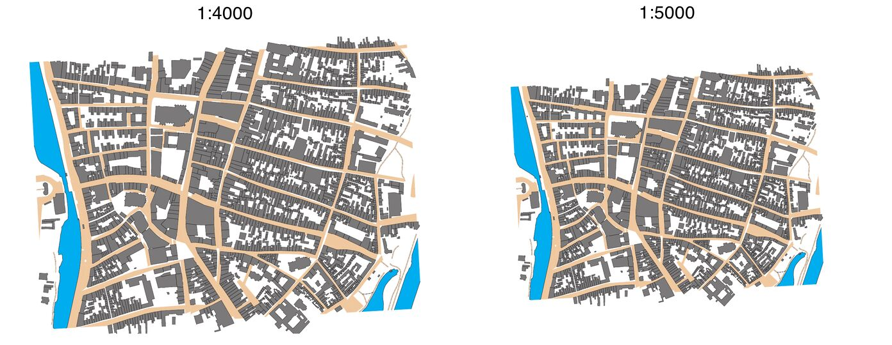

# luebeck-scales

[English](README.en.md)

Dieselbe Sprintkarte, einmal in 1:4000 und einmal in 1:5000, beide auf A4 quer.



| Datei | Inhalt |
|---|---|
| `luebeck.omap` | die Karte (OOM, ISSprOM 2019, 1:4000) |
| `luebeck-4000-a4.pdf` | Druck in 1:4000 |
| `luebeck-5000-a4.pdf` | Druck in 1:5000 |
| `preview.jpg` | beide Seiten nebeneinander |

## Was das Beispiel zeigt

Die Seiten sind genau A4, und die Karte darauf hat genau den Maßstab, der in der Datei steht. Eine Strecke von
100 m misst im PDF 25 mm bei 1:4000 und 20 mm bei 1:5000.

Beim Wechsel auf 1:5000 schrumpft die Geometrie auf 80 %. Die Symbole schrumpfen nicht mit (ADR 0012). Ein
Fußweg (Symbol 506) ist in beiden PDFs 0,27 mm breit. Die Gebäude
bleiben also gleich dunkel und die Wege gleich lesbar, nur liegt mehr Gelände auf der Seite.

Bei 1:4000 ist die Karte 3,9 mm zu hoch für den bedruckbaren Bereich von A4. Das Programm warnt und schreibt
das PDF trotzdem. Das ist hier gewollt. Auf A3 passt dieselbe 1:4000-Karte vollständig, eine A3-Datei liegt
nicht bei.

## Neu erzeugen

```sh
freemapper-print render luebeck.omap --out luebeck-4000-a4.pdf --paper a4
freemapper-print render luebeck.omap --out luebeck-5000-a4.pdf --paper a4 --scale 5000
```

Die Vorschau entsteht mit `pdftoppm` und ImageMagick (unter macOS ist `-font` ein Pfad zu einer Schrift):

```sh
pdftoppm -r 110 -png -singlefile luebeck-4000-a4.pdf p4
pdftoppm -r 110 -png -singlefile luebeck-5000-a4.pdf p5
for n in 4 5; do
  magick p$n.png -resize 690x -background white -gravity north -splice 0x40 \
    -font /System/Library/Fonts/Helvetica.ttc -pointsize 28 -fill black -annotate +0+4 "1:${n}000" l$n.png
done
magick l4.png l5.png -background white -gravity north +append -bordercolor white -border 6 -quality 80 preview.jpg
```

## Drucken

Drucken Sie mit 100 % ("Tatsächliche Größe"), und schalten Sie "An Seite anpassen" aus. Jede andere Größe
verfälscht den Maßstab.

## Herkunft

Karte von [freemapper](https://github.com/HenryJobst/freemapper) (Commit `a0cc8ef`, GPL-3.0-or-later),
Datenquellen in den Kartennotizen (`<notes>`), erzeugt mit
[freemapper-print](https://github.com/HenryJobst/freemapper-print).
