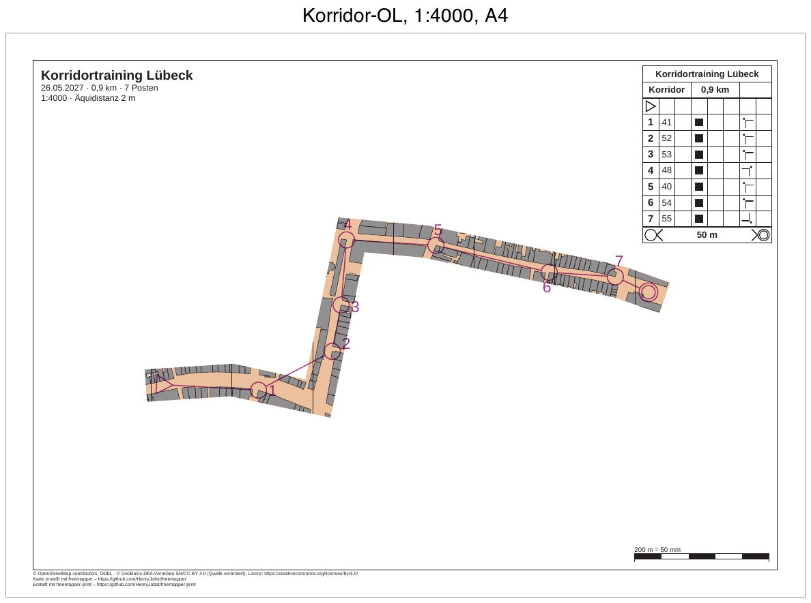

# luebeck-training-corridor

[Deutsch](README.md)

Corridor orienteering in Lübeck's old town: a short training course of 0.9 km with 7 controls on A4 at 1:4000. The
map shows only in a band 12 mm wide, 48 m on the ground. It follows three streets of the old town. Every control
lies in the corridor, and the rest of the map stays white. The program prints the overprint, the control
descriptions, title and footer everywhere.



| File | Content |
|---|---|
| `freemapper-print.toml` | the project file, with the mask `altstadt` |
| `training.ppen` | the course as a Purple Pen file, written by hand for this example |
| `luebeck.omap` | the map (OOM, ISSprOM 2019, 1:4000) |
| `freemapper.toml` | freemapper's companion file; `init` reads only the map kind from it |
| `ATTRIBUTION.txt` | the map's sources, from freemapper |
| `out/Korridor.pdf` | the course sheet, A4 landscape, 1:4000 |
| `preview.jpg` | the same sheet as an image |

The sheets are in German (`event.lang = "de"`), like the other Lübeck examples. „Korridor“ is German for
corridor, „Altstadt“ for old town.

## What to look at

- A corridor with flat ends: from the west along the broad street, left into the street to the north, at its end
  right into the long street to the east, past the finish. At the two sharp bends it has a pointed outer corner.
- The start, all seven controls and the finish lie in the corridor. The leg from 1 to 2 cuts the corner and crosses
  some white paper. Runners still stay in the corridor; the line shows only the direction.
- Outside the corridor the paper is white, without north lines or base area.
- Description box, title block, scale check bar and footer are complete.

## The course

| Number | Code | Position |
|---|---|---|
| Start | | on the broad street in the west, 6 mm after the start of the corridor |
| 1 | 41 | north-west corner of a building on the south side of the same street |
| 2 | 52 | north-west corner of a building on the east side of the street to the north |
| 3 | 53 | north-west corner of a building on the same street, 70 m further north |
| 4 | 48 | north-east corner of a building at the crossing at the north end of that street |
| 5 | 40 | north-west corner of a building on the south side of the street to the east |
| 6 | 54 | north-west corner of a building on the south side of the same street |
| 7 | 55 | south-east corner of a building at the crossing in the east |
| Finish | | on the street past the crossing, 6 mm before the end of the corridor |

Controls 41, 48 and 40 come with code, position and description from
[luebeck-competition-courses](../luebeck-competition-courses/README.en.md). The other four are building vertices
(symbol 521), read from `luebeck.omap` by a small script as there, converted to millimetres and written with the y
axis up (ADR 0032). Each lies at most 1.8 mm from the corridor's centre line, so at least 4 mm inside its edge. The
descriptions give "building" and the outside corner with its compass direction. From the last control runners
navigate to the finish without tapes (symbol 14.3).

## The corridor's line

No rule book says where a corridor runs, so the program draws none on its own. The line was chosen by hand, as
points in map mm with the y axis up, as OOM's status bar shows them:

| Point | x, y | Where |
|---|---|---|
| 1 | −92, 2.3 | start on the broad street in the west |
| 2 | −60, 4.4 | the same street, where it bends a little to the south-east |
| 3 | −28, −2.5 | crossing with the street to the north |
| 4 | −15.5, 58.5 | north end of that street, crossing with the street to the east |
| 5 | 12, 56 | street to the east, where it turns south-east |
| 6 | 84, 41 | crossing with a street from north to south |
| 7 | 101, 35 | end, 6 mm past the finish |

How the points were found: a small script drew the buildings of `luebeck.omap` with a 10 mm grid. For each street
it then looked across the street every 5 to 10 mm for the gap between the buildings and took its middle. The points
lie on these middles, at the crossings and where a street bends. The straight pieces between them stay within about
1 mm of the street's middle, more only where side streets join. Between the houses the streets are 2 to 8 mm wide,
8 to 30 m on the ground. With a width of 12 mm the corridor therefore still shows a strip of houses on each side.

## What `check` reports

The sheet is fine, and `check` ends with exit code 0. The "Zur Information" (Info) lines do not count.

```
Zur Information: Die geografischen Koordinaten wurden nicht geprüft, denn kein Posten hat sowohl eine Kartenposition als auch geografische Koordinaten.
Bahn „Korridor“ auf Layout a4-4000: A4 Querformat, Druckmaßstab 1:4000, Kartenmaßstab 1:4000, Geometriefaktor 1,000, Symbolfaktor 1,000.
Zur Information: Die Karte ist 35,5 mm zu hoch für den Kartenausschnitt und wird dort mit Absicht beschnitten (map_frame.crop = true).
Layout a4-4000: A4 Querformat, Druckmaßstab 1:4000, Kartenmaßstab 1:4000, Geometriefaktor 1,000, Symbolfaktor 1,000.
Zur Information: Die Karte ist 14,0 mm zu hoch für den Kartenausschnitt und wird dort mit Absicht beschnitten (map_frame.crop = true).
Zur Information: Der Text title nutzt {length_km}, der nur auf Bahnblättern gefüllt wird. Auf diesem Blatt bleibt er leer.
Zur Information: Der Text title nutzt {controls}, der nur auf Bahnblättern gefüllt wird. Auf diesem Blatt bleibt er leer.
1 Bahn und 1 Layoutblatt geprüft, keine Hinweise.
```

If a control lay beside the corridor, `check` would name it in a note, because runners would find no map around it.
Plain legs such as the one from 1 to 2 do not count.

## How it was made

With freemapper-print alone, in this example's folder. First the project from map and course file:

```sh
freemapper-print --lang de init . --map luebeck.omap --title "Korridortraining Lübeck" --courses training.ppen
```

`init` reports the same as in [luebeck-training-window](../luebeck-training-window/README.en.md#how-it-was-made),
with „Korridor“ as the course. Then the project file was edited by hand as there: date and organiser, the contour
interval confirmed, `[print]` with two source lines, the same title block, the layout `a4-4000` instead of
`a3-4000`, and the short `{ … }` form.

Then the corridor:

```sh
freemapper-print --lang de check .
freemapper-print --lang de masks corridor . --points "-92,2.3;-60,4.4;-28,-2.5;-15.5,58.5;12,56;84,41;101,35" --width 12 --id altstadt --assign --course Korridor
```

```
Abdeckung „altstadt“ in ./freemapper-print.toml eingetragen: ein Korridor 12 mm breit auf dem Papier bei 1:4000 entlang 7 Punkten.
Die Bahn „Korridor“ wird jetzt damit gedruckt, auf Layout a4-4000.
Mit check sehen Sie das Ergebnis.
```

The command appends a table `[[masks]]` with the id `altstadt` to the project file. The comment above it repeats
the points as `--points "…"`, so the command can be run again. The polygon has a rectangle 100 mm outside the map
as its outline and the corridor as a hole of 14 points. `--course Korridor` sets the print scale for the width, and
`--assign` writes `mask = "altstadt"` into the course's assignment.

Then check and write the PDF:

```sh
freemapper-print --lang de check .
freemapper-print --lang de export .
```

`export` writes `out/Korridor.pdf` and ends with exit code 0.

## Open

- Open `training.ppen` once in Purple Pen (macOS beta) and check it. Does Purple Pen load the map `luebeck.omap`,
  and do the controls sit at their building corners? The value `Spr2019` for the map standard has not been checked
  against Purple Pen.

## Checked

- `check` and `export` as above, with the messages above.
- All commands run again in a fresh copy: the PDF is identical byte for byte.
- The page viewed at 100 dpi and the western part with both bends at 200 dpi: map only in the corridor, the
  corridor follows the streets, clean corners, overprint and description box complete.

## Regenerate

The PDF comes from the commands above, the preview as for
[luebeck-competition-courses](../luebeck-competition-courses/README.en.md#regenerate), with `out/Korridor.pdf` as
input and the label "Korridor-OL, 1:4000, A4".

## Printing

Print at 100 % ("Actual size") and switch "Fit to page" off. Measure the scale check bar on the printout to see
whether the printer scaled the page.

## Credits and licence

Map, `freemapper.toml` and `ATTRIBUTION.txt` from the example `schleswig-holstein-luebeck` of
[freemapper](https://github.com/HenryJobst/freemapper), version 0.8.0 (commit `a2b41b4`), unchanged, as in
luebeck-competition-courses. When freemapper's examples change, the map here is replaced and the example rebuilt
with the commands above; if the streets then lie elsewhere, the corridor needs new points. The map is under the
terms `ATTRIBUTION.txt` names: map data © OpenStreetMap contributors (ODbL) and © GeoBasis-DE/LVermGeo SH (CC BY
4.0, source modified). The course in `training.ppen` was written for this example and is released under CC0. The
PDF was made with [freemapper-print](https://github.com/HenryJobst/freemapper-print).
