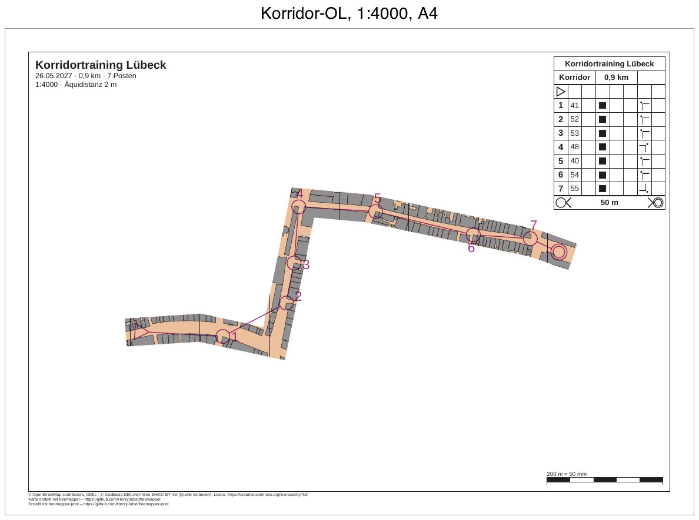

# luebeck-training-corridor

[English](README.en.md)

Ein Korridor-OL in der Lübecker Altstadt: eine kurze Trainingsbahn von 0,9 km mit 7 Posten auf A4 in 1:4000. Die
Karte ist nur in einem Streifen von 12 mm Breite zu sehen, das sind 48 m im Gelände. Er folgt drei Straßen der
Altstadt. Jeder Posten liegt im Korridor, die übrige Karte bleibt weiß. Bahnaufdruck, Postenbeschreibung, Titel und
Fußzeile druckt das Programm überall.



| Datei | Inhalt |
|---|---|
| `freemapper-print.toml` | die Projektdatei, mit der Abdeckung `altstadt` |
| `training.ppen` | die Bahn als Purple-Pen-Datei, für dieses Beispiel von Hand geschrieben |
| `luebeck.omap` | die Karte (OOM, ISSprOM 2019, 1:4000) |
| `freemapper.toml` | Begleitdatei von freemapper; `init` liest daraus nur die Kartenart |
| `ATTRIBUTION.txt` | die Quellen der Karte, von freemapper |
| `out/Korridor.pdf` | das Blatt der Bahn, A4 quer, 1:4000 |
| `preview.jpg` | dasselbe Blatt als Bild |

## Was Sie auf dem Blatt sehen

- Ein Korridor mit geraden Enden: von Westen die breite Straße entlang, nach links in die Straße nach Norden, an
  ihrem Ende nach rechts in die lange Straße nach Osten bis hinter das Ziel. An den beiden scharfen Knicken hat er
  außen eine spitze Ecke.
- Start, alle sieben Posten und das Ziel liegen im Korridor. Die Strecke von 1 nach 2 schneidet die Ecke und läuft
  ein Stück über weißes Papier. Die Läufer bleiben trotzdem im Korridor, die Linie zeigt nur die Richtung.
- Außerhalb des Korridors ist das Papier weiß, auch ohne Nordlinien und Grundfläche.
- Beschreibungskasten, Titelblock, Kontrollstrecke und Fußzeile sind vollständig.

## Die Bahn

| Nummer | Code | Lage |
|---|---|---|
| Start | | auf der breiten Straße im Westen, 6 mm hinter dem Anfang des Korridors |
| 1 | 41 | Nordwestecke eines Gebäudes an der Südseite derselben Straße |
| 2 | 52 | Nordwestecke eines Gebäudes an der Ostseite der Straße nach Norden |
| 3 | 53 | Nordwestecke eines Gebäudes an derselben Straße, 70 m weiter nördlich |
| 4 | 48 | Nordostecke eines Gebäudes an der Kreuzung am Nordende dieser Straße |
| 5 | 40 | Nordwestecke eines Gebäudes an der Südseite der Straße nach Osten |
| 6 | 54 | Nordwestecke eines Gebäudes an der Südseite derselben Straße |
| 7 | 55 | Südostecke eines Gebäudes an der Kreuzung im Osten |
| Ziel | | auf der Straße hinter der Kreuzung, 6 mm vor dem Ende des Korridors |

Die Posten 41, 48 und 40 stammen mit Code, Lage und Beschreibung aus
[luebeck-competition-courses](../luebeck-competition-courses/README.md). Die anderen vier sind Eckpunkte von
Gebäuden (Symbol 521), wie dort von einem kleinen Skript aus `luebeck.omap` gelesen, in Millimeter umgerechnet und
mit der y-Achse nach oben geschrieben (ADR 0032). Jeder liegt höchstens 1,8 mm neben der Mittellinie des
Korridors, also mindestens 4 mm innerhalb seines Randes. Die Beschreibungen nennen „Gebäude“ und die Außenecke mit
ihrer Himmelsrichtung. Vom letzten Posten orientiert man sich ohne Markierung ins Ziel (Symbol 14.3).

## Die Linie des Korridors

Kein Regelwerk sagt, wo ein Korridor verläuft, deshalb zeichnet das Programm keinen von sich aus. Die Linie ist von
Hand gewählt, als Punkte in Karten-mm mit der y-Achse nach oben, so wie die Statusleiste von OOM sie zeigt:

| Punkt | x, y | Wo |
|---|---|---|
| 1 | −92, 2,3 | Anfang auf der breiten Straße im Westen |
| 2 | −60, 4,4 | dieselbe Straße, wo sie leicht nach Südosten abknickt |
| 3 | −28, −2,5 | Kreuzung mit der Straße nach Norden |
| 4 | −15,5, 58,5 | Nordende dieser Straße, Kreuzung mit der Straße nach Osten |
| 5 | 12, 56 | Straße nach Osten, wo sie nach Südosten abbiegt |
| 6 | 84, 41 | Kreuzung mit einer Straße von Norden nach Süden |
| 7 | 101, 35 | Ende, 6 mm hinter dem Ziel |

So sind die Punkte entstanden: Ein kleines Skript hat die Gebäude aus `luebeck.omap` mit einem Gitter von 10 mm
gezeichnet. Für jede Straße hat es dann quer zur Straße alle 5 bis 10 mm die Lücke zwischen den Gebäuden gesucht
und ihre Mitte genommen. Die Punkte liegen auf diesen Mitten, an den Kreuzungen und dort, wo eine Straße abknickt.
Die geraden Stücke dazwischen weichen höchstens etwa 1 mm von der Mitte der Straße ab, nur an Einmündungen mehr.
Zwischen den Häusern sind die Straßen 2 bis 8 mm breit, 8 bis 30 m im Gelände. Mit 12 mm Breite zeigt der
Korridor deshalb auf jeder Seite noch einen Streifen der Häuser.

## Was `check` meldet

Das Blatt ist in Ordnung, `check` endet mit Exit-Code 0. Die Zeilen „Zur Information“ zählen nicht.

```
Zur Information: Die geografischen Koordinaten wurden nicht geprüft, denn kein Posten hat sowohl eine Kartenposition als auch geografische Koordinaten.
Bahn „Korridor“ auf Layout a4-4000: A4 Querformat, Druckmaßstab 1:4000, Kartenmaßstab 1:4000, Geometriefaktor 1,000, Symbolfaktor 1,000.
Zur Information: Die Karte ist 35,5 mm zu hoch für den Kartenausschnitt und wird dort mit Absicht beschnitten (map_frame.crop = true).
Layout a4-4000: A4 Querformat, Druckmaßstab 1:4000, Kartenmaßstab 1:4000, Geometriefaktor 1,000, Symbolfaktor 1,000.
Zur Information: Die Karte ist 14,0 mm zu hoch für den Kartenausschnitt und wird dort mit Absicht beschnitten (map_frame.crop = true).
Zur Information: Der Text title nutzt {length_km}, der nur auf Bahnblättern gefüllt wird. Auf diesem Blatt bleibt er leer.
Zur Information: Der Text title nutzt {controls}, der nur auf Bahnblättern gefüllt wird. Auf diesem Blatt bleibt er leer.
1 Bahn und 1 Layoutblatt geprüft, keine Hinweise.
```

Läge ein Posten neben dem Korridor, nennte `check` ihn mit einem Hinweis, denn die Läufer fänden um ihn keine
Karte. Gewöhnliche Strecken wie die von 1 nach 2 zählen nicht.

## So ist es entstanden

Nur mit freemapper-print selbst, im Ordner dieses Beispiels. Zuerst das Projekt aus Karte und Bahndatei:

```sh
freemapper-print --lang de init . --map luebeck.omap --title "Korridortraining Lübeck" --courses training.ppen
```

`init` meldet dasselbe wie in [luebeck-training-window](../luebeck-training-window/README.md#so-ist-es-entstanden),
mit „Korridor“ als Bahn. Danach ist die Projektdatei von Hand bearbeitet wie dort: Datum und Ausrichter, die
Äquidistanz bestätigt, `[print]` mit zwei Quellenzeilen, derselbe Titelblock, das Layout `a4-4000` statt
`a3-4000` und die kurze Schreibweise mit `{ … }`.

Dann der Korridor:

```sh
freemapper-print --lang de check .
freemapper-print --lang de masks corridor . --points "-92,2.3;-60,4.4;-28,-2.5;-15.5,58.5;12,56;84,41;101,35" --width 12 --id altstadt --assign --course Korridor
```

```
Abdeckung „altstadt“ in ./freemapper-print.toml eingetragen: ein Korridor 12 mm breit auf dem Papier bei 1:4000 entlang 7 Punkten.
Die Bahn „Korridor“ wird jetzt damit gedruckt, auf Layout a4-4000.
Mit check sehen Sie das Ergebnis.
```

Der Befehl hängt eine Tabelle `[[masks]]` mit der ID `altstadt` an die Projektdatei. Der Kommentar darüber
wiederholt die Punkte als `--points "…"`, so lässt sich der Befehl wieder aufrufen. Das Polygon hat ein Rechteck
100 mm außerhalb der Karte als Umriss und den Korridor als Loch, mit 14 Punkten. `--course Korridor` gibt den
Druckmaßstab für die Breite vor und `--assign` schreibt `mask = "altstadt"` in die Zuordnung der Bahn.

Dann prüfen und das PDF schreiben:

```sh
freemapper-print --lang de check .
freemapper-print --lang de export .
```

`export` schreibt `out/Korridor.pdf` und endet mit Exit-Code 0.

## Offen

- Öffnen Sie `training.ppen` einmal in Purple Pen (Beta für macOS) und prüfen Sie die Datei: Lädt Purple Pen die
  Karte `luebeck.omap`, und stehen die Posten an ihren Gebäudeecken? Der Wert `Spr2019` für den Kartenstandard ist
  nicht gegen Purple Pen geprüft.

## Geprüft

- `check` und `export` wie oben, mit den Meldungen von oben.
- Alle Befehle in einer frischen Kopie noch einmal ausgeführt: Das PDF ist Byte für Byte gleich.
- Die Seite bei 100 dpi angesehen und den Westteil mit beiden Knicken bei 200 dpi: Karte nur im Korridor, der
  Korridor folgt den Straßen, die Ecken sind sauber, Bahnaufdruck und Beschreibungskasten vollständig.

## Neu erzeugen

Das PDF mit den Befehlen oben, die Vorschau wie bei
[luebeck-competition-courses](../luebeck-competition-courses/README.md#neu-erzeugen), mit `out/Korridor.pdf` als
Eingabe und der Beschriftung „Korridor-OL, 1:4000, A4“.

## Drucken

Drucken Sie mit 100 % („Tatsächliche Größe“), und schalten Sie „An Seite anpassen“ aus. Mit der
Kontrollstrecke messen Sie am Ausdruck nach, ob der Drucker skaliert hat.

## Herkunft und Lizenz

Karte, `freemapper.toml` und `ATTRIBUTION.txt` aus dem Beispiel `schleswig-holstein-luebeck` von
[freemapper](https://github.com/HenryJobst/freemapper), Version 0.8.0 (Commit `a2b41b4`), unverändert, wie in
luebeck-competition-courses. Ändert freemapper seine Beispiele, wird die Karte hier ersetzt und das Beispiel mit
den Befehlen oben neu gebaut; liegen die Straßen dann anders, braucht der Korridor neue Punkte. Für die Karte
gilt, was `ATTRIBUTION.txt` nennt: Kartendaten © OpenStreetMap-Mitwirkende (ODbL) und © GeoBasis-DE/LVermGeo SH
(CC BY 4.0, Quelle verändert). Die Bahn in `training.ppen` ist für dieses Beispiel geschrieben und steht unter
CC0. Das PDF ist mit [freemapper-print](https://github.com/HenryJobst/freemapper-print) erzeugt.
