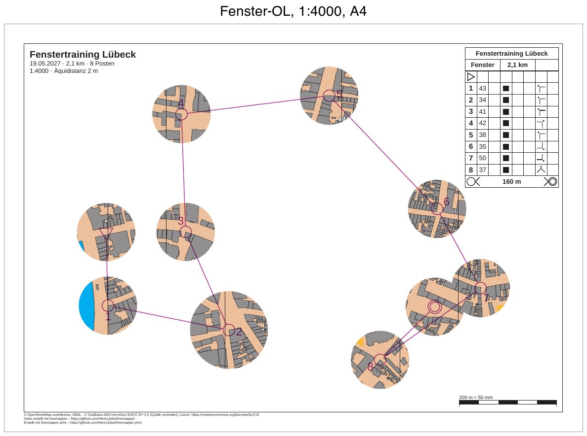

# luebeck-training-window

[Deutsch](README.md)

Window orienteering in Lübeck's old town: a training course of 2.1 km with 8 controls on A4 at 1:4000. The map
shows only in a circle around the start, each control and the finish. Between them the paper stays white, and
runners get from window to window by compass and leg. The program prints legs, circles, numbers, control
descriptions, title and footer everywhere.



| File | Content |
|---|---|
| `freemapper-print.toml` | the project file, with the mask `window-Fenster` |
| `training.ppen` | the course as a Purple Pen file, written by hand for this example |
| `luebeck.omap` | the map (OOM, ISSprOM 2019, 1:4000) |
| `freemapper.toml` | freemapper's companion file; `init` reads only the map kind from it |
| `ATTRIBUTION.txt` | the map's sources, from freemapper |
| `out/Fenster.pdf` | the course sheet, A4 landscape, 1:4000 |
| `preview.jpg` | the same sheet as an image |

The sheets are in German (`event.lang = "de"`), like the other Lübeck examples. „Fenster“ is German for window.

## What to look at

- Ten round windows with a radius of 15 mm on paper, 60 m on the ground: around the start, the eight controls and
  the finish. The window around control 34 (number 2) has a radius of 20 mm and shows how one control gets more
  map.
- The windows around control 50 (number 7) and the finish overlap. They merge into one area without a seam. The
  mask was written before `masks window` kept a gap between windows (ADR 0063). Today the two windows would get
  11.21 mm instead of 15 mm radius and 3 mm between them. The file keeps the overlap, which a mask written by hand
  may still have.
- Outside the windows the paper is white. The north lines and the light brown base area of the map are missing
  there too, because they belong to the map.
- Legs, control circles, numbers, start and finish lie in purple over the white paper as well. The description
  box at the top right, the title block, the scale check bar and the footer are complete.

## The course

The start stands on the street in the west of the old town and the finish on a square in the south-east, both at
the same place as in [luebeck-competition-courses](../luebeck-competition-courses/README.en.md). The eight controls
come from that example too, with code, position and description: 43, 34, 41, 42, 38, 35, 50 and 37. Each stands
at the corner of a building (symbol 521), a vertex that a small script read from `luebeck.omap`, converted to
millimetres and wrote with the y axis up, as Purple Pen does (ADR 0032). From the start the course goes south
first, then north through the middle, and over the east to the finish. The legs are 38 to 81 mm long, so white
paper remains between the windows. From the last control runners navigate to the finish without tapes (symbol
14.3).

Control 39 from the competition example was number 6 at first. Its window reached under the description box, and
the box covered an edge of the window. Control 35 lies 32 mm (130 m) further south and is clear.

## What `check` reports

The sheet is fine, and `check` ends with exit code 0. The "Zur Information" (Info) lines do not count.

```
Zur Information: Die geografischen Koordinaten wurden nicht geprüft, denn kein Posten hat sowohl eine Kartenposition als auch geografische Koordinaten.
Bahn „Fenster“ auf Layout a4-4000: A4 Querformat, Druckmaßstab 1:4000, Kartenmaßstab 1:4000, Geometriefaktor 1,000, Symbolfaktor 1,000.
Zur Information: Die Karte ist 14,0 mm zu hoch für den Kartenausschnitt und wird dort mit Absicht beschnitten (map_frame.crop = true).
Layout a4-4000: A4 Querformat, Druckmaßstab 1:4000, Kartenmaßstab 1:4000, Geometriefaktor 1,000, Symbolfaktor 1,000.
Zur Information: Die Karte ist 14,0 mm zu hoch für den Kartenausschnitt und wird dort mit Absicht beschnitten (map_frame.crop = true).
Zur Information: Der Text title nutzt {length_km}, der nur auf Bahnblättern gefüllt wird. Auf diesem Blatt bleibt er leer.
Zur Information: Der Text title nutzt {controls}, der nur auf Bahnblättern gefüllt wird. Auf diesem Blatt bleibt er leer.
1 Bahn und 1 Layoutblatt geprüft, keine Hinweise.
```

A mask belongs to a course's assignment. The layout sheet without a course therefore has none, and
`export --layout a4-4000` prints the whole map.

The start and the finish get their windows by default. With `--no-start` and `--no-finish` they would get none.
`masks window` says so right away, and `check` then names them with exit code 1:

```
Hinweis: Auf dem Blatt der Bahn „Fenster“ liegen der Start und das Ziel dort, wo die Abdeckung die Karte verbirgt. Die Läufer finden dort keine Karte. Ergänzen Sie ein Fenster, oder prüfen Sie, ob die Bahn die richtige Abdeckung hat.
```

## How it was made

With freemapper-print alone, in this example's folder. First the project from map and course file:

```sh
freemapper-print --lang de init . --map luebeck.omap --title "Fenstertraining Lübeck" --courses training.ppen
```

```
Kartenart: Sprintkarten, wie in der freemapper.toml neben der Karte angegeben.
Bahndatei training.ppen gelesen: 1 Bahn, an die Karte angepasst.
Suche ein A4- oder A3-Blatt, das die Karte in 1:4000 zeigt …
./freemapper-print.toml geschrieben mit einem Layout und einer Bahnzuordnung, für Sprintkarten.
Layout a3-4000 bei 1:4000: A3, Passepartout 14 mm, für „Fenster“.
Die Druckmaßstäbe stammen aus der Bahndatei, ein Layout je Maßstab. Eine Bahn ohne Druckmaßstab bekommt den Kartenmaßstab 1:4000.
Jedes Layout hat einen Beschreibungskasten in der oberen rechten Ecke des Kartenausschnitts, mit der Zellengröße des Regelprofils.
Ein Bahnblatt schneidet die Karte mit Absicht auf die Bahn zu, deshalb haben die Layouts map_frame.crop = true.
Das Projekt schlägt eine Äquidistanz von 2 m vor, üblich für Sprintkarten. Sehen Sie auf der Karte nach und bestätigen Sie den Wert oder ändern Sie map.contour_interval_m.
Als Nächstes freemapper-print check ./freemapper-print.toml aufrufen.
```

Then the project file was edited by hand, as in
[luebeck-competition-courses](../luebeck-competition-courses/README.en.md#how-it-was-made):

- `[event]`: date and organiser added.
- The suggested contour interval of 2 m compared with the map's information block and confirmed.
- `[print]` added with the two source lines from luebeck-competition-layouts.
- The title block shows `{event}`, below it `{date} · {length_km} km · {controls} Posten` and
  `1:{print_scale} · Äquidistanz {contour_interval}`.
- The layout `a3-4000` replaced by `a4-4000`: A4 landscape, 10 mm passe-partout, `crop = true`, with the
  description box at the top right. The course assignment names the new id.
- The tables brought into the short `{ … }` form, as in the other examples.

The mask comes from `masks window`, with no hand work:

```sh
freemapper-print --lang de check .
freemapper-print --lang de masks window . --course Fenster --radius 15 --radius-for 34=20 --assign
```

```
Abdeckung „window-Fenster“ in ./freemapper-print.toml eingetragen: 10 Fenster mit 15 mm Radius auf dem Papier bei 1:4000 um den Start, die Posten 43, 34, 41, 42, 38, 35, 50 und 37 und das Ziel der Bahn „Fenster“.
Posten 34 hat ein Fenster mit 20 mm Radius.
Die Bahn „Fenster“ wird jetzt damit gedruckt, auf Layout a4-4000.
Mit check sehen Sie das Ergebnis.
```

That was the output before ADR 0063. Today the first line ends with "mindestens 3 mm auseinander" (at least 3 mm
apart), and two lines follow it: "Posten 50 hat ein Fenster mit 11,21 mm Radius statt 15 mm, damit der Abstand
bleibt." (control 50 gets 11.21 mm instead of 15 mm to keep the gap) and the same for the finish.

The command appends a table `[[masks]]` with the id `window-Fenster` to the project file, with a comment on how it
was made. It has one polygon: a rectangle 100 mm outside the map as its outline and ten circles as holes.
`--assign` writes `mask = "window-Fenster"` into the course's assignment. The radius counts in millimetres on
paper, at the print scale of the layout `a4-4000`; here that equals map millimetres, because both are 1:4000.

Then check and write the PDF:

```sh
freemapper-print --lang de check .
freemapper-print --lang de export .
```

`export` writes `out/Fenster.pdf` and ends with exit code 0.

## Open

- Open `training.ppen` once in Purple Pen (macOS beta) and check it. Does Purple Pen load the map `luebeck.omap`,
  and do the controls sit at their building corners? The value `Spr2019` for the map standard has not been checked
  against Purple Pen.

## Checked

- `check` and `export` as above, with the messages above.
- All commands run again in a fresh copy: the PDF is identical byte for byte.
- The page viewed at 100 dpi and the overlap of control 50 and finish at 250 dpi: map only in the windows, no seam
  between the overlapping windows, overprint and description box complete, the box covers no window.

## Regenerate

The PDF comes from the commands above, the preview as for
[luebeck-competition-courses](../luebeck-competition-courses/README.en.md#regenerate), with `out/Fenster.pdf` as
input and the label "Fenster-OL, 1:4000, A4".

## Printing

Print at 100 % ("Actual size") and switch "Fit to page" off. Measure the scale check bar on the printout to see
whether the printer scaled the page.

## Credits and licence

Map, `freemapper.toml` and `ATTRIBUTION.txt` from the example `schleswig-holstein-luebeck` of
[freemapper](https://github.com/HenryJobst/freemapper), version 0.8.0 (commit `a2b41b4`), unchanged, as in
luebeck-competition-courses. When freemapper's examples change, the map here is replaced and the example rebuilt
with the commands above. The map is under the terms `ATTRIBUTION.txt` names: map data © OpenStreetMap contributors
(ODbL) and © GeoBasis-DE/LVermGeo SH (CC BY 4.0, source modified). The course in `training.ppen` was written for
this example and is released under CC0. The PDF was made with
[freemapper-print](https://github.com/HenryJobst/freemapper-print).
