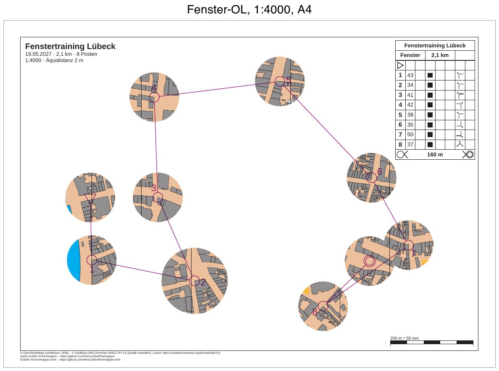

# luebeck-training-window

[English](README.en.md)

Ein Fenster-OL in der Lübecker Altstadt: eine Trainingsbahn von 2,1 km mit 8 Posten auf A4 in 1:4000. Die Karte
ist nur in einem Kreis um den Start, jeden Posten und das Ziel zu sehen. Dazwischen bleibt das Papier weiß, und
die Läufer finden den Weg von Fenster zu Fenster mit Kompass und Strecke. Strecken, Kreise, Nummern,
Postenbeschreibung, Titel und Fußzeile druckt das Programm überall.



| Datei | Inhalt |
|---|---|
| `freemapper-print.toml` | die Projektdatei, mit der Abdeckung `window-Fenster` |
| `training.ppen` | die Bahn als Purple-Pen-Datei, für dieses Beispiel von Hand geschrieben |
| `luebeck.omap` | die Karte (OOM, ISSprOM 2019, 1:4000) |
| `freemapper.toml` | Begleitdatei von freemapper; `init` liest daraus nur die Kartenart |
| `ATTRIBUTION.txt` | die Quellen der Karte, von freemapper |
| `out/Fenster.pdf` | das Blatt der Bahn, A4 quer, 1:4000 |
| `preview.jpg` | dasselbe Blatt als Bild |

## Was Sie auf dem Blatt sehen

- Zehn runde Fenster mit 15 mm Radius auf dem Papier, das sind 60 m im Gelände: um den Start, die acht Posten
  und das Ziel. Das Fenster um Posten 34 (Nummer 2) hat 20 mm Radius und zeigt, wie ein einzelner Posten mehr
  Karte bekommt.
- Die Fenster um Posten 50 (Nummer 7) und das Ziel überlappen. Sie verschmelzen zu einer Fläche ohne Naht. Die
  Abdeckung entstand, bevor `masks window` einen Abstand zwischen den Fenstern hielt (ADR 0063). Heute bekämen die
  beiden Fenster 11,21 mm statt 15 mm Radius und 3 mm Abstand. Die Datei behält die Überlappung, wie sie eine
  Abdeckung von Hand weiter haben darf.
- Außerhalb der Fenster ist das Papier weiß. Die Nordlinien und die hellbraune Grundfläche der Karte fehlen dort
  ebenfalls, denn sie gehören zur Karte.
- Strecken, Postenkreise, Nummern, Start und Ziel liegen in Violett auch über dem weißen Papier. Der
  Beschreibungskasten oben rechts, der Titelblock, die Kontrollstrecke und die Fußzeile sind vollständig.

## Die Bahn

Der Start steht auf der Straße im Westen der Altstadt, das Ziel auf einem Platz im Südosten, beide an derselben
Stelle wie in [luebeck-competition-courses](../luebeck-competition-courses/README.md). Die acht Posten stammen
ebenfalls aus diesem Beispiel, mit Code, Lage und Beschreibung: 43, 34, 41, 42, 38, 35, 50 und 37. Jeder steht an
der Ecke eines Gebäudes (Symbol 521), einem Eckpunkt, den ein kleines Skript aus `luebeck.omap` gelesen hat, in
Millimeter umgerechnet und mit der y-Achse nach oben geschrieben, wie Purple Pen es tut (ADR 0032). Die Bahn führt
vom Start erst nach Süden, dann durch die Mitte nach Norden und über den Osten ins Ziel. Die Strecken sind 38 bis
81 mm lang, so bleibt zwischen den Fenstern weißes Papier. Vom letzten Posten orientiert man sich ohne Markierung
ins Ziel (Symbol 14.3).

Als Nummer 6 stand zuerst Posten 39 aus dem Wettkampfbeispiel auf der Bahn. Sein Fenster reichte unter den
Beschreibungskasten, und der Kasten verdeckte einen Rand des Fensters. Posten 35 liegt 32 mm (130 m) weiter
südlich und frei.

## Was `check` meldet

Das Blatt ist in Ordnung, `check` endet mit Exit-Code 0. Die Zeilen „Zur Information“ zählen nicht.

```
Zur Information: Die geografischen Koordinaten wurden nicht geprüft, denn kein Posten hat sowohl eine Kartenposition als auch geografische Koordinaten.
Bahn „Fenster“ auf Layout a4-4000: A4 Querformat, Druckmaßstab 1:4000, Kartenmaßstab 1:4000, Geometriefaktor 1,000, Symbolfaktor 1,000.
Zur Information: Die Karte ist 14,0 mm zu hoch für den Kartenausschnitt und wird dort mit Absicht beschnitten (map_frame.crop = true).
Layout a4-4000: A4 Querformat, Druckmaßstab 1:4000, Kartenmaßstab 1:4000, Geometriefaktor 1,000, Symbolfaktor 1,000.
Zur Information: Die Karte ist 14,0 mm zu hoch für den Kartenausschnitt und wird dort mit Absicht beschnitten (map_frame.crop = true).
Zur Information: Der Text title nutzt {length_km}, der nur auf Bahnblättern gefüllt wird. Auf diesem Blatt bleibt er leer.
Zur Information: Der Text title nutzt {controls}, der nur auf Bahnblättern gefüllt wird. Auf diesem Blatt bleibt er leer.
1 Bahn und 1 Layoutblatt geprüft, keine Hinweise.
```

Eine Abdeckung gehört zur Zuordnung einer Bahn. Das Layoutblatt ohne Bahn hat deshalb keine, und
`export --layout a4-4000` druckt die ganze Karte.

Start und Ziel bekommen ihr Fenster von selbst. Mit `--no-start` und `--no-finish` bekämen sie keins. `masks window`
sagt das gleich, und `check` meldet sie dann mit Exit-Code 1:

```
Hinweis: Auf dem Blatt der Bahn „Fenster“ liegen der Start und das Ziel dort, wo die Abdeckung die Karte verbirgt. Die Läufer finden dort keine Karte. Ergänzen Sie ein Fenster, oder prüfen Sie, ob die Bahn die richtige Abdeckung hat.
```

## So ist es entstanden

Nur mit freemapper-print selbst, im Ordner dieses Beispiels. Zuerst das Projekt aus Karte und Bahndatei:

```sh
freemapper-print --lang de init . --map luebeck.omap --title "Fenstertraining Lübeck" --courses training.ppen
```

```
Kartenart: Sprintkarten, wie in der freemapper.toml neben der Karte angegeben.
Bahndatei training.ppen gelesen: 1 Bahn, an die Karte angepasst.
Suche ein A4- oder A3-Blatt, das die Karte in 1:4000 zeigt …
./freemapper-print.toml geschrieben mit einem Layout und einer Bahnzuordnung, für Sprintkarten.
Layout a3-4000 bei 1:4000: A3, Passepartout 14 mm, für „Fenster“.
Die Druckmaßstäbe stammen aus der Bahndatei, ein Layout je Maßstab. Eine Bahn ohne Druckmaßstab bekommt den Kartenmaßstab 1:4000.
Jedes Layout hat einen Beschreibungskasten in der oberen rechten Ecke des Kartenausschnitts, mit der Zellengröße des Regelprofils.
Ein Bahnblatt schneidet die Karte mit Absicht auf die Bahn zu, deshalb haben die Layouts map_frame.crop = true.
Das Projekt schlägt eine Äquidistanz von 2 m vor, üblich für Sprintkarten. Sehen Sie auf der Karte nach und bestätigen Sie den Wert oder ändern Sie map.contour_interval_m.
Als Nächstes freemapper-print check ./freemapper-print.toml aufrufen.
```

Danach ist die Projektdatei von Hand bearbeitet, wie in
[luebeck-competition-courses](../luebeck-competition-courses/README.md#so-ist-es-entstanden):

- `[event]`: Datum und Ausrichter ergänzt.
- Die vorgeschlagene Äquidistanz von 2 m mit dem Informationsblock der Karte verglichen und bestätigt.
- `[print]` mit den zwei Quellenzeilen aus luebeck-competition-layouts ergänzt.
- Der Titelblock zeigt `{event}`, darunter `{date} · {length_km} km · {controls} Posten` und
  `1:{print_scale} · Äquidistanz {contour_interval}`.
- Das Layout `a3-4000` durch `a4-4000` ersetzt: A4 quer, 10 mm Passepartout, `crop = true`, mit dem
  Beschreibungskasten oben rechts. Die Bahnzuordnung nennt die neue ID.
- Die Tabellen in die kurze Schreibweise mit `{ … }` gebracht, wie in den anderen Beispielen.

Die Abdeckung entsteht mit `masks window`, ohne Handarbeit:

```sh
freemapper-print --lang de check .
freemapper-print --lang de masks window . --course Fenster --radius 15 --radius-for 34=20 --assign
```

```
Abdeckung „window-Fenster“ in ./freemapper-print.toml eingetragen: 10 Fenster mit 15 mm Radius auf dem Papier bei 1:4000 um den Start, die Posten 43, 34, 41, 42, 38, 35, 50 und 37 und das Ziel der Bahn „Fenster“.
Posten 34 hat ein Fenster mit 20 mm Radius.
Die Bahn „Fenster“ wird jetzt damit gedruckt, auf Layout a4-4000.
Mit check sehen Sie das Ergebnis.
```

So lautete die Ausgabe vor ADR 0063. Heute endet die erste Zeile mit „mindestens 3 mm auseinander“, und zwei
Zeilen kommen hinzu: „Posten 50 hat ein Fenster mit 11,21 mm Radius statt 15 mm, damit der Abstand bleibt.“ und
dieselbe für das Ziel.

Der Befehl hängt eine Tabelle `[[masks]]` mit der ID `window-Fenster` an die Projektdatei, mit einem Kommentar, wie
sie entstand. Sie hat ein Polygon: ein Rechteck 100 mm außerhalb der Karte als Umriss und zehn Kreise als Löcher.
`--assign` schreibt `mask = "window-Fenster"` in die Zuordnung der Bahn. Der Radius gilt in Millimetern auf dem
Papier, im Druckmaßstab des Layouts `a4-4000`; hier ist das dasselbe wie in der Karte, denn beide sind 1:4000.

Dann prüfen und das PDF schreiben:

```sh
freemapper-print --lang de check .
freemapper-print --lang de export .
```

`export` schreibt `out/Fenster.pdf` und endet mit Exit-Code 0.

## Offen

- Öffnen Sie `training.ppen` einmal in Purple Pen (Beta für macOS) und prüfen Sie die Datei: Lädt Purple Pen die
  Karte `luebeck.omap`, und stehen die Posten an ihren Gebäudeecken? Der Wert `Spr2019` für den Kartenstandard ist
  nicht gegen Purple Pen geprüft.

## Geprüft

- `check` und `export` wie oben, mit den Meldungen von oben.
- Alle Befehle in einer frischen Kopie noch einmal ausgeführt: Das PDF ist Byte für Byte gleich.
- Die Seite bei 100 dpi angesehen und die Überlappung von Posten 50 und Ziel bei 250 dpi: Karte nur in den
  Fenstern, keine Naht zwischen den überlappenden Fenstern, Bahnaufdruck und Beschreibungskasten vollständig,
  der Kasten deckt kein Fenster ab.

## Neu erzeugen

Das PDF mit den Befehlen oben, die Vorschau wie bei
[luebeck-competition-courses](../luebeck-competition-courses/README.md#neu-erzeugen), mit `out/Fenster.pdf` als
Eingabe und der Beschriftung „Fenster-OL, 1:4000, A4“.

## Drucken

Drucken Sie mit 100 % („Tatsächliche Größe“), und schalten Sie „An Seite anpassen“ aus. Mit der
Kontrollstrecke messen Sie am Ausdruck nach, ob der Drucker skaliert hat.

## Herkunft und Lizenz

Karte, `freemapper.toml` und `ATTRIBUTION.txt` aus dem Beispiel `schleswig-holstein-luebeck` von
[freemapper](https://github.com/HenryJobst/freemapper), Version 0.8.0 (Commit `a2b41b4`), unverändert, wie in
luebeck-competition-courses. Ändert freemapper seine Beispiele, wird die Karte hier ersetzt und das Beispiel mit
den Befehlen oben neu gebaut. Für die Karte gilt, was `ATTRIBUTION.txt` nennt: Kartendaten ©
OpenStreetMap-Mitwirkende (ODbL) und © GeoBasis-DE/LVermGeo SH (CC BY 4.0, Quelle verändert). Die Bahn in
`training.ppen` ist für dieses Beispiel geschrieben und steht unter CC0. Das PDF ist mit
[freemapper-print](https://github.com/HenryJobst/freemapper-print) erzeugt.
