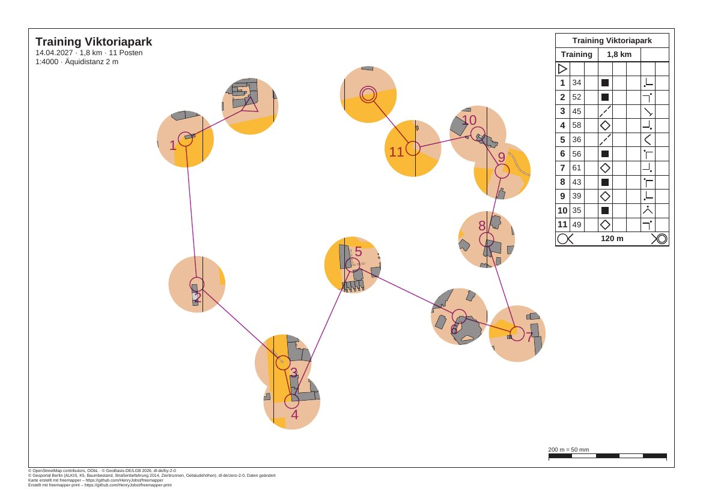

# mcp-session

[Deutsch](README.md)

A recorded session with the MCP server of freemapper-print. An AI agent gets the club training from
[berlin-viktoriapark-training](../berlin-viktoriapark-training/README.en.md) and the request: "Turn it into window
orienteering with 12 mm windows and put the PDF into the folder pdf." It needs five calls for that. The session
really ran, and every request and answer is in `session.jsonl`.



| File | Content |
|---|---|
| `session.jsonl` | the session, one message per line |
| `record_session.py` | the script that plays and records the session |
| `check_record_session.py` | checks that `record_session.py` refuses a folder with content |
| `preview.jpg` | the PDF the session wrote, as an image |

The PDF itself is not stored here; `record_session.py` writes it again (see below).

## The session

The script starts the server with `freemapper-print --lang de mcp`, as Claude Code does with the `.mcp.json` from
the [manual](../../docs/manual/en.md#3-with-an-ai-agent). The messages are therefore German, like the sheets of the
other examples. The project is a copy of berlin-viktoriapark-training in the folder
`/home/user/Verein/viktoriapark-training` ("Verein" is German for club), and the PDF goes to
`/home/user/Verein/pdf`. Both paths are placeholders: the session ran in a work folder, and the script replaced
its path while recording.

After the greeting (`initialize`) the agent asks for the list of tools (`tools/list`). Then:

1. `project_info` with `project`: the project is called "Training Viktoriapark", a sprint map at 1:4000, with one
   course "Training" of 11 controls on the layout `a4-4000` and no mask yet.
2. `check_project`: five notes, all of them info, for example that the map is cropped on purpose. One is about
   the course file, one about the course sheet and three about the layout sheet without a course.
   `needs_attention` is `false`.
3. `masks_window`:

   ```json
   {"project": "/home/user/Verein/viktoriapark-training", "course": "Training", "radius": 12, "assign": true}
   ```

   The result names the mask `window-Training` with 13 windows and these messages:

   ```
   Abdeckung „window-Training“ in /home/user/Verein/viktoriapark-training/freemapper-print.toml eingetragen: 13 Fenster mit 12 mm Radius auf dem Papier bei 1:4000 um den Start, die Posten 34, 52, 45, 58, 36, 56, 61, 43, 39, 35 und 49 und das Ziel der Bahn „Training“.
   Die Bahn „Training“ wird jetzt damit gedruckt, auf Layout a4-4000.
   Mit check_project sehen Sie das Ergebnis.
   ```

   They say that the mask was added with 13 windows of 12 mm radius around the start, the eleven controls and the
   finish, that the course prints with it on layout a4-4000, and that check_project shows the result. On the
   command line the last sentence names `check`; the server names the tool.
4. `check_project` again: the same five info notes and no other. No control, leg or finish lies under the mask.
5. `export_project` with `out_dir`: the result names `Training.pdf` with 170,397 bytes, A4, print scale 1:4000,
   the two notes of the sheet, and the reminder to print at actual size with "Fit to page" off.

Then the script closes the connection, and the server ends with exit code 0.

In the project file the course's assignment gets the line `mask = "window-Training"`. At the end comes a new
table with a comment on how it was made:

```toml
# Fenster mit 12 mm Radius auf dem Papier bei 1:4000 um den Start, die Posten 34, 52, 45, 58, 36,
# 56, 61, 43, 39, 35 und 49 und das Ziel der Bahn „Training“, erzeugt mit masks window.
[[masks]]
id = "window-Training"
polygons = [
    [
        [
            [-224.0, -253.0], [271.0, -253.0], [271.0, 203.0], [-224.0, 203.0],
        ],
        …
```

The first ring is the outline, a rectangle 100 mm outside the map, and each further ring is a window. Everything
else in the file stays as it was byte for byte, comments included.

## Reading `session.jsonl`

Each line is a JSON object. `from` says who sent the message (`client` is the agent, `server` is
freemapper-print), and `message` is the message as it went over the wire. The tool results are JSON text in
`result.content[0].text`. Only the answer to `tools/list` is shortened, and it carries `shortened` to say so: each
input of a tool shows only its description, without type and range.

## Checked

- The session recorded twice: the project file and the PDF are byte-identical both times.
- `freemapper-print masks window . --course Training --radius 12 --assign` on a fresh copy writes the same project
  file as the tool, and `export` then writes the same PDF.
- The page viewed at 100 dpi: map only in the 13 windows, the legs run over white paper, and the description box
  at the top right covers no window.
- Standard output carried JSON-RPC only, and standard error stayed empty.

## Regenerate

In the repository folder:

```sh
cargo build --locked
python3 -I examples/mcp-session/record_session.py target/debug/freemapper-print /tmp/mcp-session
```

The work folder `/tmp/mcp-session` must be missing or empty. If it holds anything, the script stops with a
message; it deletes no folder. Without the second argument it makes a new temporary folder. The script copies the
example to `/tmp/mcp-session/Verein/viktoriapark-training`, plays the session, writes `session.jsonl` again and
leaves the PDF in `/tmp/mcp-session/Verein/pdf`. The preview comes from `pdftoppm -r 100 -png` and
`magick … -quality 82 preview.jpg`. `python3 -I examples/mcp-session/check_record_session.py` checks without a
build that the script refuses a folder with content and a file, and leaves both as they were.

## Credits and licence

Map, course and project file come from
[berlin-viktoriapark-training](../berlin-viktoriapark-training/README.en.md), which names their sources and
licences. The map is under the terms its `ATTRIBUTION.txt` names. The session, the scripts and the preview were
made for this example and are released under CC0. The PDF and the preview were made with
[freemapper-print](https://github.com/HenryJobst/freemapper-print).
