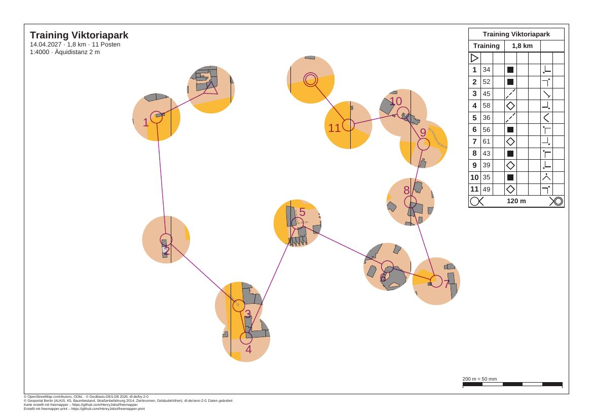

# mcp-session

[English](README.en.md)

Eine aufgezeichnete Sitzung mit dem MCP-Server von freemapper-print. Ein KI-Agent bekommt das Vereinstraining
aus [berlin-viktoriapark-training](../berlin-viktoriapark-training/README.md) und die Bitte: „Mach daraus einen
Fenster-OL mit Fenstern von 12 mm und leg das PDF in den Ordner pdf.“ Er braucht dafür fünf Aufrufe. Die
Sitzung lief wirklich, jede Anfrage und jede Antwort steht in `session.jsonl`.



| Datei | Inhalt |
|---|---|
| `session.jsonl` | die Sitzung, eine Nachricht je Zeile |
| `record_session.py` | das Skript, das die Sitzung abspielt und aufzeichnet |
| `check_record_session.py` | prüft, dass `record_session.py` einen Ordner mit Inhalt ablehnt |
| `preview.jpg` | das PDF, das die Sitzung geschrieben hat, als Bild |

Das PDF selbst liegt nicht hier; `record_session.py` schreibt es neu (siehe unten).

## Die Sitzung

Das Skript startet den Server mit `freemapper-print --lang de mcp`, so wie Claude Code es nach der `.mcp.json`
aus dem [Handbuch](../../docs/manual/de.md#3-mit-einem-ki-agenten) tut. Die Meldungen kommen deshalb auf Deutsch.
Das Projekt ist eine Kopie von berlin-viktoriapark-training im Ordner `/home/user/Verein/viktoriapark-training`,
das PDF geht nach `/home/user/Verein/pdf`. Beide Pfade sind Platzhalter: Die Sitzung lief in einem
Arbeitsordner, und das Skript hat dessen Pfad beim Aufzeichnen ersetzt.

Nach der Begrüßung (`initialize`) fragt der Agent die Liste der Werkzeuge ab (`tools/list`). Dann:

1. `project_info` mit `project`: Das Projekt heißt „Training Viktoriapark“, Sprintkarte in 1:4000, eine Bahn
   „Training“ mit 11 Posten auf dem Layout `a4-4000`, noch ohne Abdeckung.
2. `check_project`: fünf Hinweise, alle zur Information, etwa dass die Karte mit Absicht beschnitten ist. Einer
   gilt der Bahndatei, einer dem Bahnblatt, drei dem Layoutblatt ohne Bahn. `needs_attention` ist `false`.
3. `masks_window`:

   ```json
   {"project": "/home/user/Verein/viktoriapark-training", "course": "Training", "radius": 12, "assign": true}
   ```

   Das Ergebnis nennt die Abdeckung `window-Training` mit 13 Fenstern und diese Meldungen:

   ```
   Abdeckung „window-Training“ in /home/user/Verein/viktoriapark-training/freemapper-print.toml eingetragen: 13 Fenster mit 12 mm Radius auf dem Papier bei 1:4000 um den Start, die Posten 34, 52, 45, 58, 36, 56, 61, 43, 39, 35 und 49 und das Ziel der Bahn „Training“.
   Die Bahn „Training“ wird jetzt damit gedruckt, auf Layout a4-4000.
   Mit check_project sehen Sie das Ergebnis.
   ```

   In der Kommandozeile heißt der letzte Satz „Mit check sehen Sie das Ergebnis.“ Der Server nennt das Werkzeug.
4. `check_project` noch einmal: dieselben fünf Hinweise zur Information und keiner mehr. Kein Posten, keine
   Strecke und kein Ziel liegt unter der Abdeckung.
5. `export_project` mit `out_dir`: Das Ergebnis nennt `Training.pdf` mit 170 397 Byte, A4, Druckmaßstab 1:4000,
   die zwei Hinweise des Blatts und die Erinnerung „In Originalgröße drucken: 100 % („Tatsächliche Größe“), „An
   Seite anpassen“ ausgeschaltet.“

Dann schließt das Skript die Verbindung, und der Server endet mit Exit-Code 0.

In der Projektdatei bekommt die Zuordnung der Bahn die Zeile `mask = "window-Training"`. Am Ende steht eine
neue Tabelle mit einem Kommentar, wie sie entstand:

```toml
# Fenster mit 12 mm Radius auf dem Papier bei 1:4000 um den Start, die Posten 34, 52, 45, 58, 36,
# 56, 61, 43, 39, 35 und 49 und das Ziel der Bahn „Training“, erzeugt mit masks window.
[[masks]]
id = "window-Training"
polygons = [
    [
        [
            [-224.0, -253.0], [271.0, -253.0], [271.0, 203.0], [-224.0, 203.0],
        ],
        …
```

Der erste Ring ist der Umriss, ein Rechteck 100 mm außerhalb der Karte, jeder weitere Ring ein Fenster. Alles
andere in der Datei bleibt Byte für Byte, wie es war, Kommentare eingeschlossen.

## Die Datei `session.jsonl` lesen

Jede Zeile ist ein JSON-Objekt. `from` sagt, wer die Nachricht geschickt hat (`client` ist der Agent, `server`
ist freemapper-print), `message` ist die Nachricht so, wie sie über die Leitung ging. Die Ergebnisse der
Werkzeuge stehen als JSON-Text in `result.content[0].text`. Gekürzt ist nur die Antwort auf `tools/list`, sie
trägt dafür `shortened`: Von jeder Eingabe eines Werkzeugs steht nur ihre Beschreibung da, ohne Typ und
Wertebereich.

## Geprüft

- Die Sitzung zweimal aufgezeichnet: Projektdatei und PDF sind beide Male Byte für Byte gleich.
- `freemapper-print masks window . --course Training --radius 12 --assign` auf einer frischen Kopie schreibt
  dieselbe Projektdatei wie das Werkzeug, und `export` schreibt danach dasselbe PDF.
- Die Seite bei 100 dpi angesehen: Karte nur in den 13 Fenstern, die Strecken laufen über weißes Papier, der
  Beschreibungskasten oben rechts deckt kein Fenster ab.
- Auf der Standardausgabe stand nur JSON-RPC, auf der Standardfehlerausgabe nichts.

## Neu erzeugen

Im Ordner des Repositorys:

```sh
cargo build --locked
python3 -I examples/mcp-session/record_session.py target/debug/freemapper-print /tmp/mcp-session
```

Der Arbeitsordner `/tmp/mcp-session` muss fehlen oder leer sein. Hat er Inhalt, bricht das Skript mit einer
Meldung ab; es löscht keinen Ordner. Ohne zweites Argument legt es einen neuen temporären Ordner an. Das Skript
kopiert das Beispiel nach `/tmp/mcp-session/Verein/viktoriapark-training`, spielt die Sitzung ab, schreibt
`session.jsonl` neu und lässt das PDF in `/tmp/mcp-session/Verein/pdf`. Die Vorschau entsteht mit
`pdftoppm -r 100 -png` und `magick … -quality 82 preview.jpg`.
`python3 -I examples/mcp-session/check_record_session.py` prüft ohne Build, dass das Skript einen Ordner mit
Inhalt und eine Datei ablehnt und beide unverändert lässt.

## Herkunft und Lizenz

Karte, Bahn und Projektdatei stammen aus [berlin-viktoriapark-training](../berlin-viktoriapark-training/README.md);
dort stehen ihre Quellen und Lizenzen. Für die Karte gilt, was dessen `ATTRIBUTION.txt` nennt. Sitzung, Skripte
und Vorschau sind für dieses Beispiel entstanden und stehen unter CC0. Das PDF und die Vorschau sind mit
[freemapper-print](https://github.com/HenryJobst/freemapper-print) erzeugt.
