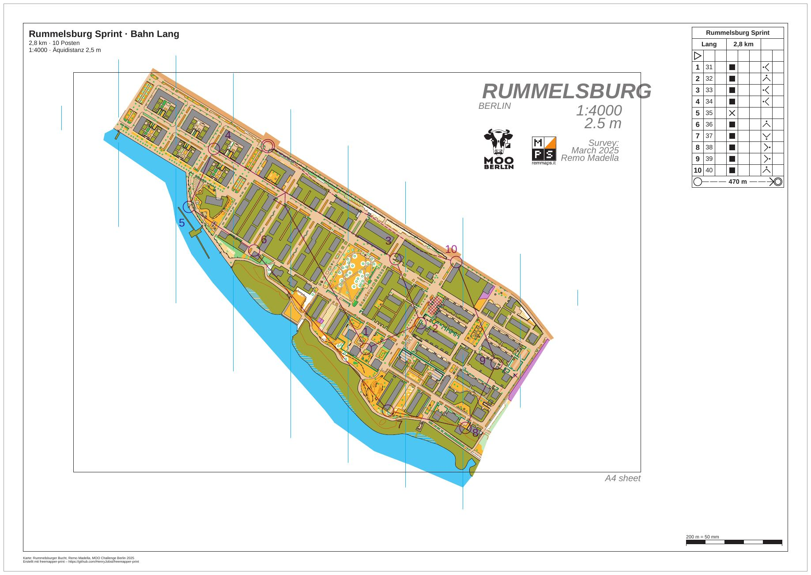

# rummelsburg-competition-courses

[Deutsch](README.md)

The sprint in Rummelsburg from [rummelsburg-competition-layouts](../rummelsburg-competition-layouts/README.en.md),
now with courses. Three courses come from a file made by freemapper-courseplan: Kurz (short), Mittel (middle) and
Lang (long), all on A3 at 1:4000. Each sheet shows the course with control numbers, the control descriptions, an
out-of-bounds area and a forbidden crossing. Lang also has a marked route to the finish. The folder `iof/` holds
the same courses as IOF XML 3.0. Those sheets have no control descriptions, because the format has none.



| File | Content |
|---|---|
| `freemapper-print.toml` | the project file for `courses.ppen` |
| `courses.ppen` | the three courses as a Purple Pen file, written by freemapper-courseplan 0.14.1 |
| `courses.xml` | the same courses as IOF XML 3.0 `CourseData` |
| `rummelsburg.omap` | the map "Rummelsburger Bucht" (OOM, 1:4000) |
| `ATTRIBUTION.txt` | author and permission for the map, origin of the courses |
| `out/Kurz.pdf`, `out/Mittel.pdf`, `out/Lang.pdf` | the sheets of the three courses from `courses.ppen`, 0.2 MB each |
| `iof/freemapper-print.toml` | the project file for `courses.xml`; it reads the map from the folder above |
| `iof/out/Kurz.pdf`, `iof/out/Mittel.pdf`, `iof/out/Lang.pdf` | the same courses from `courses.xml` |
| `preview.jpg` | the sheet of course Lang |

The sheets are in German (`event.lang = "de"`). The courses are made up and the event is fictitious: the title, the
date and the club do not exist.

## The courses

| Course | Length | Controls | Sheet |
|---|---|---|---|
| Kurz | 1.2 km | 4 | A3 landscape, 1:4000 |
| Mittel | 1.9 km | 7 | A3 landscape, 1:4000 |
| Lang | 2.8 km | 10 | A3 landscape, 1:4000 |

The courses share start and finish and the controls 31 to 41. Each control sits on a feature of the map.
freemapper-courseplan wrote the descriptions and put a fixed position into the file for each of the 21 numbers.
freemapper-print takes them as they stand in the file.

Three special objects come from the file:

- An out-of-bounds area, a hatched patch between two rows of houses in the middle of the map, just north of
  control 32. It applies to all courses.
- A forbidden crossing, a small cross at the eastern edge of the map next to control 39. It applies to all courses
  too.
- On Lang a marked route from the last control to the finish, dashed along the north-eastern edge of the map. The
  description box gives its length in the last row, 470 m.

Sheet and section. All three courses print on the same layout `a3-4000`: A3 landscape, 10 mm passe-partout,
`crop = true`. Lang spans almost the whole map. An A4 sheet would be tight, and a test with A4 shows the title
block covering the number of control 34 on the sheets of Mittel and Lang. `map_frame.centre_map_mm =
[30.0, -10.0]` shifts the section to the east. The description box at the top right then sits next to the map's
header instead of hiding its "RUMMELSBURG" lettering.

## Control numbers

Two notes of `check` concern numbers, and both come from positions already in the file.

Course Kurz, control 36. The number covers the line symbol 410.2 of the map. `check` proposes the same direction at
2 mm instead of 1.5 mm, and that place is free:

```
Hinweis: Auf dem Blatt der Bahn „Kurz“ überdeckt die Nummer von Posten 36 das Liniensymbol 410.2 der Karte. Sie wird trotzdem dort gedruckt. Frei ist Richtung 111,3° mit 2 mm Abstand. Um diese Lage zu nutzen, rufen Sie numbers accept mit --course „Kurz“, --control 36 und --sheet oder --layout-wide auf.
```

`numbers accept` takes the proposal for this one sheet:

```sh
freemapper-print --lang de numbers accept . --course Kurz --control 36 --sheet
```

```
Korrektur für die Nummer von Posten 36 für Bahn „Kurz“ in ./freemapper-print.toml eingetragen: Richtung 111,3° mit einem Abstand von 2 mm. Mit check sehen Sie das Ergebnis.
```

The project file then ends with a `[[numbers]]` table holding direction, gap and the position the file had
(`base_seen`). If someone later moves the number in the course file, `check` reports the correction as stale.

Course Mittel, control 34. The number covers the line symbol 520.1, and no place is free. The proposal is the
position the file already has, the least covered one. There is nothing to accept, and the note stays. It is a
warning, not an error: the number stands where the course setter put it. Whoever wants it elsewhere sets the
number again in the course file.

## What `check` reports

Two notes remain after the correction, and `check` ends with exit code 1.

- The note on control 34 of course Mittel, see above.
- On every sheet the note "Die Schrift Arimo ersetzt Calibri." (the font Arimo replaces Calibri). The map sets
  texts in Calibri, the font is not in the program, and Arimo stands in. That mostly affects the map header.
  Nothing on the sheet needs changing.

The "Zur Information" (Info) lines do not count. The sheet cuts the map on purpose, and the file has no latitude and
longitude for the program to check. After the courses, `check` checks the layout as a sheet without a course, as
`export --layout` writes it; there the course placeholders stay empty. Shortened:

```
Zur Information: Die geografischen Koordinaten wurden nicht geprüft, denn kein Posten hat sowohl eine Kartenposition als auch geografische Koordinaten.
Bahn „Kurz“ auf Layout a3-4000: A3 Querformat, Druckmaßstab 1:4000, Kartenmaßstab 1:4000, Geometriefaktor 1,000, Symbolfaktor 1,000.
Hinweis: Die Schrift Arimo ersetzt Calibri.
Bahn „Mittel“ auf Layout a3-4000: A3 Querformat, Druckmaßstab 1:4000, Kartenmaßstab 1:4000, Geometriefaktor 1,000, Symbolfaktor 1,000.
Hinweis: Die Schrift Arimo ersetzt Calibri.
Hinweis: Auf dem Blatt der Bahn „Mittel“ überdeckt die Nummer von Posten 34 das Liniensymbol 520.1 der Karte. Sie wird trotzdem dort gedruckt. Einen freien Platz gibt es nicht; am wenigsten verdeckt Richtung 37,9° mit 2,5 mm Abstand. Um diese Lage zu nutzen, rufen Sie numbers accept mit --course „Mittel“, --control 34 und --sheet oder --layout-wide auf.
Bahn „Lang“ auf Layout a3-4000: A3 Querformat, Druckmaßstab 1:4000, Kartenmaßstab 1:4000, Geometriefaktor 1,000, Symbolfaktor 1,000.
Hinweis: Die Schrift Arimo ersetzt Calibri.
Layout a3-4000: A3 Querformat, Druckmaßstab 1:4000, Kartenmaßstab 1:4000, Geometriefaktor 1,000, Symbolfaktor 1,000.
Hinweis: Die Schrift Arimo ersetzt Calibri.
Zur Information: Der Text title nutzt {course}, der nur auf Bahnblättern gefüllt wird. Auf diesem Blatt bleibt er leer.
… (two more lines for {length_km} and {controls})
Mit Hinweisen: 3 von 3 Bahnen, 1 von 1 Layoutblatt.
```

With `--lang en` the same lines come in English.

## How it was made

With freemapper-print alone, in the folder of this example. First the project from map and course file. The map has
no `freemapper.toml`, so `--kind` names the map kind:

```sh
freemapper-print --lang de init . --map rummelsburg.omap --title "Rummelsburg Sprint" --kind sprint --courses courses.ppen
```

```
Kartenart: Sprintkarten, wie mit --kind angegeben.
Bahndatei courses.ppen gelesen: 3 Bahnen, an die Karte angepasst.
Suche ein A4- oder A3-Blatt, das die Karte in 1:4000 zeigt …
./freemapper-print.toml geschrieben mit einem Layout und 3 Bahnzuordnungen, für Sprintkarten.
Layout a4-4000 bei 1:4000: A4, Passepartout 8 mm, für „Kurz“, „Mittel“, „Lang“.
Warnung: Kein A4- oder A3-Blatt zeigt die Karte bei 1:4000 ohne Hinweise oder Fehler, deshalb bleibt Layout a4-4000 bei A4. check meldet das.
…
```

From the file's print scale (4000 for all three courses) `init` makes one layout. A course sheet does not need paper
for the whole map, so the layout was changed by hand. Nobody has to confirm the y axis: Purple Pen always writes it
pointing up, and the program reads the file so.

Edited by hand:

- `[event]`: date and club added.
- The proposed contour interval of 2 m compared with the map header and changed to 2.5 m.
- `[print]` added with the line about map and author, as in the layouts example.
- The title block shows `{event} · Bahn {course}`, then `{length_km} km · {controls} Posten` and
  `1:{print_scale} · Äquidistanz {contour_interval}`.
- The layout `a4-4000` replaced by `a3-4000`: A3 landscape, 10 mm passe-partout, `crop = true`, `centre_map_mm`
  and the description box at the top right with the 6 mm cells of the rule profile.
- The three assignments moved to `a3-4000`.

Then check, take the correction (see above), check again and write the PDFs:

```sh
freemapper-print --lang de check .
freemapper-print --lang de numbers accept . --course Kurz --control 36 --sheet
freemapper-print --lang de check .
freemapper-print --lang de export .
```

`export` writes one PDF per course into the folder `out`, named after the course, and exits with code 0.

### The same courses as IOF XML

`courses.xml` holds the same controls at the same map positions (in millimetres, y up) and the same courses, plus
`Map/Scale` 4000, each course's length and the position of each number as `MapTextPosition`. Unlike the Purple Pen
file it also has latitude and longitude for 13 points. IOF XML has no control descriptions, special objects, bends or
print scales.

```sh
freemapper-print --lang de init iof --map rummelsburg.omap --title "Rummelsburg Sprint" --kind sprint --courses courses.xml
freemapper-print --lang de numbers accept iof --course Kurz --control 36 --sheet
freemapper-print --lang de check iof
freemapper-print --lang de export iof
```

`init` writes `iof/freemapper-print.toml` with one layout at the map scale and no description box. The title block
names the course, since otherwise its name appears nowhere on the sheet. The project file was filled in by hand as
above: A3 landscape, `crop = true`, the same `centre_map_mm`, and the map from the folder above
(`../rummelsburg.omap`). No `course_y_axis` is needed, because latitude and longitude settle the axis. The program
compares them with the map positions: 13 controls differ by 0.1 m at most. `check` shows the same two notes as
above, the font on every sheet and the number of control 34 of course Mittel, and ends with exit code 1. There are
also Info lines: "Die Bahndatei hat keine Postenbeschreibungen." (the course file has no control descriptions) and
one "kommt aus IOF-XML" (comes from IOF XML) per course.

Compared with `out/`, the sheets in `iof/out/` lack the description box, the out-of-bounds area, the forbidden
crossing and the marked route. The last leg of course Lang is a plain line.

## What to look at on the sheet

- The number of control 36 on course Kurz sits 2 mm from the circle after the correction and no longer covers the
  line symbol.
- The out-of-bounds area lies just north of control 32 and the cross east of control 39, both on all three
  sheets.
- On Lang the dashed route runs along the north-eastern edge to the finish.
- The description box covers neither a control nor the map header.

## Checked

- `check` and `export` as above, with the messages above, for both project files.
- The sheet of course Lang exported twice: the PDFs are identical byte for byte.
- The three pages in `out/` viewed at 80 dpi, Lang at 170 dpi in sections, plus the IOF sheet of course Lang: the
  controls sit on their features, the out-of-bounds area, the cross and the marked route print in purple, and
  the description box is clear.

## Regenerate

The PDFs come from `export` as above. The preview comes from `pdftoppm` and ImageMagick, working in a temporary
folder:

```sh
tmp=$(mktemp -d)
pdftoppm -r 110 -png -singlefile out/Lang.pdf "$tmp/lang"
magick "$tmp/lang.png" -bordercolor gray60 -border 1 -bordercolor white -border 8 -quality 76 preview.jpg
rm -r "$tmp"
```

## Printing

Print at 100 % ("Actual size") and switch "Fit to page" off. Measure the scale check bar on the printout to see
whether the printer scaled the page. More on courses in the
[manual, chapter 8](../../docs/manual/en.md#8-courses).

## Credits and licence

Remo Madella drew the map "Rummelsburger Bucht" for the MOO Challenge Berlin 2025. He allowed its use as an
example map in this public project. That is a permission for the freemapper suite, not an open licence;
`ATTRIBUTION.txt` has the wording. The courses in `courses.ppen` and `courses.xml` were made with
freemapper-courseplan 0.14.1. The PDFs were made with
[freemapper-print](https://github.com/HenryJobst/freemapper-print).
