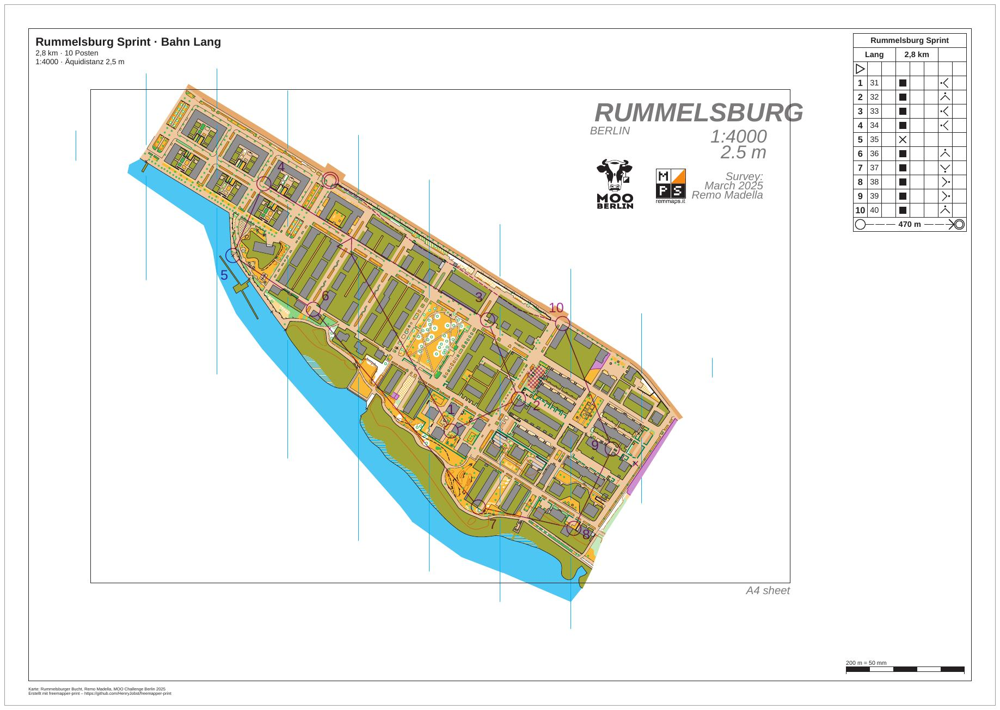

# rummelsburg-competition-courses

[English](README.en.md)

Der Sprint in Rummelsburg aus [rummelsburg-competition-layouts](../rummelsburg-competition-layouts/README.md),
jetzt mit Bahnen. Drei Bahnen kommen aus einer Datei von freemapper-courseplan: Kurz, Mittel und Lang, alle auf A3
in 1:4000. Jedes Blatt zeigt die Bahn mit Postennummern, die Postenbeschreibung, ein Sperrgebiet und eine verbotene
Querung. Lang hat dazu eine markierte Strecke ins Ziel. Der Ordner `iof/` enthält dieselben Bahnen als IOF-XML 3.0.
Diese Blätter haben keine Postenbeschreibung, weil das Format keine kennt.



| Datei | Inhalt |
|---|---|
| `freemapper-print.toml` | die Projektdatei für `courses.ppen` |
| `courses.ppen` | die drei Bahnen als Purple-Pen-Datei, von freemapper-courseplan 0.14.1 geschrieben |
| `courses.xml` | dieselben Bahnen als IOF-XML 3.0 `CourseData` |
| `rummelsburg.omap` | die Karte „Rummelsburger Bucht“ (OOM, 1:4000) |
| `ATTRIBUTION.txt` | Autor und Nutzungserlaubnis der Karte, Herkunft der Bahnen |
| `out/Kurz.pdf`, `out/Mittel.pdf`, `out/Lang.pdf` | die Blätter der drei Bahnen aus `courses.ppen`, je 0,2 MB |
| `iof/freemapper-print.toml` | die Projektdatei für `courses.xml`, sie liest die Karte aus dem Ordner darüber |
| `iof/out/Kurz.pdf`, `iof/out/Mittel.pdf`, `iof/out/Lang.pdf` | dieselben Bahnen aus `courses.xml` |
| `preview.jpg` | das Blatt der Bahn Lang |

Die Blätter sind deutsch (`event.lang = "de"`). Die Bahnen sind ausgedacht und die Veranstaltung ist erfunden:
Titel, Datum und Verein gibt es nicht.

## Die Bahnen

| Bahn | Länge | Posten | Blatt |
|---|---|---|---|
| Kurz | 1,2 km | 4 | A3 quer, 1:4000 |
| Mittel | 1,9 km | 7 | A3 quer, 1:4000 |
| Lang | 2,8 km | 10 | A3 quer, 1:4000 |

Die Bahnen teilen sich Start und Ziel und die Posten 31 bis 41. Jeder Posten steht auf einem Objekt der Karte.
freemapper-courseplan hat die Beschreibungen geschrieben und für jede der 21 Nummern eine feste Lage in die Datei
gesetzt. freemapper-print übernimmt sie so, wie sie in der Datei stehen.

Drei Sonderobjekte kommen aus der Datei:

- Ein Sperrgebiet, ein schraffiertes Feld zwischen zwei Häuserzeilen in der Mitte der Karte, knapp nördlich von
  Posten 32. Es gilt für alle Bahnen.
- Eine verbotene Querung, ein kleines Kreuz am östlichen Rand der Karte neben Posten 39. Auch sie gilt für alle
  Bahnen.
- Auf Lang eine markierte Strecke vom letzten Posten ins Ziel, gestrichelt am nordöstlichen Kartenrand entlang. Die
  Postenbeschreibung nennt ihre Länge in der letzten Zeile, 470 m.

Blatt und Ausschnitt. Alle drei Bahnen drucken auf demselben Layout `a3-4000`: A3 quer, 10 mm Passepartout,
`crop = true`. Die Bahn Lang spannt über fast die ganze Karte. Ein A4-Blatt wäre knapp. Ein Versuch mit A4 zeigt
auf den Blättern Mittel und Lang, dass der Titelblock die Nummer von Posten 34 abdeckt. `map_frame.centre_map_mm = [30.0, -10.0]` schiebt
den Ausschnitt nach Osten. Der Beschreibungskasten oben rechts liegt dann rechts neben dem Kopf der Karte, statt
dessen Schriftzug „RUMMELSBURG“ zu verdecken.

## Postennummern

Zwei Hinweise von `check` betreffen Nummern, und beide kommen schon aus den Positionen in der Datei.

Bahn Kurz, Posten 36. Die Nummer überdeckt das Liniensymbol 410.2 der Karte. `check` schlägt dieselbe Richtung
mit 2 mm Abstand statt 1,5 mm vor, und dort ist sie frei:

```
Hinweis: Auf dem Blatt der Bahn „Kurz“ überdeckt die Nummer von Posten 36 das Liniensymbol 410.2 der Karte. Sie wird trotzdem dort gedruckt. Frei ist Richtung 111,3° mit 2 mm Abstand. Um diese Lage zu nutzen, rufen Sie numbers accept mit --course „Kurz“, --control 36 und --sheet oder --layout-wide auf.
```

`numbers accept` übernimmt den Vorschlag für dieses eine Blatt:

```sh
freemapper-print --lang de numbers accept . --course Kurz --control 36 --sheet
```

```
Korrektur für die Nummer von Posten 36 für Bahn „Kurz“ in ./freemapper-print.toml eingetragen: Richtung 111,3° mit einem Abstand von 2 mm. Mit check sehen Sie das Ergebnis.
```

Die Projektdatei endet dann mit einer Tabelle `[[numbers]]` mit Richtung, Abstand und der Lage in der Datei
(`base_seen`). Verschiebt jemand die Nummer später in der Bahndatei, meldet `check` die Korrektur als veraltet.

Bahn Mittel, Posten 34. Die Nummer überdeckt das Liniensymbol 520.1, und es gibt keinen freien Platz. Der Vorschlag
ist die Lage, die schon in der Datei steht, nämlich die am wenigsten verdeckte. Es gibt also nichts zu übernehmen,
und der Hinweis bleibt. Er ist eine Warnung, kein Fehler: Die Nummer steht dort, wo die Bahnlegerin oder der
Bahnleger sie hingesetzt hat. Wer sie anders will, setzt die Nummer in der Bahndatei neu.

## Was `check` meldet

Nach der Korrektur bleiben zwei Hinweise, und `check` endet mit Exit-Code 1.

- Der Hinweis zu Posten 34 der Bahn Mittel, siehe oben.
- Auf jedem Blatt der Hinweis „Die Schrift Arimo ersetzt Calibri.“ Die Karte setzt Texte in Calibri, die Schrift ist
  nicht im Programm, und Arimo springt ein. Das betrifft vor allem den Kartenkopf. Auf dem Blatt ist nichts zu
  ändern.

Die Zeilen „Zur Information“ zählen nicht mit. Das Blatt schneidet die Karte mit Absicht, und die Datei hat keine
Breiten- und Längengrade, die das Programm prüfen könnte. Danach prüft `check` das Layout als Blatt ohne Bahn, so
wie `export --layout` es schreibt. Dort bleiben die Platzhalter für die Bahn leer. Gekürzt:

```
Zur Information: Die geografischen Koordinaten wurden nicht geprüft, denn kein Posten hat sowohl eine Kartenposition als auch geografische Koordinaten.
Bahn „Kurz“ auf Layout a3-4000: A3 Querformat, Druckmaßstab 1:4000, Kartenmaßstab 1:4000, Geometriefaktor 1,000, Symbolfaktor 1,000.
Hinweis: Die Schrift Arimo ersetzt Calibri.
Bahn „Mittel“ auf Layout a3-4000: A3 Querformat, Druckmaßstab 1:4000, Kartenmaßstab 1:4000, Geometriefaktor 1,000, Symbolfaktor 1,000.
Hinweis: Die Schrift Arimo ersetzt Calibri.
Hinweis: Auf dem Blatt der Bahn „Mittel“ überdeckt die Nummer von Posten 34 das Liniensymbol 520.1 der Karte. Sie wird trotzdem dort gedruckt. Einen freien Platz gibt es nicht; am wenigsten verdeckt Richtung 37,9° mit 2,5 mm Abstand. Um diese Lage zu nutzen, rufen Sie numbers accept mit --course „Mittel“, --control 34 und --sheet oder --layout-wide auf.
Bahn „Lang“ auf Layout a3-4000: A3 Querformat, Druckmaßstab 1:4000, Kartenmaßstab 1:4000, Geometriefaktor 1,000, Symbolfaktor 1,000.
Hinweis: Die Schrift Arimo ersetzt Calibri.
Layout a3-4000: A3 Querformat, Druckmaßstab 1:4000, Kartenmaßstab 1:4000, Geometriefaktor 1,000, Symbolfaktor 1,000.
Hinweis: Die Schrift Arimo ersetzt Calibri.
Zur Information: Der Text title nutzt {course}, der nur auf Bahnblättern gefüllt wird. Auf diesem Blatt bleibt er leer.
… (zwei weitere Zeilen zu {length_km} und {controls})
Mit Hinweisen: 3 von 3 Bahnen, 1 von 1 Layoutblatt.
```

Mit `--lang en` kommen dieselben Zeilen auf Englisch.

## So ist es entstanden

Mit freemapper-print allein, im Ordner dieses Beispiels. Zuerst das Projekt aus Karte und Bahndatei. Die Karte hat
keine `freemapper.toml`, deshalb nennt `--kind` die Kartenart:

```sh
freemapper-print --lang de init . --map rummelsburg.omap --title "Rummelsburg Sprint" --kind sprint --courses courses.ppen
```

```
Kartenart: Sprintkarten, wie mit --kind angegeben.
Bahndatei courses.ppen gelesen: 3 Bahnen, an die Karte angepasst.
Suche ein A4- oder A3-Blatt, das die Karte in 1:4000 zeigt …
./freemapper-print.toml geschrieben mit einem Layout und 3 Bahnzuordnungen, für Sprintkarten.
Layout a4-4000 bei 1:4000: A4, Passepartout 8 mm, für „Kurz“, „Mittel“, „Lang“.
Warnung: Kein A4- oder A3-Blatt zeigt die Karte bei 1:4000 ohne Hinweise oder Fehler, deshalb bleibt Layout a4-4000 bei A4. check meldet das.
…
```

Aus dem Druckmaßstab der Datei (4000 für alle drei Bahnen) macht `init` ein Layout. Ein Bahnblatt braucht kein Papier
für die ganze Karte, deshalb wurde das Layout von Hand geändert. Die y-Achse muss niemand bestätigen: Purple Pen
schreibt sie immer nach oben, und das Programm liest die Datei so.

Von Hand bearbeitet:

- `[event]`: Datum und Verein ergänzt.
- Die vorgeschlagene Äquidistanz von 2 m mit dem Kartenkopf verglichen und auf 2,5 m geändert.
- `[print]` mit der Zeile zu Karte und Autor ergänzt, wie im Beispiel mit den Layouts.
- Der Titelblock zeigt `{event} · Bahn {course}`, dann `{length_km} km · {controls} Posten` und
  `1:{print_scale} · Äquidistanz {contour_interval}`.
- Das Layout `a4-4000` durch `a3-4000` ersetzt: A3 quer, 10 mm Passepartout, `crop = true`, `centre_map_mm` und
  der Beschreibungskasten oben rechts mit den 6 mm Zellen des Regelprofils.
- Die drei Zuordnungen auf `a3-4000` gestellt.

Dann prüfen, die Korrektur übernehmen (siehe oben), noch einmal prüfen und die PDFs schreiben:

```sh
freemapper-print --lang de check .
freemapper-print --lang de numbers accept . --course Kurz --control 36 --sheet
freemapper-print --lang de check .
freemapper-print --lang de export .
```

`export` schreibt je Bahn ein PDF in den Ordner `out`, benannt nach der Bahn, und endet mit Exit-Code 0.

### Dieselben Bahnen als IOF-XML

`courses.xml` hat dieselben Posten an denselben Kartenpositionen (in Millimetern, y nach oben), dieselben Bahnen,
dazu `Map/Scale` 4000, die Länge jeder Bahn und die Lage jeder Nummer als `MapTextPosition`. Anders als die
Purple-Pen-Datei hat sie zu 13 Punkten auch Breiten- und Längengrade. IOF-XML kennt keine Postenbeschreibungen,
Sonderobjekte, Knicke oder Druckmaßstäbe.

```sh
freemapper-print --lang de init iof --map rummelsburg.omap --title "Rummelsburg Sprint" --kind sprint --courses courses.xml
freemapper-print --lang de numbers accept iof --course Kurz --control 36 --sheet
freemapper-print --lang de check iof
freemapper-print --lang de export iof
```

`init` schreibt `iof/freemapper-print.toml` mit einem Layout im Kartenmaßstab und ohne Beschreibungskasten. Der
Titelblock nennt die Bahn, weil ihr Name sonst nirgends auf dem Blatt steht. Die Projektdatei wurde wie oben von
Hand ausgebaut: A3 quer, `crop = true`, derselbe `centre_map_mm`, Karte aus dem Ordner darüber (`../rummelsburg.omap`).
Ein `course_y_axis` braucht es nicht, denn die Breiten- und Längengrade entscheiden über die Achse. Das Programm
vergleicht sie mit den Kartenpositionen: 13 Posten weichen höchstens 0,1 m voneinander ab. `check` zeigt dieselben
beiden Hinweise wie oben, die Schrift auf jedem Blatt und die Nummer von Posten 34 der Bahn Mittel, und endet mit
Exit-Code 1. Dazu kommen Zeilen zur Information: „Die Bahndatei hat keine Postenbeschreibungen.“ und je Bahn
„kommt aus IOF-XML“.

Gegenüber `out/` fehlen den Blättern in `iof/out/` der Beschreibungskasten, das Sperrgebiet, die verbotene Querung
und die markierte Strecke. Der letzte Schenkel der Bahn Lang ist eine einfache Linie.

## Worauf Sie auf dem Blatt achten

- Die Nummer von Posten 36 der Bahn Kurz sitzt nach der Korrektur 2 mm vom Kreis entfernt und deckt das
  Liniensymbol nicht mehr ab.
- Das Sperrgebiet liegt knapp nördlich von Posten 32 und das Kreuz östlich von Posten 39, beide auf allen drei
  Blättern.
- Auf Lang läuft die gestrichelte Strecke am Nordostrand entlang ins Ziel.
- Der Beschreibungskasten deckt weder einen Posten noch den Kartenkopf ab.

## Geprüft

- `check` und `export` wie oben, mit den Meldungen oben, für beide Projektdateien.
- Die Blätter der Bahn Lang zweimal exportiert: Die PDFs sind Byte für Byte gleich.
- Die drei Seiten in `out/` bei 80 dpi angesehen, Lang bei 170 dpi in Ausschnitten, dazu das IOF-Blatt der Bahn
  Lang: Die Posten sitzen an ihren Objekten, Sperrgebiet, Kreuz und markierte Strecke sind violett gedruckt, und
  der Beschreibungskasten liegt frei.

## Neu erzeugen

Die PDFs kommen aus `export`. Die Vorschau entsteht mit `pdftoppm` und ImageMagick, in einem temporären Ordner:

```sh
tmp=$(mktemp -d)
pdftoppm -r 110 -png -singlefile out/Lang.pdf "$tmp/lang"
magick "$tmp/lang.png" -bordercolor gray60 -border 1 -bordercolor white -border 8 -quality 76 preview.jpg
rm -r "$tmp"
```

## Drucken

Drucken Sie mit 100 % („Tatsächliche Größe“) und schalten Sie „An Seite anpassen“ aus. Messen Sie den
Maßstabsbalken auf dem Ausdruck nach, um zu sehen, ob der Drucker das Blatt skaliert hat. Mehr zu Bahnen im
[Handbuch, Kapitel 8](../../docs/manual/de.md#8-bahnen).

## Quellen und Lizenz

Die Karte „Rummelsburger Bucht“ zeichnete Remo Madella für die MOO Challenge Berlin 2025. Er hat ihre Nutzung als
Beispielkarte in diesem öffentlichen Projekt erlaubt. Das ist eine Erlaubnis für die freemapper-Suite, keine offene
Lizenz; `ATTRIBUTION.txt` hat den Wortlaut. Die Bahnen in `courses.ppen` und `courses.xml` entstanden mit
freemapper-courseplan 0.14.1. Die PDFs wurden mit [freemapper-print](https://github.com/HenryJobst/freemapper-print)
gemacht.
