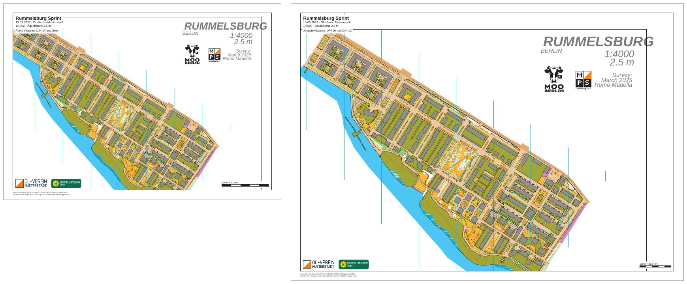

# rummelsburg-competition-layouts

[Deutsch](README.md)

A sprint in Rummelsburg (Berlin) with two layouts: A4 at 1:4000 for the older classes and A3 at 1:3000 for the
youngest. Both sheets have a passe-partout, a title block, two logos, a scale check bar and a footer at the
bottom left. There are no courses here yet; they follow in
[rummelsburg-competition-courses](../rummelsburg-competition-courses/README.en.md).



| File | Content |
|---|---|
| `freemapper-print.toml` | the project file |
| `rummelsburg.omap` | the map "Rummelsburger Bucht" (OOM, 1:4000) |
| `logos/` | two made-up logos, see [logos/README.en.md](logos/README.en.md) |
| `out/a4-4000.pdf` | sheet for the older classes, A4 landscape, 1:4000, 0.2 MB |
| `out/a3-3000.pdf` | sheet for the youngest classes, A3 landscape, 1:3000, 0.2 MB |
| `preview.jpg` | both sheets side by side |
| `ATTRIBUTION.txt` | author and permission for the map |

The sheets are in German (`event.lang = "de"`), as for a German event. The event is made up: the title, the date
and the club do not exist.

## What the example shows

Shared and layout elements. The title block, the logos and the scale check bar are written once under `[[shared]]`
and appear on both sheets. Each layout adds its own text element `classes` with its classes. All elements hang on a
corner of the map frame and have the same size in millimetres on A4 and A3, whatever the print scale of the map.

Placeholders. The title block writes `{event}`, `{date} · {organiser}` and
`1:{print_scale} · Äquidistanz {contour_interval}`. The A4 sheet shows "1:4000 · Äquidistanz 2,5 m", the A3 sheet
"1:3000 · Äquidistanz 2,5 m". The 2.5 m come from the map's header. `init` proposes 2 m for sprint maps, so the
value had to be corrected. The scale check bar reads "200 m = 50 mm" at 1:4000 and "100 m = 33,3 mm" at 1:3000.

Symbols at 133 %. The A3 layout prints at 1:3000, so terrain and symbols grow to 133 % as ISSprOM 2019-2
(section 3.1) says.

The same section on both sheets. The map is a diagonal strip from north-west to south-east and much larger than a
sheet. Both layouts therefore set `map_frame.crop = true` and use `map_frame.centre_map_mm = [25.0, 12.0]` to put
the same map point in the middle of the map frame. The A4 sheet shows 277 mm by 190 mm of map. Because of 1:3000
the A3 sheet shows about 300 mm by 208 mm, a little more surroundings. The corners in the north-east and the
south-west stay white, since the map has nothing there.

The map's header. Remo Madella drew a header into the map: the title "RUMMELSBURG", scale, contour interval, a survey
note, the logo of the MOO Challenge and the one of remmaps.it. There is also a thin black frame labelled "A4
sheet", his own print area. Both belong to the map and print with it. The header sits at the top right, so the two
club logos hang at the bottom left of the map frame.

Footer. The map has no map notes the footer could take its source line from. `print.copyright` therefore names the
map and its author by hand. With the freemapper-print line that makes two lines, and they fit below the map frame
in a 10 mm passe-partout.

## What `check` reports

`check` ends with exit code 1 although both sheets are fine. One note causes it: the map sets its texts in
Calibri, the font is not in the program, and Arimo stands in. That mostly affects the map header, whose letters
look a little different from OOM. Nothing on the sheet needs changing, and the line stays in every example that
uses the Rummelsburg map.

The second note is information only and does not count: map and map frame do not match, and `crop = true` says
that is intended.

```
Layout a4-4000: A4 Querformat, Druckmaßstab 1:4000, Kartenmaßstab 1:4000, Geometriefaktor 1,000, Symbolfaktor 1,000.
Hinweis: Die Schrift Arimo ersetzt Calibri.
Zur Information: Die Karte ist 36,6 mm zu breit und 66,8 mm zu hoch für den Kartenausschnitt und wird dort mit Absicht beschnitten (map_frame.crop = true).
Layout a3-3000: A3 Querformat, Druckmaßstab 1:3000, Kartenmaßstab 1:4000, Geometriefaktor 1,333, Symbolfaktor 1,333.
Hinweis: Die Schrift Arimo ersetzt Calibri.
Zur Information: Die Karte ist 33,5 mm zu breit und 65,4 mm zu hoch für den Kartenausschnitt und wird dort mit Absicht beschnitten (map_frame.crop = true).
Layouts mit Hinweisen: 2 von 2.
```

Without `crop` the second line would be a warning. With `--lang en` the same lines come in English ("Note: the
font Arimo replaces Calibri.", "Info: the map is 36.6 mm too wide and 66.8 mm too tall for the map frame ...").

## How it was made

With freemapper-print alone, in the folder of this example. The map has no `freemapper.toml` that `init` could read
the map kind from, so `--kind` names it:

```sh
freemapper-print --lang de init . --map rummelsburg.omap --title "Rummelsburger Bucht" --kind sprint
```

```
Kartenart: Sprintkarten, wie mit --kind angegeben.
Suche ein A4- oder A3-Blatt, das die Karte in 1:4000 zeigt …
./freemapper-print.toml geschrieben, mit einem Layout a4: A4, Passepartout 8 mm, Druckmaßstab 1:4000, für Sprintkarten.
Warnung: Weder auf A4 noch auf A3 zeigt ein Blatt die Karte im Maßstab 1:4000 ohne Hinweise oder Fehler, deshalb bleibt das Projekt bei A4. check meldet Folgendes:
…
```

`init` finds no sheet that holds the whole map and stays with A4. That is expected for this strip. Then the project
file was edited by hand:

- `[event]`: title "Rummelsburg Sprint", date and club added.
- The proposed contour interval of 2 m compared with the map header ("2.5 m") and changed to 2.5 m.
- `[print]` added with the line about map and author.
- In the title block, the line with date and club inserted and "Äquidistanz" written before `{contour_interval}`.
- The two logos added as shared elements at the bottom left of the map frame.
- The layout `a4` replaced by `a4-4000` and `a3-3000`, both landscape with a 10 mm passe-partout, `crop = true` and
  `centre_map_mm`, each with its own text `classes`.

Then check and write the PDFs. `export` creates the folder `out` next to the project file.

```sh
freemapper-print --lang de check .
freemapper-print --lang de export .
```

`export` prints the same lines as `check`, names the path of the PDF in the first line of each layout and ends with
the reminder to print at actual size. It exits with code 0 even when `check` reports notes.

## What to look at on the sheet

- Title block and classes at the top left, scale check bar at the bottom right, logos and footer at the bottom left.
- The map header at the top right with the two logos of MOO Berlin and remmaps.it.
- The thin lines in the map image, such as the frame "A4 sheet". They belong to the map.
- The A3 sheet is drawn a little wider than the A4 sheet, but its streets and buildings are larger.

## Checked

- `check` and `export` as above, with the messages above.
- Exported twice: the PDFs are identical byte for byte.
- The pages viewed at 80 dpi: title block, classes, logos, scale check bar and footer sit where they should, the
  map header is complete, and no element covers anything important.

## Regenerate

The PDFs come from `export`. The preview comes from `pdftoppm` and ImageMagick, built from both PDFs at 60 dpi:

```sh
tmp=$(mktemp -d)
pdftoppm -r 60 -png -singlefile out/a4-4000.pdf "$tmp/a4"
pdftoppm -r 60 -png -singlefile out/a3-3000.pdf "$tmp/a3"
magick "$tmp/a4.png" -bordercolor gray60 -border 1 "$tmp/a4b.png"
magick "$tmp/a3.png" -bordercolor gray60 -border 1 "$tmp/a3b.png"
magick "$tmp/a4b.png" \( -size 24x1 xc:white \) "$tmp/a3b.png" -background white -gravity north +append \
  -bordercolor white -border 8 -quality 80 preview.jpg
rm -r "$tmp"
```

## Printing

Print at 100 % ("Actual size") and switch "Fit to page" off. Measure the scale check bar on the printout to see
whether the printer scaled the page. More in the
[manual, chapter 6](../../docs/manual/en.md#6-layouts-paper-size-scale-map-frame) (layouts) and
[chapter 7](../../docs/manual/en.md#7-title-logos-and-other-sheet-elements) (title, logos, sheet elements).

## Credits and licence

Remo Madella drew the map "Rummelsburger Bucht" for the MOO Challenge Berlin 2025. He allowed its use as an
example map in this public project. That is a permission for the freemapper suite, not an open licence;
`ATTRIBUTION.txt` has the wording. The logos are made up and released under CC0 1.0 (see
[logos/README.en.md](logos/README.en.md)). The PDFs were made with
[freemapper-print](https://github.com/HenryJobst/freemapper-print).
