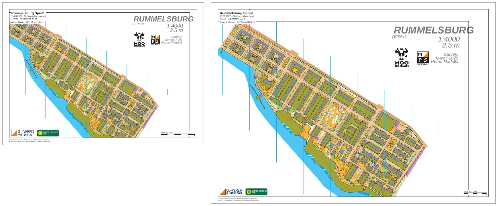

# rummelsburg-competition-layouts

[English](README.en.md)

Ein Sprint in Rummelsburg (Berlin) mit zwei Layouts: A4 in 1:4000 für die älteren Klassen und A3 in 1:3000 für
die jüngsten. Beide Blätter haben ein Passepartout, einen Titelblock, zwei Logos, einen Maßstabsbalken und unten
links die Fußzeile. Bahnen gibt es hier noch nicht, sie folgen im Beispiel
[rummelsburg-competition-courses](../rummelsburg-competition-courses/README.md).



| Datei | Inhalt |
|---|---|
| `freemapper-print.toml` | die Projektdatei |
| `rummelsburg.omap` | die Karte „Rummelsburger Bucht“ (OOM, 1:4000) |
| `logos/` | zwei erfundene Logos, siehe [logos/README.md](logos/README.md) |
| `out/a4-4000.pdf` | Blatt für die älteren Klassen, A4 quer, 1:4000, 1,1 MB |
| `out/a3-3000.pdf` | Blatt für die jüngsten Klassen, A3 quer, 1:3000, 1,1 MB |
| `preview.jpg` | beide Blätter nebeneinander |
| `ATTRIBUTION.txt` | Autor und Nutzungserlaubnis der Karte |

Die Blätter sind deutsch (`event.lang = "de"`), wie für einen Wettkampf in Deutschland. Die Veranstaltung ist
erfunden: Titel, Datum und Verein gibt es nicht.

## Was das Beispiel zeigt

Gemeinsame Elemente und Layout-Elemente. Titelblock, Logos und Maßstabsbalken stehen einmal unter `[[shared]]` und
erscheinen auf beiden Blättern. Jedes Layout fügt einen eigenen Text `classes` mit seinen Klassen hinzu. Alle
Elemente hängen an einer Ecke des Kartenausschnitts und sind auf A4 und A3 gleich groß in Millimetern, egal in
welchem Maßstab die Karte gedruckt wird.

Platzhalter. Der Titelblock schreibt `{event}`, `{date} · {organiser}` und
`1:{print_scale} · Äquidistanz {contour_interval}`. Das A4-Blatt zeigt „1:4000 · Äquidistanz 2,5 m“, das A3-Blatt
„1:3000 · Äquidistanz 2,5 m“. Die 2,5 m stammen aus dem Kartenkopf, `init` schlägt für Sprintkarten 2 m vor und
muss hier korrigiert werden. Der Maßstabsbalken sagt „200 m = 50 mm“ in 1:4000 und „100 m = 33,3 mm“ in 1:3000.

Symbole auf 133 %. Das A3-Layout druckt in 1:3000. Gelände und Symbole wachsen deshalb auf 133 %, wie
ISSprOM 2019-2 (Abschnitt 3.1) es verlangt.

Derselbe Ausschnitt auf beiden Blättern. Die Karte ist ein schräger Streifen von Nordwesten nach Südosten und viel
größer als ein Blatt. Beide Layouts setzen deshalb `map_frame.crop = true` und legen mit
`map_frame.centre_map_mm = [25.0, 12.0]` denselben Kartenpunkt in die Mitte des Kartenausschnitts. Das A4-Blatt
zeigt 277 mm mal 190 mm Karte, das A3-Blatt wegen 1:3000 etwa 300 mm mal 208 mm, also ein wenig mehr
Umgebung. Die Ecken im Nordosten und Südwesten bleiben weiß, weil dort keine Karte liegt.

Der Kopf der Karte. Remo Madella hat in die Karte einen eigenen Kopf gezeichnet: Titel „RUMMELSBURG“, Maßstab,
Äquidistanz, Vermerk zur Aufnahme, das Logo der MOO Challenge und das von remmaps.it. Dazu kommt ein dünner
schwarzer Rahmen mit dem Text „A4 sheet“, seine eigene Druckfläche. Beides gehört zur Karte und wird mitgedruckt.
Der Kopf liegt oben rechts, deshalb hängen die beiden Vereinslogos unten links an den Kartenausschnitt.

Fußzeile. Die Karte hat keine Kartennotizen, aus denen die Fußzeile ihre Quellenangabe nehmen könnte.
`print.copyright` nennt deshalb von Hand die Karte und ihren Autor. Mit der Zeile von freemapper-print sind das
zwei Zeilen, und die passen in ein 10-mm-Passepartout unter den Kartenausschnitt.

## Was `check` meldet

`check` endet mit Exit-Code 1, obwohl beide Blätter in Ordnung sind. Der Grund ist ein einziger Hinweis: Die
Karte setzt ihre Texte in Calibri, die Schrift ist nicht im Programm, und Arimo springt ein. Das betrifft vor
allem den Kartenkopf, dessen Buchstaben ein wenig anders aussehen als in OOM. Daran ist auf dem Blatt nichts zu
ändern, und die Zeile bleibt in jedem Beispiel zur Rummelsburger Karte stehen.

Der zweite Hinweis ist nur zur Information und zählt nicht: Karte und Kartenausschnitt passen nicht zusammen, und
das ist mit `crop = true` so gewollt.

```
Layout a4-4000: A4 Querformat, Druckmaßstab 1:4000, Kartenmaßstab 1:4000, Geometriefaktor 1,000, Symbolfaktor 1,000.
Hinweis: Die Schrift Arimo ersetzt Calibri.
Zur Information: Die Karte ist 36,6 mm zu breit und 66,8 mm zu hoch für den Kartenausschnitt und wird dort mit Absicht beschnitten (map_frame.crop = true).
Layout a3-3000: A3 Querformat, Druckmaßstab 1:3000, Kartenmaßstab 1:4000, Geometriefaktor 1,333, Symbolfaktor 1,333.
Hinweis: Die Schrift Arimo ersetzt Calibri.
Zur Information: Die Karte ist 33,5 mm zu breit und 65,4 mm zu hoch für den Kartenausschnitt und wird dort mit Absicht beschnitten (map_frame.crop = true).
Layouts mit Hinweisen: 2 von 2.
```

Ohne `crop` wäre die zweite Zeile eine Warnung. Mit `--lang en` kommen dieselben Zeilen auf Englisch.

## So ist es entstanden

Mit freemapper-print allein, im Ordner dieses Beispiels. Die Karte hat keine `freemapper.toml`, aus der `init` die
Kartenart lesen könnte. Sie wird deshalb mit `--kind` genannt:

```sh
freemapper-print --lang de init . --map rummelsburg.omap --title "Rummelsburger Bucht" --kind sprint
```

```
Kartenart: Sprintkarten, wie mit --kind angegeben.
Suche ein A4- oder A3-Blatt, das die Karte in 1:4000 zeigt …
./freemapper-print.toml geschrieben, mit einem Layout a4: A4, Passepartout 8 mm, Druckmaßstab 1:4000, für Sprintkarten.
Warnung: Weder auf A4 noch auf A3 zeigt ein Blatt die Karte im Maßstab 1:4000 ohne Hinweise oder Fehler, deshalb bleibt das Projekt bei A4. check meldet Folgendes:
…
```

`init` findet kein Blatt, auf dem die ganze Karte Platz hat, und bleibt bei A4. Das ist bei diesem Streifen zu
erwarten. Danach wurde die Projektdatei von Hand bearbeitet:

- `[event]`: Titel „Rummelsburg Sprint“, Datum und Verein ergänzt.
- Die Äquidistanz von 2 m mit dem Kartenkopf („2.5 m“) verglichen und auf 2,5 m geändert.
- `[print]` mit der Zeile zu Karte und Autor ergänzt.
- Im Titelblock die Zeile mit Datum und Verein eingefügt und „Äquidistanz“ vor `{contour_interval}` geschrieben.
- Die beiden Logos als gemeinsame Elemente unten links am Kartenausschnitt angehängt.
- Das Layout `a4` durch `a4-4000` und `a3-3000` ersetzt, beide quer mit 10 mm Passepartout, `crop = true` und
  `centre_map_mm`, je mit einem eigenen Text `classes`.

Dann prüfen und die PDFs schreiben. `export` legt den Ordner `out` neben der Projektdatei an.

```sh
freemapper-print --lang de check .
freemapper-print --lang de export .
```

`export` gibt dieselben Zeilen wie `check` aus, nennt in der ersten Zeile jedes Layouts den Pfad des PDFs und
schließt mit der Erinnerung, in Originalgröße zu drucken. Der Exit-Code ist 0, auch wenn `check` Hinweise meldet.

## Worauf Sie auf dem Blatt achten

- Titelblock und Klassen oben links, Maßstabsbalken unten rechts, Logos und Fußzeile unten links.
- Der Kartenkopf oben rechts mit den beiden Logos von MOO Berlin und remmaps.it.
- Die dünnen Linien im Kartenbild, etwa der Rahmen „A4 sheet“. Sie gehören zur Karte.
- Das A3-Blatt ist ein wenig weiter gezogen als das A4-Blatt, die Straßen und Gebäude sind aber größer gezeichnet.

## Geprüft

- `check` und `export` wie oben, mit den Meldungen oben.
- Zweimal exportiert: Die PDFs sind Byte für Byte gleich.
- Die Seiten bei 80 dpi angesehen: Titelblock, Klassen, Logos, Maßstabsbalken und Fußzeile sitzen an ihrem Platz,
  der Kartenkopf ist vollständig, und kein Element deckt etwas Wichtiges zu.

## Neu erzeugen

Die PDFs kommen aus `export`. Die Vorschau entsteht mit `pdftoppm` und ImageMagick aus beiden PDFs, bei 60 dpi:

```sh
tmp=$(mktemp -d)
pdftoppm -r 60 -png -singlefile out/a4-4000.pdf "$tmp/a4"
pdftoppm -r 60 -png -singlefile out/a3-3000.pdf "$tmp/a3"
magick "$tmp/a4.png" -bordercolor gray60 -border 1 "$tmp/a4b.png"
magick "$tmp/a3.png" -bordercolor gray60 -border 1 "$tmp/a3b.png"
magick "$tmp/a4b.png" \( -size 24x1 xc:white \) "$tmp/a3b.png" -background white -gravity north +append \
  -bordercolor white -border 8 -quality 80 preview.jpg
rm -r "$tmp"
```

## Drucken

Drucken Sie mit 100 % („Tatsächliche Größe“) und schalten Sie „An Seite anpassen“ aus. Messen Sie den
Maßstabsbalken auf dem Ausdruck nach, um zu sehen, ob der Drucker das Blatt skaliert hat. Mehr dazu im
[Handbuch, Kapitel 6](../../docs/manual/de.md#6-layouts-blattformat-maßstab-kartenausschnitt) (Layouts) und
[Kapitel 7](../../docs/manual/de.md#7-titel-logos-und-andere-blattelemente) (Titel, Logos, Blattelemente).

## Quellen und Lizenz

Die Karte „Rummelsburger Bucht“ zeichnete Remo Madella für die MOO Challenge Berlin 2025. Er hat ihre Nutzung als
Beispielkarte in diesem öffentlichen Projekt erlaubt. Das ist eine Erlaubnis für die freemapper-Suite, keine offene
Lizenz; `ATTRIBUTION.txt` hat den Wortlaut. Die Logos sind erfunden und stehen unter CC0 1.0 (siehe
[logos/README.md](logos/README.md)). Die PDFs entstanden mit
[freemapper-print](https://github.com/HenryJobst/freemapper-print).
