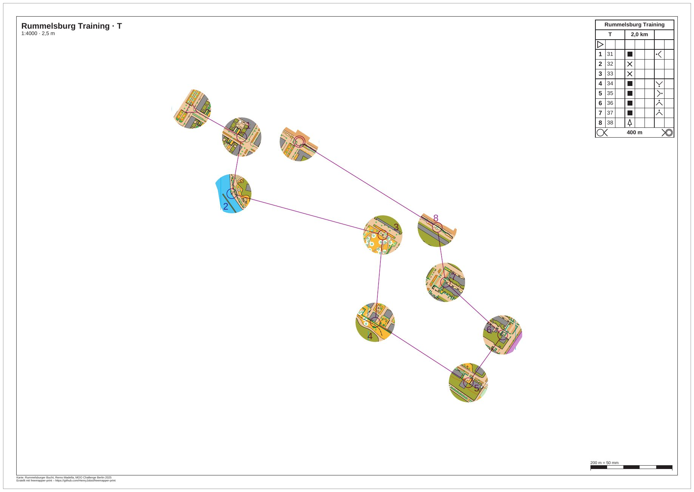

# rummelsburg-mcp-session

[Deutsch](README.md)

A recorded session with the MCP server of freemapper-print. An AI agent gets a training course for the Rummelsburger
Bucht, a map and the request: "Turn it into window orienteering with 12 mm windows and put the PDF into the folder
out." It needs six calls. The session really ran, and every request and answer is in `session.jsonl`. The agent
creates the project itself, and the folder of this example is the result.



| File | Content |
|---|---|
| `session.jsonl` | the session, one message per line |
| `record_session.py` | the script that plays and records the session |
| `check_record_session.py` | checks that `record_session.py` refuses a folder with content |
| `rummelsburg.omap` | the map "Rummelsburger Bucht" (OOM, 1:4000), input of the session |
| `rummelsburg-training.ppen` | course T as a Purple Pen file from freemapper-courseplan 0.14.1, input of the session |
| `freemapper-print.toml` | the project file as the session left it |
| `out/T.pdf` | the PDF of the session, A3 landscape, 1:4000, 1.1 MB |
| `preview.jpg` | the PDF as an image |
| `ATTRIBUTION.txt` | author and permission for the map, origin of the course |

The course is made up and the training is fictitious. Course T has eight controls (31 to 38) and is 2.0 km long.
Every two points, start and finish included, lie at least 134 m apart.

## The session

The script starts the server with `freemapper-print --lang de mcp`, as Claude Code does with the `.mcp.json` from
the [manual](../../docs/manual/en.md#3-with-an-ai-agent). The messages are therefore German, like the sheets. The
project is in the folder `/home/user/Verein/rummelsburg-training` ("Verein" is German for club) and the PDF goes
into its subfolder `out`. Both paths are placeholders: the session ran in a work folder, and the script replaced its
path while recording. Before the first call the folder holds only the map and the course file.

After the greeting (`initialize`) the agent asks for the list of tools (`tools/list`). Then:

1. `init_project` with folder, map, course file, `kind` "sprint" and the title "Rummelsburg Training". The map has
   no `freemapper.toml` the map kind could come from, so the agent names it. The result reports one course "T" on
   the layout `a4-4000`. `fits` is `false`: no sheet shows the whole map. The project proposes a contour interval
   of 2 m and asks to check it. The map's information block says 2.5 m. No tool changes `[map]`, so the agent
   changes that line in the file itself. The same goes for the footer: the map has no map notes, so under
   `[print]` it adds a line naming map and author. These two changes are no MCP call and do not show in
   `session.jsonl`. The script performs them, and that part is commented.
2. `check_project`: `needs_attention` is `true`, and there are three warnings. On the A4 sheet the element `title`
   covers the start. The number of control 31 covers the line symbol 520.1 of the map. And every sheet carries the
   note "Die Schrift Arimo ersetzt Calibri." (the font Arimo replaces Calibri).
3. `set_layout`:

   ```json
   {"project": "/home/user/Verein/rummelsburg-training", "id": "a4-4000", "paper": "A3"}
   ```

   On A4 the title block covers the start. In a test the start window also reached beyond the map frame, because
   the course with its windows is taller than the A4 frame. The agent switches the layout to A3. The rest stays as
   `init_project` made it: 8 mm passe-partout, `crop`, description box. The id `a4-4000` stays, since `set_layout`
   renames nothing. It no longer tells the truth about the paper. If that bothers you, change the id in the file.
4. `masks_window`:

   ```json
   {"project": "/home/user/Verein/rummelsburg-training", "course": "T", "radius": 12, "assign": true}
   ```

   The result names the mask `window-T` with ten windows: start, controls 31 to 38 and finish. These messages come
   with it:

   ```
   Abdeckung „window-T“ in /home/user/Verein/rummelsburg-training/freemapper-print.toml eingetragen: 10 Fenster mit 12 mm Radius auf dem Papier bei 1:4000 um den Start, die Posten 31, 32, 33, 34, 35, 36, 37 und 38 und das Ziel der Bahn „T“, mindestens 3 mm auseinander.
   Die Bahn „T“ wird jetzt damit gedruckt, auf Layout a4-4000.
   Mit check_project sehen Sie das Ergebnis.
   ```

   12 mm on paper are 48 m on the ground at 1:4000. At least 3 mm (12 m) stay free between two windows, the default
   of `gap`. Two windows of 12 mm radius therefore need 27 mm (108 m) between their centres. The points of course T
   lie at least 134 m apart, so every window keeps its 12 mm, and `reduced` in the result is empty.
5. `check_project` again: the note on the title block is gone, and there is none about the mask. No control, leg or
   finish lies under it. `needs_attention` stays `true` because of two warnings: the font (see below) and the
   number of control 31, which covers the line symbol 520.1. `check_project` names direction 60.8° at 5 mm gap as a
   free place. The agent did not take the proposal; a call to `numbers_accept` would have.
6. `export_project` with `out_dir`: the result names `T.pdf` with 1,091,820 bytes, A3, print scale 1:4000, the
   notes of the sheet and the reminder to print at actual size.

Then the script closes the connection, and the server ends with exit code 0.

In the project file the course's assignment gets the line `mask = "window-T"`. At the end comes a new table with a
comment on how it was made:

```toml
# Fenster mit 12 mm Radius auf dem Papier bei 1:4000 um den Start, die Posten 31, 32, 33, 34, 35,
# 36, 37 und 38 und das Ziel der Bahn „T“, mindestens 3 mm auseinander, erzeugt mit masks window.
[[masks]]
id = "window-T"
polygons = [
    [
        [
            [-255.0, -231.0], [254.0, -231.0], [254.0, 227.0], [-255.0, 227.0],
        ],
        …
```

The first ring is the outline, a rectangle 100 mm outside the map, and each further ring is a window. The other
tables of the file stay, comments included.

## What `check_project` reports at the end

Two warnings remain.

- "Die Schrift Arimo ersetzt Calibri." The map sets texts in Calibri, the font is not in the program, and Arimo
  stands in. Nothing on the sheet needs changing.
- The number of control 31 covers the line symbol 520.1. It is printed there all the same, inside the window around
  control 31. The proposal of `check_project` (60.8°, 5 mm) is free.

The session therefore ends with `needs_attention: true`, and the agent exports anyway. An agent that does not want
that calls `numbers_accept` before the export. The font notes would stay either way.

## Reading `session.jsonl`

Each line is a JSON object. `from` says who sent the message (`client` is the agent, `server` is freemapper-print),
and `message` is the message as it went over the wire. The tool results are JSON text in
`result.content[0].text`. Only the answer to `tools/list` is shortened, and it carries `shortened` to say so: each
input of a tool shows only its description, without type and range. The server reports `version` 0.8.0 because the
version number has not been raised yet. The session ran with a build after 0.8.0 that already keeps the gap between
windows (ADR 0063).

## Checked

- The session recorded twice: `session.jsonl`, the project file and the PDF are byte-identical both times.
- The page viewed at 110 dpi: the map shows only in the ten windows, the legs run over white paper, and the
  description box at the top right covers no window. The window around the start sits at the edge of the map and is
  partly empty there, because the map ends.

## Regenerate

In the repository folder:

```sh
cargo build --locked
python3 -I examples/rummelsburg-mcp-session/record_session.py target/debug/freemapper-print /tmp/mcp-session
```

The work folder `/tmp/mcp-session` must be missing or empty. If it holds anything, the script stops with a message;
it deletes no folder. Without the second argument it makes a new temporary folder. The script puts the map and the
course file of this example into `/tmp/mcp-session/Verein/rummelsburg-training`, plays the session, writes
`session.jsonl` again and leaves the project with `freemapper-print.toml` and `out/T.pdf` there. The project file and
the PDF in this example are copies of those. The preview comes from `pdftoppm -r 110 -png -singlefile` and
`magick … -quality 82 preview.jpg`. `python3 -I examples/rummelsburg-mcp-session/check_record_session.py` checks
without a build that the script refuses a folder with content and a file, and leaves both as they were.

## Credits and licence

Remo Madella drew the map "Rummelsburger Bucht" for the MOO Challenge Berlin 2025. He allowed its use as an example
map in this public project. That is a permission for the freemapper suite, not an open licence; `ATTRIBUTION.txt`
has the wording. The course was made with freemapper-courseplan 0.14.1. The session, the scripts and the preview
were made for this example. The PDF and the preview were made with
[freemapper-print](https://github.com/HenryJobst/freemapper-print).
