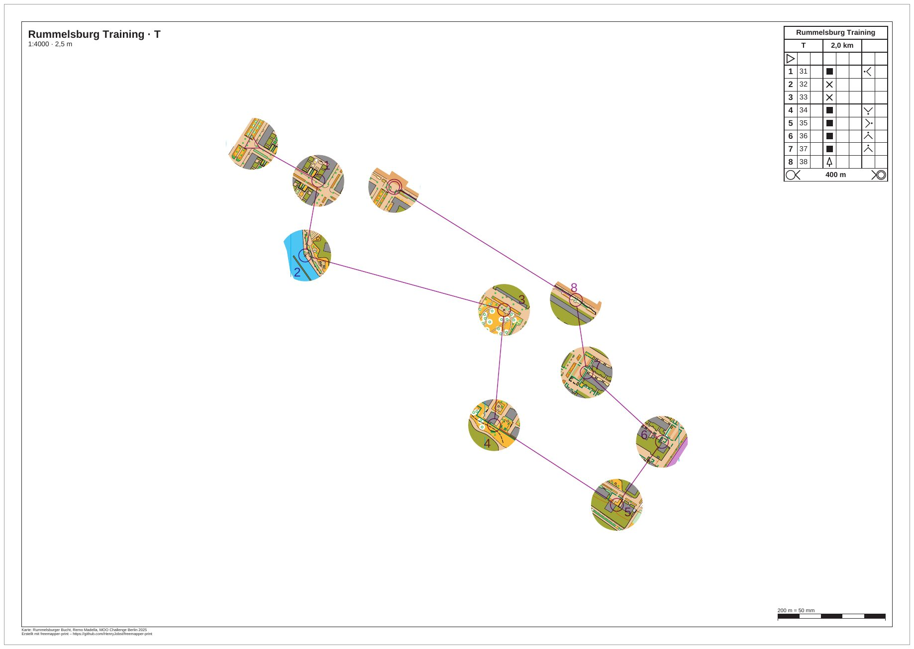

# rummelsburg-mcp-session

[English](README.en.md)

Eine aufgezeichnete Sitzung mit dem MCP-Server von freemapper-print. Ein KI-Agent bekommt eine Trainingsbahn für
die Rummelsburger Bucht, eine Karte und die Bitte: „Mach daraus einen Fenster-OL mit Fenstern von 12 mm und leg
das PDF in den Ordner out.“ Er braucht sechs Aufrufe. Die Sitzung lief wirklich, jede Anfrage und jede Antwort
steht in `session.jsonl`. Der Agent legt das Projekt selbst an, und der Ordner dieses Beispiels ist das Ergebnis.



| Datei | Inhalt |
|---|---|
| `session.jsonl` | die Sitzung, eine Nachricht je Zeile |
| `record_session.py` | das Skript, das die Sitzung abspielt und aufzeichnet |
| `check_record_session.py` | prüft, dass `record_session.py` einen Ordner mit Inhalt ablehnt |
| `rummelsburg.omap` | die Karte „Rummelsburger Bucht“ (OOM, 1:4000), Eingabe der Sitzung |
| `rummelsburg-training.ppen` | die Bahn T als Purple-Pen-Datei von freemapper-courseplan 0.14.1, Eingabe der Sitzung |
| `freemapper-print.toml` | die Projektdatei, wie die Sitzung sie hinterlassen hat |
| `out/T.pdf` | das PDF der Sitzung, A3 quer, 1:4000, 1,1 MB |
| `preview.jpg` | das PDF als Bild |
| `ATTRIBUTION.txt` | Autor und Nutzungserlaubnis der Karte, Herkunft der Bahn |

Die Bahn ist ausgedacht und das Training erfunden. Die Bahn T hat acht Posten (31 bis 38) und ist 2,0 km lang. Je
zwei Punkte, Start und Ziel eingeschlossen, liegen mindestens 134 m auseinander.

## Die Sitzung

Das Skript startet den Server mit `freemapper-print --lang de mcp`, so wie Claude Code es nach der `.mcp.json` aus
dem [Handbuch](../../docs/manual/de.md#3-mit-einem-ki-agenten) tut. Die Meldungen kommen deshalb auf Deutsch. Das
Projekt liegt im Ordner `/home/user/Verein/rummelsburg-training` und das PDF in
dessen Unterordner `out`. Beide Pfade sind Platzhalter: Die Sitzung lief in einem Arbeitsordner, und das Skript hat
dessen Pfad beim Aufzeichnen ersetzt. Vor dem ersten Aufruf liegen dort nur die Karte und die Bahndatei.

Nach der Begrüßung (`initialize`) fragt der Agent die Liste der Werkzeuge ab (`tools/list`). Dann:

1. `init_project` mit Ordner, Karte, Bahndatei, `kind` „sprint“ und dem Titel „Rummelsburg Training“. Die Karte hat
   keine `freemapper.toml`, aus der die Kartenart käme, deshalb nennt der Agent sie. Das Ergebnis meldet eine
   Bahn „T“ auf dem Layout `a4-4000`. `fits` ist `false`: Kein Blatt zeigt die ganze Karte. Das Projekt schlägt
   eine Äquidistanz von 2 m vor und bittet, sie zu prüfen. Der Informationsblock der Karte nennt 2,5 m. Kein
   Werkzeug ändert `[map]`, deshalb ändert der Agent die Zeile in der Datei selbst. Dasselbe gilt für die
   Fußzeile: Die Karte hat keine Kartennotizen, also trägt er unter `[print]` eine Zeile zu Karte und Autor ein.
   Diese beiden Änderungen sind kein MCP-Aufruf und stehen nicht in `session.jsonl`. Das Skript führt sie aus,
   und dort ist der Abschnitt kommentiert.
2. `check_project`: `needs_attention` ist `true`, und es gibt drei Warnungen. Auf dem A4-Blatt deckt das Element
   `title` den Start ab. Die Nummer von Posten 31 überdeckt das Liniensymbol 520.1 der Karte. Und auf jedem Blatt
   steht der Hinweis „Die Schrift Arimo ersetzt Calibri.“
3. `set_layout`:

   ```json
   {"project": "/home/user/Verein/rummelsburg-training", "id": "a4-4000", "paper": "A3"}
   ```

   Auf A4 deckt der Titelblock den Start ab. Beim Ausprobieren ragte dort auch das Startfenster über den
   Kartenausschnitt hinaus, denn die Bahn mit ihren Fenstern ist höher als der A4-Ausschnitt. Der Agent stellt das
   Layout auf A3 um. Der
   Rest bleibt, wie `init_project` ihn angelegt hat: 8 mm Passepartout, `crop`, Beschreibungskasten. Die Kennung
   `a4-4000` bleibt, denn `set_layout` benennt nichts um. Sie sagt jetzt nicht mehr die Wahrheit über das Papier.
   Wer das stört, ändert die Kennung in der Datei.
4. `masks_window`:

   ```json
   {"project": "/home/user/Verein/rummelsburg-training", "course": "T", "radius": 12, "assign": true}
   ```

   Das Ergebnis nennt die Abdeckung `window-T` mit zehn Fenstern: Start, die Posten 31 bis 38 und Ziel. Dazu kommen
   diese Meldungen:

   ```
   Abdeckung „window-T“ in /home/user/Verein/rummelsburg-training/freemapper-print.toml eingetragen: 10 Fenster mit 12 mm Radius auf dem Papier bei 1:4000 um den Start, die Posten 31, 32, 33, 34, 35, 36, 37 und 38 und das Ziel der Bahn „T“, mindestens 3 mm auseinander.
   Die Bahn „T“ wird jetzt damit gedruckt, auf Layout a4-4000.
   Mit check_project sehen Sie das Ergebnis.
   ```

   12 mm auf dem Papier sind in 1:4000 48 m im Gelände. Zwischen zwei Fenstern bleiben mindestens 3 mm (12 m), das
   ist die Voreinstellung von `gap`. Zwei Fenster mit 12 mm Radius brauchen also 27 mm (108 m) zwischen den
   Mittelpunkten. Die Punkte der Bahn T liegen mindestens 134 m auseinander, deshalb bleibt jedes Fenster bei
   12 mm, und `reduced` im Ergebnis ist leer.
5. `check_project` noch einmal: Der Hinweis zum Titelblock ist weg, und es gibt keinen zur Abdeckung. Kein Posten,
   keine Strecke und kein Ziel liegt unter ihr. `needs_attention` bleibt `true`, wegen zweier Warnungen: die
   Schrift (siehe unten) und die Nummer von Posten 31, die das Liniensymbol 520.1 überdeckt. `check_project` nennt
   dafür Richtung 60,8° mit 5 mm Abstand als freien Platz. Der Agent hat den Vorschlag nicht übernommen, ein Aufruf
   von `numbers_accept` hätte es getan.
6. `export_project` mit `out_dir`: Das Ergebnis nennt `T.pdf` mit 1 091 820 Byte, A3, Druckmaßstab 1:4000, die zwei
   Hinweise des Blatts und die Erinnerung, in Originalgröße zu drucken.

Dann schließt das Skript die Verbindung, und der Server endet mit Exit-Code 0.

In der Projektdatei bekommt die Zuordnung der Bahn die Zeile `mask = "window-T"`. Am Ende steht eine neue Tabelle
mit einem Kommentar, wie sie entstand:

```toml
# Fenster mit 12 mm Radius auf dem Papier bei 1:4000 um den Start, die Posten 31, 32, 33, 34, 35,
# 36, 37 und 38 und das Ziel der Bahn „T“, mindestens 3 mm auseinander, erzeugt mit masks window.
[[masks]]
id = "window-T"
polygons = [
    [
        [
            [-255.0, -231.0], [254.0, -231.0], [254.0, 227.0], [-255.0, 227.0],
        ],
        …
```

Der erste Ring ist der Umriss, ein Rechteck 100 mm außerhalb der Karte, und jeder weitere Ring ist ein Fenster.
Die übrigen Tabellen der Datei bleiben, Kommentare eingeschlossen.

## Was `check_project` am Ende meldet

Zwei Warnungen bleiben.

- „Die Schrift Arimo ersetzt Calibri.“ Die Karte setzt Texte in Calibri, die Schrift ist nicht im Programm, und Arimo
  springt ein. Auf dem Blatt ist nichts zu ändern.
- Die Nummer von Posten 31 deckt das Liniensymbol 520.1. Sie wird trotzdem dort gedruckt, im Fenster um Posten 31.
  Der Vorschlag von `check_project` (60,8°, 5 mm) ist frei.

Die Sitzung endet also mit `needs_attention: true`, und der Agent exportiert trotzdem. Ein Agent, der das nicht
will, ruft vor dem Export `numbers_accept` auf. Die Hinweise zur Schrift ändern daran nichts.

## Die Datei `session.jsonl` lesen

Jede Zeile ist ein JSON-Objekt. `from` sagt, wer die Nachricht geschickt hat (`client` ist der Agent, `server` ist
freemapper-print), und `message` ist die Nachricht, wie sie über die Leitung ging. Die Ergebnisse der Werkzeuge
sind JSON-Text in `result.content[0].text`. Nur die Antwort auf `tools/list` ist gekürzt, und sie trägt `shortened`,
um das zu sagen: Jede Eingabe eines Werkzeugs zeigt nur ihre Beschreibung, ohne Typ und Bereich. Der Server meldet
`version` 0.8.0, weil die Versionsnummer noch nicht erhöht wurde. Die Sitzung lief mit einem Stand nach 0.8.0, der
die Lücke zwischen Fenstern schon hält (ADR 0063).

## Geprüft

- Die Sitzung zweimal aufgezeichnet: `session.jsonl`, Projektdatei und PDF sind beide Male Byte für Byte gleich.
- Die Seite bei 110 dpi angesehen: Die Karte steht nur in den zehn Fenstern, die Strecken laufen über weißes Papier,
  der Beschreibungskasten oben rechts deckt kein Fenster. Das Fenster um den Start liegt am Rand der Karte und ist
  dort zum Teil leer, weil die Karte dort endet.

## Neu erzeugen

Im Ordner des Repositorys:

```sh
cargo build --locked
python3 -I examples/rummelsburg-mcp-session/record_session.py target/debug/freemapper-print /tmp/mcp-session
```

Der Arbeitsordner `/tmp/mcp-session` muss fehlen oder leer sein. Enthält er etwas, hält das Skript mit einer
Meldung an und löscht keinen Ordner. Ohne das zweite Argument legt es einen neuen temporären Ordner an. Das Skript
legt Karte und Bahndatei dieses Beispiels nach `/tmp/mcp-session/Verein/rummelsburg-training`, spielt die Sitzung
ab, schreibt `session.jsonl` neu und lässt das Projekt mit `freemapper-print.toml` und `out/T.pdf` dort zurück. Die
Projektdatei und das PDF in diesem Beispiel sind Kopien davon. Die Vorschau kommt aus
`pdftoppm -r 110 -png -singlefile` und `magick … -quality 82 preview.jpg`.
`python3 -I examples/rummelsburg-mcp-session/check_record_session.py` prüft ohne Build, dass das Skript einen Ordner
mit Inhalt und eine Datei ablehnt und beide so lässt, wie sie waren.

## Quellen und Lizenz

Die Karte „Rummelsburger Bucht“ zeichnete Remo Madella für die MOO Challenge Berlin 2025. Er hat ihre Nutzung als
Beispielkarte in diesem öffentlichen Projekt erlaubt. Das ist eine Erlaubnis für die freemapper-Suite, keine offene
Lizenz; `ATTRIBUTION.txt` hat den Wortlaut. Die Bahn entstand mit freemapper-courseplan 0.14.1. Die Sitzung, die
Skripte und die Vorschau wurden für dieses Beispiel gemacht. Das PDF und die Vorschau entstanden mit
[freemapper-print](https://github.com/HenryJobst/freemapper-print).
