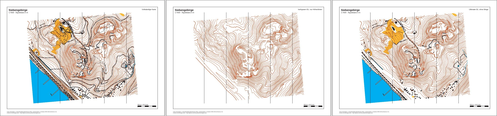

# siebengebirge-views

[Deutsch](README.md)

One forest map, printed three times: complete, as a contour orienteering sheet (contours only) and as an ultimate
orienteering sheet (no paths). The map "Siebengebirge" around the Drachenfels near Königswinter was generated by
freemapper from open data and has not been checked in the field. The examples on Remo Madella's maps are sprint maps,
and no finished forest map from OCAD was at hand.



| File | Content |
|---|---|
| `freemapper-print.toml` | the project file with the three layouts `vollstaendig`, `isohypsen` and `ultimate` |
| `siebengebirge.omap` | the map (OOM, 1:10,000, contour interval 5 m), unchanged |
| `ATTRIBUTION.txt` | source and licences, English and German |
| `out/vollstaendig.pdf` | the whole map (0.15 MB) |
| `out/isohypsen.pdf` | contours and north lines only (0.07 MB) |
| `out/ultimate.pdf` | the map without paths (0.12 MB) |
| `preview.webp` | the three sheets side by side |

## Why this area

A comparison with and without paths only shows something if both are there: relief that can be read from the
contours alone, and a path network that is missing when it is left out. The 15 forest maps that freemapper
generates for the Bundesländer were compared by the number of contours and of path objects (502 to 507):

| Map | Contours | Paths |
|---|---:|---:|
| Siebengebirge | 296 | 164 |
| Sächsische Schweiz (Bastei) | 299 | 210 |
| Bodetal | 193 | 107 |
| Bremen Bürgerpark | 62 | 300 |
| Berlin Dammheide | 18 | 196 |
| Saarland Cloef | 232 | 43 |

The Bürgerpark and the Dammheide are flat: without paths next to nothing is left, and the contours carry no picture.
The Cloef has relief but hardly any paths, so the comparison would be weak. The Bastei has both, but rock faces and the
Elbe dominate the sheet. In the Siebengebirge, hills, slopes and valleys lie close together (contour interval 5 m),
and a dense path network runs through them.

## What the example shows

The three layouts have the same extract and the same scale. They differ in `view`:

- `vollstaendig` has no view and prints the map as it is.
- `isohypsen` has `view = ["only:101,102,103,601.1"]`: contours, index contours, form lines and the north lines.
  Paths, water, vegetation and buildings are left out. Without the north lines in the list the sheet would show
  none, not even generated ones (ADR 0071).
- `ultimate` has `view = ["no-paths"]`: every path goes (502 to 507); roads, water, railway, vegetation, landforms
  and buildings stay.

The title block, the scale check bar, the credit line and the frame are on all three sheets. A line at the top right
names the view; it is a text element of the layout.

The map is drawn at 1:10,000 and printed at 1:7500, a scale of the forest standard. The map grows to 133 %, and the
symbols with it (ADR 0018); `check` reports geometry factor and symbol factor 1.333. The sheet is A4 landscape, and
250 m measure 33.3 mm.

For comparison: the contour sheet shows only the shape of the terrain, the hills, the steep slopes between them and
the valleys. The ultimate sheet has the same contours plus water, vegetation, earth banks and buildings, but not one
path; the complete sheet shows a dense network there.

## How the PDFs are made

```sh
freemapper-print check .
freemapper-print export .
```

`check` reports no notes. With `--view` it also works without a project, on the map alone:

```sh
freemapper-print render siebengebirge.omap --kind forest --scale 7500 --paper a4 --orientation landscape \
  --view "only:101,102,103,601.1" --out isohypsen.pdf
freemapper-print render siebengebirge.omap --kind forest --scale 7500 --paper a4 --orientation landscape \
  --view no-paths --out ultimate.pdf
```

## Limits

The map is derived by machine from OpenStreetMap, cadastre data and the terrain model. The paths come from
OpenStreetMap, the contours from the terrain model. Nobody has checked the map in the field, so it serves as an
example, not for a race. A finished forest map from OCAD would replace this example.
