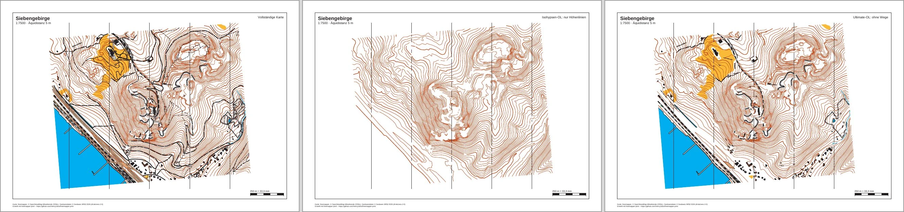

# siebengebirge-views

[English](README.en.md)

Dieselbe Waldkarte, dreimal gedruckt: vollständig, als Isohypsen-OL (nur Höhenlinien) und als Ultimate-OL (ohne
Wege). Die Karte „Siebengebirge“ um den Drachenfels bei Königswinter hat freemapper aus offenen Daten erzeugt; sie ist
im Gelände nicht geprüft. Die Beispiele auf den Karten von Remo Madella sind Sprintkarten, eine fertige Waldkarte aus
OCAD lag nicht vor.



| Datei | Inhalt |
|---|---|
| `freemapper-print.toml` | die Projektdatei mit den drei Layouts `vollstaendig`, `isohypsen` und `ultimate` |
| `siebengebirge.omap` | die Karte (OOM, 1:10 000, Äquidistanz 5 m), unverändert |
| `ATTRIBUTION.txt` | Quelle und Lizenzen, deutsch und englisch |
| `out/vollstaendig.pdf` | die ganze Karte (0,15 MB) |
| `out/isohypsen.pdf` | nur Höhenlinien und Nordlinien (0,07 MB) |
| `out/ultimate.pdf` | die Karte ohne Wege (0,12 MB) |
| `preview.webp` | die drei Blätter nebeneinander |

## Warum dieses Gebiet

Ein Vergleich „mit und ohne Wege“ zeigt nur etwas, wenn beides da ist: ein Relief, das sich allein aus den
Höhenlinien lesen lässt, und ein Wegenetz, das beim Weglassen fehlt. Verglichen wurden die 15 Waldkarten, die
freemapper für die Bundesländer erzeugt, nach der Zahl der Höhenlinien und der Wegeobjekte (502 bis 507):

| Karte | Höhenlinien | Wege |
|---|---:|---:|
| Siebengebirge | 296 | 164 |
| Sächsische Schweiz (Bastei) | 299 | 210 |
| Bodetal | 193 | 107 |
| Bremen Bürgerpark | 62 | 300 |
| Berlin Dammheide | 18 | 196 |
| Saarland Cloef | 232 | 43 |

Der Bürgerpark und die Dammheide sind flach: Ohne Wege bleibt dort fast nichts, und die Höhenlinien tragen kein Bild.
Der Cloef hat Relief, aber kaum Wege, der Vergleich wäre dort schwach. Die Bastei hat beides, doch Felsen und die Elbe
bestimmen das Blatt. Im Siebengebirge liegen Kuppen, Hänge und Täler dicht beieinander (Äquidistanz 5 m), und
ein dichtes Wegenetz führt hindurch.

## Was das Beispiel zeigt

Die drei Layouts haben denselben Ausschnitt und denselben Maßstab. Sie unterscheiden sich in `view`:

- `vollstaendig` hat keine Ansicht und druckt die Karte, wie sie ist.
- `isohypsen` hat `view = ["only:101,102,103,601.1"]`: Höhenlinien, Zählkurven, Hilfshöhenlinien und die Nordlinien.
  Wege, Gewässer, Vegetation und Gebäude entfallen. Ohne die Nordlinien in der Liste würde das Blatt keine
  zeigen, auch keine erzeugten (ADR 0071).
- `ultimate` hat `view = ["no-paths"]`: alle Wege fallen weg (502 bis 507), Straßen, Gewässer, Bahn, Vegetation,
  Gelände und Gebäude bleiben.

Titelblock, Maßstabsbalken, Namensnennung und der Rahmen stehen auf allen drei Blättern. Eine Zeile oben rechts
benennt die Ansicht; sie ist ein Textelement des Layouts.

Die Karte ist im Maßstab 1:10 000 gezeichnet, gedruckt wird in 1:7500, einem Maßstab der Waldnorm. Die Karte wächst
dabei auf 133 %, die Symbole auch (ADR 0018), `check` meldet Geometriefaktor und Symbolfaktor 1,333. Das Blatt ist
A4 quer, 250 m messen 33,3 mm.

Zum Vergleich: Das Isohypsen-Blatt zeigt nur die Form des Geländes, die Kuppen, die steilen
Hänge dazwischen und die Täler. Das Ultimate-Blatt hat dieselben Höhenlinien, dazu Gewässer, Vegetation, Hangkanten
und Gebäude, aber keinen einzigen Weg; das vollständige Blatt zeigt dort ein dichtes Netz.

## So entstehen die PDFs

```sh
freemapper-print check .
freemapper-print export .
```

`check` meldet keine Hinweise. Mit `--view` geht es auch ohne Projekt, auf der Karte allein:

```sh
freemapper-print render siebengebirge.omap --kind forest --scale 7500 --paper a4 --orientation landscape \
  --view "only:101,102,103,601.1" --out isohypsen.pdf
freemapper-print render siebengebirge.omap --kind forest --scale 7500 --paper a4 --orientation landscape \
  --view no-paths --out ultimate.pdf
```

## Grenzen

Die Karte ist maschinell aus OpenStreetMap, Katasterdaten und dem Geländemodell abgeleitet. Die Wege stammen aus
OpenStreetMap, die Höhenlinien aus dem Geländemodell. Niemand hat die Karte im Gelände geprüft, sie taugt als Beispiel,
nicht für einen Lauf. Eine fertige OCAD-Waldkarte würde das Beispiel ersetzen.
